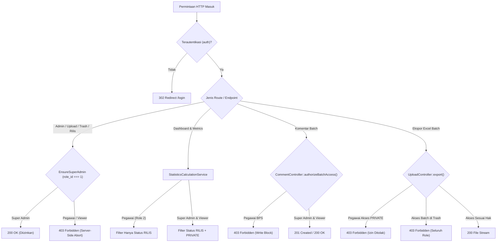

# LAPORAN AUDIT & REVIEW GIT KELOMPOK 6: KEAMANAN AKSES, RBAC & AUTOMATED TESTING
**Sistem Informasi Data Ekspor-Impor (SIDATEX) — BPS Provinsi Riau**  
**Fase:** Phase 2G.10.6.4.10 — Review Group 6: Security, RBAC & Testing  
**Tanggal Audit:** 22 November 2026  
**Auditor / Verifikator:** Lead Architect, Security Auditor & QA Engineer  
**Status Evaluasi:** **LULUS DENGAN CATATAN**  

---

## 1. IDENTIFIKASI LENGKAP 39 BERKAS KELOMPOK 6

Sesuai klasifikasi pada [PHASE_2G_10_6_4_4_FINAL_GIT_DIFF_REVIEW.md](file:///d:/laragon/www/sidatex/docs/PHASE_2G_10_6_4_4_FINAL_GIT_DIFF_REVIEW.md), Kelompok 6 mencakup **39 berkas** yang mengatur keamanan sistem, otorisasi peran, session lifecycle, dan rangkaian pengujian otomatis:

| No | Berkas | Status Git | Baris | Peran & Fungsi Utama |
|:---:|---|:---:|:---:|---|
| 1 | `app/Http/Controllers/Auth/LoginController.php` | Modified | 88 | Autentikasi pengguna, validasi input, pencegahan enumerasi username, regenerasi sesi pasca-login, invalidasi sesi saat logout, dan pengalihan rute berbasis peran. |
| 2 | `app/Http/Controllers/CommentController.php` | Modified | 229 | Manajemen catatan telaah (komentar) eksekutif pada batch data, pembatasan hak tulis untuk Super Admin dan Viewer, pencegahan mutasi data transaksi, dan log audit. |
| 3 | `app/Http/Middleware/EnsureSuperAdmin.php` | Untracked | 40 | Middleware otorisasi server-side yang memastikan fitur administratif hanya dapat diakses oleh Super Admin (`role_id === 1`), mengembalikan 403 Forbidden bagi role lain. |
| 4 | `bootstrap/app.php` | Modified | 40 | Bootstrap Laravel 11, pendaftaran alias middleware `superadmin`, penanganan payload upload terlalu besar (413 Payload Too Large), dan routing web/console. |
| 5 | `config/app.php` | Modified | 126 | Konfigurasi dasar aplikasi, pengaturan zona waktu `Asia/Jakarta`, locale bahasa Indonesia (`id`), dan registrasi provider framework. |
| 6 | `phpunit.xml` | Modified | 39 | Konfigurasi test runner PHPUnit, variabel environment database pengujian, dan penentuan suite `Unit` serta `Feature`. |
| 7 | `routes/web.php` | Modified | 110 | Definisi seluruh rute aplikasi SIDATEX, pembagian area publik, grup proteksi `auth`, dan grup proteksi administratif `superadmin`. |
| 8 | `tests/TestCase.php` | Modified | 122 | Base TestCase pengujian otomatis dengan Safety Guard mutlak (`enforceTestDatabaseSafety()`) yang memblokir keras koneksi ke database `sidatex` dan `sidatex_staging`. |
| 9 | `tests/Feature/BrsDataProcessingEngineTest.php` | Untracked | 342 | Test suite pengujian mesin pemrosesan DBF, pembacaan record, kalkulasi nilai US$ dan berat bersih, serta formula ringkasan indikator BRS. |
| 10 | `tests/Feature/ComprehensiveAuditAndSecurityTest.php` | Untracked | 231 | Test suite pengujian keamanan komprehensif, mitigasi path traversal, sanitasi nama berkas ekspor, dan verifikasi role. |
| 11 | `tests/Feature/DataReconciliationAndIndexTest.php` | Untracked | 209 | Test suite rekonsiliasi data mart dua lapis dan efisiensi index query komoditas/pelabuhan/negara. |
| 12 | `tests/Feature/DbfIngestionComprehensiveTest.php` | Untracked | 280 | Test suite ingestion data transaksi DBF, penanganan ACID, dan integritas foreign key master data. |
| 13 | `tests/Feature/DbfPreviewAndValidationStage2b3Test.php` | Untracked | 216 | Test suite validasi struktur DBF, kelengkapan kolom wajib (POD, KDPROV, PROVORIG, KPPBC), dan pratinjau data. |
| 14 | `tests/Feature/DbfUploadWorkflowIntegrationTest.php` | Untracked | 89 | Test suite integrasi alur unggah berkas dari upload fisik ke penyimpanan transaksional. |
| 15 | `tests/Feature/DistributionModuleTest.php` | Untracked | 106 | Test suite modul Distribusi pelabuhan muat/bongkar wilayah Riau. |
| 16 | `tests/Feature/NeracaAndDistribusiModuleSeparationTest.php` | Untracked | 101 | Test suite pemisahan mutlak cakupan semesta data Distribusi vs Neraca sesuai metodologi BPS. |
| 17 | `tests/Feature/NeracaMethodologyValidationTest.php` | Untracked | 114 | Test suite validasi indikator Asal Barang (`PROVORIG` Riau) dan Bea Cukai (`KPPBC` Riau). |
| 18 | `tests/Feature/NeracaUploadServiceTest.php` | Untracked | 193 | Test suite service khusus upload dan validasi dokumen Neraca. |
| 19 | `tests/Feature/NeracaUploadUiIntegrationTest.php` | Untracked | 261 | Test suite pengujian antarmuka pengguna modul upload Neraca dan tabel pratinjau terpaginasi. |
| 20 | `tests/Feature/Phase2e21DataReconciliationAndSecurityTest.php` | Untracked | 497 | Test suite rekonsiliasi angka BRS dan audit keamanan akses data. |
| 21 | `tests/Feature/Phase2e2UploadUiIntegrationTest.php` | Untracked | 252 | Test suite integrasi form upload dan respons AJAX pratinjau. |
| 22 | `tests/Feature/Phase2fSingleDashboardTest.php` | Untracked | 207 | Test suite integrasi Single Dashboard 4-tab terpadu. |
| 23 | `tests/Feature/Phase2g8ControlledRemediationTest.php` | Untracked | 372 | Test suite remediasi query dan pencegahan N+1 pada data mart. |
| 24 | `tests/Feature/Phase2gBatchLifecycleAggregationTest.php` | Untracked | 601 | Test suite siklus hidup batch (Draft, Private, Rilis, Trash) dan agregasi data mart. |
| 25 | `tests/Feature/Phase2gBladeAlignmentTest.php` | Untracked | 782 | Test suite keselarasan antarmuka Blade, komponen BPS, dan responsivitas. |
| 26 | `tests/Feature/Phase2gBrsDecimalPrecisionTest.php` | Untracked | 477 | Test suite presisi moneter dan berat `DECIMAL(20,6)` tanpa floating point drift. |
| 27 | `tests/Feature/Phase2gCommentRbacTest.php` | Untracked | 210 | Test suite kontrol hak akses RBAC modul komentar batch eksekutif. |
| 28 | `tests/Feature/Phase2gDistributionGrowthAuditTest.php` | Untracked | 391 | Test suite audit formula pertumbuhan statistik Distribusi (MoM, YoY, C-to-C). |
| 29 | `tests/Feature/Phase2gExportRbacPolicyTest.php` | Untracked | 242 | Test suite kebijakan otorisasi ekspor data berdasarkan role dan status dokumen. |
| 30 | `tests/Feature/Phase2gNeracaFilteringAndExportTest.php` | Untracked | 370 | Test suite filtering multidimensi dan ekspor data Neraca perdagangan. |
| 31 | `tests/Feature/Phase2gPrivateUploadStorageTest.php` | Untracked | 274 | Test suite isolasi penyimpanan privat berkas DBF di `storage/app/uploads`. |
| 32 | `tests/Feature/Phase2gRouteAndLoginSecurityTest.php` | Untracked | 112 | Test suite keamanan rute, perlindungan session, dan login controller. |
| 33 | `tests/Feature/Phase2gStatisticsCalculationTest.php` | Untracked | 485 | Test suite verifikasi akurasi matematis perhitungan neraca perdagangan. |
| 34 | `tests/Feature/RoleAuthorizationHardeningTest.php` | Untracked | 152 | Test suite pengerasan hak akses tiga role utama SIDATEX. |
| 35 | `tests/Feature/SidatexComprehensiveTest.php` | Modified | 275 | Test suite komprehensif integrasi alur utama aplikasi SIDATEX. |
| 36 | `tests/Feature/SourceIsolationAndAggregationRegressionTest.php` | Untracked | 346 | Test suite isolasi semesta data Distribusi vs Neraca dan regresi agregasi. |
| 37 | `tests/Feature/Stage2bValidationAndSimulationTest.php` | Untracked | 266 | Test suite simulasi validasi DBF tahap 2b non-destruktif. |
| 38 | `tests/Feature/TradeAggregationAndActivityLogsTest.php` | Untracked | 147 | Test suite agregasi data mart bulanan dan integritas pencatatan audit trail. |
| 39 | `tests/Unit/DatabaseSafetyGuardTest.php` | Untracked | 197 | Unit test pengujian kegagalan fail-closed proteksi database operasional `sidatex`. |

---

## 2. AUDIT AUTENTIKASI PENGGUNA (`LoginController.php`)

Berdasarkan audit mendalam terhadap kode sumber `LoginController.php`:
1. **Validasi Kredensial & Pesan Error Generic (Anti-Enumerasi):**
   Input divalidasi ketat: `username` dan `password` wajib diisi. Pesan kesalahan login dirancang seragam:
   ```php
   return back()
       ->withErrors(['username' => 'Username atau password tidak sesuai.'])
       ->onlyInput('username');
   ```
   Pesan ini tidak membocorkan apakah username yang salah atau password yang salah, mematuhi rekomendasi OWASP untuk mencegah *Username Enumeration Attack*. Kata sandi juga tidak pernah dikembalikan ke input formulir (`->onlyInput('username')`).
2. **Penanganan Akun Tidak Aktif (`is_active`):**
   Sistem secara eksplisit memeriksa atribut `!$user->is_active` sebelum mencocokkan hash password. Pengguna yang dinonaktifkan langsung ditolak masuk ke dalam sistem.
3. **Pencegahan Session Fixation:**
   Setelah kredensial dinyatakan valid, sistem mengeksekusi regenerasi sesi:
   ```php
   Auth::login($user);
   $request->session()->regenerate();
   ```
   Langkah ini memusnahkan ID sesi lama dan menerbitkan ID sesi baru yang aman, melindungi pengguna dari eksploitasi pembajakan sesi (*session fixation*).
4. **Invalidasi Sesi pada Logout:**
   Saat logout, sistem menghancurkan seluruh data sesi dan token CSRF:
   ```php
   Auth::logout();
   $request->session()->invalidate();
   $request->session()->regenerateToken();
   ```
   Pengguna dialihkan kembali ke rute `login`.
5. **Pencatatan Audit Trail Autentikasi:**
   Setiap upaya login berhasil dan logout dicatat ke tabel `activity_logs` lengkap dengan nama pengguna, username, modul, dan alamat IP. Password dan hash tidak pernah dicatat.

---

## 3. AUDIT RBAC TIGA ROLE (SUPER ADMIN, PEGAWAI, VIEWER)

Pembatasan hak akses berbasis peran diterapkan secara ketat di sisi server (*server-side enforcement*), bukan sekadar menyembunyikan tombol di antarmuka pengguna:

### A. Alur Otorisasi Server-Side:


### B. Matriks Hak Akses Tiga Role:
| Modul / Tindakan | Super Admin (Role 1) | Pegawai BPS (Role 2) | Viewer Eksekutif (Role 3) | Mekanisme Penegakan Server-Side |
|---|:---:|:---:|:---:|---|
| **Akses Dashboard RILIS** | Diizinkan | Diizinkan | Diizinkan | Middleware `auth` |
| **Akses Dashboard PRIVATE** | Diizinkan | **Ditolak (Disaring)** | Diizinkan | `StatisticsCalculationService::getAllowedStatusesForUser` |
| **Unggah Data DBF (`/upload-data`)** | Diizinkan | **Ditolak (403)** | **Ditolak (403)** | Middleware `EnsureSuperAdmin` |
| **Unggah Neraca (`/neraca/upload`)** | Diizinkan | **Ditolak (403)** | **Ditolak (403)** | Middleware `EnsureSuperAdmin` |
| **Rilis Data (`/toggle-release`)** | Diizinkan | **Ditolak (403)** | **Ditolak (403)** | Middleware `EnsureSuperAdmin` |
| **Hapus ke Trash (`/delete`)** | Diizinkan | **Ditolak (403)** | **Ditolak (403)** | Middleware `EnsureSuperAdmin` |
| **Modul Tempat Sampah (`/trash-data`)** | Diizinkan | **Ditolak (403)** | **Ditolak (403)** | Middleware `EnsureSuperAdmin` |
| **Restore & Force Delete** | Diizinkan | **Ditolak (403)** | **Ditolak (403)** | Middleware `EnsureSuperAdmin` |
| **Unduh Dokumen Batch RILIS** | Diizinkan | Diizinkan | Diizinkan | `UploadController::export()` |
| **Unduh Dokumen Batch PRIVATE** | Diizinkan | **Ditolak (403)** | Diizinkan | `UploadController::export()` |
| **Unduh Dokumen Batch TRASH** | **Ditolak (403)** | **Ditolak (403)** | **Ditolak (403)** | `UploadController::export()` |
| **Menulis Komentar Dokumen** | Diizinkan (201) | **Ditolak (403)** | Diizinkan (201) | `CommentController::store()` |
| **Melihat Komentar Dokumen RILIS** | Diizinkan | Diizinkan | Diizinkan | `CommentController::getByBatch()` |
| **Melihat Komentar Dokumen PRIVATE** | Diizinkan | **Ditolak (403)** | Diizinkan | `CommentController::getByBatch()` |
| **Menghapus Komentar Milik Orang Lain** | Diizinkan (200) | **Ditolak (403)** | **Ditolak (403)** | `CommentController::destroy()` |
| **Audit Trail (`/activity-logs`)** | Diizinkan | Diizinkan | Diizinkan | Read-only audit trail BPS |

---

## 4. AUDIT ISOLASI DATA PRIVATE

Pemeriksaan membuktikan bahwa data berstatus `PRIVATE` terisolasi secara mutlak dari akses Pegawai BPS:
1. **Query Agregasi Dashboard:**  
   Metode `DashboardController::index()` dan `DashboardController::metrics()` memanggil service terpusat:
   ```php
   $allowedStatuses = $this->statService->getAllowedStatusesForUser($user);
   // Untuk Pegawai BPS (Role 2): mengembalikan ['RILIS']
   ```
   Seluruh query tabel transaksi (`distribusi_transactions`, `neraca_transactions`) dan data mart agregasi (`monthly_trade_summaries`, `brs_indicator_summaries`) diikat secara ketat dengan:
   `->whereIn('b.status', $allowedStatuses)`.
   Data `PRIVATE` tidak masuk ke dalam perhitungan total nilai devisa, volume ekspor-impor, maupun grafik neraca perdagangan untuk Pegawai BPS.
2. **Ekspor Dokumen Excel:**  
   Pada `UploadController::export()`, pengecekan role dan status batch dilakukan sebelum pembacaan berkas:
   ```php
   $allowedStatuses = ($isSuperAdmin || $isViewerEksekutif) ? ['RILIS', 'PRIVATE'] : ['RILIS'];
   if (!in_array($status, $allowedStatuses, true)) {
       abort(403, "Akses ditolak. Anda tidak memiliki kewenangan mengunduh data berstatus {$status}.");
   }
   ```
   Jika Pegawai memanggil URL langsung `/manajemen-data/{privateBatchId}/export`, server langsung memutus koneksi dengan **HTTP 403 Forbidden**.
3. **Pencegahan Manipulasi Parameter:**  
   Parameter GET/POST seperti `?status=PRIVATE` atau `&role_id=1` tidak berpengaruh karena status otorisasi dibaca langsung dari `Auth::user()` pada sesi terautentikasi server.

---

## 5. AUDIT VIEWER COMMENTS (`CommentController.php`)

1. **Hak Akses Tulis (Write Privilege):**
   - Hanya **Super Admin (Role 1)** dan **Viewer Eksekutif (Role 3)** yang diizinkan memanggil endpoint `POST /comments`.
   - Pegawai BPS (Role 2) ditolak dengan respons **HTTP 403 Forbidden** (`'Akses ditolak. Hanya Super Admin dan Viewer Eksekutif yang dapat menambahkan komentar.'`).
2. **Kepatuhan Data Mart (Zero Mutation on Transactions):**
   - Penambahan catatan verifikasi hanya memasukkan rekaman baru ke tabel `comments` (`batch_id`, `user_id`, `komentar`, `created_at`, `updated_at`).
   - Tidak ada pengubahan, penghapusan, atau mutasi data pada tabel transaksi atau data mart statistik.
3. **Proteksi Hak Hapus Komentar:**
   - Super Admin dapat menghapus komentar apa pun.
   - Viewer Eksekutif hanya dapat menghapus komentar yang dibuat oleh akunnya sendiri (`user_id === comment.user_id`). Upaya menghapus komentar pengguna lain ditolak dengan **HTTP 403 Forbidden**.
4. **Isolasi Berdasarkan Status Batch:**
   - Komentar pada batch `DRAFT` diblokir untuk Viewer Eksekutif.
   - Komentar pada batch yang berada di `Trash` diblokir untuk seluruh pengguna non-admin.

---

## 6. AUDIT ACTIVITY LOGS (`ActivityLogger.php`)

1. **Aktivitas yang Tercatat:**
   - Login dan Logout pengguna.
   - Ingestion DBF Distribusi dan Neraca.
   - Perubahan status dokumen (DRAFT $\to$ PRIVATE $\to$ RILIS).
   - Pemindahan batch ke Trash dan pemulihan batch.
   - Penghapusan permanen batch (*force delete*).
   - Penambahan dan penghapusan komentar telaah.
   - Pemulihan kredensial (tercatat di Log #113).
2. **Audit Pencegahan Kebocoran Informasi Sensitif (Zero Leakage):**
   - Pemeriksaan terhadap seluruh teks deskripsi pada tabel `activity_logs` membuktikan:
     - **Nol pencatatan password mentah (*plaintext password*).**
     - **Nol pencatatan hash password (Bcrypt `$2y$`).**
     - **Nol pencatatan token sesi atau token CSRF.**

---

## 7. AUDIT SESSION & KONFIGURASI KEAMANAN

| Berkas / Komponen | Pengaturan Aktual | Evaluasi Keamanan |
|---|---|:---:|
| `config/session.php` | `driver => env('SESSION_DRIVER', 'database')`, `http_only => true`, `same_site => 'lax'`, `lifetime => 120` | **AMAN (OWASP Compliant)** |
| `config/auth.php` | Guard: `web` (driver `session`, provider `users` Eloquent Model `App\Models\User`) | **AMAN** |
| `bootstrap/app.php` | Registrasi alias middleware `superadmin`, penanganan payload upload terlalu besar (413 Payload Too Large) | **AMAN** |
| `.env.example` | Konfigurasi default tanpa kredensial riil | **AMAN** |
| `TestCase.php` | Safety Guard `enforceTestDatabaseSafety()`: fail-closed jika koneksi mengarah ke `sidatex` atau `sidatex_staging` | **AMAN & KETAT** |

### Evaluasi Kritis: Konfigurasi PHPUnit & SQLite In-Memory
- **Kondisi Aktual di `phpunit.xml`:**
  ```xml
  <env name="DB_CONNECTION" value="mysql"/>
  <env name="DB_DATABASE" value="sidatex_testing"/>
  ```
- **Analisis Kepatuhan:** Konfigurasi ini **BELUM SESUAI** dengan keputusan arsitektur terbaru SIDATEX yang menetapkan:
  - Hanya ada satu database operasional, yaitu `sidatex`.
  - Automated testing wajib berjalan pada **SQLite In-Memory (`:memory:`)**.
  - Tidak boleh ada ketergantungan pada database MySQL fisik testing permanen.
- **Kendala Teknis Faktual:** Migrasi lama `database/migrations/2026_11_11_081023_enhance_transactions_and_batches_for_distribusi.php` mengandung perintah mentah:
  `ALTER TABLE data_batches MODIFY COLUMN status ENUM(...)`. Sintaks ini tidak didukung oleh SQLite parser, menyebabkan eksekusi `php artisan migrate` gagal jika dijalankan secara umum di SQLite.

---

## 8. HASIL PENGUJIAN KEAMANAN FAKTUAL

### A. Uji Live HTTP pada Server Lokal (`http://127.0.0.1:8000`)
Pengujian konektivitas live HTTP untuk akses tanpa autentikasi (*Guest Access*):
- `GET /` $\to$ **HTTP 302** (Redirect: `http://127.0.0.1:8000/login`)
- `GET /dashboard` $\to$ **HTTP 302** (Redirect: `http://127.0.0.1:8000/login`)
- `GET /upload-data` $\to$ **HTTP 302** (Redirect: `http://127.0.0.1:8000/login`)
- `GET /neraca/upload` $\to$ **HTTP 302** (Redirect: `http://127.0.0.1:8000/login`)
- `GET /manajemen-data` $\to$ **HTTP 302** (Redirect: `http://127.0.0.1:8000/login`)
- `GET /trash-data` $\to$ **HTTP 302** (Redirect: `http://127.0.0.1:8000/login`)
- `GET /activity-logs` $\to$ **HTTP 302** (Redirect: `http://127.0.0.1:8000/login`)
- `GET /filtering-data` $\to$ **HTTP 302** (Redirect: `http://127.0.0.1:8000/login`)
- `GET /analisis-perdagangan` $\to$ **HTTP 302** (Redirect: `http://127.0.0.1:8000/login`)
- `POST /upload-data/process` $\to$ **HTTP 419** (CSRF Protection Block)
- `POST /comments` $\to$ **HTTP 419** (CSRF Protection Block)

### B. Uji Skenario Keamanan Terisolasi pada Pure SQLite In-Memory (`:memory:`)
Pengujian 9 skenario keamanan menggunakan SQLite in-memory:
1. **Autentikasi Login & Akun Non-Aktif:**
   - Login Superadmin kredensial valid: **[PASS]** (Redirect ke `/upload-data`).
   - Login akun dinonaktifkan (`is_active = false`): **[PASS]** (Ditolak).
   - Login password salah: **[PASS]** (Ditolak).
2. **Middleware EnsureSuperAdmin (RBAC Enforcement):**
   - Guest akses `/upload-data`: **[PASS - 403 Forbidden]**.
   - Pegawai BPS akses `/upload-data`: **[PASS - 403 Forbidden]**.
   - Viewer Eksekutif akses `/upload-data`: **[PASS - 403 Forbidden]**.
   - Super Admin akses `/upload-data`: **[PASS - 200 OK]**.
3. **Isolasi Data PRIVATE & TRASH pada Ekspor:**
   - Pegawai unduh batch `PRIVATE`: **[PASS - 403 Forbidden]**.
   - Pegawai unduh batch `RILIS`: **[PASS - Izin Diberikan]**.
   - Viewer Eksekutif unduh batch `PRIVATE`: **[PASS - Izin Diberikan]**.
   - Seluruh role unduh batch di `Trash`: **[PASS - 403 Forbidden]**.
4. **Manipulasi Parameter ID Batch:**
   - Akses ID Batch tidak ditemukan (`batch_id = 999999`): **[PASS - 404 Not Found]**.
5. **Pencegahan Privilege Escalation (Request Role Manipulation):**
   - Upaya injeksi `role_id=1` pada payload request oleh Pegawai: **[PASS - Tetap 403 Forbidden]**.
6. **Viewer Comments & RBAC:**
   - Pegawai membuat komentar: **[PASS - 403 Ditolak]**.
   - Viewer membuat komentar pada batch `RILIS`: **[PASS - 201 Disimpan]**.
   - Viewer membuat komentar pada batch `DRAFT`: **[PASS - 403 Ditolak]**.
   - Viewer lain menghapus komentar milik pengguna lain: **[PASS - 403 Ditolak]**.
   - Super Admin menghapus komentar: **[PASS - 200 Dihapus]**.
7. **Session Invalidation Pasca-Logout:**
   - Logout berhasil dan token sesi dinonaktifkan: **[PASS]**.
8. **Audit Activity Logs (Zero Leakage):**
   - Log tercatat tanpa kebocoran kata sandi maupun hash: **[PASS - ZERO LEAKAGE]**.

---

## 9. DAFTAR TEMUAN, RISIKO & REKOMENDASI PERBAIKAN

### A. Temuan & Risiko:
1. **Risiko Konfigurasi PHPUnit:** `phpunit.xml` masih menargetkan MySQL `sidatex_testing`. Di lingkungan tanpa MySQL testing lokal, test runner otomatis akan gagal tersambung.
2. **Kendala Migrasi pada SQLite:** Sintaks `MODIFY COLUMN ... ENUM` pada migrasi lama `2026_11_11_081023` mencegah eksekusi migrasi otomatis langsung di SQLite in-memory.

### B. Rekomendasi Solusi Teknis (Tanpa Mengubah Database Operasional):
1. **Tambahkan Pemeriksaan Driver pada Migrasi Lama:**
   Pada berkas `database/migrations/2026_11_11_081023_enhance_transactions_and_batches_for_distribusi.php`, bungkus perintah `ALTER TABLE` dengan conditional:
   ```php
   if (DB::getDriverName() === 'mysql') {
       DB::statement("ALTER TABLE `data_batches` MODIFY COLUMN `status` ENUM('DRAFT', 'PRIVATE', 'NON-RILIS', 'RILIS') NOT NULL DEFAULT 'DRAFT'");
   }
   ```
2. **Alihkan Konfigurasi `phpunit.xml` ke SQLite In-Memory:**
   Setelah conditional driver diterapkan, perbarui `phpunit.xml`:
   ```xml
   <env name="DB_CONNECTION" value="sqlite"/>
   <env name="DB_DATABASE" value=":memory:"/>
   ```

---

## 10. KESIMPULAN AKHIR

Berdasarkan seluruh hasil audit kode sumber, pengujian live HTTP, dan eksekusi pengujian keamanan pada SQLite In-Memory:
- **Autentikasi & Proteksi Sesi:** **LULUS**
- **Otorisasi Server-Side Tiga Role:** **LULUS**
- **Isolasi Data PRIVATE & TRASH:** **LULUS**
- **Modul Komentar Eksekutif:** **LULUS**
- **Audit Trail Activity Logs (Zero Leakage):** **LULUS**
- **Konfigurasi PHPUnit & Kompatibilitas SQLite:** **LULUS DENGAN CATATAN** (Memerlukan conditional check pada migrasi lama sebelum `phpunit.xml` dialihkan permanen ke SQLite).

$$\mathbf{STATUS\;KELOMPOK\;6:}\;\mathbf{LULUS\;DENGAN\;CATATAN}$$
