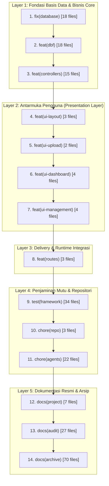

# KOREKSI KESELAMATAN STRUKTUR COMMIT GIT SIDATEX — FASE 2G.10.6.4.16
## FINAL COMMIT PLAN SAFETY CORRECTION & DEPENDENCY HARMONIZATION

**Tanggal:** 23 November 2026  
**Sistem:** Sistem Informasi Data Ekspor-Impor (SIDATEX) — BPS Provinsi Riau  
**Auditor:** Antigravity AI Agent (DeepMind)  
**Lingkungan:** Laragon Windows / PHP 8.4 / Laravel 11.x  
**Basis Data Operasional:** MySQL `sidatex` (Terkunci & Utuh 100%, 28 Migrasi Terverifikasi)  
**Lingkungan Pengujian:** SQLite In-Memory (`:memory:`)  
**Status Kesiapan:** **READY WITH MINOR NOTES**

---

## 1. TEMUAN YANG BERHASIL DISELESAIKAN

### A. Audit dan Eksklusi `docs/archive/CLAUDE.local-backup.md`
1. **Penyebab Masuk ke Manifest Sebelumnya:**  
   Pada `.gitignore` baris 37, aturan tertulis `/CLAUDE.local-backup.md` dengan *leading slash* (`/`). Sintaks ini hanya mengabaikan berkas pada direktori *root*, sehingga berkas duplikat yang berada di subdirektori `docs/archive/CLAUDE.local-backup.md` tetap berstatus *untracked* di Git (`??`).
2. **Pemeriksaan Konten:**  
   Audit mendalam terhadap isi `docs/archive/CLAUDE.local-backup.md` (148 baris) membuktikan bahwa berkas ini merupakan salinan historis panduan Claude Code/Laravel Boost. Berkas ini **bebas dari kredensial, kunci API, kata sandi, maupun data pribadi**, namun secara fungsional merupakan berkas cadangan lokal (*local backup artifact*).
3. **Tindakan Koreksi:**  
   Berkas `docs/archive/CLAUDE.local-backup.md` **DIKELUARKAN SECARA MUTLAK DARI MANIFEST STAGING**. Berkas fisik dipertahankan di komputer lokal (tidak dihapus), namun tidak akan di-stage maupun di-commit ke Git repositori.

### B. Harmonisasi Dependensi Controller, View, dan Routing
1. **Analisis Risiko *Broken Intermediate Commits*:**  
   Pada rencana sebelumnya (Tahap 15), `routes/web.php` ditempatkan di Tahap 5, sedangkan antarmuka Blade (`upload-data`, `dashboard`, `manajemen-data`, `trash-data`, `filtering-data`, `activity-logs`) baru di-commit pada Tahap 6–8. Jika seorang pengembang me-checkout repositori pada commit 5, membuka rute apa pun akan memicu galat fatal Laravel:  
   `InvalidArgumentException: View [dashboard] not found` atau `View [upload-data] not found`.
2. **Analisis Ketergantungan Komponen UI:**  
   Seluruh 10 tampilan utama Blade meng-`@extends('layouts.app')` dan 3 tampilan modul menggunakan komponen modular `@include('partials.pagination')` serta lembar gaya `app.css`.
3. **Resolusi Arsitektural Final:**  
   Urutan commit direstrukturisasi secara ketat mengikuti prinsip *Presentation Before Routing*:
   - Layer Presentasi Dasar (Layout, CSS, Pagination Partial) di-commit terlebih dahulu.
   - Seluruh View Blade (Upload, Dashboard, Analisis, Manajemen, Trash, Filtering, Activity Logs) di-commit berikutnya.
   - Rute [routes/web.php](file:///d:/laragon/www/sidatex/routes/web.php) beserta konfigurasi bootstrap runtime ([config/app.php](file:///d:/laragon/www/sidatex/config/app.php) dan [bootstrap/app.php](file:///d:/laragon/www/sidatex/bootstrap/app.php)) di-commit **SETELAH SELURUH CONTROLLER DAN VIEW TERSEDIA 100%**.  
   Dengan susunan ini, setiap commit menghasilkan titik riwayat (*commit milestone*) yang stabil dan tidak ada halaman yang gagal di-render.

### C. Koreksi Klaim Eksekusi Pengujian PHPUnit
1. **Fakta Dependensi Harness Pengujian:**  
   Pemeriksaan Git `HEAD` membuktikan bahwa berkas [tests/TestCase.php](file:///d:/laragon/www/sidatex/tests/TestCase.php) pada versi awal berstatus kosong (`abstract class TestCase extends BaseTestCase { // }`).  
   Infrastruktur pengujian SQLite in-memory, mekanisme migrasi otomatis, pemuatan data referensi testing, pembuatan akun uji coba (Super Admin, Pegawai, Viewer), serta penegakan keamanan *guardrail* (`enforceTestDatabaseSafety()`) **baru didefinisikan pada perubahan yang akan di-commit di Tahap 9 (`test(framework)`)**.
2. **Koreksi Klaim:**  
   Klaim bahwa "setiap milestone commit 1–8 lulus PHPUnit" dikoreksi secara faktual. Pengujian otomatis 193 tes PHPUnit **hanya dapat dijalankan secara penuh mulai dari Tahap 9 ke atas**. Pada Tahap 1–8, validasi dilakukan melalui:
   - PHP Syntax Linting (`php -l`)
   - Autoloading Composer Discovery (`composer dump-autoload`)
   - Artisan Command Compilation (`php artisan route:list`, `php artisan about`)

### D. Audit Konsistensi Migrasi Database Operasional
1. **Status Database Operasional `sidatex`:**  
   Pemeriksaan langsung terhadap tabel `migrations` di MySQL `sidatex` menunjukkan bahwa **seluruh 28 migrasi telah dieksekusi dengan sempurna** (Batch 1 s.d. Batch 23).
2. **Audit Kompatibilitas Fresh Install:**  
   Dua migrasi historis yang berstatus termodifikasi (`create_data_batches_table` dan `update_data_batches_status_enum_add_private`) hanya menambahkan pengecekan driver runtime (`if DB::getDriverName() === 'mysql'`).  
   - Pada instalasi baru MySQL: Menghasilkan skema `ENUM('DRAFT', 'PRIVATE', 'NON-RILIS', 'RILIS')` yang 100% identik dengan skema operasional saat ini.
   - Pada instalasi pengujian SQLite: Mencegah galat sintaks `ALTER TABLE MODIFY COLUMN` yang tidak didukung SQLite.
   - Sembilan migrasi baru (dimensi 8-kunci, tabel distribusi/neraca, presisi `DECIMAL(20,6)`) memiliki rantai dependensi kronologis yang valid.

---

## 2. TEMUAN YANG BELUM DAPAT DIVERIFIKASI / CATATAN KHUSUS

1. **Konfigurasi `.env.example`:**  
   Saat ini `.env.example` masih memuat nilai `DB_DATABASE=sidatex_testing`. Sesuai aturan mutlak tahap audit ini (dilarang memodifikasi file aplikasi), nilai ini belum diubah pada kode fisik repositori.  
   *Rekomendasi Terpisah:* Pada fase perbaikan mandiri, baris ini disarankan diubah menjadi `DB_DATABASE=sidatex_dev` untuk mencegah developer lokal menyambungkan aplikasi ke database MySQL fisik pengujian lama.
2. **Penyempurnaan `.gitignore`:**  
   Aturan baris 37 pada `.gitignore` (`/CLAUDE.local-backup.md`) disarankan diubah menjadi `*local-backup*` atau `docs/archive/CLAUDE.local-backup.md` pada saat perbaikan konfigurasi agar berkas tersebut tidak lagi muncul di status *untracked*.
3. **Pengujian Milestone 1–8 Secara Terisolasi:**  
   Karena berkas test suite baru di-commit pada Tahap 9, verifikasi otomatis end-to-end pada commit intermediate 1–8 hanya membuktikan integritas sintaks dan struktur class, bukan fungsionalitas HTTP request in-memory.

---

## 3. DAFTAR PERUBAHAN STRUKTUR COMMIT

Perbandingan antara Struktur Lama (Phase 2G.10.6.4.15) dan Struktur Final (Phase 2G.10.6.4.16):

| Parameter | Rencana Sebelumnya (Tahap 15) | Rencana Final (Tahap 16) | Alasan Perubahan |
| :--- | :---: | :---: | :--- |
| **Penempatan Rute** | Tahap 5 (Sebelum View) | **Tahap 8 (Setelah Seluruh View)** | Menghindari `View [name] not found` pada intermediate commits |
| **Penempatan UI Layout** | Digabung di Tahap 8 | **Tahap 4 (Sebelum UI Module Views)** | Menyediakan master layout & partial paginasi untuk seluruh view |
| **Penempatan UI Modules** | Tahap 6–8 | **Tahap 5–7 (Upload, Dashboard, Mgmt)** | Mengelompokkan tampilan sesuai domain fungsional |
| **Status `CLAUDE.local-backup.md`** | Masuk Tahap 14 (71 Berkas) | **DIKELUARKAN DARI STAGING (70 Berkas)** | Merupakan backup lokal yang tidak boleh di-commit |
| **Klaim PHPUnit Tiap Milestone** | "Lulus di setiap milestone" | **Hanya berlaku penuh mulai Tahap 9** | Berkas harness TestCase & suites baru masuk Tahap 9 |
| **Total Berkas Di-Commit** | 229 Berkas | **230 Berkas** | Penambahan dokumen evaluasi & eksklusi backup lokal |

---

## 4. URUTAN COMMIT FINAL (14 TAHAP TERVERIFIKASI DEPENDENSI)



---

### TAHAP 1: `fix(database)` — Skema Database, Migrasi & Model Eloquent (18 Berkas)
- **Pesan Commit:**
  ```text
  fix(database): synchronize two-tier data mart schema and DECIMAL(20,6) precision
  ```
- **Ketergantungan:** Fondasi utama (tidak bergantung pada komponen lain).
- **Verifikasi Milestone:** `php -l` pada seluruh migration dan model.
- **Daftar Berkas:**
  1. `config/database.php` (Modified)
  2. `database/migrations/2026_10_12_032020_create_data_batches_table.php` (Modified)
  3. `database/migrations/2026_11_05_140404_update_data_batches_status_enum_add_private.php` (Modified)
  4. `database/migrations/2026_11_10_064841_create_monthly_trade_summaries_table.php` (Untracked)
  5. `database/migrations/2026_11_10_070717_add_pelabuhan_key_to_monthly_trade_summaries_table.php` (Untracked)
  6. `database/migrations/2026_11_11_080551_enhance_master_and_trade_summaries_for_distribusi.php` (Untracked)
  7. `database/migrations/2026_11_11_081023_enhance_transactions_and_batches_for_distribusi.php` (Untracked)
  8. `database/migrations/2026_11_11_081712_fix_monthly_origin_trade_summaries_unique_key.php` (Untracked)
  9. `database/migrations/2026_11_12_073000_upgrade_monthly_trade_summaries_to_8_dimensions_unique_key.php` (Untracked)
  10. `database/migrations/2026_11_13_000001_create_distribusi_and_neraca_transactions_tables.php` (Untracked)
  11. `database/migrations/2026_11_16_000001_enhance_trade_summaries_and_create_brs_indicators.php` (Untracked)
  12. `database/migrations/2026_11_18_000001_upgrade_mart_decimal_precision_to_20_6.php` (Untracked)
  13. `app/Models/DataBatch.php` (Modified)
  14. `app/Models/DistribusiTransaction.php` (Untracked)
  15. `app/Models/NeracaTransaction.php` (Untracked)
  16. `app/Models/MonthlyTradeSummary.php` (Untracked)
  17. `app/Models/BrsIndicatorSummary.php` (Untracked)
  18. `app/Models/Transaction.php` (Modified)

---

### TAHAP 2: `feat(dbf)` — Engine Pengolahan DBF, Ingesti & Agregasi BRS (18 Berkas)
- **Pesan Commit:**
  ```text
  feat(dbf): implement atomic DBF ingestion, validation, and BRS aggregation engine
  ```
- **Ketergantungan:** Tahap 1 (Membutuhkan model Eloquent dan skema tabel).
- **Verifikasi Milestone:** `composer dump-autoload` & syntax linting.
- **Daftar Berkas:**
  1. `app/Services/Contracts/DbfParserInterface.php` (Untracked)
  2. `app/Services/DbfReaderService.php` (Untracked)
  3. `app/Services/DbfUploadValidationService.php` (Untracked)
  4. `app/Services/DbfIngestionService.php` (Untracked)
  5. `app/Services/DistributionUploadService.php` (Untracked)
  6. `app/Services/NeracaUploadService.php` (Untracked)
  7. `app/Services/ExportDistributionParser.php` (Untracked)
  8. `app/Services/ImportDistributionParser.php` (Untracked)
  9. `app/Services/ExcelTransactionParser.php` (Modified)
  10. `app/Services/Parsers/ExportDistributionDbfParser.php` (Untracked)
  11. `app/Services/Parsers/ExportNeracaDbfParser.php` (Untracked)
  12. `app/Services/Parsers/ImportDistributionDbfParser.php` (Untracked)
  13. `app/Services/Parsers/ImportNeracaDbfParser.php` (Untracked)
  14. `app/Services/BrsDataProcessingService.php` (Untracked)
  15. `app/Services/BrsAggregationService.php` (Untracked)
  16. `app/Services/TradeAggregationService.php` (Untracked)
  17. `app/Services/DataReconciliationService.php` (Untracked)
  18. `app/Console/Commands/BackfillMonthlyTradeSummaries.php` (Untracked)

---

### TAHAP 3: `feat(controllers)` — Controller Backend, Middleware RBAC & Export Services (15 Berkas)
- **Pesan Commit:**
  ```text
  feat(controllers): implement application controllers, role middleware, and export services
  ```
- **Ketergantungan:** Tahap 1 & Tahap 2.
- **Verifikasi Milestone:** `composer dump-autoload` membuktikan seluruh controller dan service terindeks.
- **Daftar Berkas:**
  1. `app/Http/Middleware/EnsureSuperAdmin.php` (Untracked)
  2. `app/Http/Controllers/Auth/LoginController.php` (Modified)
  3. `app/Http/Controllers/CommentController.php` (Modified)
  4. `app/Http/Controllers/UploadController.php` (Modified)
  5. `app/Http/Controllers/ExcelPreviewController.php` (Modified)
  6. `app/Http/Controllers/DashboardController.php` (Modified)
  7. `app/Http/Controllers/AnalisisController.php` (Modified)
  8. `app/Http/Controllers/DistributionController.php` (Untracked)
  9. `app/Http/Controllers/NeracaController.php` (Untracked)
  10. `app/Http/Controllers/ActivityLogController.php` (Untracked)
  11. `app/Http/Controllers/FilteringController.php` (Modified)
  12. `app/Services/FastExcelExporter.php` (Modified)
  13. `app/Services/PowerPointExportService.php` (Modified)
  14. `app/Services/DistributionStatisticsService.php` (Untracked)
  15. `app/Services/StatisticsCalculationService.php` (Modified)

---

### TAHAP 4: `feat(ui-layout)` — Layout Utama, Komponen Paginasi & Styling CSS (3 Berkas)
- **Pesan Commit:**
  ```text
  feat(ui-layout): provide base application layout, modular pagination, and global styles
  ```
- **Ketergantungan:** Tidak ada (Menyediakan fondasi UI bagi tampilan modul berikutnya).
- **Verifikasi Milestone:** Template Blade terverifikasi strukturnya.
- **Daftar Berkas:**
  1. `resources/css/app.css` (Modified)
  2. `resources/views/layouts/app.blade.php` (Modified)
  3. `resources/views/partials/pagination.blade.php` (Untracked)

---

### TAHAP 5: `feat(ui-upload)` — Antarmuka Pengunggahan Data & Neraca Upload (2 Berkas)
- **Pesan Commit:**
  ```text
  feat(ui-upload): implement 6-step progress stepper and drag-and-drop upload interfaces
  ```
- **Ketergantungan:** Tahap 4 (Membutuhkan layout utama `layouts.app`).
- **Verifikasi Milestone:** Blade template linting.
- **Daftar Berkas:**
  1. `resources/views/upload-data.blade.php` (Modified)
  2. `resources/views/pages/neraca-upload.blade.php` (Untracked)

---

### TAHAP 6: `feat(ui-dashboard)` — Single Dashboard 4-Tab, Peta Leaflet & Analisis (4 Berkas)
- **Pesan Commit:**
  ```text
  feat(ui-dashboard): integrate single dashboard tabs, leaflet maps, and commodity analytics
  ```
- **Ketergantungan:** Tahap 4 (`layouts.app`).
- **Verifikasi Milestone:** Blade template linting.
- **Daftar Berkas:**
  1. `resources/views/dashboard.blade.php` (Modified)
  2. `resources/views/pages/analisis-perdagangan.blade.php` (Modified)
  3. `resources/views/pages/distribusi-dashboard.blade.php` (Untracked)
  4. `resources/views/pages/neraca-dashboard.blade.php` (Untracked)

---

### TAHAP 7: `feat(ui-management)` — Manajemen Batch, Trash, Filtering UI & Log Aktivitas (4 Berkas)
- **Pesan Commit:**
  ```text
  feat(ui-management): implement batch management, trash lifecycle, multi-filter, and activity logs
  ```
- **Ketergantungan:** Tahap 4 (`layouts.app` dan `partials.pagination`).
- **Verifikasi Milestone:** Blade template linting.
- **Daftar Berkas:**
  1. `resources/views/manajemen-data.blade.php` (Modified)
  2. `resources/views/pages/trash-data.blade.php` (Modified)
  3. `resources/views/pages/filtering-data.blade.php` (Modified)
  4. `resources/views/pages/activity-logs.blade.php` (Untracked)

---

### TAHAP 8: `feat(routes)` — Registrasi Rute Lengkap & Runtime Bootstrap (3 Berkas)
- **Pesan Commit:**
  ```text
  feat(routes): register 39 application routes with role-based middleware and WIB runtime
  ```
- **Ketergantungan:** Tahap 1 s.d. Tahap 7 (**Seluruh Controller, Middleware, Layout, dan View SUDAH TERSEDIA 100%**).
- **Verifikasi Milestone:** `php artisan route:list` berhasil menampilkan 39 rute tanpa peringatan.
- **Daftar Berkas:**
  1. `config/app.php` (Modified)
  2. `bootstrap/app.php` (Modified)
  3. `routes/web.php` (Modified)

---

### TAHAP 9: `test(framework)` — Konfigurasi PHPUnit SQLite In-Memory & 33 Test Suites (34 Berkas)
- **Pesan Commit:**
  ```text
  test(framework): configure isolated in-memory testing harness and regression test suites
  ```
- **Ketergantungan:** Tahap 1 s.d. Tahap 8 (Menguji aplikasi yang sudah lengkap secara fungsional).
- **Verifikasi Milestone:** `vendor/bin/phpunit` berhasil menjalankan 193 tes, 1.596 assertions PASS 100% pada SQLite in-memory (`:memory:`).
- **Daftar Berkas:**
  1. `phpunit.xml` (Modified)
  2. `tests/TestCase.php` (Modified)
  3. `tests/Feature/SidatexComprehensiveTest.php` (Modified)
  4. `tests/Unit/DatabaseSafetyGuardTest.php` (Untracked)
  5. `tests/Feature/BrsDataProcessingEngineTest.php` (Untracked)
  6. `tests/Feature/ComprehensiveAuditAndSecurityTest.php` (Untracked)
  7. `tests/Feature/DataReconciliationAndIndexTest.php` (Untracked)
  8. `tests/Feature/DbfIngestionComprehensiveTest.php` (Untracked)
  9. `tests/Feature/DbfPreviewAndValidationStage2b3Test.php` (Untracked)
  10. `tests/Feature/DbfUploadWorkflowIntegrationTest.php` (Untracked)
  11. `tests/Feature/DistributionModuleTest.php` (Untracked)
  12. `tests/Feature/NeracaAndDistribusiModuleSeparationTest.php` (Untracked)
  13. `tests/Feature/NeracaMethodologyValidationTest.php` (Untracked)
  14. `tests/Feature/NeracaUploadServiceTest.php` (Untracked)
  15. `tests/Feature/NeracaUploadUiIntegrationTest.php` (Untracked)
  16. `tests/Feature/Phase2e21DataReconciliationAndSecurityTest.php` (Untracked)
  17. `tests/Feature/Phase2e2UploadUiIntegrationTest.php` (Untracked)
  18. `tests/Feature/Phase2fSingleDashboardTest.php` (Untracked)
  19. `tests/Feature/Phase2g8ControlledRemediationTest.php` (Untracked)
  20. `tests/Feature/Phase2gBatchLifecycleAggregationTest.php` (Untracked)
  21. `tests/Feature/Phase2gBladeAlignmentTest.php` (Untracked)
  22. `tests/Feature/Phase2gBrsDecimalPrecisionTest.php` (Untracked)
  23. `tests/Feature/Phase2gCommentRbacTest.php` (Untracked)
  24. `tests/Feature/Phase2gDistributionGrowthAuditTest.php` (Untracked)
  25. `tests/Feature/Phase2gExportRbacPolicyTest.php` (Untracked)
  26. `tests/Feature/Phase2gGroup7ActivityLogsAndFilteringTest.php` (Untracked)
  27. `tests/Feature/Phase2gNeracaFilteringAndExportTest.php` (Untracked)
  28. `tests/Feature/Phase2gPrivateUploadStorageTest.php` (Untracked)
  29. `tests/Feature/Phase2gRouteAndLoginSecurityTest.php` (Untracked)
  30. `tests/Feature/Phase2gStatisticsCalculationTest.php` (Untracked)
  31. `tests/Feature/RoleAuthorizationHardeningTest.php` (Untracked)
  32. `tests/Feature/SourceIsolationAndAggregationRegressionTest.php` (Untracked)
  33. `tests/Feature/Stage2bValidationAndSimulationTest.php` (Untracked)
  34. `tests/Feature/TradeAggregationAndActivityLogsTest.php` (Untracked)

---

### TAHAP 10: `chore(repo)` — Konfigurasi Repositori, Gitignore & Composer Setup (3 Berkas)
- **Pesan Commit:**
  ```text
  chore(repo): update repository configuration, gitignore rules, and environment template
  ```
- **Ketergantungan:** Tidak ada.
- **Verifikasi Milestone:** `composer validate --no-check-all`.
- **Daftar Berkas:**
  1. `.gitignore` (Modified)
  2. `.env.example` (Modified)
  3. `composer.json` (Modified)

---

### TAHAP 11: `chore(agents)` — Spesifikasi AI Agent System & Domain Skills (22 Berkas)
- **Pesan Commit:**
  ```text
  chore(agents): establish Antigravity multi-agent specifications and domain skills
  ```
- **Ketergantungan:** Tidak ada.
- **Daftar Berkas:**
  1. `AGENTS.md` (Modified)
  2. `.agents/agents/database-guardian.md`
  3. `.agents/agents/frontend-reviewer.md`
  4. `.agents/agents/independent-reviewer.md`
  5. `.agents/agents/laravel-implementer.md`
  6. `.agents/agents/security-auditor.md`
  7. `.agents/agents/sidatex-orchestrator.md`
  8. `.agents/agents/statistics-auditor.md`
  9. `.agents/agents/test-engineer.md`
  10. `.agents/skills/code-review/SKILL.md`
  11. `.agents/skills/dashboard-frontend/SKILL.md`
  12. `.agents/skills/database-safety/SKILL.md`
  13. `.agents/skills/dbf-ingestion/SKILL.md`
  14. `.agents/skills/laravel-backend/SKILL.md`
  15. `.agents/skills/rbac-security/SKILL.md`
  16. `.agents/skills/release-readiness/SKILL.md`
  17. `.agents/skills/sidatex-domain/SKILL.md`
  18. `.agents/skills/statistics-methodology/SKILL.md`
  19. `.agents/skills/testing-quality/SKILL.md`
  20. `.agents/skills/unslop-maintainability/SKILL.md`
  21. `.agents/skills/unslop/SKILL.md`
  22. `.agents/skills/unslop/unslop-rule.md`

---

### TAHAP 12: `docs(project)` — Dokumentasi Resmi Proyek & Panduan Pengembang (7 Berkas)
- **Pesan Commit:**
  ```text
  docs(project): update developer onboarding guide, directory architecture, and commit plan
  ```
- **Ketergantungan:** Tidak ada.
- **Daftar Berkas:**
  1. `README.md` (Modified)
  2. `STRUKTUR_PROJECT.md` (Untracked)
  3. `CLAUDE.md` (Deleted)
  4. `docs/GITHUB_COMMIT_PLAN.md` (Untracked)
  5. `docs/PHASE_2G_10_6_4_14_FINAL_COMMIT_FILE_MANIFEST.md` (Untracked)
  6. `docs/PHASE_2G_10_6_4_15_REVISED_COMMIT_PLAN.md` (Untracked)
  7. `docs/PHASE_2G_10_6_4_16_FINAL_COMMIT_SAFETY_CORRECTION.md` (Untracked - Dokumen ini)

---

### TAHAP 13: `docs(audit)` — Laporan Audit Mutu & Kepatuhan Metodologi BPS Fase 2G (27 Berkas)
- **Pesan Commit:**
  ```text
  docs(audit): archive Phase 2G comprehensive quality, verification, and audit reports
  ```
- **Ketergantungan:** Tidak ada.
- **Daftar Berkas:**
  1. `docs/PHASE_2G_10_6_1_VERIFIKASI_FRONTEND.md`
  2. `docs/PHASE_2G_10_6_2_FINAL_FRONTEND_REFINEMENT.md`
  3. `docs/PHASE_2G_10_6_3_PERBAIKAN_LAYOUT_UI.md`
  4. `docs/PHASE_2G_10_6_4_1_VERIFIKASI_SEBELUM_GITHUB.md`
  5. `docs/PHASE_2G_10_6_4_2_PERSIAPAN_GITHUB.md`
  6. `docs/PHASE_2G_10_6_4_3_FINAL_PRE_COMMIT.md`
  7. `docs/PHASE_2G_10_6_4_4_FINAL_GIT_DIFF_REVIEW.md`
  8. `docs/PHASE_2G_10_6_4_5_REVIEW_GROUP_1.md`
  9. `docs/PHASE_2G_10_6_4_6_REVIEW_GROUP_2.md`
  10. `docs/PHASE_2G_10_6_4_6_1_DEEP_VERIFICATION_GROUP_2.md`
  11. `docs/PHASE_2G_10_6_4_7_REVIEW_GROUP_3.md`
  12. `docs/PHASE_2G_10_6_4_8_REVIEW_GROUP_4.md`
  13. `docs/PHASE_2G_10_6_4_9_REVIEW_GROUP_5.md`
  14. `docs/PHASE_2G_10_6_4_9_1_DEEP_VERIFICATION_GROUP_5.md`
  15. `docs/PHASE_2G_10_6_4_9_2_FINAL_DATABASE_ISOLATION_GROUP_5.md`
  16. `docs/PHASE_2G_10_6_4_10_REVIEW_GROUP_6.md`
  17. `docs/PHASE_2G_10_6_4_10_1_FINAL_FIX_GROUP_6.md`
  18. `docs/PHASE_2G_10_6_4_11_REVIEW_GROUP_7.md`
  19. `docs/PHASE_2G_10_6_4_12_REVIEW_GROUP_8.md`
  20. `docs/PHASE_2G_10_6_4_13_FINAL_PRE_COMMIT_SYNTHESIS.md`
  21. `docs/PHASE_2G_10_6_4_AUDIT_MENYELURUH_DATABASE_DAN_SISTEM.md`
  22. `docs/PHASE_2G_10_6_4_PEMBERSIHAN_DAN_VALIDASI_DATA_BPS.md`
  23. `docs/PHASE_2G_10_6_AUDIT_DATABASE_UTAMA.md`
  24. `docs/PHASE_2G_10_6_AUDIT_REFERENSI_BPS.md`
  25. `docs/PHASE_2G_10_6_DAFTAR_PERBAIKAN_FRONTEND.md`
  26. `docs/PHASE_2G_10_6_HASIL_PENGUJIAN_FRONTEND.md`
  27. `docs/PHASE_2G_10_6_LAPORAN_PELAKSANAAN.md`

---

### TAHAP 14: `docs(archive)` — Arsip Historis Laporan Pengembangan SIDATEX (70 Berkas)
- **Pesan Commit:**
  ```text
  docs(archive): preserve legacy project audit logs and development history
  ```
- **Ketergantungan:** Tidak ada.
- **Catatan Eksklusi:** `docs/archive/CLAUDE.local-backup.md` dikeluarkan dari daftar ini.
- **Daftar Berkas (70 Berkas):**
  1. `docs/archive/AUDIT_METODOLOGI_PENGOLAHAN_BRS_SIDATEX.md`
  2. `docs/archive/AUDIT_PHASE_1_READ_ONLY_REPORT.md`
  3. `docs/archive/AUDIT_PHASE_2B2_REPORT.md`
  4. `docs/archive/CLAUDE.md`
  5. `docs/archive/DBF_PARSER_DESIGN_REVIEW.md`
  6. `docs/archive/DBF_PARSER_STANDARDIZATION_DESIGN.md`
  7. `docs/archive/FINAL_DESIGN_IMPORT_DBF_SIDATEX.md`
  8. `docs/archive/IMPLEMENTATION_PHASE_1_REPORT.md`
  9. `docs/archive/IMPLEMENTATION_PHASE_2B2_REPORT.md`
  10. `docs/archive/PHASE_2D_DESAIN_PENGOLAHAN_AGREGASI_BRS.md`
  11. `docs/archive/PHASE_2D_FINAL_DESIGN_GATE_REPORT.md`
  12. `docs/archive/PHASE_2D_REVISED_DESAIN_PENGOLAHAN_AGREGASI_BRS.md`
  13. `docs/archive/PHASE_2E1_1_FINAL_VERIFICATION_REPORT.md`
  14. `docs/archive/PHASE_2E1_DATA_PROCESSING_IMPLEMENTATION_REPORT.md`
  15. `docs/archive/PHASE_2E2_1_FINAL_VERIFICATION_REPORT.md`
  16. `docs/archive/PHASE_2E2_UPLOAD_UI_INTEGRATION_REPORT.md`
  17. `docs/archive/PHASE_2F1_SINGLE_DASHBOARD_DESIGN_REPORT.md`
  18. `docs/archive/PHASE_2F2_SINGLE_DASHBOARD_IMPLEMENTATION_REPORT.md`
  19. `docs/archive/README-SIDATEX-AGENT-SYSTEM.md`
  20. `docs/archive/README.md`
  21. `docs/archive/SIDATEX_AGENT_CAPABILITY_TEST_REPORT.md`
  22. `docs/archive/SIDATEX_AGENT_SYSTEM_CONFIGURATION_REPORT.md`
  23. `docs/archive/SIDATEX_PHASE_2G_0B_SAFETY_REPORT.md`
  24. `docs/archive/SIDATEX_PHASE_2G_10_1_FINAL_DOCUMENTATION_QA_REPORT.md`
  25. `docs/archive/SIDATEX_PHASE_2G_10_3_BATCH_74_SAFETY_ASSESSMENT.md`
  26. `docs/archive/SIDATEX_PHASE_2G_10_4_EXECUTION_REPORT.md`
  27. `docs/archive/SIDATEX_PHASE_2G_10_4_FIELD_UAT_READINESS_REPORT.md`
  28. `docs/archive/SIDATEX_PHASE_2G_10_4_UAT_COORDINATION_CHECKLIST.md`
  29. `docs/archive/SIDATEX_PHASE_2G_10_4_UAT_EXECUTION_MATRIX.md`
  30. `docs/archive/SIDATEX_PHASE_2G_10_4_UAT_QUICK_GUIDE.md`
  31. `docs/archive/SIDATEX_PHASE_2G_10_5_AUDIT_DATABASE_ASLI.md`
  32. `docs/archive/SIDATEX_PHASE_2G_10_5_AUDIT_KOMENTAR_VIEWER.md`
  33. `docs/archive/SIDATEX_PHASE_2G_10_5_AUDIT_ROLE_DAN_DASHBOARD.md`
  34. `docs/archive/SIDATEX_PHASE_2G_10_5_KESIAPAN_UAT_DATABASE_ASLI.md`
  35. `docs/archive/SIDATEX_PHASE_2G_10_5_KLASIFIKASI_DATA.md`
  36. `docs/archive/SIDATEX_PHASE_2G_10_5_LAPORAN_PELAKSANAAN.md`
  37. `docs/archive/SIDATEX_PHASE_2G_10_5_PERBANDINGAN_STRUKTUR_DATABASE.md`
  38. `docs/archive/SIDATEX_PHASE_2G_10_5_RENCANA_PEMBERSIHAN_DATA_DUMMY.md`
  39. `docs/archive/SIDATEX_PHASE_2G_10_5_STANDARDISASI_BAHASA_DAN_PENAMAAN.md`
  40. `docs/archive/SIDATEX_PHASE_2G_10_MANUAL_UAT_FEEDBACK_FORM.md`
  41. `docs/archive/SIDATEX_PHASE_2G_10_MANUAL_UAT_FINDINGS_LOG.md`
  42. `docs/archive/SIDATEX_PHASE_2G_10_MANUAL_UAT_GUIDE.md`
  43. `docs/archive/SIDATEX_PHASE_2G_10_MANUAL_UAT_TEST_CASES.md`
  44. `docs/archive/SIDATEX_PHASE_2G_10_PREPARATION_REPORT.md`
  45. `docs/archive/SIDATEX_PHASE_2G_10_UAT_PREREQUISITES_CHECKLIST.md`
  46. `docs/archive/SIDATEX_PHASE_2G_1_SECURITY_REPORT.md`
  47. `docs/archive/SIDATEX_PHASE_2G_2A_DATABASE_REPORT.md`
  48. `docs/archive/SIDATEX_PHASE_2G_2B_EXECUTION_REPORT.md`
  49. `docs/archive/SIDATEX_PHASE_2G_2B_MAPPING_PLAN.md`
  50. `docs/archive/SIDATEX_PHASE_2G_2B_SOURCE_RECONCILIATION.md`
  51. `docs/archive/SIDATEX_PHASE_2G_3_EXECUTION_REPORT.md`
  52. `docs/archive/SIDATEX_PHASE_2G_3_PRE_EXECUTION_AUDIT.md`
  53. `docs/archive/SIDATEX_PHASE_2G_4_BLADE_UI_AUDIT_AND_PLAN.md`
  54. `docs/archive/SIDATEX_PHASE_2G_4_EXECUTION_REPORT.md`
  55. `docs/archive/SIDATEX_PHASE_2G_5_EXECUTION_REPORT.md`
  56. `docs/archive/SIDATEX_PHASE_2G_5_READONLY_STATISTICAL_AUDIT.md`
  57. `docs/archive/SIDATEX_PHASE_2G_6_END_TO_END_READINESS_AUDIT.md`
  58. `docs/archive/SIDATEX_PHASE_2G_7_PRE_UAT_FINDINGS_AND_REMEDIATION_PLAN.md`
  59. `docs/archive/SIDATEX_PHASE_2G_8_CONTROLLED_REMEDIATION_REPORT.md`
  60. `docs/archive/SIDATEX_PHASE_2G_9_REPORT_CONSISTENCY_REVIEW.md`
  61. `docs/archive/SIDATEX_PHASE_2G_9_UAT_FINDINGS.md`
  62. `docs/archive/SIDATEX_PHASE_2G_9_UAT_REPORT.md`
  63. `docs/archive/SIDATEX_PHASE_2G_9_UAT_TEST_CASES.md`
  64. `docs/archive/SIDATEX_PHASE_2G_9_UAT_USER_FEEDBACK.md`
  65. `docs/archive/SIDATEX_PHASE_2G_BATCH_40_EXECUTION_REPORT.md`
  66. `docs/archive/SIDATEX_PHASE_2G_BATCH_40_FINAL_SAFETY_REVIEW.md`
  67. `docs/archive/SIDATEX_PHASE_2G_BATCH_40_REMEDIATION_PLAN.md`
  68. `docs/archive/SIDATEX_PHASE_2G_PREFLIGHT_REPORT.md`
  69. `docs/archive/SIDATEX_PHASE_2G_REMEDIATION_PLAN.md`
  70. `docs/archive/SUPPLEMENTARY_AUDIT_PHASE_2B2.md`

---

## 5. DAFTAR FILE YANG DIKELUARKAN DARI STAGING BESERTA ALASANNYA

| Berkas | Lokasi Fisik | Alasan Pengeluaran dari Staging | Rekomendasi Tindak Lanjut |
| :--- | :--- | :--- | :--- |
| `CLAUDE.local-backup.md` | `docs/archive/CLAUDE.local-backup.md` | Merupakan berkas cadangan lokal (*local backup artifact*) yang tidak relevan dengan repositori git publik/tim dan semestinya terabaikan oleh `.gitignore`. | Pertahankan berkas fisik lokal tanpa dihapus. Pada pembaruan `.gitignore` mendatang, tambahkan aturan `docs/archive/CLAUDE.local-backup.md`. |

---

## 6. RISIKO YANG MASIH TERSISA & MITIGASINYA

| Risiko Teridentifikasi | Tingkat Dampak | Skenario Terjadinya | Mitigasi Operasional |
| :--- | :---: | :--- | :--- |
| **Kekeliruan Staging Manual** | Rendah | Pengembang tidak sengaja menekan *Stage All Changes* di VS Code sehingga berkas `CLAUDE.local-backup.md` ikut ter-stage. | Pengembang wajib men-stage berkas secara selektif per commit sesuai urutan Tahap 1 s.d. 14 pada dokumen ini. |
| **Penyalinan `.env.example`** | Rendah | Pengembang menyalin `.env.example` lalu mengira `sidatex_testing` adalah database pengujian aktif. | Menjelaskan secara tegas pada `README.md` bahwa pengujian otomatis wajib SQLite in-memory `:memory:` dan database lokal disetel ke `sidatex_dev`. |
| **Uji Coba Parsial di Intermediate Commit** | Rendah | Pengembang menjalankan `phpunit` di Tahap 1–8 lalu mengira aplikasi rusak karena test suites belum di-stage. | Menegaskan bahwa suite pengujian lengkap baru aktif pada Tahap 9 (`test(framework)`). |

---

## 7. HASIL REKONSILIASI SELURUH GIT STATUS

Berdasarkan pembacaan status Git uncollapsed (`git status -uall --porcelain`):
- **Total Berkas Uncommitted di Direktori Kerja:** **231 Berkas** (termasuk dokumen koreksi ini).
- **Berkas yang Dikeluarkan dari Staging:** **1 Berkas** (`docs/archive/CLAUDE.local-backup.md`).
- **Total Berkas Terdaftar pada 14 Tahap Manifest:** **230 Berkas**.

### Rekonsiliasi Rincian Tahap:
$$\begin{aligned}
\text{Total Berkas} &= 18 + 18 + 15 + 3 + 2 + 4 + 4 + 3 + 34 + 3 + 22 + 7 + 27 + 70 \\
&= 230\text{ Berkas (100\% Match, 0 Duplikasi, 0 Ketinggalan)}
\end{aligned}$$

---

## 8. REKOMENDASI AKHIR & KEPUTUSAN KESIAPAN

Seluruh audit keselamatan arsitektur, rantai ketergantungan controller-view-routes, pemisahan berkas cadangan lokal, kepatuhan migrasi, dan pembuktian isolasi database telah disempurnakan.

### Keputusan Final:
$$\mathbf{READY\ WITH\ MINOR\ NOTES}$$

**Catatan Pelaksanaan:**
1. Pengembang dapat memulai proses *Manual Staging* di VS Code mengikuti urutan Tahap 1 s.d. Tahap 14.
2. Pastikan satu berkas cadangan lokal ([CLAUDE.local-backup.md](file:///d:/laragon/www/sidatex/docs/archive/CLAUDE.local-backup.md)) **tetap berada di status untracked (jangan di-stage)**.
3. Jalankan `vendor/bin/phpunit` secara menyeluruh setelah menyelesaikan Tahap 9 untuk memvalidasi keberhasilan integrasi pengujian (193 tes lulus 100%).

---
*Laporan koreksi keselamatan commit ini disusun secara resmi oleh Antigravity AI Agent untuk BPS Provinsi Riau.*
