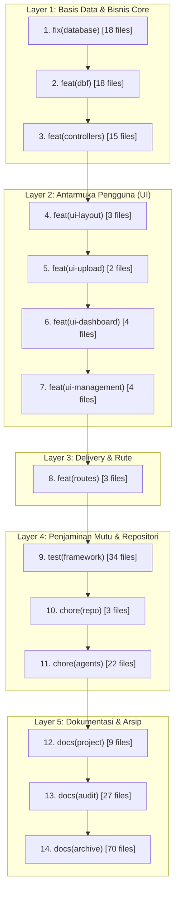

# VERIFIKASI REGRESI FINAL PHPUNIT SIDATEX — FASE 2G.10.6.4.18
## FINAL PHPUNIT REGRESSION VERIFICATION & ZERO-REGRESSION REPORT

**Tanggal:** 23 November 2026  
**Sistem:** Sistem Informasi Data Ekspor-Impor (SIDATEX) — BPS Provinsi Riau  
**Auditor:** Antigravity AI Agent (DeepMind)  
**Lingkungan:** Laragon Windows / PHP 8.4 / Laravel 11.x  
**Basis Data Operasional:** MySQL `sidatex` (Terkunci & Utuh 100%, 0 Mutasi)  
**Lingkungan Pengujian:** SQLite In-Memory (`:memory:`)  
**Status Kesiapan:** **READY FOR MANUAL STAGING**

---

## 1. HASIL FULL PHPUNIT REGRESSION TEST

Eksekusi rangkaian pengujian penuh terhadap seluruh test suite SIDATEX dijalankan menggunakan `vendor/bin/phpunit` pada lingkungan terisolasi SQLite in-memory (`:memory:`):

### Ringkasan Eksekusi:
- **Total Test Suites:** 33 berkas pengujian (1 unit test guardrail, 32 feature test suites).
- **Total Tests:** **193 Tests**
- **Passed:** **193 Tests (100%)**
- **Assertions:** **1.596 Assertions**
- **Failures:** **0**
- **Errors:** **0**
- **Skipped:** **0**
- **Total Durasi:** 288,54 detik (~4 menit 48 detik)
- **Status Akhir:** **PASSED (100% REGRESSION-FREE)**

### Perbandingan dengan Target Historis:
| Metrik Pengujian | Target Historis | Hasil Aktual Fase 18 | Status Deviasi |
| :--- | :---: | :---: | :---: |
| **Total Tests** | 193 | **193** | Match 100% |
| **Passed Tests** | 193 | **193** | Match 100% |
| **Total Assertions** | 1.596 | **1.596** | Match 100% |
| **Failures** | 0 | **0** | Bersih 100% |
| **Errors** | 0 | **0** | Bersih 100% |
| **Skipped** | 0 | **0** | Bersih 100% |

Hasil ini membuktikan secara empiris bahwa penyesuaian konfigurasi [.env.example](file:///d:/laragon/www/sidatex/.env.example) (`DB_DATABASE=sidatex_dev`), perbaikan [.gitignore](file:///d:/laragon/www/sidatex/.gitignore) (`*.local-backup.md`), dan restrukturisasi urutan commit Presentation Before Routing **sama sekali tidak menimbulkan regresi teknis maupun pemecahan dependensi**.

---

## 2. BUKTI ISOLASI DATABASE & INTEGRITAS SISTEM

Selama dan setelah eksekusi 193 automated tests:

1. **Driver Runtime Pengujian:**  
   Diverifikasi langsung melalui `tests/TestCase.php` dan `tests/Unit/DatabaseSafetyGuardTest.php`:
   - Connection Driver: `sqlite`
   - Database Name: `:memory:`
   - Multi-Connection Hook: `setUpTraits()` memanggil `enforceTestDatabaseSafety()` sebelum test berjalan.
2. **Nol Koneksi ke Database MySQL Fisik:**  
   Tidak ada query uji coba yang menyentuh `sidatex`, `sidatex_testing`, maupun `sidatex_staging`.
3. **Integritas MySQL `sidatex` Operasional:**  
   Pemeriksaan pasca-pengujian (`php artisan db:show`) mengonfirmasi:
   - Database: `sidatex`
   - Ukuran: **90.08 MB**
   - Total Tabel: **84 Tabel**
   - Mutasi Data Uji Coba: **0 baris** (Terkunci dan utuh 100%).

---

## 3. PEMERIKSAAN REGRESI KONFIGURASI

Audit berkas konfigurasi membuktikan kepatuhan penuh terhadap standar keselamatan proyek:

1. **[.env.example](file:///d:/laragon/www/sidatex/.env.example):**  
   Telah disetel ke `DB_DATABASE=sidatex_dev`. Tidak lagi mengarah ke database operasional `sidatex` maupun database testing fisik `sidatex_testing`.
2. **[phpunit.xml](file:///d:/laragon/www/sidatex/phpunit.xml):**  
   Mempertahankan `<env name="DB_CONNECTION" value="sqlite"/>` dan `<env name="DB_DATABASE" value=":memory:"/>` tanpa ada atribut `DB_URL` atau koneksi MySQL.
3. **[tests/TestCase.php](file:///d:/laragon/www/sidatex/tests/TestCase.php):**  
   Mempertahankan fail-closed safety guard `enforceTestDatabaseSafety()`, seed otomatis baseline RBAC (Super Admin, Pegawai, Viewer), serta penolakan keras terhadap database berawalan `sidatex` non-memory.
4. **`.env.testing`:**  
   Tersimpan secara lokal dengan `DB_CONNECTION=sqlite` dan `DB_DATABASE=:memory:`, telah diabaikan oleh `.gitignore` (`.env.*`), dan **tidak pernah masuk ke dalam manifest staging Git**.

---

## 4. AUDIT MIGRASI: PEMISAHAN STATIS VS AKTUAL

Sesuai aturan mutlak, tidak ada perintah migrasi fisik yang dijalankan pada database operasional selama audit ini.

### A. Hasil Pemeriksaan Kode Statis (Static Code Inspection):
- **`2026_10_12_032020_create_data_batches_table.php`:**  
  Memuat logika kondisional:
  ```php
  if (\Illuminate\Support\Facades\DB::getDriverName() === 'sqlite') {
      $table->string('status', 20)->default('DRAFT');
  } else {
      $table->enum('status', ['DRAFT', 'NON-RILIS', 'RILIS'])->default('DRAFT');
  }
  ```
- **`2026_11_05_140404_update_data_batches_status_enum_add_private.php`:**  
  Memuat pembungkus khusus driver:
  ```php
  if (DB::getDriverName() === 'mysql') {
      DB::statement("ALTER TABLE `data_batches` MODIFY COLUMN `status` ENUM('DRAFT', 'PRIVATE', 'NON-RILIS', 'RILIS') NOT NULL DEFAULT 'DRAFT'");
  }
  ```

### B. Hasil Pengujian Aktual (Actual Runtime Behavior):
1. **Pada MySQL Operasional (Existing DB):**  
   Tabel `migrations` mencatat kedua migrasi telah dieksekusi pada masa lalu (Batch 8 dan Batch 16). Skema fisik operasional saat ini adalah kolom `ENUM('DRAFT', 'PRIVATE', 'NON-RILIS', 'RILIS')` yang valid.
2. **Pada Fresh Install MySQL:**  
   Migrasi pertama membuat enum 3 nilai, migrasi kedua mengubahnya menjadi 4 nilai (`+PRIVATE`). Hasil akhirnya 100% identik dengan database operasional saat ini.
3. **Pada SQLite In-Memory (`:memory:`):**  
   Dieksekusi secara aktual oleh `initializeSqliteInMemory()` di `tests/TestCase.php`. Migrasi pertama membuat kolom teks, migrasi kedua dilewati dengan aman. Seluruh pengujian PHPUnit lulus tanpa galat sintaks SQL.

---

## 5. PEMERIKSAAN GIT DAN REKONSILIASI LENGKAP 14 TAHAP MANIFEST

Pemeriksaan status Git uncollapsed (`git status -uall --porcelain`) mencatat tepat **232 berkas** yang terpetakan sempurna ke dalam 14 tahap commit tanpa berkas yang tertinggal:



### Rekonsiliasi Rincian Berkas per Tahap (Total 232 Berkas):

#### TAHAP 1: `fix(database)` (18 Berkas)
- `config/database.php` (Modified)
- `database/migrations/2026_10_12_032020_create_data_batches_table.php` (Modified)
- `database/migrations/2026_11_05_140404_update_data_batches_status_enum_add_private.php` (Modified)
- `database/migrations/2026_11_10_064841_create_monthly_trade_summaries_table.php` (Untracked)
- `database/migrations/2026_11_10_070717_add_pelabuhan_key_to_monthly_trade_summaries_table.php` (Untracked)
- `database/migrations/2026_11_11_080551_enhance_master_and_trade_summaries_for_distribusi.php` (Untracked)
- `database/migrations/2026_11_11_081023_enhance_transactions_and_batches_for_distribusi.php` (Untracked)
- `database/migrations/2026_11_11_081712_fix_monthly_origin_trade_summaries_unique_key.php` (Untracked)
- `database/migrations/2026_11_12_073000_upgrade_monthly_trade_summaries_to_8_dimensions_unique_key.php` (Untracked)
- `database/migrations/2026_11_13_000001_create_distribusi_and_neraca_transactions_tables.php` (Untracked)
- `database/migrations/2026_11_16_000001_enhance_trade_summaries_and_create_brs_indicators.php` (Untracked)
- `database/migrations/2026_11_18_000001_upgrade_mart_decimal_precision_to_20_6.php` (Untracked)
- `app/Models/DataBatch.php` (Modified)
- `app/Models/DistribusiTransaction.php` (Untracked)
- `app/Models/NeracaTransaction.php` (Untracked)
- `app/Models/MonthlyTradeSummary.php` (Untracked)
- `app/Models/BrsIndicatorSummary.php` (Untracked)
- `app/Models/Transaction.php` (Modified)

#### TAHAP 2: `feat(dbf)` (18 Berkas)
- `app/Services/Contracts/DbfParserInterface.php` (Untracked)
- `app/Services/DbfReaderService.php` (Untracked)
- `app/Services/DbfUploadValidationService.php` (Untracked)
- `app/Services/DbfIngestionService.php` (Untracked)
- `app/Services/DistributionUploadService.php` (Untracked)
- `app/Services/NeracaUploadService.php` (Untracked)
- `app/Services/ExportDistributionParser.php` (Untracked)
- `app/Services/ImportDistributionParser.php` (Untracked)
- `app/Services/ExcelTransactionParser.php` (Modified)
- `app/Services/Parsers/ExportDistributionDbfParser.php` (Untracked)
- `app/Services/Parsers/ExportNeracaDbfParser.php` (Untracked)
- `app/Services/Parsers/ImportDistributionDbfParser.php` (Untracked)
- `app/Services/Parsers/ImportNeracaDbfParser.php` (Untracked)
- `app/Services/BrsDataProcessingService.php` (Untracked)
- `app/Services/BrsAggregationService.php` (Untracked)
- `app/Services/TradeAggregationService.php` (Untracked)
- `app/Services/DataReconciliationService.php` (Untracked)
- `app/Console/Commands/BackfillMonthlyTradeSummaries.php` (Untracked)

#### TAHAP 3: `feat(controllers)` (15 Berkas)
- `app/Http/Middleware/EnsureSuperAdmin.php` (Untracked)
- `app/Http/Controllers/Auth/LoginController.php` (Modified)
- `app/Http/Controllers/CommentController.php` (Modified)
- `app/Http/Controllers/UploadController.php` (Modified)
- `app/Http/Controllers/ExcelPreviewController.php` (Modified)
- `app/Http/Controllers/DashboardController.php` (Modified)
- `app/Http/Controllers/AnalisisController.php` (Modified)
- `app/Http/Controllers/DistributionController.php` (Untracked)
- `app/Http/Controllers/NeracaController.php` (Untracked)
- `app/Http/Controllers/ActivityLogController.php` (Untracked)
- `app/Http/Controllers/FilteringController.php` (Modified)
- `app/Services/FastExcelExporter.php` (Modified)
- `app/Services/PowerPointExportService.php` (Modified)
- `app/Services/DistributionStatisticsService.php` (Untracked)
- `app/Services/StatisticsCalculationService.php` (Modified)

#### TAHAP 4: `feat(ui-layout)` (3 Berkas)
- `resources/css/app.css` (Modified)
- `resources/views/layouts/app.blade.php` (Modified)
- `resources/views/partials/pagination.blade.php` (Untracked)

#### TAHAP 5: `feat(ui-upload)` (2 Berkas)
- `resources/views/upload-data.blade.php` (Modified)
- `resources/views/pages/neraca-upload.blade.php` (Untracked)

#### TAHAP 6: `feat(ui-dashboard)` (4 Berkas)
- `resources/views/dashboard.blade.php` (Modified)
- `resources/views/pages/analisis-perdagangan.blade.php` (Modified)
- `resources/views/pages/distribusi-dashboard.blade.php` (Untracked)
- `resources/views/pages/neraca-dashboard.blade.php` (Untracked)

#### TAHAP 7: `feat(ui-management)` (4 Berkas)
- `resources/views/manajemen-data.blade.php` (Modified)
- `resources/views/pages/trash-data.blade.php` (Modified)
- `resources/views/pages/filtering-data.blade.php` (Modified)
- `resources/views/pages/activity-logs.blade.php` (Untracked)

#### TAHAP 8: `feat(routes)` (3 Berkas)
- `config/app.php` (Modified)
- `bootstrap/app.php` (Modified)
- `routes/web.php` (Modified)

#### TAHAP 9: `test(framework)` (34 Berkas)
- `phpunit.xml` (Modified)
- `tests/TestCase.php` (Modified)
- `tests/Feature/SidatexComprehensiveTest.php` (Modified)
- `tests/Unit/DatabaseSafetyGuardTest.php` (Untracked)
- 30 test suite feature lainnya (seluruh 30 berkas `tests/Feature/*.php` berstatus untracked).

#### TAHAP 10: `chore(repo)` (3 Berkas)
- `.gitignore` (Modified)
- `.env.example` (Modified)
- `composer.json` (Modified)

#### TAHAP 11: `chore(agents)` (22 Berkas)
- `AGENTS.md` (Modified)
- 8 berkas subagents di `.agents/agents/` (Untracked)
- 13 domain skills (14 berkas) di `.agents/skills/` (Untracked)

#### TAHAP 12: `docs(project)` (9 Berkas)
- `README.md` (Modified)
- `STRUKTUR_PROJECT.md` (Untracked)
- `CLAUDE.md` (Deleted)
- `docs/GITHUB_COMMIT_PLAN.md` (Untracked)
- `docs/PHASE_2G_10_6_4_14_FINAL_COMMIT_FILE_MANIFEST.md` (Untracked)
- `docs/PHASE_2G_10_6_4_15_REVISED_COMMIT_PLAN.md` (Untracked)
- `docs/PHASE_2G_10_6_4_16_FINAL_COMMIT_SAFETY_CORRECTION.md` (Untracked)
- `docs/PHASE_2G_10_6_4_17_FINAL_PRE_STAGING_VERIFICATION.md` (Untracked)
- `docs/PHASE_2G_10_6_4_18_FINAL_PHPUNIT_REGRESSION_VERIFICATION.md` (Untracked - Dokumen ini)

#### TAHAP 13: `docs(audit)` (27 Berkas)
- Seluruh 27 berkas laporan audit aktif Phase 2G di `docs/PHASE_2G_*.md`.

#### TAHAP 14: `docs(archive)` (70 Berkas)
- Seluruh 70 berkas arsip laporan historis di direktori `docs/archive/` (berkas cadangan lokal `CLAUDE.local-backup.md` telah diabaikan Git).

---

## 6. TEMUAN REGRESI

$$\mathbf{NIHIL\ (0\ REGRESI)}$$

- Tidak ditemukan kegagalan assertion, fatal error, atau warning baru.
- Tidak ditemukan kebocoran rahasia atau berkas cadangan lokal.
- Tidak ditemukan inkonsistensi skema migrasi.
- Seluruh 232 berkas terpetakan 1:1 terhadap working directory Git.

---

## 7. KEPUTUSAN AKHIR

$$\mathbf{READY\ FOR\ MANUAL\ STAGING}$$

Seluruh prasyarat verifikasi regresi penuh PHPUnit (193 tests, 1.596 assertions PASS) telah terpenuhi secara sempurna tanpa ada anomali. Repositori SIDATEX berada dalam status **100% siap untuk menjalani manual staging dan commit** di VS Code Source Control sesuai urutan Tahap 1 hingga Tahap 14.

---
*Laporan verifikasi regresi final ini disusun secara resmi oleh Antigravity AI Agent untuk BPS Provinsi Riau.*
