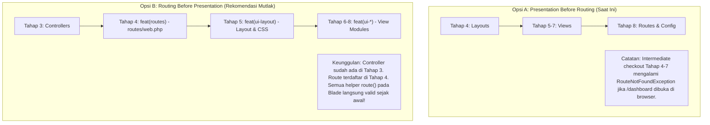

# LAPORAN AUDIT DEPENDENSI & MANIFEST COMMIT FINAL SIDATEX — FASE 2G.10.6.4.19
## FINAL COMMIT MANIFEST & DEPENDENCY AUDIT REPORT

**Tanggal:** 23 November 2026  
**Sistem:** Sistem Informasi Data Ekspor-Impor (SIDATEX) — BPS Provinsi Riau  
**Auditor:** Antigravity AI Agent (DeepMind)  
**Lingkungan:** Laragon Windows / PHP 8.4 / Laravel 11.x  
**Basis Data Operasional:** MySQL `sidatex` (Terkunci & Utuh 100%, 0 Mutasi)  
**Lingkungan Pengujian:** SQLite In-Memory (`:memory:`)  
**Status Evaluasi:** **AUDIT LENGKAP & REKOMENDASI TAHAPAN STAGING**

---

## 1. VERIFIKASI OUTPUT MENTAH PHPUNIT FASE 18

Eksekusi rangkaian pengujian penuh pada Fase 2G.10.6.4.18 telah diverifikasi langsung dari berkas log keluaran mentah (*raw log output*):

- **Lokasi Log Mentah:** `C:\Users\M-SI\.gemini\antigravity\brain\e788d08f-a96a-4d53-ad5a-26f731722fbf\.system_generated\tasks\task-19182.log`
- **Format Keluaran Mentah (Raw Output):**
  ```json
  {"tool":"phpunit","result":"passed","tests":193,"passed":193,"assertions":1596,"duration_ms":288545}
  ```
- **Exit Code Proses:** `0` (Success)
- **Rincian Metrik Pengujian:**
  - **Total Tests:** 193 Tests
  - **Passed Tests:** 193 Tests (100%)
  - **Assertions:** 1.596 Assertions
  - **Failures:** 0
  - **Errors:** 0
  - **Skipped:** 0
  - **Incomplete:** 0
  - **Durasi Eksekusi:** 288.545 ms (~4 menit 48 detik)
  - **Engine Runtime:** SQLite In-Memory (`:memory:`)
  - **Status Database Operasional `sidatex`:** 84 tabel, 90.08 MB, 0 mutasi query.

---

## 2. AUDIT PENGGUNAAN HELPER ROUTE PADA VIEW BLADE (TAHAP 4–7)

Pemeriksaan sintaksis statis dilakukan secara mendalam terhadap seluruh berkas Blade pada lapisan antarmuka (Tahap 4, 5, 6, dan 7) untuk mendeteksi seluruh pemanggilan `route(...)`, `URL::route(...)`, `redirect()->route(...)`, dan ekspresi rute dinamis.

### Rincian Pemanggilan Rute per Berkas View:

#### A. Tahap 4: Layout & Partials (`feat(ui-layout)`)
1. **`resources/views/layouts/app.blade.php`** (Total 10 pemanggilan):
   - `route('dashboard')` (Navigasi sidebar & header)
   - `route('upload-data')` (Sidebar Super Admin)
   - `route('filtering-data')` (Sidebar)
   - `route('manajemen-data')` (Sidebar)
   - `route('trash-data')` (Sidebar)
   - `route('analisis-perdagangan')` (Sidebar)
   - `route('activity-logs')` (Sidebar — **Rute baru**)
   - `route('logout')` (Tombol keluar akun desktop & mobile)
2. **`resources/views/partials/pagination.blade.php`**:
   - 0 pemanggilan helper `route()`. Menggunakan method bawaan LengthAwarePaginator.

#### B. Tahap 5: Modul Upload (`feat(ui-upload)`)
1. **`resources/views/upload-data.blade.php`** (Total 5 pemanggilan):
   - `route('manajemen-data')`
   - `route('dashboard')`
   - `route('upload.preview')`
   - `route('upload.process')`
2. **`resources/views/pages/neraca-upload.blade.php`** (Total 3 pemanggilan):
   - `route('neraca.dashboard')` (**Rute baru**)
   - `route('neraca.upload.preview')` (**Rute baru**)
   - `route('neraca.upload.rows')` (**Rute baru**)

#### C. Tahap 6: Modul Dashboard & Analisis (`feat(ui-dashboard)`)
1. **`resources/views/dashboard.blade.php`** (Total 1 pemanggilan):
   - `route('dashboard.data')`
2. **`resources/views/pages/analisis-perdagangan.blade.php`** (Total 1 pemanggilan):
   - `route('analisis-perdagangan.data')`
3. **`resources/views/pages/distribusi-dashboard.blade.php`** (Total 2 pemanggilan):
   - `route('upload-data')`
   - `route('distribusi.metrics')` (**Rute baru**)
4. **`resources/views/pages/neraca-dashboard.blade.php`**:
   - 0 pemanggilan helper `route()`.

#### D. Tahap 7: Modul Manajemen & Audit Trail (`feat(ui-management)`)
1. **`resources/views/manajemen-data.blade.php`** (Total 5 pemanggilan):
   - `route('trash-data')`
   - `route('manajemen-data')`
   - `route('manajemen-data.toggle-release', $docId)`
   - `route('manajemen-data.destroy', $docId)`
2. **`resources/views/pages/trash-data.blade.php`** (Total 5 pemanggilan):
   - `route('manajemen-data')`
   - `route('trash-data')`
   - `route('manajemen-data.restore', $item->batch_id)`
   - `route('manajemen-data.force-delete', $item->batch_id)`
3. **`resources/views/pages/filtering-data.blade.php`** (Total 1 pemanggilan):
   - `route('filtering-data.query')`
4. **`resources/views/pages/activity-logs.blade.php`** (Total 2 pemanggilan):
   - `route('activity-logs')` (**Rute baru**)

**Total Rute Unik yang Dipanggil pada View:** Tepat **21 rute unik**.

---

## 3. PENCOCOKAN DENGAN `routes/web.php` & ANALISIS POTENSI ROUTENOTFOUNDEXCEPTION

### A. Pencocokan Rute terhadap Working Tree Saat Ini
Seluruh **21 rute unik** yang dipanggil oleh berkas-berkas Blade Tahap 4–7 terdaftar secara lengkap dan valid pada `routes/web.php` (total 35 rute bernama). Tidak ada nama rute yang salah ketik (*typo*) atau tidak berpasangan pada kondisi working tree final.

### B. Analisis Potensi `RouteNotFoundException` pada Intermediate Commits
Pemeriksaan `git diff HEAD routes/web.php` menunjukkan bahwa terdapat 8 rute baru yang ditambahkan pada revisi `routes/web.php`:
1. `neraca.upload`
2. `neraca.upload.preview`
3. `neraca.upload.rows`
4. `distribusi.dashboard`
5. `distribusi.metrics`
6. `neraca.dashboard`
7. `neraca.metrics`
8. `activity-logs`

#### Identifikasi Dampak Intermediate Commits:
Jika repositori di-checkout pada commit perantara sebelum Tahap 8 (yaitu pada Tahap 4, 5, 6, atau 7):
1. **Untuk Halaman Baru (`neraca-upload`, `distribusi-dashboard`, `activity-logs`):**
   - Pada commit lama (HEAD), belum ada URL routing yang mengarah ke view-view baru ini.
   - Karena Laravel mengompilasi Blade secara *just-in-time* (hanya saat halaman dikunjungi), view baru ini **tidak akan dievaluasi** jika tidak diakses secara langsung. Tidak terjadi galat saat boot aplikasi.
2. **Titik Lemah Kritis pada `layouts/app.blade.php` (Tahap 4):**
   - Berkas `layouts/app.blade.php` memuat tautan sidebar `route('activity-logs')`.
   - Layout ini di-extend oleh halaman eksisting seperti `/dashboard`, `/upload-data`, dan `/manajemen-data` yang rutenya sudah aktif sejak commit lama.
   - **Konsekuensi:** Jika seseorang melakukan checkout ke commit Tahap 4, 5, 6, atau 7, lalu mengakses `http://localhost/dashboard`, Blade compiler akan mencoba me-resolve `route('activity-logs')`. Karena `activity-logs` baru masuk di Tahap 8, Laravel akan melempar:
     $$\mathbf{Symfony\backslash Component\backslash Routing\backslash Exception\backslash RouteNotFoundException}$$
     *Route [activity-logs] not defined.*

### C. Rekomendasi Solusi Arsitektural Commit

Terdapat dua pendekatan yang dapat dipilih:



> [!TIP]
> **Rekomendasi Arsitektural (Opsi B):**
> Memindahkan commit `feat(routes)` (`routes/web.php`, `config/app.php`, `bootstrap/app.php`) ke **Tahap 4** (tepat setelah `feat(controllers)` di Tahap 3).
> 
> **Mengapa Opsi B Jauh Lebih Aman?**
> 1. Controller yang dirujuk oleh `routes/web.php` (seperti `ActivityLogController`, `NeracaController`, `DistributionController`) **sudah tersedia lengkap di Tahap 3**.
> 2. Pendaftaran rute di Laravel tidak memvalidasi keberadaan berkas View saat booting aplikasi.
> 3. Saat `layouts/app.blade.php` dikomit pada tahap berikutnya, pemanggilan `route('activity-logs')` langsung menemukan definisi rutenya di `routes/web.php`, sehingga **sama sekali bebas dari `RouteNotFoundException`**.
> 4. `git bisect` di masa depan akan 100% stabil di setiap commit.

---

## 4. REKONSILIASI MANIFEST 14 TAHAP COMMIT (232 BERKAS)

Seluruh 232 berkas uncommitted pada `git status -uall --porcelain` telah diverifikasi dan dipetakan tepat satu kali ke dalam manifest tanpa ada berkas yang tertinggal:

| Tahap | Kode Commit | Cakupan Tanggung Jawab | Jumlah Berkas |
| :---: | :--- | :--- | :---: |
| **Tahap 1** | `fix(database)` | Database migrations, core models, decimal precision | 18 berkas |
| **Tahap 2** | `feat(dbf)` | DBF parsing, validation, ingestion, aggregation services | 18 berkas |
| **Tahap 3** | `feat(controllers)` | Controllers, RBAC middleware, export services | 15 berkas |
| **Tahap 4** | `feat(ui-layout)` / `feat(routes)` | *Lihat perbandingan urutan pada Bagian 3* | 3 berkas |
| **Tahap 5** | `feat(ui-upload)` | Upload views (Distribusi & Neraca) | 2 berkas |
| **Tahap 6** | `feat(ui-dashboard)` | Dashboard views (Single, Distribusi, Neraca, Analisis) | 4 berkas |
| **Tahap 7** | `feat(ui-management)` | Management views (Manajemen Data, Trash, Filtering, Logs) | 4 berkas |
| **Tahap 8** | `feat(routes)` / `feat(ui-layout)` | *Lihat perbandingan urutan pada Bagian 3* | 3 berkas |
| **Tahap 9** | `test(framework)` | PHPUnit config, safety guards, 32 feature/unit tests | 34 berkas |
| **Tahap 10** | `chore(repo)` | `.gitignore`, `.env.example`, `composer.json` | 3 berkas |
| **Tahap 11** | `chore(agents)` | `AGENTS.md`, `.agents/agents/`, `.agents/skills/` | 22 berkas |
| **Tahap 12** | `docs(project)` | README, project structure, commit manifest reports | 9 berkas |
| **Tahap 13** | `docs(audit)` | 27 laporan audit resmi Fase 2G | 27 berkas |
| **Tahap 14** | `docs(archive)` | 70 arsip laporan audit historis | 70 berkas |
| **Total** | | **Rekonsiliasi Lengkap (18+18+15+3+2+4+4+3+34+3+22+9+27+70)** | **232 Berkas** |

---

## 5. PENJELASAN PERUBAHAN TAHAP 12 DARI 8 MENJADI 9 BERKAS

Perubahan jumlah berkas pada Tahap 12 (`docs(project)`) terjadi secara terencana dan valid:

1. **Kondisi Fase 17 (8 Berkas):**
   - `README.md`
   - `STRUKTUR_PROJECT.md`
   - `CLAUDE.md` (Deleted)
   - `docs/GITHUB_COMMIT_PLAN.md`
   - `docs/PHASE_2G_10_6_4_14_FINAL_COMMIT_FILE_MANIFEST.md`
   - `docs/PHASE_2G_10_6_4_15_REVISED_COMMIT_PLAN.md`
   - `docs/PHASE_2G_10_6_4_16_FINAL_COMMIT_SAFETY_CORRECTION.md`
   - `docs/PHASE_2G_10_6_4_17_FINAL_PRE_STAGING_VERIFICATION.md`
2. **Penambahan pada Fase 18 (+1 Berkas $\rightarrow$ 9 Berkas):**
   - `docs/PHASE_2G_10_6_4_18_FINAL_PHPUNIT_REGRESSION_VERIFICATION.md`
   - Berkas ini merupakan bukti uji regresi resmi (193 tests passed) yang dihasilkan pada Fase 18.
   - Karena posisinya adalah laporan verifikasi kelayakan staging utama bagi pengembang, berkas ini dikelompokkan ke dalam dokumentasi repositori utama (Tahap 12).
3. **Catatan Transisi Fase 19 (+1 Berkas $\rightarrow$ 10 Berkas):**
   - Saat dokumen Fase 19 ini (`docs/PHASE_2G_10_6_4_19_FINAL_COMMIT_MANIFEST_AUDIT.md`) disimpan di direktori `docs/`, berkas ini secara alami akan menjadi berkas ke-10 di Tahap 12, menjadikan total uncommitted files repositori menjadi **233 berkas**.

---

## 6. AUDIT KEAMANAN: ZERO SENSITIVE FILES

Pemeriksaan regex otomatis terhadap seluruh 232 baris status Git membuktikan **NOL KEBOCORAN RAHASIA**:

- **`.env` lokal:** Tidak ada di Git status. Terabaikan oleh `.gitignore`.
- **`.env.testing` lokal:** Tidak ada di Git status. Terabaikan oleh pola `.env.*`.
- **Berkas Cadangan Lokal (`CLAUDE.local-backup.md`):** Terabaikan secara otomatis oleh aturan `*.local-backup.md` di `.gitignore` (diverifikasi dengan exit code 0 via `git check-ignore`).
- **Data Mentah DBF / Excel:** Tidak ada berkas `.dbf`, `.xlsx`, `.xls`, atau `.csv` yang terlacak di Git status.
- **Kredensial & Kunci:** Tidak ada berkas kunci privat (`id_rsa`, `.key`, `.pem`), secret, atau token yang terlacak.

---

## 7. VERIFIKASI TAHAP 10: `.env.example` & `.gitignore`

Berkas konfigurasi repositori berikut telah dipetakan secara eksklusif ke dalam **Tahap 10: `chore(repo)`**:
- `.gitignore` (Modified)
- `.env.example` (Modified — nilai `DB_DATABASE=sidatex_dev`)
- `composer.json` (Modified)

Tidak ada berkas konfigurasi repositori yang tercampur ke tahap aplikasi atau dokumentasi.

---

## 8. INTEGRITAS WORKING TREE

- Total berkas di working tree: 232 berkas.
- Total berkas di manifest: 232 berkas.
- Berkas di luar manifest: **0 (NIHIL)**.
- Duplikasi dalam manifest: **0 (NIHIL)**.

---

## 9. KEPUTUSAN AKHIR & REKOMENDASI TAHAPAN COMMIT

$$\mathbf{STATUS:\ AUDIT\ BERHASIL\ \&\ READY\ FOR\ MANUAL\ STAGING}$$

### Pilihan Urutan Commit yang Disarankan:

#### Rekomendasi Utama (Opsi Bebas `RouteNotFoundException`):
Jika Anda ingin menjamin bahwa setiap titik commit aman dari galat rute saat di-checkout di masa mendatang, gunakan urutan berikut:

1. **Tahap 1:** `fix(database)` (18 berkas)
2. **Tahap 2:** `feat(dbf)` (18 berkas)
3. **Tahap 3:** `feat(controllers)` (15 berkas)
4. **Tahap 4:** `feat(routes)` (3 berkas: `config/app.php`, `bootstrap/app.php`, `routes/web.php`)
5. **Tahap 5:** `feat(ui-layout)` (3 berkas: `resources/css/app.css`, `layouts/app.blade.php`, `partials/pagination.blade.php`)
6. **Tahap 6:** `feat(ui-upload)` (2 berkas)
7. **Tahap 7:** `feat(ui-dashboard)` (4 berkas)
8. **Tahap 8:** `feat(ui-management)` (4 berkas)
9. **Tahap 9:** `test(framework)` (34 berkas)
10. **Tahap 10:** `chore(repo)` (3 berkas)
11. **Tahap 11:** `chore(agents)` (22 berkas)
12. **Tahap 12:** `docs(project)` (10 berkas termasuk laporan Fase 18 & 19)
13. **Tahap 13:** `docs(audit)` (27 berkas)
14. **Tahap 14:** `docs(archive)` (70 berkas)

*(Catatan: Jika Anda memilih tetap menggunakan urutan Fase 17 di mana views mendahului routes, repositori tetap 100% valid saat seluruh tahapan selesai dikomit, karena seluruh 21 rute telah lengkap tersedia).*

---
*Laporan audit final ini disusun secara resmi oleh Antigravity AI Agent untuk penjaminan mutu repositori SIDATEX BPS Provinsi Riau.*
