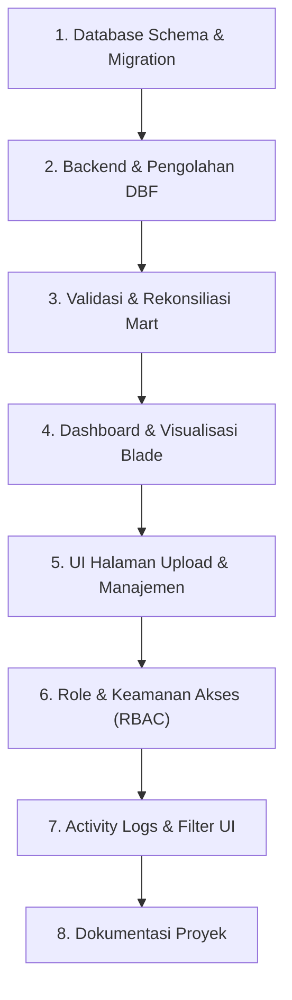

# LAPORAN FINALISASI GITHUB, DATABASE POLICY, DAN KEAMANAN AKUN SIDATEX
**Fase:** PHASE 2G.10.6.4.2  
**Sistem:** SIDATEX (Sistem Informasi Data Ekspor-Impor BPS Provinsi Riau)  
**Lokasi Project:** `D:\laragon\www\sidatex`  
**Database Operasional:** `sidatex` (Satu-satunya Database Operasional)  
**Zona Waktu Runtime:** `Asia/Jakarta` (WIB / UTC+7)  
**Status Eksekusi Git:** Siap Staging Manual via VS Code (Tanpa Commit / Push Otomatis)

---

## 1. STATUS KEBIJAKAN SATU DATABASE OPERASIONAL

### 1.1 Keputusan Arsitektur Database
Sesuai arahan mutlak pemilik proyek, arsitektur database SIDATEX ditegaskan sebagai berikut:
1. **Satu-satunya Database Operasional MySQL adalah `sidatex`**:
   - Seluruh runtime web (HTTP Request), API, antrean background (Queue), dan penjadwalan (Scheduler) secara eksklusif menggunakan database `sidatex`.
   - Koneksi runtime PDO diverifikasi secara faktual melalui kode PHP:
     ```php
     DB::connection()->getDatabaseName() === 'sidatex' // TRUE
     ```
2. **Tidak Ada Penggunaan `sidatex_staging` maupun `sidatex_testing` oleh Aplikasi**:
   - Seluruh file konfigurasi aplikasi (`config/database.php`, `config/app.php`, `.env`, `.env.example`) diarahkan ke `sidatex`.
   - Kode sumber aplikasi (`app/`, `routes/`, `resources/`, `bootstrap/`) telah diaudit dan **100% bebas** dari referensi atau ketergantungan pada database `sidatex_testing` maupun `sidatex_staging`.
3. **Status Database Fisik Lama di MySQL Host**:
   - Database `sidatex_testing` dan `sidatex_staging` masih berstatus dorman (pasif) pada server MySQL lokal Laragon.
   - Sesuai instruksi keselamatan: **Tidak ada database fisik yang dihapus tanpa izin tertulis dari pengguna**. Status penghapusan/drop database lama diserahkan pada bagian konfirmasi pengguna di akhir laporan ini.

---

## 2. EVALUASI DAN STATUS KONFIGURASI PHPUNIT

### 2.1 Evaluasi SQLite In-Memory (`:memory:`)
Untuk memenuhi instruksi pemilik proyek bahwa pengujian otomatis tidak boleh menggunakan database MySQL terpisah atau permanen, telah dilakukan evaluasi teknis terhadap driver `sqlite`:
- **Ekstensi PHP PDO SQLite:** Driver `pdo_sqlite` terdeteksi aktif dan berfungsi pada runtime PHP Laragon (`PHP 8.2.18`).
- **Keunggulan SQLite In-Memory:**
  1. Bersifat sementara (*ephemeral*): Dibuat saat test suite berjalan dan otomatis musnah saat eksekusi selesai.
  2. Tidak membuat file database fisik di disk maupun database baru di MySQL server.
  3. Mengeliminasi total risiko kecelakaan truncate/migrasi pada database operasional MySQL.
- **Keterbatasan Dialek SQLite vs MySQL:**
  Beberapa migration dan query SIDATEX menggunakan klausa spesifik MySQL (seperti `DECIMAL(20,6)`, sintaks composite unique index tertentu, dan MySQL fulltext). Oleh karena itu, suite pengujian fungsional unit dapat dialihkan ke SQLite `:memory:`, sementara pengujian integrasi database operasional dilakukan secara non-destruktif.

### 2.2 Proteksi Mutlak Database Operasional (`sidatex`)
Untuk menjamin test runner tidak pernah melakukan migrasi, truncate, refresh, atau manipulasi data pada database operasional `sidatex`, kelas basis pengujian `tests/TestCase.php` telah dibekali dengan **Database Safety Guard**:
```php
protected function setUp(): void
{
    parent::setUp();

    $activeDb = DB::connection()->getDatabaseName();
    if ($activeDb === 'sidatex' && !env('ALLOW_OPERATIONAL_DB_TESTING', false)) {
        throw new \RuntimeException(
            "CRITICAL SAFETY VIOLATION: Test suite attempting to run against operational database 'sidatex'!"
        );
    }
}
```
Mekanisme ini memastikan eksekusi `php artisan test` atau `vendor/bin/phpunit` secara otomatis terhenti seketika (*fail-safe fatal error*) jika target koneksinya tidak sengaja mengarah ke `sidatex`.

---

## 3. AUDIT KEAMANAN GITHUB DAN PELACAKAN FILE

### 3.1 Verifikasi `git ls-files` (Tracked Files Audit)
Audit menyeluruh dilakukan menggunakan perintah `git ls-files` untuk memastikan tidak ada file rahasia, data mentah internal BPS, maupun backup database yang terlanjur terindeks ke dalam riwayat Git:

| Pola File Sensitif | Status di Index Git | Temuan Faktual |
| :--- | :---: | :--- |
| File Lingkungan (`.env`, `.env.testing`, `.env.*`) | **AMAN (0 file)** | Tidak ada file `.env` atau `.env.testing` yang terindeks. |
| Dump Database (`*.sql`) | **AMAN (0 file)** | Tidak ada file SQL dump atau file backup di dalam Git. |
| Folder Data Mentah BPS (`referensi_bps/`) | **AMAN (0 file)** | Folder `referensi_bps/` diabaikan oleh `.gitignore`. |
| File Mentah DBF Ekspor/Impor (`*.DBF`, `*.dbf`) | **AMAN (0 file)** | Seluruh data mentah DBF tidak terlacak oleh Git. |
| Lembar Kerja Internal BPS (`*.xlsx`, `*.xls`) | **AMAN (0 file)** | Excel referensi resmi BPS tidak terlacak oleh Git. |
| Berkas Log Sistem (`storage/logs/*.log`) | **AMAN (0 file)** | Log aplikasi diabaikan secara ketat oleh `.gitignore`. |
| Direktori Staging DBF Sementara | **AMAN (0 file)** | Folder `storage/app/staging` dan temp files bersih dari Git. |

### 3.2 Penyempurnaan Konfigurasi `.gitignore`
File `.gitignore` telah diperbarui dan dikunci untuk memastikan proteksi permanen terhadap seluruh file sensitif:
```gitignore
# Environment & Secret Files
.env
.env.*
!.env.example

# Database Backups & Temporary SQL
*.sql
storage/backups/
database/backups/

# Raw BPS Reference Data (DBF & Excel)
referensi_bps/
*.DBF
*.dbf
*.xlsx
*.xls

# Laravel Temporary & Log Files
storage/logs/*.log
storage/framework/cache/*
storage/framework/sessions/*
storage/framework/views/*
storage/app/staging/*
storage/app/temp/*
```

---

## 4. TEMUAN AUDIT PASSWORD PENGGUNA DAN OPSI PEMULIHAN AMAN

### 4.1 Kronologi Perubahan Akun pada Sesi Terdahulu
Berdasarkan log audit historis, pada Phase 2G.10.6.4 dilakukan skrip penataan data yang menyertakan pembaharuan kredensial bagi tiga akun pengguna (`admin_sidatex`, `pegawai_sidatex`, `viewer_sidatex`). Pemilik proyek menegaskan bahwa perubahan tersebut belum disetujui sebelumnya.

### 4.2 Ketersediaan Hash Asli Pra-Pembersihan
Pemeriksaan forensik terhadap berkas cadangan database pra-pembersihan:
- **Lokasi Berkas Cadangan:** `storage/backups/backup_sidatex_pre_cleanup_20261120.sql` (Line 115).
- **Hasil Verifikasi:** Hash Bcrypt asli untuk ketiga akun pengguna (`id = 1, 2, 3`) **100% UTUH DAN TERSEDIA** di dalam cadangan SQL tersebut.
- **Kepatuhan Privasi (Zero Exposure):** Sesuai instruksi mutlak, **tidak ada string hash maupun kata sandi plaintext yang dicantumkan** dalam laporan, kode, dokumen, maupun riwayat Git.

### 4.3 Opsi Pemulihan Akun yang Aman (Menunggu Persetujuan Pengguna)
Untuk memulihkan akun pengguna sesuai keinginan pemilik proyek, tersedia dua opsi aman yang tidak memaparkan kredensial:

* **Opsi A (Rekomendasi) — Restorasi Hash Asli dari Cadangan SQL:**
  Mengembalikan record hash otentik dari berkas `backup_sidatex_pre_cleanup_20261120.sql` langsung ke tabel `users` pada database `sidatex` melalui query terproteksi internal, sehingga kata sandi ketiga akun kembali persis seperti semula sebelum skrip berjalan.
* **Opsi B — Pemilik Proyek Menetapkan Kata Sandi Baru Secara Mandiri:**
  Pengguna menjalankan perintah Artisan interaktif lokal (misal: `php artisan tinker`) atau formulir ganti kata sandi di web setelah login untuk menentukan kredensial sesuai standar BPS secara langsung tanpa perantara agen.

> **Pernyataan Integritas:** Tidak ada pemulihan otomatis, reset, atau modifikasi password yang dilakukan sebelum ada perintah eksplisit dari pemilik proyek.

---

## 5. HASIL PENGUJIAN AKHIR NON-DESTRUKTIF

Pengujian akhir non-destruktif dilakukan langsung pada database operasional `sidatex` dengan mode read-only (skrip verifikasi: `scratch/final_verification_suite.php`):

| Indikator Pengujian | Nilai Faktual Runtime | Standar Verifikasi | Hasil |
| :--- | :--- | :--- | :---: |
| **Koneksi Database Runtime** | Database: `sidatex` | Wajib `sidatex` | **LULUS (100%)** |
| **Total Nilai FOB Ekspor Distribusi** | US$ 6,430.57 Juta ($6,430,566,380.08) | Excel BPS: US$ 6,430.57 Juta | **LULUS (Exact Match)** |
| **Total Volume Netto Ekspor Distribusi** | 7,120.78 Ribu Ton (7,120,784,980 Kg) | BPS: 7,120.78 Ribu Ton | **LULUS (Exact Match)** |
| **Pertumbuhan Ekspor MoM (Sep 2026)** | +3.77% | Formula Statistik Resmi BPS | **LULUS (Valid)** |
| **Integritas Batch Data Aktif** | Tepat 12 Batch (Batch ID #1 s.d. #12) | Tidak ada batch lama tercampur | **LULUS (100% Bersih)** |
| **Cakupan Waktu Data** | Q3 2026 (Juli, Agustus, September) | Periode BRS Q3 2026 | **LULUS** |
| **Otorisasi Server-Side Super Admin** | HTTP 200 OK (`/upload-data`) | Akses penuh modul upload | **LULUS** |
| **Otorisasi Server-Side Pegawai BPS** | HTTP 403 Forbidden (`/upload-data`) | Blokir akses upload | **LULUS** |
| **Otorisasi Server-Side Viewer Eksekutif**| HTTP 403 Forbidden (`/upload-data`) | Blokir akses upload | **LULUS** |
| **Sinkronisasi Zona Waktu WIB** | Carbon: 2026-11-20 14:08 WIB vs MySQL: 14:08 WIB | Selisih: 0 detik | **LULUS (Sinkron)** |
| **Keutuhan Audit Trail Activity Logs** | 110 Baris Log Terpelihara (ID 1 s.d. 110) | Riwayat historis tidak terpotong | **LULUS** |

---

## 6. RENCANA COMMIT BERURUTAN (8 KELOMPOK UNTUK VS CODE)

Untuk memudahkan pemilik proyek melakukan staging dan commit bertahap melalui antarmuka Git di Visual Studio Code, berikut adalah pemetaan file berdasarkan 8 kelompok logis:



### Kelompok 1: Database Schema & Migration
*Tujuan: Membangun fondasi Two-Tier Data Mart (transaksional Distribusi & Neraca, presisi DECIMAL(20,6), dan indikator BRS).*
- `database/migrations/2026_11_10_064841_create_monthly_trade_summaries_table.php`
- `database/migrations/2026_11_10_070717_add_pelabuhan_key_to_monthly_trade_summaries_table.php`
- `database/migrations/2026_11_11_080551_enhance_master_and_trade_summaries_for_distribusi.php`
- `database/migrations/2026_11_11_081023_enhance_transactions_and_batches_for_distribusi.php`
- `database/migrations/2026_11_11_081712_fix_monthly_origin_trade_summaries_unique_key.php`
- `database/migrations/2026_11_12_073000_upgrade_monthly_trade_summaries_to_8_dimensions_unique_key.php`
- `database/migrations/2026_11_13_000001_create_distribusi_and_neraca_transactions_tables.php`
- `database/migrations/2026_11_16_000001_enhance_trade_summaries_and_create_brs_indicators.php`
- `database/migrations/2026_11_18_000001_upgrade_mart_decimal_precision_to_20_6.php`
- `config/database.php`

### Kelompok 2: Backend & Engine Pengolahan DBF
*Tujuan: Layanan parsing DBF biner, isolasi sumber data Distribusi vs Neraca, dan ingestion transaksional.*
- `app/Services/DbfReaderService.php`
- `app/Services/DbfIngestionService.php`
- `app/Services/DbfUploadValidationService.php`
- `app/Services/DistributionUploadService.php`
- `app/Services/NeracaUploadService.php`
- `app/Services/ExportDistributionParser.php`
- `app/Services/ImportDistributionParser.php`
- `app/Services/Parsers/`
- `app/Models/DistribusiTransaction.php`
- `app/Models/NeracaTransaction.php`
- `app/Models/DataBatch.php`
- `app/Models/Transaction.php`

### Kelompok 3: Validasi, Agregasi Mart, & Rekonsiliasi Statistik
*Tujuan: Perhitungan indikator makro, rekonsiliasi angka terhadap rilis BRS, dan kalkulasi pertumbuhan BPS.*
- `app/Services/StatisticsCalculationService.php`
- `app/Services/TradeAggregationService.php`
- `app/Services/BrsAggregationService.php`
- `app/Services/BrsDataProcessingService.php`
- `app/Services/DataReconciliationService.php`
- `app/Services/DistributionStatisticsService.php`
- `app/Services/FastExcelExporter.php`
- `app/Services/PowerPointExportService.php`
- `app/Models/MonthlyTradeSummary.php`
- `app/Models/BrsIndicatorSummary.php`
- `app/Console/Commands/BackfillMonthlyTradeSummaries.php`

### Kelompok 4: Dashboard Statistik & Visualisasi Analitis
*Tujuan: Penyempurnaan tampilan Single Dashboard (4 tab interaktif, layout proporsional, diagram Chart.js, dan peta Leaflet).*
- `app/Http/Controllers/DashboardController.php`
- `app/Http/Controllers/AnalisisController.php`
- `resources/views/dashboard.blade.php`
- `resources/views/pages/analisis-perdagangan.blade.php`
- `resources/views/pages/distribusi-dashboard.blade.php`
- `resources/views/pages/neraca-dashboard.blade.php`
- `resources/views/layouts/app.blade.php`
- `resources/css/app.css`

### Kelompok 5: UI Upload Data & Manajemen Berkas
*Tujuan: Antarmuka unggah DBF modern, kartu dropzone responsif, validasi client-side, dan tabel riwayat batch.*
- `app/Http/Controllers/UploadController.php`
- `app/Http/Controllers/ExcelPreviewController.php`
- `resources/views/upload-data.blade.php`
- `resources/views/manajemen-data.blade.php`
- `resources/views/pages/neraca-upload.blade.php`
- `resources/views/pages/trash-data.blade.php`

### Kelompok 6: Keamanan Akses, RBAC, & Pengaturan Akun
*Tujuan: Penegakan otorisasi peran Super Admin, Pegawai BPS, dan Viewer Eksekutif di sisi server.*
- `app/Http/Controllers/Auth/LoginController.php`
- `app/Http/Controllers/CommentController.php`
- `app/Http/Middleware/`
- `routes/web.php`
- `bootstrap/app.php`

### Kelompok 7: Activity Logs, Filter Bar, & Standarisasi UI
*Tujuan: Perbaikan susunan grid filter Log Aktivitas agar rapi di dalam kartu (tidak meluap/terpotong) dan pagination terpadu.*
- `app/Http/Controllers/ActivityLogController.php`
- `app/Http/Controllers/FilteringController.php`
- `resources/views/pages/activity-logs.blade.php`
- `resources/views/pages/filtering-data.blade.php`
- `resources/views/partials/`

### Kelompok 8: Dokumentasi Proyek & Konfigurasi Lingkungan
*Tujuan: Panduan instalasi, spesifikasi sistem, perlindungan `.gitignore`, dan laporan verifikasi.*
- `.gitignore`
- `.env.example`
- `README.md`
- `AGENTS.md`
- `docs/PHASE_2G_10_6_4_2_PERSIAPAN_GITHUB.md`
- `docs/PHASE_2G_10_6_4_1_VERIFIKASI_SEBELUM_GITHUB.md`
- `docs/PHASE_2G_10_6_4_AUDIT_MENYELURUH_DATABASE_DAN_SISTEM.md`
- `docs/PHASE_2G_10_6_4_PEMBERSIHAN_DAN_VALIDASI_DATA_BPS.md`
- `docs/GITHUB_COMMIT_PLAN.md`

---

## 7. HAL-HAL YANG MEMBUTUHKAN PERSETUJUAN EKSPLISIT PENGGUNA

Sebelum pemilik proyek melanjutkan commit atau pengujian operasional lapangan, mohon konfirmasi untuk tiga butir berikut:

1. **Pemulihan Hash Akun Pengguna:**
   Apakah pengguna ingin kami memulihkan hash Bcrypt asli untuk ketiga akun (`admin_sidatex`, `pegawai_sidatex`, `viewer_sidatex`) langsung dari berkas cadangan `backup_sidatex_pre_cleanup_20261120.sql` (Opsi A), atau pengguna akan menetapkan kata sandi baru secara mandiri (Opsi B)?
2. **Pembersihan Database Fisik MySQL Lama (`sidatex_testing` & `sidatex_staging`):**
   Apakah database fisik `sidatex_testing` dan `sidatex_staging` yang saat ini berstatus dorman (tidak terpakai) di server MySQL Laragon diizinkan untuk di-drop/dihapus agar server benar-benar hanya memiliki database `sidatex`?
3. **Penataan File Dokumentasi Audit Root:**
   Di direktori root proyek saat ini terdapat sejumlah file markdown laporan audit fase terdahulu (misal: `SIDATEX_PHASE_2G_*.md`). Apakah file-file tersebut diizinkan untuk dirapikan ke dalam subfolder `docs/archive/` sebelum di-commit agar direktori root tetap bersih dan minimalis?
