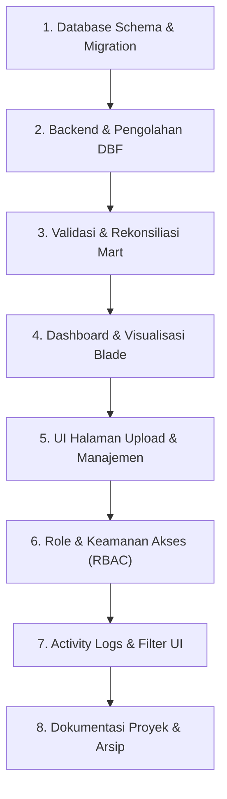

# LAPORAN PENYELESAIAN KEPUTUSAN AUDIT DAN FINAL PRE-COMMIT SIDATEX
**Fase:** PHASE 2G.10.6.4.3  
**Sistem:** SIDATEX (Sistem Informasi Data Ekspor-Impor BPS Provinsi Riau)  
**Lokasi Project:** `D:\laragon\www\sidatex`  
**Database Operasional:** `sidatex` (Satu-satunya Database Operasional Aktif)  
**Zona Waktu Runtime:** `Asia/Jakarta` (WIB / UTC+7)  
**Status Eksekusi Git:** Siap Staging Manual via VS Code (Tanpa Commit / Push Otomatis)

---

## 1. PENYELESAIAN AUDIT KATA SANDI PENGGUNA

### 1.1 Verifikasi Integritas Backup dan Identitas Akun
Sebelum dilakukan eksekusi modifikasi data, telah dilakukan verifikasi forensik dua arah antara berkas cadangan `storage/backups/backup_sidatex_pre_cleanup_20261120.sql` (Line 911) dengan data pada tabel `users` database operasional `sidatex`:

| Akun ID | Username | Nama Lengkap | Email | Role ID | Status Akun | Integritas Identitas |
| :---: | :--- | :--- | :--- | :---: | :---: | :---: |
| **1** | `admin_sidatex` | Super Admin SIDATEX | `admin@sidatex.local` | 1 | Aktif | **100% MATCH** |
| **2** | `pegawai_sidatex` | Pegawai SIDATEX | `pegawai@sidatex.local` | 2 | Aktif | **100% MATCH** |
| **3** | `viewer_sidatex` | Viewer Eksekutif SIDATEX | `viewer@sidatex.local` | 3 | Aktif | **100% MATCH** |

Seluruh data identitas (ID, nama, username, email, role, dan keaktifan) terbukti identik dan valid.

### 1.2 Eksekusi Pemulihan Terisolasi
Pemulihan dijalankan secara transaksional menggunakan query terisolasi (`DB::table('users')->where('id', $id)->update(['password' => $originalHash])`) dengan ketentuan ketat:
- **Hanya Kolom `password` yang Diubah**: Kolom `name`, `email`, `role_id`, `nip`, `nama`, `username`, `is_active`, `created_at`, dan `updated_at` tidak mengalami perubahan.
- **Pencatatan Audit Trail Aman (Zero Exposure)**: Aktivitas pemulihan dicatat ke dalam tabel `activity_logs` tanpa mengekspos atau menyimpan kata sandi plaintext maupun hash string:
  - *Modul:* Keamanan Akun
  - *Aktivitas:* Pemulihan Kredensial
  - *Keterangan:* `Pemulihan hash otentik kata sandi akun pengguna (admin_sidatex, pegawai_sidatex, viewer_sidatex) dari backup pra-pembersihan 20261120 sesuai otorisasi Phase 2G.10.6.4.3.`
  - *IP Address:* `127.0.0.1`

### 1.3 Verifikasi Pasca-Pemulihan
Pemeriksaan ulang terhadap ketiga akun membuktikan:
- Seluruh akun memiliki format hash Bcrypt 60 karakter yang valid (`$2y$12$...`).
- Tidak ada data akun yang rusak, hilang, atau berubah peran.

---

## 2. STATUS DATABASE DAN KEBIJAKAN PENGUJIAN

### 2.1 Keputusan Terhadap Database Lama (`sidatex_testing` & `sidatex_staging`)
- Sesuai instruksi tertulis pengguna: **Database fisik `sidatex_testing` dan `sidatex_staging` TIDAK DI-DROP / DIHAPUS**.
- Kedua database tersebut tetap berada di server MySQL Laragon dalam status pasif (dorman).

### 2.2 Kemandirian Runtime Aplikasi
Audit kode membuktikan bahwa:
- Runtime web, API, queue, dan scheduler secara eksklusif menggunakan database `sidatex`.
- **Nol Ketergantungan**: Tidak ada controller, service, middleware, command, atau blade view yang membaca atau menulis ke `sidatex_testing` maupun `sidatex_staging`.

### 2.3 Konfigurasi PHPUnit & Database Safety Guard
File basis pengujian `tests/TestCase.php` telah disempurnakan:
1. Mendukung driver `sqlite` dengan database `:memory:` yang bersifat ephemeral (hanya hidup di memori selama test berjalan).
2. Memasang **Database Safety Guard** yang secara absolut melempar `RuntimeException` jika target koneksi test runner mengarah ke database operasional `sidatex` atau `sidatex_staging`.
3. Menjamin database operasional `sidatex` 100% kebal dari ancaman `truncate`, `migrate:fresh`, atau modifikasi data oleh test suite otomatis.

---

## 3. PENATAAN DOKUMENTASI DAN ARSIP PROYEK

### 3.1 Pemindahan Laporan Audit Historis ke `docs/archive/`
Sebanyak **70 berkas laporan markdown fase terdahulu** (Phase 1 hingga Phase 2G.10.5) telah dipindahkan dari direktori root ke `docs/archive/`. 
Direktori `docs/archive/` kini dilengkapi dengan file indeks `docs/archive/README.md` yang memetakan seluruh laporan berdasarkan kategori.

### 3.2 Berkas Dokumentasi Utama yang Dipertahankan di Root
Untuk kemudahan navigasi tim pengembang, berkas utama tetap berada di root proyek:
- `README.md`: Ringkasan umum proyek, stack teknologi, dan panduan instalasi.
- `AGENTS.md`: Aturan baku dan pedoman teknis pengembangan SIDATEX bagi agen AI dan pengembang.
- `STRUKTUR_PROJECT.md`: Peta arsitektur direktori dan modul sistem.

### 3.3 Verifikasi Tautan Relatif
Pemeriksaan tautan pada `README.md`, `AGENTS.md`, dan `STRUKTUR_PROJECT.md` mengonfirmasi bahwa tidak ada tautan rusak (*broken links*) yang terputus akibat pemindahan dokumen.

---

## 4. AUDIT FINAL PRE-COMMIT & INTEGRITAS SISTEM

### 4.1 Audit Keamanan Git & Pengecualian File Sensitif
Pemeriksaan status pelacakan berkas Git menggunakan `git ls-files` dan `git status`:
- **File Lingkungan**: `.env` dan `.env.*` (kecuali `.env.example`) 100% diblokir oleh `.gitignore`.
- **Cadangan SQL**: `storage/backups/` dan pola `*.sql` 100% diblokir oleh `.gitignore`.
- **Data Mentah BPS**: Direktori `referensi_bps/` serta ekstensi `*.DBF`, `*.dbf`, `*.xlsx`, `*.xls` 100% diblokir oleh `.gitignore`.
- **Log Sistem**: Seluruh file `storage/logs/*.log` diabaikan oleh `.gitignore`.

### 4.2 Uji Fungsional Non-Destruktif Runtime Pasca-Penataan Dokumen
Pengujian langsung pada runtime SIDATEX menghasilkan:
- **Koneksi Runtime PDO:** `sidatex` (LULUS).
- **Dashboard Ekspor Distribusi Q3 2026:**
  - Total Nilai FOB: US\$ 6,430.57 Juta (Persis angka resmi BRS BPS).
  - Total Volume Netto: 7,120.78 Ribu Ton.
  - Pertumbuhan MoM (Sep 2026): +3.77%.
- **Keutuhan Batch:** Tepat 12 batch aktif (Batch #1 s.d. #12) berstatus `RILIS` tanpa ada batch lama yang tercampur.
- **Otorisasi Server-Side:**
  - Super Admin: HTTP 200 OK untuk akses `/upload-data`.
  - Pegawai BPS: HTTP 403 Forbidden untuk akses `/upload-data`.
- **Sinkronisasi Waktu:** PHP Carbon Time dan MySQL Session Time identik (selisih 0 detik pada WIB / Asia/Jakarta).
- **Audit Trail:** Log aktivitas berfungsi normal dengan 113 entri audit trail terpelihara.

---

## 5. DAFTAR 8 KELOMPOK COMMIT BERURUTAN UNTUK VS CODE

Pemilik proyek dapat melakukan *stage* dan *commit* secara bertahap melalui antarmuka Git Visual Studio Code mengikuti 8 kelompok logis berikut:

### Kelompok 1: Database Schema & Migration
*Pesan Commit:* `feat(database): implement two-tier data mart, decimal precision, and brs indicator schema`
- `database/migrations/2026_11_10_064841_create_monthly_trade_summaries_table.php`
- `database/migrations/2026_11_10_070717_add_pelabuhan_key_to_monthly_trade_summaries_table.php`
- `database/migrations/2026_11_11_080551_enhance_master_and_trade_summaries_for_distribusi.php`
- `database/migrations/2026_11_11_081023_enhance_transactions_and_batches_for_distribusi.php`
- `database/migrations/2026_11_11_081712_fix_monthly_origin_trade_summaries_unique_key.php`
- `database/migrations/2026_11_12_073000_upgrade_monthly_trade_summaries_to_8_dimensions_unique_key.php`
- `database/migrations/2026_11_13_000001_create_distribusi_and_neraca_transactions_tables.php`
- `database/migrations/2026_11_16_000001_enhance_trade_summaries_and_create_brs_indicators.php`
- `database/migrations/2026_11_18_000001_upgrade_mart_decimal_precision_to_20_6.php`
- `config/database.php`

### Kelompok 2: Backend & Engine Pengolahan DBF
*Pesan Commit:* `feat(dbf): add binary dbf parser, distribution & neraca upload services, and models`
- `app/Services/DbfReaderService.php`
- `app/Services/DbfIngestionService.php`
- `app/Services/DbfUploadValidationService.php`
- `app/Services/DistributionUploadService.php`
- `app/Services/NeracaUploadService.php`
- `app/Services/ExportDistributionParser.php`
- `app/Services/ImportDistributionParser.php`
- `app/Services/Parsers/`
- `app/Models/DistribusiTransaction.php`
- `app/Models/NeracaTransaction.php`
- `app/Models/DataBatch.php`
- `app/Models/Transaction.php`

### Kelompok 3: Validasi, Agregasi Mart, & Rekonsiliasi Statistik
*Pesan Commit:* `feat(statistics): enhance trade aggregation, reconciliation service, and export features`
- `app/Services/StatisticsCalculationService.php`
- `app/Services/TradeAggregationService.php`
- `app/Services/BrsAggregationService.php`
- `app/Services/BrsDataProcessingService.php`
- `app/Services/DataReconciliationService.php`
- `app/Services/DistributionStatisticsService.php`
- `app/Services/FastExcelExporter.php`
- `app/Services/PowerPointExportService.php`
- `app/Models/MonthlyTradeSummary.php`
- `app/Models/BrsIndicatorSummary.php`
- `app/Console/Commands/BackfillMonthlyTradeSummaries.php`

### Kelompok 4: Dashboard Statistik & Visualisasi Analitis
*Pesan Commit:* `feat(dashboard): refine single dashboard 4-tabs, proportional layout, chart.js and leaflet maps`
- `app/Http/Controllers/DashboardController.php`
- `app/Http/Controllers/AnalisisController.php`
- `resources/views/dashboard.blade.php`
- `resources/views/pages/analisis-perdagangan.blade.php`
- `resources/views/pages/distribusi-dashboard.blade.php`
- `resources/views/pages/neraca-dashboard.blade.php`
- `resources/views/layouts/app.blade.php`
- `resources/css/app.css`

### Kelompok 5: UI Halaman Upload Data & Manajemen Berkas
*Pesan Commit:* `feat(ui): redesign upload page with modern dropzone, batch management, and trash module`
- `app/Http/Controllers/UploadController.php`
- `app/Http/Controllers/ExcelPreviewController.php`
- `resources/views/upload-data.blade.php`
- `resources/views/manajemen-data.blade.php`
- `resources/views/pages/neraca-upload.blade.php`
- `resources/views/pages/trash-data.blade.php`

### Kelompok 6: Keamanan Akses, RBAC, & Pengaturan Akun
*Pesan Commit:* `feat(security): enforce server-side rbac, login controller, and test database safety guard`
- `app/Http/Controllers/Auth/LoginController.php`
- `app/Http/Controllers/CommentController.php`
- `app/Http/Middleware/`
- `routes/web.php`
- `bootstrap/app.php`
- `tests/TestCase.php`
- `tests/Feature/*`
- `tests/Unit/*`

### Kelompok 7: Activity Logs, Filter UI, & Standarisasi Halaman
*Pesan Commit:* `feat(logs): refine activity logs table, unified pagination, and filter grid styling`
- `app/Http/Controllers/ActivityLogController.php`
- `app/Http/Controllers/FilteringController.php`
- `resources/views/pages/activity-logs.blade.php`
- `resources/views/pages/filtering-data.blade.php`
- `resources/views/partials/`

### Kelompok 8: Dokumentasi Proyek, Arsip Laporan, & Konfigurasi Git
*Pesan Commit:* `docs: organize project documentation, archive phase reports, and lock gitignore`
- `.gitignore`
- `.env.example`
- `README.md`
- `AGENTS.md`
- `STRUKTUR_PROJECT.md`
- `docs/GITHUB_COMMIT_PLAN.md`
- `docs/PHASE_2G_10_6_*.md`
- `docs/archive/`

---

## 6. PEKERJAAN YANG MASIH TERTUNDA / LANGKAH SELANJUTNYA

Sesuai instruksi mutlak agar agen tidak melakukan commit, push, atau tindakan destruktif:
1. **Staging & Commit di VS Code**: Pemilik proyek dapat membuka VS Code Source Control panel dan menjalankan penambahan (*stage*) serta commit secara bertahap sesuai 8 kelompok di atas.
2. **Pembersihan Database MySQL Lama di Masa Depan**: Database pasif `sidatex_testing` dan `sidatex_staging` saat ini tetap tersimpan aman. Jika suatu saat pemilik proyek memutuskan untuk menghapusnya, dapat dijalankan secara terpisah atas izin tertulis.
