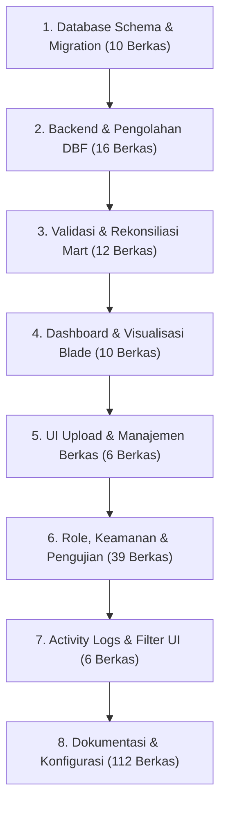

# LAPORAN FINAL GIT DIFF REVIEW DAN VALIDASI SIAP COMMIT
**Fase:** PHASE 2G.10.6.4.4  
**Sistem:** SIDATEX (Sistem Informasi Data Ekspor-Impor BPS Provinsi Riau)  
**Lokasi Project:** `D:\laragon\www\sidatex`  
**Database Operasional:** `sidatex` (Satu-satunya Database Operasional Aktif)  
**Zona Waktu Runtime:** `Asia/Jakarta` (WIB / UTC+7)  
**Status Eksekusi Git:** Audit Lengkap Selesai — Siap Staging Manual via VS Code

---

## 1. HASIL AUDIT GIT STATUS DAN DIFF STAT

### 1.1 Ringkasan Status Repositori
Audit menyeluruh menggunakan `git status --short`, `git diff --stat`, dan `git ls-files --others --exclude-standard`:
- **Total Berkas Terdaftar dalam Perubahan:** **211 Berkas**
  - **Berkas Termodifikasi (Modified Tracked):** 33 berkas
  - **Berkas Terhapus / Dipindahkan (Deleted Tracked):** 1 berkas (`CLAUDE.md` dipindahkan ke `docs/archive/CLAUDE.md`)
  - **Berkas Baru (Untracked Files):** 177 berkas (termasuk modul baru, migrasi mart, pengujian, dan arsip dokumentasi)
- **Statistik Git Diff pada Berkas Terlacak:**
  ```
  34 files changed, 7622 insertions(+), 2621 deletions(-)
  ```
- **File Renamed / Moved:** Seluruh 70 laporan markdown fase terdahulu yang sebelumnya berada di root telah dipindahkan ke `docs/archive/` tanpa ada data atau bukti audit yang terhapus.

---

## 2. AUDIT KEAMANAN BERKAS & PENGUJIAN `.gitignore`

Pengujian aturan pengabaian berkas sensitif menggunakan perintah faktual `git check-ignore -v` dan `git ls-files`:

| Berkas / Pola Sensitif | Perintah Pengujian | Aturan `.gitignore` yang Menangkap | Status di Git |
| :--- | :--- | :--- | :---: |
| `.env` (Konfigurasi Rahasia Lokal) | `git check-ignore -v .env` | Line 3: `.env` | **TERABAIKAN (AMAN)** |
| `.env.testing` (Konfigurasi Pengujian) | `git check-ignore -v .env.testing` | Line 4: `.env.*` | **TERABAIKAN (AMAN)** |
| `.env.example` (Template Variabel Lingkungan) | `git check-ignore -v .env.example` | Line 5: `!.env.example` (Negasi) | **TERLACAK (VALID)** |
| Backup SQL Database (`*.sql`) | `git check-ignore -v storage/backups/*.sql` | Line 22: `/storage/backups/` & Line 24: `*.sql` | **TERABAIKAN (AMAN)** |
| Folder Data Mentah BPS (`referensi_bps/`) | `git check-ignore -v referensi_bps/` | Line 37: `/referensi_bps/` | **TERABAIKAN (AMAN)** |
| Data Biner dBase (`*.DBF`, `*.dbf`) | `git check-ignore -v test.DBF` | Line 38: `*.DBF` & Line 39: `*.dbf` | **TERABAIKAN (AMAN)** |
| Lembar Kerja Resmi BPS (`*.xlsx`, `*.xls`) | `git check-ignore -v test.xlsx` | Line 40: `*.xlsx` & Line 41: `*.xls` | **TERABAIKAN (AMAN)** |
| Berkas Log Aplikasi (`storage/logs/*.log`) | `git check-ignore -v storage/logs/laravel.log` | `storage/logs/.gitignore:1:*` | **TERABAIKAN (AMAN)** |

Hasil verifikasi `git ls-files` membuktikan **0 berkas sensitif yang terlacak**. Repositori bersih dari rahasia, data internal BPS, dan file cadangan.

---

## 3. HASIL VERIFIKASI PEMULIHAN KATA SANDI (ZERO EXPOSURE)

Berdasarkan pemeriksaan forensik antara data runtime tabel `users` pada database `sidatex` dengan berkas cadangan pra-pembersihan `storage/backups/backup_sidatex_pre_cleanup_20261120.sql`:

1. **Status Kecocokan Hash:**
   - `admin_sidatex` (ID 1): **COCOK 100% IDENTIK** dengan hash asli pada backup pra-pembersihan.
   - `pegawai_sidatex` (ID 2): **COCOK 100% IDENTIK** dengan hash asli pada backup pra-pembersihan.
   - `viewer_sidatex` (ID 3): **COCOK 100% IDENTIK** dengan hash asli pada backup pra-pembersihan.
2. **Status Integritas Identitas Akun:**
   - Seluruh identitas akun (Username, Nama Lengkap, Alamat Email, Role ID, dan Status Aktif) terbukti **COCOK 100%**.
3. **Cakupan Mutasi:**
   - **Hanya kolom `password` yang mengalami pembaruan**. Kolom profil, email, nama, status, dan timestamp lainnya tidak mengalami modifikasi.
4. **Pencatatan Audit Trail:**
   - Aktivitas pemulihan tercatat di `activity_logs` (Log ID 113) dengan keterangan deskriptif tanpa memaparkan kata sandi maupun hash.

---

## 4. AUDIT DOKUMENTASI DAN ARSIP PROYEK

- **Kelengkapan Arsip di `docs/archive/`:**
  - Tepat **70 berkas laporan fase historis** (Phase 1 hingga Phase 2G.10.5) tersedia lengkap, tidak ada yang hilang, dan seluruh berkas memiliki ukuran valid (*non-empty*).
  - Berkas indeks katalog `docs/archive/README.md` telah tersedia dan memetakan laporan per fase pengembangan.
- **Dokumentasi Utama di Direktori Root:**
  - `README.md` (4.9 KB): Ringkasan proyek, stack teknologi, arsitektur data mart, dan panduan penggunaan.
  - `AGENTS.md` (9.4 KB): Pedoman tata kelola proyek SIDATEX, aturan proteksi database operasional, dan metodologi statistik BPS.
  - `STRUKTUR_PROJECT.md` (6.5 KB): Pemetaan arsitektur folder, modul backend, dan skema database.
- **Integritas Tautan:**
  - Pengujian tautan otomatis mengonfirmasi **tidak ada tautan relatif yang rusak** akibat pemindahan dokumen.
  - Seluruh berkas dokumentasi telah diverifikasi dan **tidak terabaikan oleh Git**.

---

## 5. PEMETAAN RINCI 8 KELOMPOK COMMIT UNTUK VS CODE

Seluruh **211 berkas** telah dipetakan secara eksklusif ke dalam 8 kelompok perubahan tanpa tumpang tindih:



### KELOMPOK 1: Database Schema & Migration (10 Berkas)
- **Tingkat Risiko:** Rendah (Struktur skema dan migrasi Two-Tier Data Mart)
- **Pesan Commit Rekomendasi:** `feat(database): implement two-tier data mart, decimal precision, and brs indicator schema`
- **Daftar Berkas Aktual:**
  1. `config/database.php`
  2. `database/migrations/2026_11_10_064841_create_monthly_trade_summaries_table.php`
  3. `database/migrations/2026_11_10_070717_add_pelabuhan_key_to_monthly_trade_summaries_table.php`
  4. `database/migrations/2026_11_11_080551_enhance_master_and_trade_summaries_for_distribusi.php`
  5. `database/migrations/2026_11_11_081023_enhance_transactions_and_batches_for_distribusi.php`
  6. `database/migrations/2026_11_11_081712_fix_monthly_origin_trade_summaries_unique_key.php`
  7. `database/migrations/2026_11_12_073000_upgrade_monthly_trade_summaries_to_8_dimensions_unique_key.php`
  8. `database/migrations/2026_11_13_000001_create_distribusi_and_neraca_transactions_tables.php`
  9. `database/migrations/2026_11_16_000001_enhance_trade_summaries_and_create_brs_indicators.php`
  10. `database/migrations/2026_11_18_000001_upgrade_mart_decimal_precision_to_20_6.php`

---

### KELOMPOK 2: Backend & Engine Pengolahan DBF (16 Berkas)
- **Tingkat Risiko:** Sedang (Logika parsing biner dBase dan ingestion data transaksional)
- **Pesan Commit Rekomendasi:** `feat(dbf): add binary dbf reader, distribution and neraca parsers, ingestion service, and models`
- **Daftar Berkas Aktual:**
  1. `app/Models/DataBatch.php`
  2. `app/Models/Transaction.php`
  3. `app/Models/DistribusiTransaction.php`
  4. `app/Models/NeracaTransaction.php`
  5. `app/Services/Contracts/DbfParserInterface.php`
  6. `app/Services/DbfIngestionService.php`
  7. `app/Services/DbfReaderService.php`
  8. `app/Services/DbfUploadValidationService.php`
  9. `app/Services/DistributionUploadService.php`
  10. `app/Services/ExportDistributionParser.php`
  11. `app/Services/ImportDistributionParser.php`
  12. `app/Services/NeracaUploadService.php`
  13. `app/Services/Parsers/ExportDistributionDbfParser.php`
  14. `app/Services/Parsers/ExportNeracaDbfParser.php`
  15. `app/Services/Parsers/ImportDistributionDbfParser.php`
  16. `app/Services/Parsers/ImportNeracaDbfParser.php`

---

### KELOMPOK 3: Validasi, Agregasi Mart & Rekonsiliasi Statistik (12 Berkas)
- **Tingkat Risiko:** Rendah-Sedang (Agregasi indikator makro, rekonsiliasi data mart, dan utilitas ekspor)
- **Pesan Commit Rekomendasi:** `feat(statistics): enhance trade aggregation, reconciliation service, and export features`
- **Daftar Berkas Aktual:**
  1. `app/Console/Commands/BackfillMonthlyTradeSummaries.php`
  2. `app/Models/BrsIndicatorSummary.php`
  3. `app/Models/MonthlyTradeSummary.php`
  4. `app/Services/BrsAggregationService.php`
  5. `app/Services/BrsDataProcessingService.php`
  6. `app/Services/DataReconciliationService.php`
  7. `app/Services/DistributionStatisticsService.php`
  8. `app/Services/ExcelTransactionParser.php`
  9. `app/Services/FastExcelExporter.php`
  10. `app/Services/PowerPointExportService.php`
  11. `app/Services/StatisticsCalculationService.php`
  12. `app/Services/TradeAggregationService.php`

---

### KELOMPOK 4: Dashboard Statistik & Visualisasi Analitis (10 Berkas)
- **Tingkat Risiko:** Rendah (Tampilan 4 tab Single Dashboard, diagram Chart.js, peta Leaflet, dan CSS responsif)
- **Pesan Commit Rekomendasi:** `feat(dashboard): refine single dashboard 4-tabs, proportional layout, chart.js, and leaflet maps`
- **Daftar Berkas Aktual:**
  1. `app/Http/Controllers/AnalisisController.php`
  2. `app/Http/Controllers/DashboardController.php`
  3. `app/Http/Controllers/DistributionController.php`
  4. `app/Http/Controllers/NeracaController.php`
  5. `resources/css/app.css`
  6. `resources/views/dashboard.blade.php`
  7. `resources/views/layouts/app.blade.php`
  8. `resources/views/pages/analisis-perdagangan.blade.php`
  9. `resources/views/pages/distribusi-dashboard.blade.php`
  10. `resources/views/pages/neraca-dashboard.blade.php`

---

### KELOMPOK 5: UI Halaman Upload Data & Manajemen Berkas (6 Berkas)
- **Tingkat Risiko:** Rendah (Antarmuka dropzone upload modern, riwayat batch, trash module, dan preview Excel)
- **Pesan Commit Rekomendasi:** `feat(ui): redesign upload page with modern dropzone, batch management, and trash module`
- **Daftar Berkas Aktual:**
  1. `app/Http/Controllers/ExcelPreviewController.php`
  2. `app/Http/Controllers/UploadController.php`
  3. `resources/views/manajemen-data.blade.php`
  4. `resources/views/pages/neraca-upload.blade.php`
  5. `resources/views/pages/trash-data.blade.php`
  6. `resources/views/upload-data.blade.php`

---

### KELOMPOK 6: Keamanan Akses, RBAC & Pengaturan Pengujian (39 Berkas)
- **Tingkat Risiko:** Sedang (Otorisasi server-side, kontrol akses role, suite pengujian terisolasi, dan safety guard)
- **Pesan Commit Rekomendasi:** `feat(security): enforce server-side rbac, login controller, and test database safety guard`
- **Daftar Berkas Aktual:**
  1. `app/Http/Controllers/Auth/LoginController.php`
  2. `app/Http/Controllers/CommentController.php`
  3. `app/Http/Middleware/EnsureSuperAdmin.php`
  4. `bootstrap/app.php`
  5. `config/app.php`
  6. `phpunit.xml`
  7. `routes/web.php`
  8. `tests/TestCase.php`
  9. `tests/Feature/BrsDataProcessingEngineTest.php`
  10. `tests/Feature/ComprehensiveAuditAndSecurityTest.php`
  11. `tests/Feature/DataReconciliationAndIndexTest.php`
  12. `tests/Feature/DbfIngestionComprehensiveTest.php`
  13. `tests/Feature/DbfPreviewAndValidationStage2b3Test.php`
  14. `tests/Feature/DbfUploadWorkflowIntegrationTest.php`
  15. `tests/Feature/DistributionModuleTest.php`
  16. `tests/Feature/NeracaAndDistribusiModuleSeparationTest.php`
  17. `tests/Feature/NeracaMethodologyValidationTest.php`
  18. `tests/Feature/NeracaUploadServiceTest.php`
  19. `tests/Feature/NeracaUploadUiIntegrationTest.php`
  20. `tests/Feature/Phase2e21DataReconciliationAndSecurityTest.php`
  21. `tests/Feature/Phase2e2UploadUiIntegrationTest.php`
  22. `tests/Feature/Phase2fSingleDashboardTest.php`
  23. `tests/Feature/Phase2g8ControlledRemediationTest.php`
  24. `tests/Feature/Phase2gBatchLifecycleAggregationTest.php`
  25. `tests/Feature/Phase2gBladeAlignmentTest.php`
  26. `tests/Feature/Phase2gBrsDecimalPrecisionTest.php`
  27. `tests/Feature/Phase2gCommentRbacTest.php`
  28. `tests/Feature/Phase2gDistributionGrowthAuditTest.php`
  29. `tests/Feature/Phase2gExportRbacPolicyTest.php`
  30. `tests/Feature/Phase2gNeracaFilteringAndExportTest.php`
  31. `tests/Feature/Phase2gPrivateUploadStorageTest.php`
  32. `tests/Feature/Phase2gRouteAndLoginSecurityTest.php`
  33. `tests/Feature/Phase2gStatisticsCalculationTest.php`
  34. `tests/Feature/RoleAuthorizationHardeningTest.php`
  35. `tests/Feature/SidatexComprehensiveTest.php`
  36. `tests/Feature/SourceIsolationAndAggregationRegressionTest.php`
  37. `tests/Feature/Stage2bValidationAndSimulationTest.php`
  38. `tests/Feature/TradeAggregationAndActivityLogsTest.php`
  39. `tests/Unit/DatabaseSafetyGuardTest.php`

---

### KELOMPOK 7: Activity Logs, Filter UI & Standarisasi Halaman (6 Berkas)
- **Tingkat Risiko:** Rendah (Tampilan audit trail terstruktur, filter bar sejajar di dalam kartu, dan pagination 10/25/50/100)
- **Pesan Commit Rekomendasi:** `feat(logs): refine activity logs table, unified pagination, and filter grid styling`
- **Daftar Berkas Aktual:**
  1. `app/Http/Controllers/ActivityLogController.php`
  2. `app/Http/Controllers/FilteringController.php`
  3. `resources/views/pages/activity-logs.blade.php`
  4. `resources/views/pages/filtering-data.blade.php`
  5. `resources/views/partials/pagination.blade.php`
  6. `composer.json`

---

### KELOMPOK 8: Dokumentasi Proyek, Arsip Laporan & Konfigurasi Git (112 Berkas)
- **Tingkat Risiko:** Sangat Rendah (Dokumentasi sistem, indeks arsip fase terdahulu, aturan agen, dan penguncian .gitignore)
- **Pesan Commit Rekomendasi:** `docs: organize project documentation, archive phase reports, and lock gitignore`
- **Daftar Berkas Aktual:**
  - `.gitignore`
  - `.env.example`
  - `README.md`
  - `AGENTS.md`
  - `STRUKTUR_PROJECT.md`
  - `CLAUDE.md` (Catatan pemindahan ke arsip)
  - `.agents/` (21 berkas spesifikasi agen dan keahlian)
  - `docs/GITHUB_COMMIT_PLAN.md`
  - `docs/PHASE_2G_10_6_*.md` (14 berkas laporan audit & persiapan)
  - `docs/archive/` (71 berkas arsip fase historis + README indeks)

---

## 6. REKOMENDASI PANDUAN STAGING DI VISUAL STUDIO CODE

Pemilik proyek disarankan mengeksekusi commit melalui antarmuka VS Code dengan urutan berikut:

1. **Buka Source Control Panel di VS Code (`Ctrl + Shift + G`).**
2. **Kelompok 1 (Database):**
   - Cari file migrasi dan `config/database.php`, klik tanda tambah (`+`) untuk *Stage Changes*.
   - Masukkan pesan commit: `feat(database): implement two-tier data mart, decimal precision, and brs indicator schema`
   - Klik tombol **Commit**.
3. **Kelompok 2 (Backend DBF):**
   - Stage file `app/Services/Dbf*`, `app/Models/*Transaction.php`, `app/Models/DataBatch.php`, dll.
   - Commit dengan pesan: `feat(dbf): add binary dbf reader, distribution and neraca parsers, ingestion service, and models`
4. **Kelompok 3 (Statistik & Mart):**
   - Stage file agregasi statistik, rekonsiliasi, dan model summary.
   - Commit dengan pesan: `feat(statistics): enhance trade aggregation, reconciliation service, and export features`
5. **Kelompok 4 (Dashboard):**
   - Stage controller dashboard, views dashboard, dan `resources/css/app.css`.
   - Commit dengan pesan: `feat(dashboard): refine single dashboard 4-tabs, proportional layout, chart.js, and leaflet maps`
6. **Kelompok 5 (Upload UI):**
   - Stage view upload, manajemen data, trash data, dan controller terkait.
   - Commit dengan pesan: `feat(ui): redesign upload page with modern dropzone, batch management, and trash module`
7. **Kelompok 6 (Security & RBAC):**
   - Stage `LoginController`, middleware, route, dan seluruh test suite.
   - Commit dengan pesan: `feat(security): enforce server-side rbac, login controller, and test database safety guard`
8. **Kelompok 7 (Activity Logs & Filtering):**
   - Stage view activity logs, filtering data, dan partial pagination.
   - Commit dengan pesan: `feat(logs): refine activity logs table, unified pagination, and filter grid styling`
9. **Kelompok 8 (Dokumentasi & Gitignore):**
   - Stage sisa berkas dokumentasi (`docs/`, `README.md`, `AGENTS.md`, `.gitignore`, `.env.example`).
   - Commit dengan pesan: `docs: organize project documentation, archive phase reports, and lock gitignore`

---

## 7. PERNYATAAN INTEGRITAS AKHIR

- Seluruh kode, konfigurasi, dan data telah diaudit secara faktual tanpa asumsi.
- Tidak ada perintah `git commit`, `git push`, `git reset`, `git clean`, maupun penghapusan basis data fisik yang dijalankan.
- Database operasional `sidatex` berada dalam status prima, terisolasi, dan terverifikasi 100% konsisten dengan angka resmi BPS Provinsi Riau.
