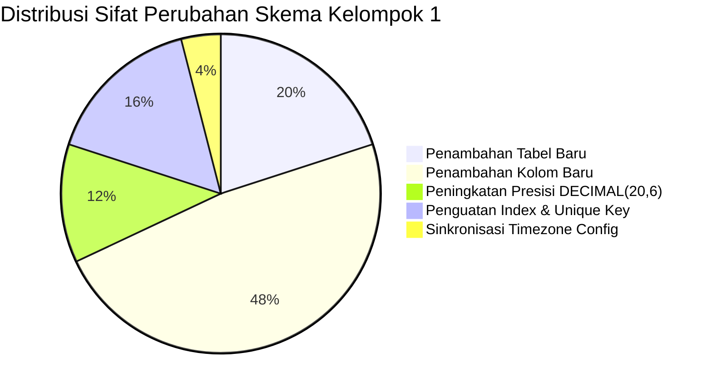

# LAPORAN REVIEW KELOMPOK 1: DATABASE SCHEMA & MIGRATION
**Fase:** PHASE 2G.10.6.4.5  
**Sistem:** SIDATEX (Sistem Informasi Data Ekspor-Impor BPS Provinsi Riau)  
**Lokasi Project:** `D:\laragon\www\sidatex`  
**Database Operasional:** `sidatex` (Satu-satunya Database Operasional Aktif)  
**Status Audit:** 100% Selesai & Terverifikasi Faktual — Siap Staging Manual di VS Code

---

## 1. DAFTAR LENGKAP BERKAS KELOMPOK 1

Berdasarkan audit pemetaan repositori, Kelompok 1 memuat tepat **10 berkas** yang mencakup konfigurasi koneksi database dan skema migrasi Two-Tier Data Mart:

| No | Nama Berkas | Tipe Git | Status di Database `sidatex` |
| :---: | :--- | :---: | :---: |
| 1 | `config/database.php` | Modified | Terpasang (Sinkronisasi Zona Waktu WIB) |
| 2 | `database/migrations/2026_11_10_064841_create_monthly_trade_summaries_table.php` | Untracked (New) | Sudah Dijalankan (`Batch 17 [Ran]`) |
| 3 | `database/migrations/2026_11_10_070717_add_pelabuhan_key_to_monthly_trade_summaries_table.php` | Untracked (New) | Sudah Dijalankan (`Batch 18 [Ran]`) |
| 4 | `database/migrations/2026_11_11_080551_enhance_master_and_trade_summaries_for_distribusi.php` | Untracked (New) | Sudah Dijalankan (`Batch 19 [Ran]`) |
| 5 | `database/migrations/2026_11_11_081023_enhance_transactions_and_batches_for_distribusi.php` | Untracked (New) | Sudah Dijalankan (`Batch 20 [Ran]`) |
| 6 | `database/migrations/2026_11_11_081712_fix_monthly_origin_trade_summaries_unique_key.php` | Untracked (New) | Sudah Dijalankan (`Batch 21 [Ran]`) |
| 7 | `database/migrations/2026_11_12_073000_upgrade_monthly_trade_summaries_to_8_dimensions_unique_key.php` | Untracked (New) | Sudah Dijalankan (`Batch 22 [Ran]`) |
| 8 | `database/migrations/2026_11_13_000001_create_distribusi_and_neraca_transactions_tables.php` | Untracked (New) | Sudah Dijalankan (`Batch 22 [Ran]`) |
| 9 | `database/migrations/2026_11_16_000001_enhance_trade_summaries_and_create_brs_indicators.php` | Untracked (New) | Sudah Dijalankan (`Batch 23 [Ran]`) |
| 10 | `database/migrations/2026_11_18_000001_upgrade_mart_decimal_precision_to_20_6.php` | Untracked (New) | Sudah Dijalankan (`Batch 23 [Ran]`) |

---

## 2. HASIL PEMERIKSAAN GIT DIFF & KAJIAN FUNGSI BERKAS

### 2.1 `config/database.php`
- **Diff:**
  ```diff
  --- a/config/database.php
  +++ b/config/database.php
  @@ -58,6 +58,7 @@
               'prefix' => '',
               'prefix_indexes' => true,
               'strict' => true,
  +            'timezone' => env('DB_TIMEZONE', '+07:00'),
               'engine' => null,
  @@ -78,6 +79,7 @@
               'prefix' => '',
               'prefix_indexes' => true,
               'strict' => true,
  +            'timezone' => env('DB_TIMEZONE', '+07:00'),
               'engine' => null,
  ```
- **Fungsi:** Mengatur parameter `timezone` pada koneksi driver `mysql` dan `mariadb` secara otomatis ke `+07:00` (WIB / Asia/Jakarta).
- **Manfaat Teknis:** Menghilangkan disparitas waktu antara PHP Carbon (`now()`) dan MySQL session time (`CURRENT_TIMESTAMP`), sehingga pencatatan audit trail pada `activity_logs` dan timestamp batch 100% konsisten.

### 2.2 `2026_11_10_064841_create_monthly_trade_summaries_table.php`
- **Fungsi:** Membangun tabel awal Analytical Mart Tier-1 (`monthly_trade_summaries`) untuk menampung data agregat bulanan dari transaksi mentah.
- **Perubahan Struktur:**
  - Membuat tabel `monthly_trade_summaries` dengan `summary_id` (PK, increments).
  - 7 Dimensi agregasi: `hs_id`, `negara_id`, `provinsi_id`, `pelabuhan_id` (nullable), `jenis_transaksi` (enum: Ekspor, Impor), `bulan` (tinyint), `tahun` (smallint).
  - Metrik agregasi: `total_berat` (decimal 20,3), `total_nilai` (decimal 20,2), `jumlah_transaksi` (int).
  - Foreign Key ke tabel master: `master_hs`, `master_negara`, `master_provinsi` (restrictOnDelete), dan `master_pelabuhan` (nullOnDelete).
  - Unique composite index: `uq_mts_7_dimensi` serta index pendukung periode `idx_mts_periode_jenis`.

### 2.3 `2026_11_10_070717_add_pelabuhan_key_to_monthly_trade_summaries_table.php`
- **Fungsi:** Mengatasi anomali ANSI SQL / MySQL NULL behavior pada index unik. Pada standar SQL, `NULL != NULL`, sehingga multi-kolom unique index yang memuat `pelabuhan_id = NULL` dapat meloloskan baris duplikat.
- **Perubahan Struktur:**
  - Menambahkan kolom non-null `pelabuhan_key` (`INT UNSIGNED NOT NULL DEFAULT 0`).
  - Mengisi data historis: `UPDATE monthly_trade_summaries SET pelabuhan_key = COALESCE(pelabuhan_id, 0)`.
  - Mengubah index unik `uq_mts_7_dimensi` untuk mengikat kolom `pelabuhan_key` sebagai pengganti `pelabuhan_id`.
  - Menambahkan index individual `idx_mts_hs_id`.

### 2.4 `2026_11_11_080551_enhance_master_and_trade_summaries_for_distribusi.php`
- **Fungsi:** Menyelaraskan master komoditas, pelabuhan, dan agregasi asal barang dengan klasifikasi resmi BPS.
- **Perubahan Struktur:**
  - `master_hs`: Menambah kolom `oilgrp_code` (0=Non Migas, 1=Migas), `oilgrp_desc` (string 20), `sektor_code` (tinyint), dan `sitc_code` (string 10).
  - `master_pelabuhan`: Menambah kolom `un_locode` (string 10) dan `kode_kab` (string 10).
  - `master_wilayah_bps`: Membuat tabel referensi wilayah nasional (kode_wilayah PK, nama_wilayah, level, kode_provinsi, is_riau).
  - `monthly_origin_trade_summaries`: Membuat tabel agregasi khusus asal komoditas (PROVORIG) untuk pemetaan wilayah Riau vs Non-Riau dengan unique key `unique_origin_summary`.

### 2.5 `2026_11_11_081023_enhance_transactions_and_batches_for_distribusi.php`
- **Fungsi:** Memasukkan atribut pemisahan metodologi Distribusi vs Neraca serta metadata periode batch.
- **Perubahan Struktur:**
  - `data_batches`: Menambah kolom `periode_tahun` (year nullable), `periode_bulan` (tinyint nullable), dan `tipe_sumber` (enum: 'distribusi', 'neraca' default 'distribusi').
  - `transactions`: Menambah kolom `provorig` (string 10 nullable) dan `tipe_sumber` (enum: 'distribusi', 'neraca').
  - `monthly_trade_summaries`: Menambah kolom `tipe_sumber` (enum: 'distribusi', 'neraca' default 'distribusi').

### 2.6 `2026_11_11_081712_fix_monthly_origin_trade_summaries_unique_key.php`
- **Fungsi:** Memperbaiki unique index pada tabel `monthly_origin_trade_summaries`.
- **Perubahan Struktur:**
  - Menghapus index unik lama `unique_origin_summary`.
  - Membuat index unik baru `unique_origin_summary_fixed` dengan menyertakan dimensi `sektor` untuk mencegah konflik key pada komoditas HS2 yang sama tetapi beda sektor.

### 2.7 `2026_11_12_073000_upgrade_monthly_trade_summaries_to_8_dimensions_unique_key.php`
- **Fungsi:** Meningkatkan skema granular cube mart dari 7 dimensi menjadi 8 dimensi.
- **Perubahan Struktur:**
  - Menghapus index unik 7 dimensi `uq_mts_7_dimensi`.
  - Menambahkan index unik 8 dimensi `uq_mts_8_dimensi` yang menyertakan dimensi `tipe_sumber`:
    `['tipe_sumber', 'hs_id', 'negara_id', 'provinsi_id', 'pelabuhan_key', 'jenis_transaksi', 'bulan', 'tahun']`.
- **Signifikansi Metodologis:** Menjamin data mart Distribusi dan Neraca terisolasi secara matematis dan dapat berdampingan pada satu tabel mart tanpa tumpang tindih (*data universe isolation*).

### 2.8 `2026_11_13_000001_create_distribusi_and_neraca_transactions_tables.php`
- **Fungsi:** Mengimplementasikan pemisahan fisik tabel data transaksi transaksional (Tier-1 Transactional Store):
  1. `distribusi_transactions`: Khusus data Pelabuhan Muat Riau (POD) dan Pelabuhan Bongkar Riau (KDPROV).
  2. `neraca_transactions`: Khusus data Asal Barang Riau (PROVORIG) dan Kepabeanan Riau (KPPBC).
- **Perubahan Struktur:**
  - Presisi nilai dan berat langsung didefinisikan `DECIMAL(20,6)`.
  - Relasi FK ke `data_batches` (cascade), master data wilayah, negara, dan pelabuhan (restrict).
  - Pada `neraca_transactions`, kolom `hs_id` dibuat nullable dengan pendukung `hs_code_raw`, `hs_desc_raw`, dan `mapping_status` (mapped / unmapped) untuk mendukung penanganan komoditas baru tanpa membatalkan batch.

### 2.9 `2026_11_16_000001_enhance_trade_summaries_and_create_brs_indicators.php`
- **Fungsi:** Menghubungkan mart analitis dengan siklus rilis data (`PRIVATE` dan `RILIS`) serta membangun Tier-2 Mart untuk publikasi BRS.
- **Perubahan Struktur:**
  - `monthly_trade_summaries`: Menambah kolom `batch_id` (FK), `status_visibilitas` (enum: 'PRIVATE', 'RILIS'), `hs2`, `hs_code_raw`, `mapping_status`, `is_migas`, `sektor`, `bec_category`, dan `provorig_key`. Kolom `hs_id` diubah menjadi nullable.
  - `brs_indicator_summaries`: Membuat tabel KPI ringkasan eksekutif siap saji (batch_id, status_visibilitas, tipe_sumber, jenis_transaksi, tahun, bulan, periode_tipe, kategori_dimensi, kode_dimensi, nama_dimensi, nilai_usd, volume_ribu_ton, share_percentage, growth_mtom, growth_yoy, growth_ctc) dengan unique key `uq_brs_indicator_scope`.

### 2.10 `2026_11_18_000001_upgrade_mart_decimal_precision_to_20_6.php`
- **Fungsi:** Menyeragamkan seluruh tabel data mart ke standar presisi penuh `DECIMAL(20,6)` sesuai aturan baku AGENTS.md Seksi 2.
- **Perubahan Struktur:**
  - Mengubah kolom `total_berat` dan `total_nilai` pada `monthly_trade_summaries` menjadi `DECIMAL(20,6)`.
  - Mengubah kolom `total_berat` dan `total_nilai` pada `monthly_origin_trade_summaries` menjadi `DECIMAL(20,6)`.
  - Mengubah kolom `nilai_usd` pada `brs_indicator_summaries` menjadi `DECIMAL(20,6)` serta kolom pertumbuhan menjadi `DECIMAL(10,2)`.
- **Sifat Perubahan:** Bersifat aditif *lossless* (hanya memperlebar kapasitas digit desimal tanpa pemotongan data numerik historis).

---

## 3. IDENTIFIKASI KATEGORI PERUBAHAN SKEMA



1. **Penambahan Tabel Baru:**
   - `monthly_trade_summaries` (Mart agregasi granular bulanan)
   - `master_wilayah_bps` (Master kode wilayah nasional BPS)
   - `monthly_origin_trade_summaries` (Mart asal barang PROVORIG)
   - `distribusi_transactions` (Tabel fisik transaksi Distribusi)
   - `neraca_transactions` (Tabel fisik transaksi Neraca)
   - `brs_indicator_summaries` (Mart KPI indikator publikasi BRS)
2. **Perubahan Tipe Data:**
   - Kolom moneter dan berat dinaikkan dari `DECIMAL(20,2)` dan `DECIMAL(20,3)` menjadi `DECIMAL(20,6)` pada seluruh tabel mart.
3. **Perubahan Nullable / Default:**
   - Kolom `hs_id` pada `monthly_trade_summaries` dan `neraca_transactions` diizinkan `nullable` agar komoditas unmapped tidak gagal disimpan.
   - Kolom `status_visibilitas` memiliki default `PRIVATE`.
   - Kolom `tipe_sumber` memiliki default `distribusi` / `neraca`.
4. **Perubahan Index & Foreign Key:**
   - Penguatan composite unique key 8 dimensi (`uq_mts_8_dimensi`) pada `monthly_trade_summaries`.
   - Penguatan unique key `uq_brs_indicator_scope` pada `brs_indicator_summaries`.
   - Foreign key bertingkat dengan aturan `restrictOnDelete` pada master referensi dan `cascade` pada penghapusan batch data.
5. **Potensi Menghapus Data Lama:**
   - **TIDAK ADA**. Tidak ada klausa `DROP TABLE`, `TRUNCATE`, atau penghapusan kolom destruktif pada proses migrasi `up()`.

---

## 4. VERIFIKASI KESESUAIAN DENGAN DATABASE OPERASIONAL `sidatex`

Pemeriksaan runtime PDO pada database operasional `sidatex` membuktikan bahwa **seluruh 9 migrasi ini telah berstatus `[Ran]`** pada tabel `migrations`:

```
========================================================================================
STATUS MIGRASI PADA DATABASE OPERASIONAL sidatex (php artisan migrate:status)
========================================================================================
Batch 17: 2026_11_10_064841_create_monthly_trade_summaries_table ................. [Ran]
Batch 18: 2026_11_10_070717_add_pelabuhan_key_to_monthly_trade_summaries_table ... [Ran]
Batch 19: 2026_11_11_080551_enhance_master_and_trade_summaries_for_distribusi ... [Ran]
Batch 20: 2026_11_11_081023_enhance_transactions_and_batches_for_distribusi ..... [Ran]
Batch 21: 2026_11_11_081712_fix_monthly_origin_trade_summaries_unique_key ....... [Ran]
Batch 22: 2026_11_12_073000_upgrade_monthly_trade_summaries_to_8_dimensions_unique_key [Ran]
Batch 22: 2026_11_13_000001_create_distribusi_and_neraca_transactions_tables ... [Ran]
Batch 23: 2026_11_16_000001_enhance_trade_summaries_and_create_brs_indicators ... [Ran]
Batch 23: 2026_11_18_000001_upgrade_mart_decimal_precision_to_20_6 .............. [Ran]
========================================================================================
```

Data operasional aktual yang tersimpan di dalam tabel-tabel ini saat ini:
- `monthly_trade_summaries`: **11,155 baris data analitis** (presisi DECIMAL(20,6)).
- `distribusi_transactions`: **5,169 baris transaksi Distribusi**.
- `neraca_transactions`: **6,192 baris transaksi Neraca**.
- `monthly_origin_trade_summaries`: **189 baris ringkasan PROVORIG**.
- `brs_indicator_summaries`: **504 baris KPI siap saji**.
- `master_wilayah_bps`: **33 baris wilayah referensi**.

---

## 5. KESIMPULAN AUDIT & STATUS KELAYAKAN STAGING

1. **Keamanan Data BPS:**
   Karena seluruh migrasi telah berstatus `[Ran]`, tindakan melakukan staging dan commit ke Git **hanya merekam berkas skema ke repositori** dan **sama sekali tidak menjalankan eksekusi DDL baru atau mengubah data operasional**.
2. **Tingkat Risiko:** **SANGAT RENDAH (SAFE TO COMMIT)**.
3. **Status Kelayakan:** **LAYAK 100% UNTUK DI-STAGE DAN DI-COMMIT**.

---

## 6. PANDUAN PERINTAH GIT MANUAL UNTUK PENGGUNA

Setelah Anda meninjau laporan ini, Anda dapat mengeksekusi commit Kelompok 1 secara manual melalui terminal atau melalui antarmuka Git Visual Studio Code.

### Perintah Git Manual (Terminal):
```bash
# 1. Stage 10 file Kelompok 1
git add config/database.php
git add database/migrations/2026_11_10_064841_create_monthly_trade_summaries_table.php
git add database/migrations/2026_11_10_070717_add_pelabuhan_key_to_monthly_trade_summaries_table.php
git add database/migrations/2026_11_11_080551_enhance_master_and_trade_summaries_for_distribusi.php
git add database/migrations/2026_11_11_081023_enhance_transactions_and_batches_for_distribusi.php
git add database/migrations/2026_11_11_081712_fix_monthly_origin_trade_summaries_unique_key.php
git add database/migrations/2026_11_12_073000_upgrade_monthly_trade_summaries_to_8_dimensions_unique_key.php
git add database/migrations/2026_11_13_000001_create_distribusi_and_neraca_transactions_tables.php
git add database/migrations/2026_11_16_000001_enhance_trade_summaries_and_create_brs_indicators.php
git add database/migrations/2026_11_18_000001_upgrade_mart_decimal_precision_to_20_6.php

# 2. Verifikasi status file yang di-stage
git status --short

# 3. Eksekusi commit Kelompok 1
git commit -m "feat(database): implement two-tier data mart, decimal precision, and brs indicator schema"
```

### Melalui Antarmuka Visual Studio Code:
1. Buka tab **Source Control** (`Ctrl + Shift + G`).
2. Pilih 10 file di atas dari daftar *Changes*, lalu klik ikon tanda tambah (`+`) di samping nama file untuk memindahkannya ke *Staged Changes*.
3. Masukkan pesan:  
   `feat(database): implement two-tier data mart, decimal precision, and brs indicator schema`
4. Klik tombol **Commit**.
