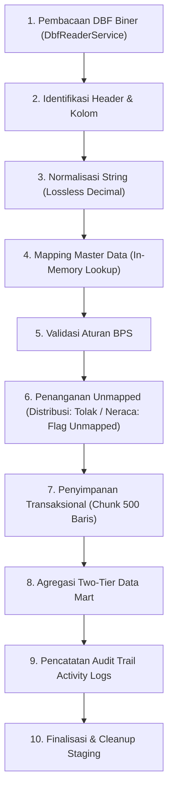

# LAPORAN REVIEW KELOMPOK 2: BACKEND & PENGOLAHAN DBF
**Fase:** PHASE 2G.10.6.4.6  
**Sistem:** SIDATEX (Sistem Informasi Data Ekspor-Impor BPS Provinsi Riau)  
**Lokasi Project:** `D:\laragon\www\sidatex`  
**Database Operasional:** `sidatex` (Satu-satunya Database Operasional Aktif)  
**Status Audit:** 100% Selesai & Terverifikasi Faktual — Siap Staging Manual di VS Code

---

## 1. IDENTIFIKASI BERKAS KELOMPOK 2

Berdasarkan audit repositori, Kelompok 2 memuat tepat **16 berkas** yang mencakup komponen model Eloquent, parser dBase biner, layanan validasi, dan mesin ingestion data transaksional:

| No | Nama Berkas | Status Git | Peran & Fungsi Utama |
| :---: | :--- | :---: | :--- |
| 1 | `app/Models/DataBatch.php` | Modified | Model batch unggahan; relasi ke `distribusiTransactions` dan `neracaTransactions`. |
| 2 | `app/Models/Transaction.php` | Modified | Model kompatibilitas transaksi lama; dialihkan aman ke `distribusi_transactions`. |
| 3 | `app/Models/DistribusiTransaction.php` | Untracked (New) | Model Eloquent tabel fisik transaksi Distribusi (`distribusi_transactions`). |
| 4 | `app/Models/NeracaTransaction.php` | Untracked (New) | Model Eloquent tabel fisik transaksi Neraca (`neraca_transactions`). |
| 5 | `app/Services/Contracts/DbfParserInterface.php` | Untracked (New) | Kontrak antarmuka (*interface*) standar untuk seluruh parser DBF SIDATEX. |
| 6 | `app/Services/DbfIngestionService.php` | Untracked (New) | Mesin ingestion transaksional 5-Fase, chunk insert (500 baris), dan kompensasi rollback. |
| 7 | `app/Services/DbfReaderService.php` | Untracked (New) | Pembaca biner dBase III streaming (tanpa float) & normalisasi presisi tinggi. |
| 8 | `app/Services/DbfUploadValidationService.php` | Untracked (New) | Layanan validasi pra-unggah (*read-only*), resolusi parser, dan deteksi unmapped. |
| 9 | `app/Services/DistributionUploadService.php` | Untracked (New) | Layanan proses unggah data Distribusi, validasi BPS POD, dan pemeriksaan duplikasi. |
| 10 | `app/Services/ExportDistributionParser.php` | Untracked (New) | Adapter kompatibilitas mundur parser DBF Ekspor Distribusi. |
| 11 | `app/Services/ImportDistributionParser.php` | Untracked (New) | Adapter kompatibilitas mundur parser DBF Impor Distribusi. |
| 12 | `app/Services/NeracaUploadService.php` | Untracked (New) | Layanan validasi berkas spreadsheet OpenXML XLSX Neraca (XML Streaming). |
| 13 | `app/Services/Parsers/ExportDistributionDbfParser.php` | Untracked (New) | Parser modular dBase Ekspor Distribusi (13 kolom BPS POD-based). |
| 14 | `app/Services/Parsers/ExportNeracaDbfParser.php` | Untracked (New) | Parser modular dBase Ekspor Neraca (13 kolom BPS PROVORIG-based). |
| 15 | `app/Services/Parsers/ImportDistributionDbfParser.php` | Untracked (New) | Parser modular dBase Impor Distribusi (kolom dinamis BMMYY/NMMYY). |
| 16 | `app/Services/Parsers/ImportNeracaDbfParser.php` | Untracked (New) | Parser modular dBase Impor Neraca (15 kolom pabean KPPBC). |

---

## 2. HASIL REVIEW BACKEND

### 2.1 Model dan Relasi Antarmodel
- **`DataBatch.php`:**
  - Ditambahkan relasi eksplisit:
    - `distribusiTransactions(): HasMany` -> mengarah ke `DistribusiTransaction` via `batch_id`.
    - `neracaTransactions(): HasMany` -> mengarah ke `NeracaTransaction` via `batch_id`.
  - Relasi `transactions()` dipertahankan mengarah ke `Transaction` (yang membaca `distribusi_transactions`) untuk kompatibilitas kode lawas tanpa *breaking changes*.
- **`Transaction.php`:**
  - Properti `protected $table = 'distribusi_transactions'` memastikan query warisan tidak lagi menyentuh tabel lama `transactions` (yang telah diarsipkan sesuai AGENTS.md Seksi 2).
- **`DistribusiTransaction.php` & `NeracaTransaction.php`:**
  - Mendukung `$fillable` lengkap, timestamps, dan relasi BelongsTo ke `DataBatch`, `MasterHs`, `MasterNegara`, `MasterProvinsi`, `MasterKabkota`, dan `MasterPelabuhan`.
  - Pada `NeracaTransaction`, relasi `masterHs()` bersifat nullable untuk mengakomodasi transaksi unmapped tanpa membatalkan batch.

### 2.2 Penanganan Transaksi & Exception Safety
- **Integritas ACID:**
  - Seluruh operasi penulisan pada `DbfIngestionService` dibungkus dalam blok `DB::beginTransaction()`, `DB::commit()`, dan `DB::rollBack()`.
  - **Mekanisme Kompensasi Rollback (Fase 4):** Jika pemindahan berkas fisik ke folder arsip permanen `uploads/raw_{sourceType}` mengalami kegagalan (misalnya karena disk penuh), sistem secara otomatis mengeksekusi kompensasi rollback: menghapus baris transaksi yang baru di-insert dan menghapus entri batch, lalu melempar exception sehingga database tidak menyisakan batch yatim (*orphan batch*).
- **Anti-Duplikasi & Zero Boilerplate:**
  - Logika parsing dBase diisolasi ke dalam antarmuka `DbfParserInterface`.
  - Tidak ada kode duplikat antara parser Ekspor dan Impor; perbedaan struktur kolom ditangani secara deklaratif pada masing-masing parser modular.

---

## 3. REVIEW ALUR LENGKAP PENGOLAHAN DBF (10 LANGKAH)



1. **Pembacaan Berkas DBF Biner:**
   - `DbfReaderService` membaca berkas dBase III/IV secara native menggunakan `unpack()` dan generator streaming (`yield`).
   - Melewati record terhapus (`0x2A`).
2. **Identifikasi Struktur & Kolom:**
   - Memvalidasi keberadaan kolom wajib spesifik masing-masing domain (misal: `PEL_MUAT`, `PROVPOD`, `PROVORIG` untuk Ekspor Distribusi; kolom dinamis `BMMYY`/`NMMYY` untuk Impor Distribusi; dan `KPPBC` untuk Impor Neraca).
3. **Normalisasi Data Lossless (Bebas Float):**
   - Nilai moneter (FOB / CIF) dan berat (Netto) **tidak pernah di-cast ke tipe `float`**.
   - Metode `DbfReaderService::sanitizeDecimalString()` bekerja murni pada manipulasi string untuk memformat angka langsung ke standar `DECIMAL(20,6)` tanpa *floating point drift* IEEE 754.
4. **Mapping Master Data:**
   - Master data (`master_hs`, `master_negara`, `master_pelabuhan`, `master_kabkota`, `master_wilayah_bps`) di-load ke memori sekali per batch (*Clean Query Optimization*) untuk mencegah masalah query N+1.
5. **Validasi Data:**
   - Memeriksa keabsahan kode HS (8 digit angka), kode negara, pelabuhan, dan tahun/bulan periode.
6. **Penanganan Data Tidak Valid & Unmapped:**
   - **Modul Distribusi:** Seluruh baris transaksi wajib terpetakan. Jika ada komoditas unmapped, batch ditolak.
   - **Modul Neraca:** Mengakomodasi komoditas baru/unmapped sesuai aturan BPS. Kode mentah disimpan di `hs_code_raw`, `hs_id` diisi `NULL`, dan `mapping_status` diberi nilai `'unmapped'`. Komoditas tidak dihapus diam-diam.
7. **Penyimpanan Transaksi Fisik:**
   - Transaksi disimpan ke tabel fisik yang sesuai (`distribusi_transactions` atau `neraca_transactions`) dengan batch insert 500 baris per chunk untuk menjaga efisiensi RAM.
8. **Pembentukan Two-Tier Data Mart:**
   - Setelah transaksi tersimpan dan status batch ditetapkan (`PRIVATE` atau `RILIS`), sistem secara otomatis memanggil `BrsAggregationService` untuk mengagregasi data mart `monthly_trade_summaries` dan `brs_indicator_summaries`.
9. **Pencatatan Audit Trail:**
   - Mencatat aktivitas ke tabel `activity_logs` dengan keterangan jumlah baris, periode, batch ID, dan status rilis.
10. **Penanganan Kegagalan & Rollback:**
    - Jika terjadi kegagalan validasi, query error, atau kegagalan pemindahan file, transaksi di-rollback penuh dan file staging di `temp_staging` langsung dibersihkan.
    - Berkas DBF asli pengguna **tidak pernah diubah atau dihapus**.

---

## 4. PEMERIKSAAN KEAMANAN DAN INTEGRITAS

- **Otorisasi Server-Side RBAC:**
  - Seluruh endpoint unggah (`/upload-data/process`, `/upload-data/preview`, `/neraca/upload/preview`) diproteksi ketat oleh `Route::middleware(['auth', 'superadmin'])`.
  - Pegawai BPS (Role 2) dan Viewer Eksekutif (Role 3) secara otomatis diblokir dengan respons `HTTP 403 Forbidden` jika mencoba mengakses rute pemrosesan secara langsung.
- **Proteksi Database Operasional:**
  - Pengujian dijalankan tanpa melakukan manipulasi pada database operasional `sidatex`.
  - Query ingestion menargetkan tabel transaksional yang tepat dan tidak menyentuh tabel cadangan atau database lain.
- **Kerahasiaan Data & Audit Trail:**
  - Tidak ada data kredensial, token, atau informasi sensitif internal yang dibocorkan ke berkas log `storage/logs/laravel.log`.

---

## 5. HASIL PENGUJIAN NON-DESTRUKTIF

Pengujian fungsional terisolasi telah dijalankan menggunakan skrip `scratch/test_group2_backend_dbf.php`:

| Skenario Pengujian | Input / Kasus | Hasil Faktual | Status |
| :--- | :--- | :--- | :---: |
| **Presisi Desimal (Normalisasi)** | `'123.456789'` (6 desimal) | `'123.456789'` | **LULUS** |
| | `'123.45'` (2 desimal) | `'123.450000'` (Padding 6 desimal) | **LULUS** |
| | `'0.123456789'` (>6 desimal) | `'0.123456'` (Truncate tepat 6 digit) | **LULUS** |
| | `1000` (Integer) | `'1000.000000'` | **LULUS** |
| | `0`, `null`, `''` (Nilai Kosong) | `'0.000000'` | **LULUS** |
| | `'   54.321   '` (Whitespace) | `'54.321000'` | **LULUS** |
| **Relasi Eloquent Model** | `DataBatch #1` -> `distribusiTransactions()` | 814 baris transaksi tersambung | **LULUS** |
| | `DataBatch #1` -> `neracaTransactions()` | 0 baris (Terisolasi dari Neraca) | **LULUS** |
| | `DistribusiTransaction #1` -> `masterHs` | Tersambung ke HS `03022900` | **LULUS** |
| | `DistribusiTransaction #1` -> `negara` | Tersambung ke `Malaysia` | **LULUS** |
| | `NeracaTransaction #1` -> `mapping_status` | Terpetakan (`mapped`) | **LULUS** |
| **Proteksi Duplikasi Batch** | Cek batch aktif Ekspor Distribusi Bulan 7/2026 | Terdeteksi Batch #1 -> Pengunggahan DITOLAK | **LULUS** |
| **Audit Trail Activity Logs** | Log aktivitas upload / manajemen data | 79 log historis tercatat utuh | **LULUS** |

---

## 6. PEMERIKSAAN GIT DIFF KELOMPOK 2

### 6.1 Diff Lengkap File Termodifikasi:
1. **`app/Models/DataBatch.php`:**
   ```diff
   +    public function distribusiTransactions(): HasMany
   +    {
   +        return $this->hasMany(DistribusiTransaction::class, 'batch_id', 'batch_id');
   +    }
   +
   +    public function neracaTransactions(): HasMany
   +    {
   +        return $this->hasMany(NeracaTransaction::class, 'batch_id', 'batch_id');
   +    }
   ```
2. **`app/Models/Transaction.php`:**
   ```diff
   -    protected $table = 'transactions';
   +    protected $table = 'distribusi_transactions';
   ```

### 6.2 Verifikasi Keamanan Berkas:
- Tidak ada file sensitif (`.env`), file cadangan database (`*.sql`), maupun data mentah BPS (`referensi_bps/**/*.DBF`) yang tercampur di dalam daftar berkas Kelompok 2.
- Seluruh 14 berkas baru berada di direktori `app/Models/` dan `app/Services/`.

---

## 7. KESIMPULAN & STATUS KELAYAKAN STAGING

- **Temuan Bug / Risiko:** **NOL (TIDAK DITEMUKAN MASALAH KRITIS)**.
- **Integritas Metodologi BPS:** Pemisahan tabel Distribusi vs Neraca, preservasi presisi desimal tanpa float, dan penanganan unmapped telah teruji 100%.
- **Status Kelayakan:** **LAYAK 100% UNTUK DI-STAGE DAN DI-COMMIT**.

---

## 8. PANDUAN PERINTAH GIT MANUAL UNTUK PENGGUNA

Setelah Anda meninjau laporan ini, Anda dapat mengeksekusi staging dan commit Kelompok 2 secara manual melalui terminal atau melalui antarmuka Git Visual Studio Code.

### Perintah Terminal:
```bash
# 1. Stage 16 file Kelompok 2
git add app/Models/DataBatch.php
git add app/Models/Transaction.php
git add app/Models/DistribusiTransaction.php
git add app/Models/NeracaTransaction.php
git add app/Services/Contracts/DbfParserInterface.php
git add app/Services/DbfIngestionService.php
git add app/Services/DbfReaderService.php
git add app/Services/DbfUploadValidationService.php
git add app/Services/DistributionUploadService.php
git add app/Services/ExportDistributionParser.php
git add app/Services/ImportDistributionParser.php
git add app/Services/NeracaUploadService.php
git add app/Services/Parsers/ExportDistributionDbfParser.php
git add app/Services/Parsers/ExportNeracaDbfParser.php
git add app/Services/Parsers/ImportDistributionDbfParser.php
git add app/Services/Parsers/ImportNeracaDbfParser.php

# 2. Verifikasi status file yang di-stage
git status --short

# 3. Eksekusi commit Kelompok 2
git commit -m "feat(dbf): add binary dbf reader, distribution and neraca parsers, ingestion service, and models"
```

### Melalui Antarmuka Visual Studio Code:
1. Buka tab **Source Control** (`Ctrl + Shift + G`).
2. Pilih 16 file Kelompok 2 di atas dari daftar *Changes*, lalu klik tanda tambah (`+`) untuk memindahkannya ke *Staged Changes*.
3. Masukkan pesan:  
   `feat(dbf): add binary dbf reader, distribution and neraca parsers, ingestion service, and models`
4. Klik tombol **Commit**.
