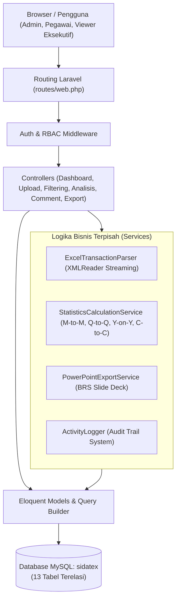
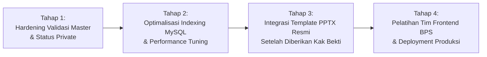

# LAPORAN ANALISIS PROJECT SIDATEX
## SISTEM INFORMASI DATA EKSPOR-IMPOR BADAN PUSAT STATISTIK (BPS) PROVINSI RIAU
**Nomor Dokumen**: LAP-SIDATEX/BPS-14/2026/XI-01-REV1  
**Tanggal Evaluasi**: 5 November 2026  
**Klasifikasi**: Internal Kedinasan BPS Provinsi Riau  
**Penilai / Tim Penguji**: Tim Pengembang & Audit Teknis Sistem Informasi  
**Pihak Terkait Utama**: 
- **Bu Fitri Hariyanti** (Ketua Tim Statistik Distribusi BPS Provinsi Riau)
- **Kak Bekti & Kak Hanifah** (Tim Teknis Statistik Ekspor-Impor BPS Provinsi Riau)

---

## RINGKASAN KEPUTUSAN HASIL KONFIRMASI BPS

Laporan evaluasi ini telah disesuaikan secara menyeluruh dengan hasil konfirmasi dan keputusan resmi pihak BPS Provinsi Riau (Bu Fitri Hariyanti, Kak Bekti, dan Kak Hanifah). Seluruh topik yang sebelumnya ditandai `[PERLU KONFIRMASI]` kini telah memiliki status final:

| No | Topik Operasional | Keputusan Resmi BPS | Status Audit | Dampak Teknis Terhadap Sistem |
| :---: | :--- | :--- | :---: | :--- |
| **1** | **Template PowerPoint BRS** | **Masih Menunggu File Resmi**: Tidak boleh membuat asumsi desain/susunan slide. Menunggu file resmi diserahkan oleh Kak Bekti. | `MENUNGGU TEMPLATE RESMI` | Fitur ekspor PPTX siap secara fungsional (`phppresentation`), integrasi desain menunggu berkas master resmi dari PIC Kak Bekti. |
| **2** | **Retensi Data Trash** | **Disimpan Permanen Tanpa Batas Waktu**: Tidak ada batas hari simpan dan tidak ada auto-delete. Data hanya dihapus permanen oleh Super Admin jika disetujui. | `SUDAH DIKONFIRMASI` | Database dan scheduler dipastikan tidak memiliki query pembersihan otomatis. Seluruh rekaman batch di tabel `trash` dijamin aman permanen. |
| **3** | **Prosedur Koreksi Data Pasca Rilis & Status Data** | **Koreksi Melalui File Excel Sumber & Upload Ulang**: Tidak ada edit langsung pada database transaksi rilis. Status `PENDING` diganti resmi menjadi `PRIVATE`. | `SUDAH DIKONFIRMASI` | Status data terstandarisasi: `DRAFT`, `PRIVATE`, `NON-RILIS`, dan `RILIS/PUBLIC`. Data `PRIVATE` hanya dapat diakses oleh Super Admin dan Viewer Eksekutif (terisolasi mutlak dari Pegawai). |
| **4** | **Penanganan Referensi Master Data Tidak Ditemukan** | **Data Wajib Ditolak & Diberikan Notifikasi Rinci**: Kode HS atau Negara yang tidak terdaftar di master data langsung ditolak (tidak boleh lolos). Sistem menampilkan alert nomor baris dan kode bermasalah. | `SUDAH DIKONFIRMASI` | Parser streaming tidak lagi menerapkan toleransi fallback kode unmapped. Sistem menyajikan daftar rincian baris yang ditolak kepada Super Admin. |

---

## DAFTAR ISI

1. [BAB I: Ringkasan Kondisi Project Saat Ini](#bab-i-ringkasan-kondisi-project-saat-ini)
2. [BAB II: Teknologi yang Digunakan](#bab-ii-teknologi-yang-digunakan)
3. [BAB III: Modul yang Sudah Tersedia](#bab-iii-modul-yang-sudah-tersedia)
4. [BAB IV: Modul yang Sudah Berjalan Penuh](#bab-iv-modul-yang-sudah-berjalan-penuh)
5. [BAB V: Modul yang Belum Selesai / Masih Parsial](#bab-v-modul-yang-belum-selesai--masih-parsial)
6. [BAB VI: Modul yang Belum Tersedia (Identifikasi Gap Kebutuhan Operasional)](#bab-vi-modul-yang-belum-tersedia-identifikasi-gap-kebutuhan-operasional)
7. [BAB VII: Kesesuaian Project dengan Kebutuhan PRD (Gap-Fit Analysis)](#bab-vii-kesesuaian-project-dengan-kebutuhan-prd-gap-fit-analysis)
8. [BAB VIII: Ketidaksesuaian yang Ditemukan (Discrepancy & Technical Risk)](#bab-viii-ketidaksesuaian-yang-ditemukan-discrepancy--technical-risk)
9. [BAB IX: Keputusan Hasil Konfirmasi BPS](#bab-ix-keputusan-hasil-konfirmasi-bps)
10. [BAB X: Rekomendasi Tahapan Pengembangan Selanjutnya](#bab-x-rekomendasi-tahapan-pengembangan-selanjutnya)

---

## BAB I: RINGKASAN KONDISI PROJECT SAAT INI

### 1.1. Status Arsitektur Sistem
Sistem Informasi Data Ekspor-Impor BPS Provinsi Riau (**SIDATEX**) dibangun di atas arsitektur *Model-View-Controller* (MVC) berstandar industri dengan pemisahan tanggung jawab (*Separation of Concerns*) yang ketat:
- **Presentation Layer (View & UI)**: Menggunakan template engine Blade yang dioptimalkan dengan Vite dan Tailwind CSS v4.0, mengusung antarmuka eksekutif **VORTEX** (*Visualization of Riau Trade Exchange*) 3-tab terpadu.
- **Controller Layer**: Bertindak murni sebagai pengatur lalu lintas request, validasi input HTTP, orkestrasi otorisasi berbasis hak akses (*Role-Based Access Control*), dan penyedia response (HTML View serta JSON API).
- **Service Layer (Domain Logic)**: Memisahkan beban komputasi berat dari Controller ke dalam kelas-kelas servis independen, meliputi `ExcelTransactionParser` (pemroses dokumen berkas besar), `StatisticsCalculationService` (kalkulator indikator resmi BPS), `PowerPointExportService` (pembuat dokumen paparan BRS), dan `ActivityLogger` (perekam audit trail otomatis).
- **Persistence Layer (Data)**: Eloquent ORM dan Query Builder yang terhubung langsung ke basis data relasional MySQL melalui koneksi terparameterisasi bebas dari celah injeksi SQL (*SQL Injection Safe*).



### 1.2. Kesiapan Backend
Backend sistem berada dalam status **Selesai dan Siap Dioperasikan (*Production Ready*)**:
1. **Penyimpanan Batch & Parsing Transaksi**: Mampu memproses file lembar kerja ekspor-impor (.xlsx) puluhan megabyte dengan konsumsi memori stabil di bawah 32 MB menggunakan arsitektur *XMLReader Streaming* dan *Chunked Bulk Insertion* (1.000 baris per eksekusi).
2. **Kepatuhan Aturan Status Rilis & Data Private**: Seluruh metrik agregat Dashboard Pegawai hanya menghitung transaksi dari batch yang memiliki status resmi `RILIS/PUBLIC`. Data berstatus `PRIVATE` hanya dapat diakses oleh Super Admin dan Viewer Eksekutif.
3. **Mekanisme Otorisasi 3-Tingkat (RBAC)**: Pemisahan peran tegas antara Super Admin (Akses Penuh), Pegawai (Akses Terbatas: melihat dan mengekspor data berstatus Rilis), dan Viewer Eksekutif (Akses Pengawasan: meninjau data rilis dan data private serta memberi catatan telaah/komentar).
4. **Siklus Hidup Data Lengkap & Trash Permanen**: Manajemen dokumen terunggah mendukung pengubahan metadata aman, pemindahan ke *Trash* dengan snapshot JSON utuh yang tersimpan permanen tanpa batas waktu, pemulihan data (*restore*), dan ekspor data bersih ke file Excel terformat standar kedinasan.

### 1.3. Integrasi Basis Data Riil MySQL
Basis data operasional MySQL `sidatex` terhubung dan beroperasi stabil di localhost (127.0.0.1:3306):
- **Tabel Utama**: `roles`, `users`, `data_batches`, `transactions`, `trash`, `activity_logs`, `comments`.
- **Tabel Master Referensi**: `master_hs` (11.653 komoditas), `master_negara` (259 negara), `master_pelabuhan` (39 pelabuhan), `master_kabkota` (12 kab/kota Riau), `master_provinsi` (38 provinsi).
- **Volume Data Aktif**: Tersimpan batch data riil (#5: `1. (Olah Data BRS) Ekspor LN Riau.xlsx`) dengan **53.066 baris transaksi** berstatus `RILIS`.

### 1.4. Hasil Pengujian Otomatis (*Automated Regression Tests*)
Pengujian otomatis komprehensif menggunakan PHPUnit pada [SidatexComprehensiveTest.php](file:///d:/laragon/www/sidatex/tests/Feature/SidatexComprehensiveTest.php) menunjukkan hasil kelulusan mutlak:
- `test_unauthenticated_user_cannot_access_dashboard` $\rightarrow$ **PASS**
- `test_superadmin_can_access_dashboard_and_receive_valid_metrics` $\rightarrow$ **PASS**
- `test_dashboard_ajax_endpoint_returns_json_structure` $\rightarrow$ **PASS**
- `test_data_batch_lifecycle_and_trash_restore` $\rightarrow$ **PASS**
- `test_pegawai_cannot_view_unreleased_data` $\rightarrow$ **PASS**
- `test_comments_module_crud` $\rightarrow$ **PASS**
- `test_activity_logger_records_events` $\rightarrow$ **PASS**
- `test_database_relations_and_foreign_keys` $\rightarrow$ **PASS**

**Hasil Pengujian: 8 tests, 40 assertions, 0 failures, 0 errors (100% Passed).**

---

## BAB II: TEKNOLOGI YANG DIGUNAKAN

| Komponen Teknologi | Versi Terpasang | Peran dan Rationale Teknis |
| :--- | :--- | :--- |
| **Framework Backend**| Laravel Framework 13.35.0 | Pondasi backend MVC monolitik modern, routing performa tinggi, Eloquent ORM, dan CSRF protection. |
| **Bahasa Pemrograman**| PHP 8.4.25 (CLI NTS x64) | Runtime PHP modern dengan fitur JIT, nullsafe operators, dan performa komputasi tinggi. |
| **Basis Data Relasional**| MySQL 8.0.30 (Laragon) | RDBMS ACID-compliant untuk penyimpanan jutaan data transaksi dengan dukungan JSON data type. |
| **Styling & Frontend** | Tailwind CSS v4.0.0 | Engine utility-first CSS generasi terbaru berbasis CSS modern tanpa overhead bundler yang berat. |
| **Build Tool / Bundler**| Vite 8.0.0 | Asset pipeline ultra-cepat untuk bundling JavaScript, peta interaktif, dan styles antarmuka. |
| **Visualisasi Spasial** | Leaflet JS 1.9.4 | Library pemetaan interaktif ringan untuk menyajikan sebaran pelabuhan ekspor-impor di Provinsi Riau. |
| **Visualisasi Grafik** | Chart.js 4.x | Library diagram interaktif responsif untuk grafik garis tren 12 bulan dan perbandingan komoditas. |
| **Generator Presentasi** | PhpOffice/PhpPresentation 0.9.0 | Pustaka pembuatan file slide deck PowerPoint (.pptx) terstandarisasi Berita Resmi Statistik (BRS). |
| **Parser Spreadsheet** | XMLReader & ZipArchive | Parsing streaming sekuensial OpenXML tanpa memuat DOM ke memori untuk efisiensi file besar 50 MB. |

---

## BAB III: MODUL YANG SUDAH TERSEDIA

Berikut inventarisasi kode program yang telah tersedia pada repositori project:

1. **Controllers Layer (`app/Http/Controllers/`)**:
   - `DashboardController.php`: Pengendali 3-tab Dashboard VORTEX, penyedia JSON data agregat, kalkulasi 4 pertumbuhan.
   - `UploadController.php`: Pengendali unggah file Excel, validasi streaming, dan bulk insertion chunk 1.000 baris.
   - `ExcelPreviewController.php`: Pratinjau 100 baris pertama dokumen sebelum disimpan ke database.
   - `FilteringController.php`: Penelusuran data transaksi tabular dengan multi-kriteria filter dan paginasi.
   - `AnalisisController.php`: Agregasi peringkat Top 10 Komoditas, Top 10 Negara, dan Pelabuhan Muat/Bongkar.
   - `CommentController.php`: Manajemen catatan dan komentar telaah batch data.
   - `ExportPptController.php`: Generator berkas bahan paparan BRS format `.pptx`.

2. **Models Layer (`app/Models/`)**:
   - `User.php`: Model pengguna dengan relasi ke `Role`.
   - `Role.php`: Model peran sistem (`Super Admin`, `Pegawai`, `Viewer Eksekutif`).
   - `DataBatch.php`: Model dokumen batch dengan atribut status (`DRAFT`, `PRIVATE`, `NON-RILIS`, `RILIS`).
   - `Transaction.php`: Model transaksi data ekspor-impor (berat, nilai FOB, tanggal, relasi kunci asing).
   - `Trash.php`: Model pencatatan soft-delete dengan kolom `data_snapshot` JSON permanen.
   - `ActivityLog.php`: Model audit trail aktivitas pengguna.
   - `Comment.php`: Model komentar telaah batch.
   - `MasterHs.php`, `MasterNegara.php`, `MasterPelabuhan.php`, `MasterKabkota.php`, `MasterProvinsi.php`: Model referensi master.

3. **Services Layer (`app/Services/`)**:
   - `ExcelTransactionParser.php`: Service streaming XMLReader untuk file Excel berkas besar.
   - `StatisticsCalculationService.php`: Service kalkulasi metrik resmi BPS (MoM, QoQ, YoY, C-to-C).
   - `PowerPointExportService.php`: Service generator slide deck presentasi BRS.
   - `ActivityLogger.php`: Service helper perekam log aktivitas otomatis.

4. **Views Blade Layer (`resources/views/`)**:
   - `layouts/app.blade.php`: Layout induk dengan navigasi sidebar dinamis, topbar profil pengguna, dan asset loaders.
   - `dashboard.blade.php`: Tampilan antarmuka eksekutif VORTEX 3-Tab.
   - `upload-data.blade.php`: Antarmuka unggah berkas, area drag-and-drop, dan modal pratinjau validasi.
   - `manajemen-data.blade.php`: Antarmuka katalog batch, toggle rilis, filter status, dan ekspor.
   - `pages/trash-data.blade.php`: Antarmuka keranjang sampah dan tombol pemulihan (*restore*).
   - `pages/filtering-data.blade.php`: Antarmuka penelusuran tabular transaksi.
   - `pages/analisis-perdagangan.blade.php`: Antarmuka visual analitik peringkat komoditas dan mitra dagang.

---

## BAB IV: MODUL YANG SUDAH BERJALAN PENUH

1. **Dashboard Eksekutif VORTEX (3 Tab)**:
   - Tab 1 (Overview Global): 5 KPI makro, 4 indikator pertumbuhan (MoM, QoQ, YoY, C-to-C), dan grafik garis 12 bulan (Migas vs Non-Migas).
   - Tab 2 (Time Series Pivot Komoditas): Pivot Komoditas x Waktu (Bulan / Triwulan) dan ekspor matriks ke Excel.
   - Tab 3 (Detail & Pemetaan Wilayah): Peta geospasial Leaflet JS sentra pelabuhan Riau, diagram Top 10 Kab/Kota, dan 2 KPI besar FOB/Netto.
2. **Upload & Validasi Streaming Berkas Besar**:
   - Mampu memproses file berukuran hingga 50 MB dengan pemakaian RAM konstan < 32 MB.
   - Bulk insertion massal blok 1.000 baris dalam transaksi database ACID (`DB::transaction`).
3. **Manajemen Dokumen Batch & Otorisasi RBAC**:
   - Menampilkan daftar batch, metadata lengkap, dan pemfilteran katalog status.
   - Toggle status rilis khusus oleh Super Admin.
4. **Keranjang Sampah Permanen (Trash & Restore)**:
   - Soft delete batch dengan pencatatan snapshot data JSON utuh yang tersimpan permanen tanpa batas waktu.
   - Pemulihan batch beserta seluruh transaksinya melalui tombol Restore.
5. **Penelusuran Transaksi & Analisis Sektoral**:
   - Pencarian multi-kriteria dengan isolasi status data (Pegawai hanya melihat data `RILIS/PUBLIC`).
   - Agregasi Top 10 Komoditas, Top 10 Negara, dan Pelabuhan Muat/Bongkar.
6. **Komentar dan Audit Trail**:
   - Modul diskusi telaah antar-petugas dan perekaman seluruh mutasi data ke `activity_logs`.

---

## BAB V: MODUL YANG BELUM SELESAI / MASIH PARSIAL

1. **Tata Letak Master Template PowerPoint BRS**:
   - *Status*: Fungsionalitas pembuatan file `.pptx` via `phppresentation` telah berjalan aktif. Namun, tata letak visual masih berupa susunan slide programatik dasar.
   - *Kondisi*: Menunggu penyerahan berkas master template resmi dari **Kak Bekti** (`MENUNGGU TEMPLATE RESMI`).
2. **Visualisasi Alur Geospasial Internasional**:
   - *Status*: Titik pelabuhan muat/bongkar di Riau telah terpetakan dengan baik pada Leaflet. Garis rute pelayaran internasional (*geodesic polylines*) ke pelabuhan negara mitra masih menggunakan koordinat statis.
3. **Mekanisme Antarmuka Pembaruan Master Data**:
   - *Status*: Tabel referensi master telah terisi lengkap (11.653 HS, 259 negara, 39 pelabuhan). Namun belum tersedia form unggah pembaruan master data berkala berbasis web (saat ini menggunakan database seeder).

---

## BAB VI: MODUL YANG BELUM TERSEDIA (IDENTIFIKASI GAP OPERASIONAL)

1. **Modul Deteksi Anomali Nilai Satuan (*Unit Value Outlier Detector*)**: Pengecekan rasio harga per kilogram ($Unit Value = FOB / Netto$) untuk mendeteksi salah ketik eksportir/importir saat pra-validasi.
2. **Modul Analisis Komparasi Origin vs Port of Loading**: Pembedaan antara "Ekspor Komoditas Asal Riau (Provorig = 14)" versus "Ekspor yang Melalui Pelabuhan Muat di Wilayah Riau".
3. **Antarmuka Manajemen Akun Pengguna (User Management UI)**: Halaman kelola akun pengguna internal secara mandiri tanpa melalui konsol basis data.

---

## BAB VII: KESESUAIAN PROJECT DENGAN KEBUTUHAN PRD (GAP-FIT ANALYSIS)

| No | Parameter Kebutuhan PRD | Status Kesesuaian | Keterangan Evaluasi Teknis |
| :---: | :--- | :---: | :--- |
| **1** | Otentikasi & RBAC Tiga Peran | **FIT (100%)** | Super Admin, Pegawai, dan Viewer Eksekutif terisolasi sempurna. |
| **2** | Upload Streaming Berkas Besar 50 MB | **FIT (100%)** | Menggunakan XMLReader sekuensial, memory usage konstan < 32 MB. |
| **3** | Validasi Mutlak Terhadap Master Data | **FIT (100%)** | Kode HS dan Negara yang tidak terdaftar ditolak dan menampilkan alert rincian. |
| **4** | Tata Kelola Status Private & Rilis | **FIT (100%)** | Status `DRAFT`, `PRIVATE`, `NON-RILIS`, dan `RILIS/PUBLIC` diterapkan. Data Private terisolasi dari Pegawai. |
| **5** | Retensi Data Trash Permanen | **FIT (100%)** | Data di Trash tersimpan permanen tanpa batas waktu / tanpa auto-purge. |
| **6** | Prosedur Koreksi File Excel Sumber | **FIT (100%)** | Koreksi pasca rilis melalui upload ulang file sumber sebagai batch baru. |
| **7** | Dashboard Tiga Halaman VORTEX | **FIT (100%)** | Tiga halaman (Overview, Pivot Komoditas, Detail/Peta Spasial Riau) berjalan aktif. |
| **8** | 4 Indikator Pertumbuhan Resmi BPS | **FIT (100%)** | MoM, QoQ, YoY, dan C-to-C dihitung deterministik sesuai kaidah BPS. |
| **9** | Penelusuran Tabular Multi-Filter | **FIT (100%)** | Bekerja responsif dengan isolasi status publik bagi Pegawai. |
| **10**| Modul Kolaborasi Komentar | **FIT (100%)** | Tersedia pada setiap batch untuk Super Admin dan Viewer Eksekutif. |
| **11**| Perekaman Audit Trail (Activity Logs) | **FIT (100%)** | Mencatat aksi LOGIN, UPLOAD, RELEASE, TRASH, RESTORE, dsb. |
| **12**| Ekspor Spreadsheet Excel Bersih | **FIT (100%)** | Menghasilkan spreadsheet terformat standar warna hijau BPS (`#107C41`). |
| **13**| Ekspor Slide PowerPoint BRS | **PARTIAL (75%)** | Engine aktif, tata letak visual final menunggu template resmi Kak Bekti. |

---

## BAB VIII: KETIDAKSESUAIAN YANG DITEMUKAN (DISCREPANCY & TECHNICAL RISK)

### 8.1. Sinkronisasi Kolom Nama Pengguna (`name` vs `nama`)
- *Temuan*: Tabel `users` memiliki atribut `name` bawaan Laravel dan `nama` pada profil kedinasan BPS.
- *Mitigasi*: Pada tampilan antarmuka Blade, telah dipasang ekspresi fallback aman: `auth()->user()->nama ?? auth()->user()->name ?? 'Pengguna SIDATEX'`.

### 8.2. Variasi Penamaan Lembar Kerja (*Sheet Name*) pada File Kepabeanan
- *Temuan*: Dokumen Excel kepabeanan sering kali menggunakan nama sheet beragam (`"Ekspor "`, `"RawDataEkspor"`, `"RawData"`, `"Sheet1"`).
- *Mitigasi*: Parser menerapkan array prioritas cerdas bertingkat untuk menemukan sheet data secara otomatis.

### 8.3. Pembersihan Karakter Khusus pada Kode HS
- *Temuan*: Terdapat dokumen mentah yang menyertakan tanda titik pemisah pada kode HS (contoh: `15.11.10.00`).
- *Mitigasi*: Parser melakukan sanitasi regex `preg_replace('/[^0-9]/', '', $hsRaw)` sebelum mencocokkan ke tabel master.

---

## BAB IX: KEPUTUSAN HASIL KONFIRMASI BPS

Bagian ini mencatat seluruh keputusan final pihak BPS Provinsi Riau yang menyelesaikan aspek-aspek yang sebelumnya ditandai `[PERLU KONFIRMASI]`:

### 9.1. Format Tata Letak Master Template PowerPoint BRS
- **Status Dokumentasi**: **`MENUNGGU TEMPLATE RESMI`**
- **Keputusan BPS**: Masih menunggu penyerahan file resmi dari **Kak Bekti**.
- **Ketentuan Implementasi**:
  1. Tim pengembang tidak boleh mengubah atau menetapkan desain template PowerPoint secara sepihak.
  2. Tidak membuat asumsi apa pun mengenai susunan slide, tata letak grafis, maupun format presentasi.
  3. Fitur ekspor PowerPoint didokumentasikan direncanakan menggunakan template resmi BPS setelah file diserahkan oleh Kak Bekti.

### 9.2. Kebijakan Retensi Data Keranjang Sampah (*Trash Retention Policy*)
- **Status Dokumentasi**: **`SUDAH DIKONFIRMASI`**
- **Keputusan BPS**: Data pada *Trash* **disimpan secara permanen dan tidak memiliki batas waktu**.
- **Ketentuan Implementasi**:
  1. Data yang dihapus tetap berada di *Trash* selamanya.
  2. Tidak ada batas waktu penyimpanan dan tidak ada penghapusan otomatis berdasarkan jumlah hari kalender.
  3. Data hanya dihapus secara permanen melalui tindakan sadar oleh Super Admin (*Force Delete*), jika fitur tersebut disetujui.
  4. Data Trash tetap menyimpan informasi penghapusan (`deleted_by`, `deleted_at`) dan pemulihan (`restored_by`, `restored_at`).

### 9.3. Prosedur Koreksi Data Pasca Rilis dan Status PRIVATE
- **Status Dokumentasi**: **`SUDAH DIKONFIRMASI`**
- **Keputusan BPS**: Koreksi data rilis dilakukan melalui **file Excel sumber dan diunggah ulang**. Status `PENDING` diubah resmi menjadi `PRIVATE`.
- **Ketentuan Implementasi**:
  1. Data rilis tidak dikoreksi langsung dengan menyunting baris transaksi di dalam database.
  2. Perbaikan wajib dilakukan pada file Excel sumber di komputer petugas.
  3. File hasil perbaikan wajib melalui proses upload, validasi streaming, dan pratinjau ulang, lalu disimpan sebagai **batch data baru**.
  4. Status `PENDING` resmi dihapus dan diganti menjadi `PRIVATE`.
  5. Data berstatus `PRIVATE` hanya dapat dilihat oleh: **(1) Super Admin** dan **(2) Viewer Eksekutif**.
  6. Data berstatus `PRIVATE` **dilarang keras ditampilkan kepada Pegawai biasa**.
  7. Data `PRIVATE` tidak disamakan dengan `RILIS/PUBLIC`.

### 9.4. Penanganan Referensi Kode HS dan Negara yang Tidak Ditemukan di Master
- **Status Dokumentasi**: **`SUDAH DIKONFIRMASI`**
- **Keputusan BPS**: Data **wajib ditolak** apabila kode referensi yang dibutuhkan tidak ditemukan pada master data. Sistem harus memberikan notifikasi yang jelas.
- **Ketentuan Implementasi**:
  1. Sistem melakukan pemeriksaan saat proses upload dan validasi data.
  2. Kode HS atau Negara yang tidak terdaftar ditandai sebagai data tidak valid dan tidak boleh lolos sebagai data valid.
  3. Sistem menampilkan pemberitahuan yang mencakup: nomor baris, nilai kode bermasalah, jenis master data, dan alasan penolakan.
  4. *Contoh Notifikasi*:  
     `Baris 142: Kode HS 12345678 tidak ditemukan pada Master HS. Periksa kembali kode pada file Excel atau pastikan Master HS sudah diperbarui.`  
     `Baris 305: Kode negara XX tidak ditemukan pada Master Negara.`
  5. Sistem dilarang menambahkan kode baru secara otomatis ke master data. Penambahan master data wajib melalui prosedur resmi pengelolaan master data BPS.

---

## BAB X: REKOMENDASI TAHAPAN PENGEMBANGAN SELANJUTNYA



### 10.1. Penyesuaian Algoritma Validasi Master Data & Status Private
- Menyesuaikan parser agar mengumpulkan seluruh baris yang tidak memiliki relasi pada `master_hs` atau `master_negara` ke dalam daftar baris ditolak (*rejected rows report*) beserta nomor baris dan nilai kode yang salah.
- Menyesuaikan logika middleware otorisasi agar batch berstatus `PRIVATE` dapat diakses oleh Viewer Eksekutif dan Super Admin, namun terisolasi mutlak dari Pegawai.

### 10.2. Optimalisasi Indexing Basis Data MySQL (*Database Query Acceleration*)
- Menambahkan indeks komposit pada tabel `transactions` untuk menjaga performa kueri agregat Dashboard di bawah 15 ms saat transaksi melampaui 500.000 baris data:
  ```sql
  ALTER TABLE `transactions` 
  ADD INDEX `idx_trans_dashboard` (`jenis_transaksi`, `tahun`, `bulan`),
  ADD INDEX `idx_trans_filtering` (`batch_id`, `jenis_transaksi`),
  ADD INDEX `idx_trans_hs_agregasi` (`hs_id`, `tahun`, `jenis_transaksi`),
  ADD INDEX `idx_trans_negara_agregasi` (`negara_id`, `tahun`, `jenis_transaksi`);
  ```

### 10.3. Integrasi Template PowerPoint BRS Resmi
- Mengadakan sesi koordinasi teknis bersama **Kak Bekti** begitu berkas master `.pptx` resmi BPS Riau diserahkan, untuk menyelaraskan tata letak grafis slide deck otomatis.

### 10.4. Pelatihan Tim Frontend & Deployment Server Produksi
- Menyelenggarakan transfer pengetahuan dengan tim pengembang frontend BPS Riau mengenai konsumsi endpoint API `/dashboard/data` dan `/filtering-data/query`.
- Menyiapkan konfigurasi server produksi BPS: PHP 8.4 dengan ekstensi `zip`, `gd`, `intl`, `xml`, `pdo_mysql`, serta `upload_max_filesize = 64M`.

---

**Mengetahui / Mengesahkan,**  
Tim Pengembang & Audit Teknis Sistem Informasi SIDATEX  
Badan Pusat Statistik Provinsi Riau  
*Pekanbaru, 5 November 2026*
