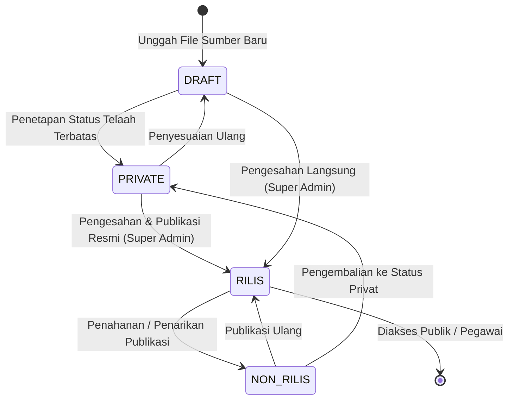
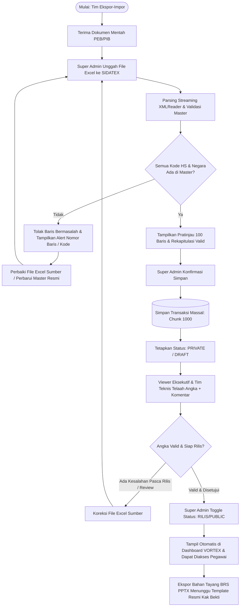
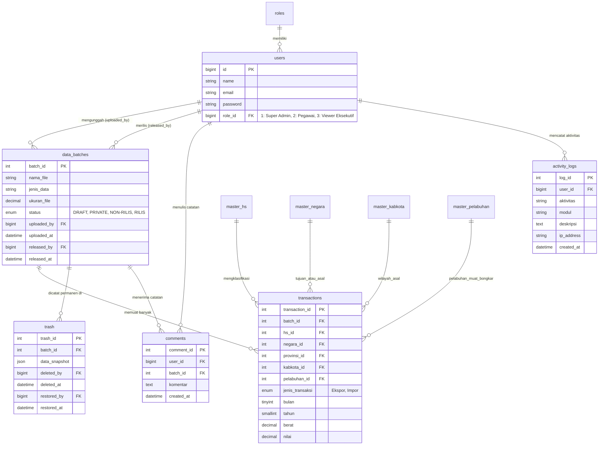

# PRODUCT REQUIREMENTS DOCUMENT (PRD)
# SISTEM INFORMASI DATA EKSPOR-IMPOR BADAN PUSAT STATISTIK (BPS) PROVINSI RIAU (SIDATEX)

---

**Nomor Dokumen**: PRD-SIDATEX/BPS-14/2026/XI-01  
**Versi**: 1.1 (Revisi Resmi Pasca Konfirmasi Keputusan BPS)  
**Tanggal Rilis**: 5 November 2026  
**Status**: Disahkan Berdasarkan Keputusan Resmi BPS Provinsi Riau  
**Penyusun**: Backend Architect & System Analyst Tim Pengembang SIDATEX  
**Pemilik Sistem**: Badan Pusat Statistik (BPS) Provinsi Riau  
**Pihak Terkait Utama**:
- **Bu Fitri Hariyanti** (Ketua Tim Statistik Distribusi BPS Provinsi Riau)
- **Kak Bekti & Kak Hanifah** (Tim Teknis Statistik Ekspor-Impor BPS Provinsi Riau)
- **Seluruh Pegawai Internal BPS Provinsi Riau**

---

## RINGKASAN KEPUTUSAN HASIL KONFIRMASI BPS

Dokumen PRD versi 1.1 ini memuat pembaharuan menyeluruh berdasarkan hasil konfirmasi dan keputusan resmi pihak BPS Provinsi Riau (Bu Fitri Hariyanti, Kak Bekti, dan Kak Hanifah) terkait 4 (empat) aspek operasional krusial:

| No | Topik | Keputusan Resmi BPS | Status Dokumentasi | Dampak Terhadap Sistem |
| :---: | :--- | :--- | :---: | :--- |
| **1** | **Template PowerPoint BRS** | **Masih Menunggu File Resmi**: Belum ada penetapan desain final. Dilarang membuat asumsi layout/slide. Implementasi menunggu file resmi diserahkan oleh Kak Bekti. | `MENUNGGU TEMPLATE RESMI` | Modul ekspor PPTX tetap berbasis engine `phpoffice/phppresentation` namun tata letak slide visual menunggu berkas master resmi dari Kak Bekti. |
| **2** | **Retensi Data Trash** | **Disimpan Permanen Tanpa Batas Waktu**: Data yang dihapus ke Trash tidak memiliki masa kadaluarsa (tidak ada auto-purge/auto-delete harian). | `SUDAH DIKONFIRMASI` | Tabel `trash` dan `data_batches` mempertahankan snapshot data selamanya. Penghapusan permanen (*force delete*) hanya dapat dilakukan melalui tindakan sadar oleh Super Admin jika disetujui. |
| **3** | **Prosedur Koreksi Data Pasca Rilis & Status Data** | **Koreksi Melalui File Excel Sumber & Upload Ulang**: Data rilis tidak disunting parsial langsung di DB. Perbaikan wajib pada file Excel, lalu diunggah ulang sebagai batch baru. Status `PENDING` dihapus dan diganti menjadi `PRIVATE`. | `SUDAH DIKONFIRMASI` | Siklus status data menjadi: `DRAFT`, `PRIVATE`, `NON-RILIS`, dan `RILIS/PUBLIC`. Data `PRIVATE` hanya dapat dilihat oleh Super Admin dan Viewer Eksekutif (terisolasi mutlak dari Pegawai). |
| **4** | **Penanganan Referensi Master Tidak Ditemukan** | **Data Wajib Ditolak & Diberikan Notifikasi Rinci**: Jika kode HS atau Negara tidak terdaftar di master data, baris data tidak boleh lolos sebagai data valid. Sistem wajib menampilkan alert nomor baris, kode bermasalah, dan alasan penolakan. | `SUDAH DIKONFIRMASI` | Validasi parser tidak lagi menggunakan toleransi unmapped otomatis. Baris yang tidak cocok dengan `master_hs` atau `master_negara` ditandai tidak valid, dan ringkasan penolakan disajikan kepada Super Admin sebelum penyimpanan. |

---

## DAFTAR ISI

1. [BAB 1: Informasi Dokumen](#bab-1-informasi-dokumen)
2. [BAB 2: Pendahuluan](#bab-2-pendahuluan)
3. [BAB 3: Latar Belakang](#bab-3-latar-belakang)
4. [BAB 4: Tujuan Pengembangan](#bab-4-tujuan-pengembangan)
5. [BAB 5: Ruang Lingkup Sistem](#bab-5-ruang-lingkup-sistem)
6. [BAB 6: Deskripsi Produk](#bab-6-deskripsi-produk)
7. [BAB 7: Pengguna dan Hak Akses](#bab-7-pengguna-dan-hak-akses)
8. [BAB 8: Matriks Hak Akses](#bab-8-matriks-hak-akses)
9. [BAB 9: Modul dan Kebutuhan Fungsional](#bab-9-modul-dan-kebutuhan-fungsional)
10. [BAB 10: Dashboard Tiga Halaman (Arsitektur VORTEX)](#bab-10-dashboard-tiga-halaman-arsitektur-vortex)
11. [BAB 11: Filter dan Analisis Data](#bab-11-filter-dan-analisis-data)
12. [BAB 12: Upload dan Validasi Excel](#bab-12-upload-dan-validasi-excel)
13. [BAB 13: Preview dan Penyimpanan Data](#bab-13-preview-dan-penyimpanan-data)
14. [BAB 14: Manajemen Data](#bab-14-manajemen-data)
15. [BAB 15: Tata Kelola Status Data](#bab-15-tata-kelola-status-data)
16. [BAB 16: Trash dan Restore (Penyimpanan Permanen)](#bab-16-trash-dan-restore-penyimpanan-permanen)
17. [BAB 17: Activity Log (Audit Trail)](#bab-17-activity-log-audit-trail)
18. [BAB 18: Komentar dan Kolaborasi Telaah](#bab-18-komentar-dan-kolaborasi-telaah)
19. [BAB 19: Master Data Referensi](#bab-19-master-data-referensi)
20. [BAB 20: Ekspor Excel dan PowerPoint](#bab-20-ekspor-excel-dan-powerpoint)
21. [BAB 21: Kebutuhan Non-Fungsional](#bab-21-kebutuhan-non-fungsional)
22. [BAB 22: Business Rules (Aturan Bisnis Mutlak)](#bab-22-business-rules-aturan-bisnis-mutlak)
23. [BAB 23: User Stories](#bab-23-user-stories)
24. [BAB 24: Acceptance Criteria](#bab-24-acceptance-criteria)
25. [BAB 25: Alur Proses Sistem (System Workflows)](#bab-25-alur-proses-sistem-system-workflows)
26. [BAB 26: Gambaran Database dan Relasi](#bab-26-gambaran-database-dan-relasi)
27. [BAB 27: Prioritas Pengembangan](#bab-27-prioritas-pengembangan)
28. [BAB 28: Batasan Sistem](#bab-28-batasan-sistem)
29. [BAB 29: Catatan Keputusan Final dan Rencana Kerja](#bab-29-catatan-keputusan-final-dan-rencana-kerja)
30. [BAB 30: Kriteria Keberhasilan Sistem](#bab-30-kriteria-keberhasilan-sistem)
31. [BAB 31: Kesimpulan](#bab-31-kesimpulan)

---

## BAB 1: INFORMASI DOKUMEN

| Parameter | Keterangan Rinci |
| :--- | :--- |
| **Judul Dokumen** | Product Requirements Document (PRD) Sistem Informasi Data Ekspor-Impor (SIDATEX) |
| **Versi Dokumen** | 1.1 (Memuat Seluruh Keputusan Resmi BPS Pasca Klarifikasi) |
| **Tanggal Pembuatan**| 5 November 2026 |
| **Instansi Pengguna**| Badan Pusat Statistik (BPS) Provinsi Riau |
| **Unit Kerja** | Tim Statistik Distribusi & Neraca Perdagangan Luar Negeri |
| **Status Dokumen** | Dokumen Spesifikasi Baku Arsitektur Backend, Frontend, dan QA |
| **Target Pembaca** | System Analyst, Backend Architect, Frontend Developer, Tim QA, serta PIC BPS Riau |

---

## BAB 2: PENDAHULUAN

Sistem Informasi Data Ekspor-Impor (**SIDATEX**) BPS Provinsi Riau adalah platform digital berbasis web enterprise yang dibangun untuk memusatkan, mengotomatisasi, memvalidasi, dan mengamankan pengolahan statistik perdagangan luar negeri di Provinsi Riau. 

Sistem ini memfasilitasi transformasi pengolahan dokumen kepabeanan berukuran besar (puluhan ribu transaksi bulanan) menjadi repositori data terstruktur dengan tata kelola status data yang ketat (`DRAFT`, `PRIVATE`, `NON-RILIS`, `RILIS/PUBLIC`), visualisasi analitik eksekutif tiga halaman (**VORTEX**), modul keranjang sampah permanen, serta otomatisasi bahan diseminasi statistik.

---

## BAB 3: LATAR BELAKANG

Badan Pusat Statistik Provinsi Riau menerima berkas data kepabeanan dari Direktorat Jenderal Bea dan Cukai (DJBC) berupa dokumen Pemberitahuan Ekspor Barang (PEB) dan Pemberitahuan Impor Barang (PIB) setiap periode. Sebelum adanya SIDATEX, operasional analisis menghadapi tantangan:
1. **Kerapuhan Spreadsheet Berkas Besar**: File Excel berisi lebih dari 50.000 baris transaksi sering kali menyebabkan kelambatan (*freeze*) pada komputer analis.
2. **Risiko Kesalahan Pencocokan Kode Master**: Kode HS (*Harmonized System*) dan kode negara yang tidak valid atau salah ketik sulit terdeteksi secara manual pada ribuan baris data.
3. **Kerahasiaan Angka Sebelum Berita Resmi Statistik (BRS)**: Diperlukan mekanisme isolasi data yang sangat ketat agar data yang belum final atau berstatus `PRIVATE` tidak dapat diakses oleh staf biasa sebelum waktu konferensi pers resmi.
4. **Ketiadaan Prosedur Baku Koreksi Pasca Rilis**: Diperlukan aturan tegas bahwa pembetulan data rilis tidak boleh dilakukan dengan menyunting parsial transaksi di database, melainkan wajib memperbaiki file Excel sumber dan mengunggah ulang.

---

## BAB 4: TUJUAN PENGEMBANGAN

1. **Sentralisasi Basis Data**: Memusatkan jutaan transaksi ekspor-impor ke dalam basis data MySQL yang terindeks dan aman.
2. **Validasi Mutlak Referensi Master Data**: Menjamin seluruh transaksi yang disimpan memiliki relasi valid dengan `master_hs` dan `master_negara`. Data berkode tidak dikenal langsung ditolak dengan laporan baris yang jelas.
3. **Penerapan Hirarki Status Empat Tingkat**: Mengamankan data dalam status `DRAFT`, `PRIVATE`, `NON-RILIS`, dan `RILIS/PUBLIC`.
4. **Analisis Eksekutif Tiga Dimensi Melalui VORTEX**: Menyajikan dashboard interaktif dengan rumus pertumbuhan statistik resmi BPS (*Month-to-Month*, *Quarter-to-Quarter*, *Year-on-Year*, dan *Cumulative-to-Cumulative*).
5. **Penyimpanan Permanen Dokumen Terhapus**: Menjamin seluruh data yang dipindahkan ke *Trash* tersimpan selamanya tanpa batas waktu kadaluarsa untuk kebutuhan audit.

---

## BAB 5: RUANG LINGKUP SISTEM

### 5.1. Dalam Ruang Lingkup (*In-Scope*)
- Autentikasi sesi berbasis peran dengan otorisasi 3 role resmi: **Super Admin**, **Pegawai**, dan **Viewer Eksekutif**.
- Parser berkas besar berbasis *XMLReader Streaming* (hingga 50 MB / 100.000+ baris data) dengan konsumsi RAM stabil (< 32 MB).
- Validasi kepabeanan ketat: Penolakan langsung terhadap transaksi yang tidak memiliki referensi pada Master HS dan Master Negara.
- Manajemen Batch dengan status `DRAFT`, `PRIVATE`, `NON-RILIS`, dan `RILIS/PUBLIC`.
- Proteksi keranjang sampah (*Trash*) dengan penyimpanan JSON snapshot secara **permanen tanpa batasan waktu**.
- Prosedur koreksi data pasca-rilis berbasis **perbaikan file Excel sumber dan pengunggahan ulang sebagai batch baru**.
- Dashboard Eksekutif VORTEX 3 Halaman (Overview Global, Time Series Pivot Komoditas, Detail & Pemetaan Wilayah).
- Modul Filter Data tabular multi-kriteria dan Analisis Perdagangan (Top Komoditas, Top Negara, Pelabuhan Muat/Bongkar).
- Modul Catatan & Kolaborasi Telaah (Komentar Batch).
- Modul Audit Trail menyeluruh (`activity_logs`).
- Generator Ekspor Excel resmi dan generator PowerPoint BRS (direncanakan menggunakan template resmi BPS setelah diserahkan oleh Kak Bekti).

### 5.2. Luar Ruang Lingkup (*Out-of-Scope*)
- **PENEGASAN MUTLAK: Tidak ada fitur Artificial Intelligence (AI), Machine Learning, maupun Chatbot AI di dalam sistem SIDATEX.** Sistem bekerja secara deterministik dan berbasis rumus statistik resmi BPS.
- Sistem tidak melayani transaksi perbankan, kepabeanan operasional, atau penerbitan dokumen PEB/PIB.
- Dibatasi pada jaringan kedinasan intranet BPS Provinsi Riau.

---

## BAB 6: DESKRIPSI PRODUK

SIDATEX dibangun menggunakan ekosistem **Laravel 13** dan **PHP 8.4** di atas basis data **MySQL 8.0**. Sistem mengadopsi pola arsitektur *Separation of Concerns* dengan memisahkan logika komputasi ke dalam servis independen:
- `ExcelTransactionParser`: Memproses berkas OpenXML secara streaming serta melakukan validasi integritas terhadap master data.
- `StatisticsCalculationService`: Menghitung agregat nilai FOB, berat Netto, dan 4 indikator pertumbuhan (MoM, QoQ, YoY, C-to-C).
- `PowerPointExportService`: Menyiapkan generator slide deck paparan BRS berbasis pustaka `phpoffice/phppresentation`.
- `ActivityLogger`: Mencatat setiap aktivitas mutasi data dan otentikasi.

---

## BAB 7: PENGGUNA DAN HAK AKSES

Sistem menetapkan 3 (tiga) peran pengguna resmi:

```
+---------------------------------------------------------------------------------------+
|                              HIRARKI PERAN RESMI SIDATEX                              |
+---------------------------------------------------------------------------------------+
| 1. Super Admin       : Bu Fitri Hariyanti (Ketua Tim), Kak Bekti, dan Kak Hanifah     |
| 2. Pegawai           : Staf Internal BPS (Hanya Melihat & Mengunduh Data RILIS/PUBLIC)|
| 3. Viewer Eksekutif  : Pimpinan / Eksekutif (Melihat Data RILIS & PRIVATE, Komentar)  |
+---------------------------------------------------------------------------------------+
```

### 7.1. Super Admin (Role ID: 1)
- **Personel Resmi**: Bu Fitri Hariyanti, Kak Bekti, dan Kak Hanifah.
- **Wewenang**:
  - Mengunggah berkas Excel kepabeanan dan menjalankan validasi streaming.
  - Memeriksa notifikasi penolakan jika terdapat kode HS atau Negara yang tidak terdaftar di master data.
  - Menyimpan transaksi ke basis data dalam status `DRAFT` atau `PRIVATE`.
  - Mengakses seluruh data pada semua status (`DRAFT`, `PRIVATE`, `NON-RILIS`, `RILIS/PUBLIC`).
  - Berwenang penuh mengubah status publikasi (*Publish* ke RILIS, atau menarik ke PRIVATE/DRAFT).
  - Melakukan soft-delete batch ke *Trash*, melihat data Trash, memulihkan batch (*Restore*), dan menjalankan *Force Delete* jika disetujui.
  - Menjalankan koreksi data dengan mengunggah ulang file Excel sumber yang telah diperbaiki.
  - Meninjau seluruh rekam jejak (*Activity Logs*) dan mengelola komentar telaah.

### 7.2. Pegawai (Role ID: 2)
- **Personel Resmi**: Seluruh staf fungsional dan pelaksana BPS Provinsi Riau.
- **Wewenang**:
  - Mengakses Dashboard VORTEX dan melihat metrik dari batch yang **berstatus `RILIS/PUBLIC`**.
  - Mengakses halaman Manajemen Data dan Penelusuran Transaksi **khusus data berstatus `RILIS/PUBLIC`**.
  - Mengunduh data transaksi berstatus `RILIS/PUBLIC` dalam format Excel (.xlsx).
- **Batasan Mutlak**:
  - **DILARANG KERAS** melihat, mengakses, menelusuri, atau mengunduh data berstatus `DRAFT`, `PRIVATE`, atau `NON-RILIS`.
  - Tidak memiliki akses menu Unggah Data, menu Trash, ubah status rilis, edit metadata, maupun hapus data.

### 7.3. Viewer Eksekutif (Role ID: 3)
- **Personel Resmi**: Pimpinan eksekutif (Kepala BPS Provinsi), analis madya, atau penelaah kebijakan berizin.
- **Wewenang**:
  - Mengakses Dashboard Eksekutif VORTEX untuk data berstatus **`RILIS/PUBLIC`** dan data berstatus **`PRIVATE`**.
  - Melihat katalog data Manajemen Data dan Penelusuran Transaksi pada status **`RILIS/PUBLIC`** dan **`PRIVATE`**.
  - Memberikan catatan telaah, koreksi, dan komentar pada dokumen batch.
- **Batasan Mutlak**:
  - Tidak diizinkan mengakses data berstatus `DRAFT` (yang masih diolah teknis oleh Super Admin) dan `NON-RILIS`.
  - Tidak memiliki wewenang operasional manajemen data (dilarang upload file, ubah status rilis, edit batch, hapus, atau kelola trash).

---

## BAB 8: MATRIKS HAK AKSES

| Modul & Fungsi Sistem | Aksi Spesifik | Super Admin (Role 1) | Pegawai (Role 2) | Viewer Eksekutif (Role 3) |
| :--- | :--- | :---: | :---: | :---: |
| **Autentikasi** | Login / Logout Sesi | Ya | Ya | Ya |
| **Dashboard VORTEX** | Melihat Data Status `RILIS/PUBLIC` | Ya | Ya | Ya |
| | Melihat Data Status `PRIVATE` | Ya | **Tidak (Terisolasi)** | **Ya (Khusus Telaah)** |
| | Melihat Data Status `DRAFT` / `NON-RILIS` | Ya | **Tidak (Terisolasi)** | **Tidak (Terisolasi)** |
| **Upload Data** | Unggah File Excel & Uji Validasi Master | Ya | Tidak | Tidak |
| | Pratinjau Error Validasi & Simpan Batch | Ya | Tidak | Tidak |
| **Manajemen Data** | Melihat Batch Status `RILIS/PUBLIC` | Ya | Ya | Ya |
| | Melihat Batch Status `PRIVATE` | Ya | **Tidak (Terisolasi)** | **Ya** |
| | Melihat Batch Status `DRAFT` / `NON-RILIS` | Ya | **Tidak (Terisolasi)** | **Tidak (Terisolasi)** |
| | Edit Metadata Dokumen Batch | Ya | Tidak | Tidak |
| | Ubah Status Rilis (Publish / Unpublish) | Ya | Tidak | Tidak |
| | Pindahkan Dokumen ke Trash (Soft Delete) | Ya | Tidak | Tidak |
| **Modul Trash** | Melihat Daftar Berkas Terhapus Permanen | Ya | Tidak | Tidak |
| | Pulihkan Batch Terhapus (*Restore*) | Ya | Tidak | Tidak |
| | Hapus Permanen (*Force Delete*) | Ya (Jika Disetujui) | Tidak | Tidak |
| **Filtering Transaksi**| Penelusuran Transaksi Data `RILIS/PUBLIC`| Ya | Ya | Ya |
| | Penelusuran Transaksi Data `PRIVATE` | Ya | **Tidak** | **Ya** |
| | Penelusuran Transaksi Data `DRAFT` | Ya | **Tidak** | **Tidak** |
| **Analisis Perdagangan**| Melihat Top Komoditas & Top Negara | Ya | Ya (Data Rilis) | Ya (Rilis & Private) |
| **Komentar Batch** | Membaca Komentar | Ya | Ya | Ya |
| | Menulis / Mengirim Komentar Telaah | Ya | Tidak | Ya |
| | Menghapus Komentar Sendiri | Ya | Tidak | Ya |
| **Audit Log** | Meninjau Audit Trail Sistem | Ya | Tidak | Tidak |
| **Ekspor Dokumen** | Ekspor Excel Data `RILIS/PUBLIC` | Ya | Ya | Ya |
| | Ekspor Excel Data `PRIVATE` | Ya | **Tidak** | **Ya** |
| | Ekspor Excel Data `DRAFT` | Ya | **Tidak** | **Tidak** |
| | Ekspor Bahan Tayang PowerPoint BRS | Ya | Tidak | Ya |

---

## BAB 9: MODUL DAN KEBUTUHAN FUNGSIONAL

Sistem SIDATEX terbagi ke dalam 10 modul fungsional:
1. **Modul Autentikasi & RBAC Tiga Tingkat**: Enkripsi Bcrypt, isolasi route berbasis middleware untuk Super Admin, Pegawai, dan Viewer Eksekutif.
2. **Modul Unggah & Parsing Streaming XMLReader**: Pembacaan berkas Excel besar tanpa membebani memori server.
3. **Modul Validasi Master Terpadu**: Pemeriksaan integritas data kepabeanan terhadap tabel referensi (penolakan mutlak bagi kode HS/Negara yang tidak ditemukan).
4. **Modul Manajemen Data Batch**: Pengelolaan siklus hidup arsip data dan pembaruan metadata.
5. **Modul Tata Kelola Status Data**: Pengaturan status `DRAFT`, `PRIVATE`, `NON-RILIS`, dan `RILIS/PUBLIC`.
6. **Modul Keranjang Sampah Permanen (Trash & Restore)**: Penyimpanan arsip terhapus secara permanen tanpa batasan waktu.
7. **Modul Penelusuran Transaksi (Filtering Data)**: Kueri data tabular multi-filter berbasis hak akses status.
8. **Modul Analisis Perdagangan**: Agregasi Top Komoditas, Top Negara, dan Distribusi Pelabuhan.
9. **Modul Dashboard VORTEX**: Visualisasi metrik makro, matriks waktu, dan pemetaan geospasial Riau.
10. **Modul Pelaporan & Ekspor**: Ekspor lembar kerja Excel resmi dan generator PowerPoint BRS (menunggu template fisik resmi Kak Bekti).

---

## BAB 10: DASHBOARD TIGA HALAMAN (ARSITEKTUR VORTEX)

### 10.1. Halaman 1: Overview Global & Tren Kronologis
- **5 Kartu KPI Utama**: Total Nilai Ekspor FOB (Juta US$), Total Berat Bersih Netto (Ton/Ribu Kg), Total Nilai Impor CIF, Neraca Perdagangan (*Trade Balance*), dan Total Transaksi Terverifikasi.
- **4 Indikator Pertumbuhan Resmi BPS**:
  - **M-to-M (*Month-to-Month*)**: Pertumbuhan terhadap bulan sebelumnya pada tahun yang sama.
  - **Q-to-Q (*Quarter-to-Quarter*)**: Pertumbuhan triwulan berjalan terhadap triwulan sebelumnya.
  - **Y-on-Y (*Year-on-Year*)**: Pertumbuhan terhadap bulan yang sama pada tahun sebelumnya.
  - **C-to-C (*Cumulative-to-Cumulative*)**: Pertumbuhan kumulatif tahun berjalan terhadap periode yang sama tahun sebelumnya.
- **Grafik Tren Garis 12 Bulan**: Grafik nilai ekspor bulanan Januari s.d. Desember, terbagi atas Sektor Migas vs Non-Migas.

### 10.2. Halaman 2: Time Series Pivot Komoditas
- **Matriks Pivot Komoditas x Waktu**: Tabulasi silang Kelompok Komoditi terhadap periode waktu (Pilihan tampilan: **Komoditas x Bulan** atau **Komoditas x Triwulan**).
- **Laju Pertumbuhan Sektoral**: Delta nilai devisa dan persentase perubahan per komoditi.
- **Ekspor Matriks**: Pengunduhan matriks pivot ke file Excel.

### 10.3. Halaman 3: Detail & Pemetaan Wilayah (Geospatial Mapping)
- **Peta Spasial Riau (Leaflet JS)**: Visualisasi tematik 12 Kabupaten/Kota di Riau dengan titik sentra pelabuhan muat/bongkar (Dumai, Pekanbaru, Siak, Bengkalis, Kuala Enok, Sei Pakning, dsb) dengan gradasi ukuran/warna.
- **Peringkat Top 10 Kab/Kota**: Diagram batang kontribusi wilayah asal barang ekspor.
- **2 KPI Besar Terpisah**: Total Nilai FOB dan Berat Netto terpisah tegas antara Sektor Migas dan Non-Migas.
- **Tabulasi Rinci**: Mitra dagang utama dan komoditi unggulan.

---

## BAB 11: FILTER DAN ANALISIS DATA

Filter dinamis multi-kriteria berbasis AJAX:
1. **Tahun**: Pilihan tahun data transaksi.
2. **Bulan**: Pilihan bulan transaksi (Januari s.d. Desember) atau Semua Bulan.
3. **Triwulan**: Filter cepat kuartal (Q1: Jan-Mar, Q2: Apr-Jun, Q3: Jul-Sep, Q4: Okt-Des).
4. **Sektor Migas / Non-Migas**: Pemilahan komoditas migas dan non-migas.
5. **Kelompok Komoditi**: Klasifikasi golongan barang utama ekspor BPS Riau.
6. **Kabupaten / Kota Asal**: Pemilahan 12 wilayah administratif Riau.
7. **Negara Mitra**: Pilihan negara tujuan ekspor atau asal impor.

---

## BAB 12: UPLOAD DAN VALIDASI EXCEL

### 12.1. Standar Header File Excel Kepabeanan
File yang diunggah berupa berkas Microsoft Excel (`.xlsx` atau `.xls`) dengan batas ukuran maksimal **50 MB**:
`KODE_KANTOR`, `NO_DAFTAR`, `TGL_DAFTAR`, `KODE_NEGARA`/`NEGARA`, `KODE_PELABUHAN`/`PELABUHAN`, `KODE_KABKOTA`, `KODE_HS`, `URAIAN_BARANG`, `BERAT_BERSIH`/`NETTO`, `NILAI_FOB`/`NILAI_CIF`.

### 12.2. Mekanisme Validasi Mutlak Terhadap Master Data
Sistem menjalankan pemeriksaan ketat pada saat pengunggahan:
1. **Pemeriksaan Master HS**: Kode HS wajib terdaftar pada tabel `master_hs`. Jika kode HS tidak ditemukan, sistem **menolak baris data tersebut** dan menandainya sebagai tidak valid.
2. **Pemeriksaan Master Negara**: Kode atau nama negara wajib terdaftar pada tabel `master_negara`. Jika tidak ditemukan, sistem **menolak baris data tersebut**.
3. **Penyajian Informasi Penolakan yang Jelas**: Sistem menampilkan notifikasi kesalahan spesifik kepada Super Admin, mencakup:
   - Nomor baris pada file Excel.
   - Nilai kode yang bermasalah.
   - Jenis master data rujukan.
   - Alasan penolakan.
   - *Contoh Notifikasi*:  
     `Baris 142: Kode HS 12345678 tidak ditemukan pada Master HS. Periksa kembali kode pada file Excel atau pastikan Master HS sudah diperbarui.`  
     `Baris 305: Kode negara XX tidak ditemukan pada Master Negara.`
4. **Kemandirian Master Data**: Sistem **dilarang menambahkan kode baru secara otomatis** ke tabel master data. Pembaruan master data wajib melalui mekanisme tata kelola master resmi BPS.
5. **Ringkasan Validasi**: Menampilkan total baris terdeteksi, jumlah baris valid yang dapat disimpan, dan daftar rincian baris yang ditolak.

---

## BAB 13: PREVIEW DAN PENYIMPANAN DATA

1. **XMLReader Streaming**: Membaca file OpenXML langsung dari arsip zip tanpa *in-memory DOM loading*, menjamin penggunaan RAM < 32 MB.
2. **Pratinjau Data**: Menampilkan pratinjau 100 baris pertama beserta rekapitulasi estimasi devisa FOB dan berat Netto dari baris-baris yang dinyatakan valid.
3. **Penyimpanan Transaksional**: Eksekusi simpan massal menggunakan blok *chunk* **1.000 baris per query** di dalam `DB::beginTransaction()`. Jika terjadi galat, sistem membatalkan seluruh operasi via `DB::rollBack()`. Data batch baru disimpan dengan status awal `DRAFT` atau `PRIVATE`.

---

## BAB 14: MANAJEMEN DATA

Modul Manajemen Data menyediakan pusat kendali bagi Super Admin:
- Informasi berkas: Nama File, Tanggal Upload, Ukuran Berkas, Jenis Perdagangan, Jumlah Transaksi, Status Data, dan Pengunggah.
- Penyaringan katalog berdasarkan status: Tab `DRAFT`, `PRIVATE`, `NON-RILIS`, dan `RILIS/PUBLIC`.
- Aksi Cepat: Detail transaksi, Toggle Status Rilis, Ekspor Excel (.xlsx), dan Hapus ke *Trash*.

---

## BAB 15: TATA KELOLA STATUS DATA

Sistem SIDATEX menerapkan 4 (empat) status data resmi:



### Definisi dan Visibilitas Status:
1. **`DRAFT`**: Data transaksi yang baru diunggah dan masih dalam tahap penelaahan teknis internal oleh Tim Ekspor-Impor.  
   - *Visibilitas*: **Hanya Super Admin**. Pegawai dan Viewer Eksekutif dilarang mengakses.
2. **`PRIVATE`**: Data transaksi yang disiapkan untuk proses validasi substansi dan telaah pimpinan.  
   - *Visibilitas*: **Hanya Super Admin dan Viewer Eksekutif**. Pegawai biasa dilarang keras mengakses data berstatus Private. Data Private tidak ditampilkan pada Dashboard publik Pegawai.
3. **`NON-RILIS`**: Data yang ditangguhkan publikasinya karena memerlukan konfirmasi teknis lanjutan.  
   - *Visibilitas*: **Hanya Super Admin**. Pegawai dan pengguna tanpa izin khusus tidak dapat mengakses.
4. **`RILIS/PUBLIC`**: Data yang telah disahkan secara resmi oleh Super Admin untuk diseminasi publik.  
   - *Visibilitas*: **Dapat diakses oleh seluruh pengguna** (Super Admin, Pegawai, dan Viewer Eksekutif). Menjadi sumber tunggal perhitungan Dashboard resmi.

### Prosedur Koreksi Data Pasca Rilis:
- Jika ditemukan kekeliruan data pada batch yang telah berstatus `RILIS/PUBLIC`, **DILARANG menyunting langsung baris transaksi di dalam batch yang telah dirilis**.
- Petugas wajib memperbaiki data pada **file Excel sumber**.
- File Excel yang telah diperbaiki diunggah ulang melalui modul Unggah Data (menjalani validasi streaming dan pencocokan master kembali).
- Data hasil koreksi disimpan sebagai **batch data baru**, diverifikasi dalam status `DRAFT` atau `PRIVATE`, dan baru disahkan menjadi `RILIS/PUBLIC` menggantikan data lama. Batch lama yang salah dapat dipindahkan ke *Trash*.

---

## BAB 16: TRASH DAN RESTORE (PENYIMPANAN PERMANEN)

1. **Penyimpanan Permanen Tanpa Batas Waktu**:
   - Seluruh dokumen batch yang dihapus (*Soft Delete*) dipindahkan ke tabel `trash` beserta rekaman utuh `data_snapshot` berformat JSON.
   - **TIDAK ADA BATAS WAKTU PENYIMPANAN** (tidak ada mekanisme auto-delete atau penghapusan otomatis berbasis hari). Data tetap tersimpan aman di Trash selamanya.
2. **Pemulihan (*Restore*)**: Super Admin dapat melihat daftar berkas di modul *Trash* dan memulihkan batch beserta seluruh transaksinya ke status semula kapan pun diperlukan.
3. **Penghapusan Permanen (*Force Delete*)**: Data di Trash hanya dapat dihapus permanen melalui tindakan sadar yang diinisiasi oleh Super Admin dengan modal konfirmasi ganda, jika fitur tersebut memang disetujui untuk digunakan.

---

## BAB 17: ACTIVITY LOG (AUDIT TRAIL)

Setiap peristiwa penting dicatat pada tabel `activity_logs`:
- Atribut: `user_id`, `aktivitas` (LOGIN, UPLOAD_BATCH, RE_UPLOAD_CORRECTION, RELEASE_BATCH, UNRELEASE_BATCH, MOVE_TO_TRASH, RESTORE_TRASH, FORCE_DELETE, EXPORT_EXCEL, EXPORT_PPTX), `modul`, `deskripsi` kontekstual, `ip_address`, dan stempel waktu server `created_at`.

---

## BAB 18: KOMENTAR DAN KOLABORASI TELAAH

Modul Komentar memfasilitasi telaah data antara Super Admin dan Viewer Eksekutif pada batch berstatus `PRIVATE` maupun `RILIS/PUBLIC`:
- Memberikan catatan analisis, justifikasi anomali angka perdagangan, atau instruksi koreksi file Excel sumber.
- Penulis dapat menghapus komentar miliknya sendiri; Super Admin memiliki wewenang moderasi penuh.

---

## BAB 19: MASTER DATA REFERENSI

Katalog referensi resmi:
1. **`master_hs`**: Kode HS 2 s.d. 10 digit, deskripsi barang bahasa Indonesia, bab HS, sektor industri, dan kode BEC.
2. **`master_negara`**: Kode negara 3 digit standar BPS/ISO, nama negara resmi bahasa Indonesia, dan kawasan benua.
3. **`master_pelabuhan`**: Daftar pelabuhan laut/udara muat dan bongkar di wilayah Riau.
4. **`master_kabkota`**: 12 kabupaten dan kota definitif Provinsi Riau (kode 1401 s.d. 1472).
5. **`master_provinsi`**: Daftar referensi provinsi di Indonesia.

---

## BAB 20: EKSPOR EXCEL DAN POWERPOINT

### 20.1. Ekspor Lembar Kerja Excel (.xlsx)
Menghasilkan spreadsheet data transaksi terfilter lengkap dengan kode HS, deskripsi komoditi, negara tujuan, pelabuhan, berat netto, dan nilai devisa FOB terformat akuntansi resmi dengan header hijau BPS (`#107C41`).

### 20.2. Ekspor Bahan Tayang PowerPoint BRS (.pptx)
- **Status Implementasi**: `MENUNGGU TEMPLATE RESMI`.
- Fitur ekspor slide presentasi Berita Resmi Statistik (BRS) direncanakan menggunakan template resmi BPS Provinsi Riau.
- Implementasi penuh dan penyesuaian tata letak slide visual (posisi logo, tipografi, bagan, dan susunan slide) menunggu berkas template resmi (`.pptx`) diserahkan oleh **Kak Bekti**.
- Tidak ada asumsi desain atau penetapan sepihak sebelum berkas fisik resmi diterima.

---

## BAB 21: KEBUTUHAN NON-FUNGSIONAL

| Parameter | Spesifikasi Teknis |
| :--- | :--- |
| **Kinerja & Skalabilitas** | Mampu memproses file Excel 50 MB (100.000 baris) dalam waktu < 60 detik. Latensi agregasi kueri Dashboard < 300 ms. Konsumsi RAM PHP konstan di bawah 32 MB. |
| **Keamanan Data** | Isolasi data berstatus `PRIVATE` dan `DRAFT` dari akses Pegawai biasa. Proteksi CSRF, sanitasi PDO (SQL Injection Free), dan enkripsi kata sandi Bcrypt. |
| **Keandalan (*Reliability*)**| Penyimpanan batch insert wajib transaksional (`DB::transaction`). Retensi data Trash bersifat permanen tanpa risiko kehilangan data sepihak. |
| **Antarmuka (*Usability*)** | Gaya birokrasi pemerintahan bersih (*clean government design*), ramah pengguna, dengan tipografi terbaca jelas dan layout proporsional. |

---

## BAB 22: BUSINESS RULES (ATURAN BISNIS MUTLAK)

1. **BR-01 (Status Awal Batch)**: Berkas yang baru disimpan wajib berstatus default `DRAFT` atau `PRIVATE`.
2. **BR-02 (Isolasi Dashboard Publik)**: Kueri Dashboard Pegawai dan umum hanya menghitung transaksi dari batch berstatus `RILIS/PUBLIC`.
3. **BR-03 (Akses Data Private)**: Data berstatus `PRIVATE` hanya dapat diakses oleh Super Admin dan Viewer Eksekutif untuk keperluan telaah angka.
4. **BR-04 (Penolakan Master Data)**: Transaksi dengan kode HS atau Negara yang tidak terdaftar pada master data wajib ditolak dan tidak boleh lolos sebagai data valid.
5. **BR-05 (Notifikasi Rinci Validasi)**: Sistem wajib menampilkan rincian nomor baris dan kode yang menyebabkan penolakan saat validasi file Excel.
6. **BR-06 (Integritas Master Data)**: Sistem dilarang menambahkan kode master baru secara otomatis saat proses unggah file.
7. **BR-07 (Prosedur Koreksi Data Rilis)**: Koreksi data yang telah dirilis wajib dilakukan dengan merevisi file Excel sumber dan mengunggah ulang sebagai batch baru (dilarang menyunting parsial database transaksi rilis).
8. **BR-08 (Retensi Permanen Trash)**: Data yang dipindahkan ke *Trash* disimpan secara permanen tanpa batas waktu dan tanpa penghapusan otomatis.
9. **BR-09 (Wewenang Tunggal Rilis)**: Hanya Super Admin yang berhak melakukan perubahan status rilis data (*Toggle Release*).
10. **BR-10 (Audit Trail Mutlak)**: Seluruh aksi mutasi data wajib terekam ke tabel `activity_logs`.
11. **BR-11 (Kemandirian Non-AI)**: Sistem beroperasi murni secara deterministik berbasis kaidah statistik BPS tanpa model kecerdasan buatan (AI).
12. **BR-12 (Dependensi Template PPTX)**: Tata letak ekspor PowerPoint BRS berstatus menunggu penyerahan master template resmi dari Kak Bekti.

---

## BAB 23: USER STORIES

1. **Super Admin (Bu Fitri / Kak Bekti / Kak Hanifah)**:
   - *Sebagai Super Admin*, saya ingin sistem menolak baris data yang kode HS atau negaranya tidak ada di master serta memberikan rincian nomor barisnya, *sehingga* saya dapat segera memperbaiki file Excel sebelum data disimpan ke database.
   - *Sebagai Super Admin*, saya ingin data yang dihapus ke Trash tersimpan selamanya tanpa batas waktu, *sehingga* riwayat data operasional tidak pernah hilang secara sepihak.
   - *Sebagai Super Admin*, jika ada revisi data yang sudah dirilis, saya ingin melakukan perbaikan pada file Excel sumber dan mengunggahnya kembali, *sehingga* integritas data rujukan tetap terjaga utuh.

2. **Viewer Eksekutif (Pimpinan / Analis Kebijakan)**:
   - *Sebagai Viewer Eksekutif*, saya ingin dapat melihat data berstatus `PRIVATE` dan memberikan komentar telaah, *sehingga* saya dapat memvalidasi kebenaran angka statistik sebelum disahkan ke publik.

3. **Pegawai Internal BPS**:
   - *Sebagai Pegawai*, saya ingin menelusuri data perdagangan yang telah berstatus `RILIS/PUBLIC` dan mengunduhnya ke Excel, *sehingga* saya dapat menyusun laporan statistik tanpa risiko mengakses data mentah yang belum sah.

---

## BAB 24: ACCEPTANCE CRITERIA

### AC-01: Penolakan Kode HS / Negara yang Tidak Ditemukan di Master
- **Given**: Pengguna login sebagai Super Admin dan mengunggah file Excel kepabeanan.
- **When**: Di dalam file terdapat baris transaksi dengan kode HS `12345678` yang tidak ada di tabel `master_hs`.
- **Then**: Sistem menandai baris tersebut sebagai tidak valid, tidak menyimpannya ke database transaksi valid, dan menampilkan pesan: *"Baris X: Kode HS 12345678 tidak ditemukan pada Master HS. Periksa kembali kode pada file Excel atau pastikan Master HS sudah diperbarui."*

### AC-02: Isolasi Akses Data Status PRIVATE
- **Given**: Terdapat batch data #8 yang ditetapkan berstatus `PRIVATE`.
- **When**: Pengguna dengan peran `Pegawai` membuka halaman Dashboard atau Manajemen Data.
- **Then**: Batch #8 sama sekali tidak ditampilkan pada daftar tabel dan tidak dihitung ke dalam kartu metrik Dashboard Pegawai.
- **When**: Pengguna dengan peran `Viewer Eksekutif` membuka sistem.
- **Then**: Batch #8 dapat dilihat pada Manajemen Data dan metriknya dapat ditelaah pada Dashboard khusus telaah.

### AC-03: Retensi Permanen Tempat Sampah (Trash)
- **Given**: Batch data dipindahkan ke *Trash* oleh Super Admin.
- **When**: Waktu telah berlalu lebih dari 30 atau 90 hari kalender.
- **Then**: Rekaman batch dan transaksi tetap berada di tabel `trash` tanpa mengalami penghapusan otomatis oleh sistem scheduler apa pun.

### AC-04: Alur Koreksi Pasca Rilis Melalui File Excel Sumber
- **Given**: Batch #5 telah berstatus `RILIS/PUBLIC` dan ditemukan kesalahan angka oleh tim ekspor-impor.
- **When**: Super Admin hendak mengoreksi data.
- **Then**: Super Admin tidak dapat menyunting transaksi individual rilis secara langsung di tabel, melainkan mengoreksi file Excel asli di komputernya, lalu mengunggahnya sebagai batch baru di sistem SIDATEX.

---

## BAB 25: ALUR PROSES SISTEM (SYSTEM WORKFLOWS)



---

## BAB 26: GAMBARAN DATABASE DAN RELASI



---

## BAB 27: PRIORITAS PENGEMBANGAN

1. **Prioritas P0 (Mendesak / Critical Path)**:
   - Validasi ketat kode HS dan Negara (penolakan baris dan alert rincian kesalahan).
   - Penegakan tata kelola status data (`DRAFT`, `PRIVATE`, `NON-RILIS`, `RILIS/PUBLIC`) dan RBAC 3 peran (Super Admin, Pegawai, Viewer Eksekutif).
   - Pengamanan modul *Trash* dengan retensi penyimpanan permanen tanpa batas waktu.
   - Dashboard Tiga Halaman VORTEX dengan isolasi data rilis dan 4 indikator pertumbuhan resmi BPS.
2. **Prioritas P1 (Tinggi / Core Value)**:
   - Modul Penelusuran Transaksi (*Filtering Data*) multi-kriteria berbasis hak akses peran.
   - Modul Analisis Perdagangan (Top Komoditas, Top Negara, Pelabuhan Muat/Bongkar).
   - Prosedur unggah ulang file Excel sumber untuk koreksi data pasca rilis.
   - Perekaman jejak audit komprehensif pada `activity_logs`.
3. **Prioritas P2 (Menengah / Integrasi Lanjutan)**:
   - Integrasi template master PowerPoint BRS resmi segera setelah file diserahkan oleh Kak Bekti.
   - Peningkatan visualisasi geospasial Leaflet JS batas poligon wilayah Riau.
   - Panel diskusi dan catatan telaah angka pada dokumen batch (Komentar).

---

## BAB 28: BATASAN SISTEM

1. **Format & Ukuran Berkas**: Hanya menerima berkas Microsoft Excel (.xlsx/.xls) dengan batas ukuran maksimum 50 MB.
2. **Lingkungan Jaringan**: Dioperasikan dalam intranet kedinasan BPS Provinsi Riau.
3. **Ketiadaan AI / Machine Learning**: Sistem murni deterministik berdasarkan kaidah statistik resmi BPS.
4. **Dependensi Template Presentasi**: Tata letak dan desain visual slide ekspor PowerPoint BRS menunggu penyerahan berkas fisik dari PIC teknis.

---

## BAB 29: CATATAN KEPUTUSAN FINAL DAN RENCANA KERJA

Berdasarkan klarifikasi bersama pihak BPS Provinsi Riau:
1. **Template PowerPoint BRS**: Berstatus `MENUNGGU TEMPLATE RESMI`. Tim pengembang tidak melakukan asumsi desain mandiri hingga file master diserahkan oleh Kak Bekti.
2. **Retensi Trash**: Berstatus `SUDAH DIKONFIRMASI`. Ditetapkan permanen tanpa batas hari.
3. **Koreksi Data Pasca Rilis & Status Private**: Berstatus `SUDAH DIKONFIRMASI`. Koreksi melalui perbaikan file Excel sumber dan upload ulang. Status `PENDING` secara resmi diganti menjadi `PRIVATE`.
4. **Validasi Master Data**: Berstatus `SUDAH DIKONFIRMASI`. Data dengan kode referensi yang tidak terdaftar di master data wajib ditolak dan menampilkan notifikasi kesalahan yang jelas kepada pengguna.

---

## BAB 30: KRITERIA KEBERHASILAN SISTEM

1. **Zero Unmapped Data Entry**: Tidak ada data transaksi tersimpan dengan kode HS atau negara yang tidak sah. Seluruh kode yang tidak terdaftar berhasil dicegat pada tahap validasi.
2. **100% Kepatuhan Keamanan Status Private & Rilis**: Pegawai biasa terbukti 100% tidak dapat melihat atau mengunduh data berstatus `DRAFT`, `PRIVATE`, atau `NON-RILIS`.
3. **Integritas Retensi Permanen**: Data di modul Trash terbukti tersimpan secara permanen tanpa pernah terhapus oleh proses otomatis.
4. **Akurasi Hitung Statistik**: Perhitungan total devisa, volume, serta indikator MoM, QoQ, YoY, dan C-to-C identik 100% dengan kaidah perhitungan manual BPS.

---

## BAB 31: KESIMPULAN

Dokumen *Product Requirements Document* (PRD) versi 1.1 ini adalah pedoman arsitektur dan fungsional final bagi Sistem Informasi Data Ekspor-Impor (**SIDATEX**) BPS Provinsi Riau. 

Dengan mengintegrasikan seluruh keputusan resmi pimpinan dan tim teknis BPS Provinsi Riau—termasuk validasi ketat referensi master, tata kelola status data berbasis `PRIVATE` dan `RILIS/PUBLIC`, retensi permanen keranjang sampah, serta prosedur koreksi berbasis file Excel sumber—SIDATEX menjadi fondasi teknologi informasi yang andal, aman, dan berstandar tata kelola data pemerintahan (*Good Data Governance*).

---

**Mengetahui / Mengesahkan,**  
Tim Pengembang & Audit Teknis Sistem Informasi SIDATEX  
Badan Pusat Statistik Provinsi Riau  
*Pekanbaru, 5 November 2026*
