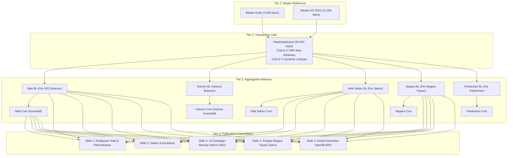
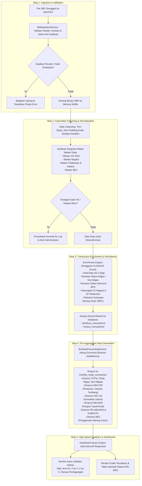
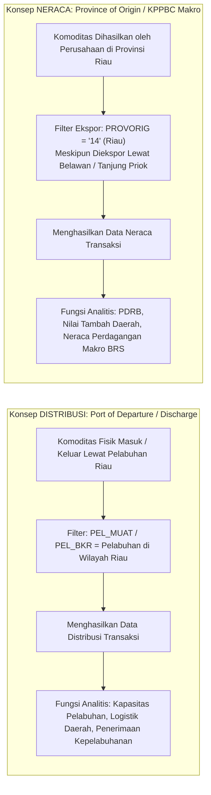

# LAPORAN AUDIT METODOLOGI PENGOLAHAN DATA BRS – SISTEM SIDATEX
**Badan Pusat Statistik (BPS) Provinsi Riau**  
*Dokumen Referensi Teknis & Arsitektur Transformasi Data Ekspor-Impor*

---

## DAFTAR ISI
1. [Ringkasan Eksekutif Hasil Audit](#1-ringkasan-eksekutif-hasil-audit)
2. [Inventarisasi & Karakteristik Berkas Referensi](#2-inventarisasi--karakteristik-berkas-referensi)
3. [Anatomi & Struktur Internal Excel Olah Data BRS](#3-anatomi--struktur-internal-excel-olah-data-brs)
4. [Katalog Formula Excel, Logika Bisnis & Perhitungan Indikator BRS](#4-katalog-formula-excel-logika-bisnis--perhitungan-indikator-brs)
5. [Spesifikasi Skema Raw DBF (4 Kategori) & Analisis Anomali](#5-spesifikasi-skema-raw-dbf-4-kategori--analisis-anomali)
6. [Matriks Pemetaan Data Alir: Raw DBF $\rightarrow$ Excel $\rightarrow$ Slide Rilis BRS](#6-matriks-pemetaan-data-alir-raw-dbf-rightarrow-excel-rightarrow-slide-rilis-brs)
7. [Diagram Alur Pengolahan Data End-to-End (Mermaid)](#7-diagram-alur-pengolahan-data-end-to-end)
8. [Aturan Pembersihan Data (Data Cleansing) & Standar Integritas Referensi](#8-aturan-pembersihan-data-data-cleansing--standar-integritas-referensi)
9. [Arsitektur Penyimpanan Data Bersih & Skema Agregasi Efisien](#9-arsitektur-penyimpanan-data-bersih--skema-agregasi-efisien)
10. [Spesifikasi Fitur Filtering, Indikator Analitik & Kebutuhan Dashboard](#10-spesifikasi-fitur-filtering-indikator-analitik--kebutuhan-dashboard)
11. [Diferensiasi Metodologis Mendalam: Distribusi vs Neraca](#11-diferensiasi-metodologis-mendalam-distribusi-vs-neraca)
12. [Daftar Temuan Kritis & Hal yang Memerlukan Konfirmasi Resmi BPS](#12-daftar-temuan-kritis--hal-yang-memerlukan-konfirmasi-resmi-bps)
13. [Rekomendasi Roadmap Teknis Implementasi Backend SIDATEX (Laravel)](#13-rekomendasi-roadmap-teknis-implementasi-backend-sidatex-laravel)

---

## 1. RINGKASAN EKSEKUTIF HASIL AUDIT

Berdasarkan audit mendalam terhadap seluruh artefak data di `D:\laragon\www\sidatex\referensi_bps`, diperoleh temuan fundamental: **Aplikasi SIDATEX saat ini baru berfungsi sebagai penyimpan data mentah DBF (Raw Ingestion Storage) dan belum mengadopsi rantai nilai pengolahan analitis BRS (Berita Resmi Statistik) yang selama ini dijalankan secara semi-manual melalui Microsoft Excel.**

### Temuan Kunci Audit:
1. **Rantai Pengolahan Eksisting (Manual Spreadsheet):**
   - Data mentah DBF dari BPS RI di-append ke lembar kerja `RawDataEkspor` (53.067 baris) dan `RawDataImpor` (92.821 baris).
   - Kolom A–J adalah salinan atribut mentah transaksi, sedangkan Kolom K–T dihitung secara dinamis menggunakan formula pencarian (`VLOOKUP`, `LEFT`, composite key concatenation) ke lembar `Master HS 2022` (11.556 baris) dan `Master Kode` (1.000 baris).
   - Tabel ringkasan bulanan dan kumulatif dihitung menggunakan rumus matriks multi-kriteria `SUMIFS` yang sangat berat, kemudian diringkas ke sheet presentasi (`Slide 1` s.d. `Slide 5`) dengan pembagian satuan (\$10^6\$ atau \$10^9\$) dan kalkulasi pertumbuhan standar BPS ($M\text{-to-}M$, $Y\text{-on-}Y$, $C\text{-to-}C$, dan pangsa kontribusi).
2. **Keterbatasan & Risiko Spreadsheet Eksisting:**
   - Ukuran file sangat masif (`Ekspor`: 13,74 MB; `Impor`: 17,60 MB) menyebabkan *memory exhaustion* saat diproses menggunakan library PHP standar jika tidak dioptimalkan secara streaming.
   - Ketergantungan pada formula dinamis di ratusan ribu sel menyebabkan resiko *human error* (misal kesalahan *copy-paste* formula, formula referensi bergeser, atau kode baru menghasilkan `#N/A`).
   - Terdapat inkonsistensi kelengkapan: File Excel Impor hanya memuat 3 sheet dasar (`Master Kode`, `Master HS 2022`, `RawDataImpor`) tanpa sheet matriks analitis (`Nilai BL`, `Slide 1`–`5`), padahal materi rilis resmi di PPTX memuat analitika impor yang setara.
3. **Peluang & Solusi SIDATEX:**
   - SIDATEX dapat mengeliminasi 100% ketergantungan pada Microsoft Excel dengan mengimplementasikan **Automated Ingestion, Enrichment, and Pre-Aggregation Pipeline** pada backend Laravel.
   - Saat pengguna mengunggah DBF, sistem langsung membaca binary DBF, melakukan validasi & pengayaan metadata (*enrichment*) ke tabel transaksi bersih, serta menghitung agregasi berkala (*pre-computed summaries*) ke tabel mart analitik sehingga dashboard visualisasi dapat merender angka indikator BRS secara instan (< 100 ms).

---

## 2. INVENTARISASI & KARAKTERISTIK BERKAS REFERENSI

Folder referensi `D:\laragon\www\sidatex\referensi_bps` menyimpan 16 berkas utama yang menjadi fondasi metodologi pengolahan data:

| No | Kategori / Berkas | Tipe & Ukuran | Karakteristik & Cakupan Data |
|---|---|---|---|
| 1 | `ekspor_distribusi/` (3 DBF) | DBF (dBase IV / FoxPro)<br>~142 KB per file | Transaksi ekspor Juli, Agustus, September 2026 berbasis pelabuhan muat Riau (POD: *Port of Departure*). 814 s.d. 846 baris/file. |
| 2 | `ekspor_neraca/` (3 DBF) | DBF (dBase IV / FoxPro)<br>~142 KB per file | Transaksi ekspor Juli, Agustus, September 2026 berbasis asal barang Riau (`PROVORIG` = 14). 806 s.d. 842 baris/file. |
| 3 | `impor_distribusi/` (3 DBF) | DBF (dBase IV / FoxPro)<br>~160 KB per file | Transaksi impor Juli, Agustus, September 2026 berbasis pelabuhan bongkar Riau (POD: *Port of Discharge*). 797 s.d. 931 baris/file. |
| 4 | `impor_neraca/` (3 DBF) | DBF (dBase IV / FoxPro)<br>~160 KB per file | Transaksi impor Juli, Agustus, September 2026 berbasis kantor pabean Riau (`kppbc_based`). 797 s.d. 931 baris/file. |
| 5 | `1. (Olah Data BRS) Ekspor LN Riau.xlsx` | Excel Workbook (OpenXML)<br>13,74 MB (13.744.357 bytes) | Workbook kerja utama Seksi Statistik Distribusi BPS Riau untuk Ekspor. Terdiri dari **18 worksheets**, 53.067 transaksi historis. |
| 6 | `2. (Olah Data BRS) Impor LN Riau.xlsx` | Excel Workbook (OpenXML)<br>17,60 MB (17.603.027 bytes) | Workbook kerja utama untuk Impor. Terdiri dari **3 worksheets**, memuat 92.821 transaksi historis impor. |
| 7 | `Master Ekspor Impor.xlsx` | Excel Workbook<br>1,38 MB (1.384.171 bytes) | Master referensi statis BPS berisi katalog HS 2022 dan tabel kode standar nasional/internasional. |
| 8 | `master_hs_mapping.csv` | Flat CSV (UTF-8)<br>219 KB (219.308 bytes) | Pemetaan cepat klasifikasi 8-digit HS ke komoditas BRS, sektor, dan kategori migas/non-migas. |
| 9 | `14. Rilis Eksim BPS Riau September 2026.pptx` | Presentasi Resmi BRS<br>49,65 MB (49.654.676 bytes) | Bahan rilis pers BRS Provinsi Riau edisi 1 November 2026 (data realisasi September 2026), 19 slide infografis resmi. |

---

## 3. ANATOMI & STRUKTUR INTERNAL EXCEL OLAH DATA BRS

### 3.1. Workbook Ekspor: `1. (Olah Data BRS) Ekspor LN Riau.xlsx`
Workbook ini memiliki 18 lembar kerja yang terbagi menjadi 4 lapisan fungsional (*functional tiers*):



#### Struktur Kolom `RawDataEkspor` (Baris 1 s.d. 53.067):
- **Kolom Mentah DBF (A – J):**
  - `A (JREC)`: Record sequence ID.
  - `B (BULAN)`: Angka bulan transaksi (1–12).
  - `C (TAHUN)`: Tahun transaksi (misal 2024, 2025, 2026).
  - `D (PROPINSI)`: Kode provinsi pelabuhan muat (selalu `14` untuk Riau).
  - `E (PELABUHAN)`: Kode pelabuhan muat lokal (4 digit teks, misal `0100` untuk Dumai, `0223` untuk Panipahan).
  - `F (HS)`: Kode Harmonized System 8-digit barang (teks, misal `15119020`, `27090010`).
  - `G (NEGARA)`: Kode negara tujuan 3-digit BPS (misal `124` Malaysia, `102` Singapura, `100` India).
  - `H (BERAT)`: Berat bersih barang dalam satuan Kilogram (Kg).
  - `I (NILAI)`: Nilai ekspor Free On Board dalam US Dollar (FOB US$).
  - `J (PROPASAL)`: Kode provinsi asal barang (untuk filter metodologis neraca).
- **Kolom Pengayaan / Rumus Lookup (K – T):**
  - `K (HS2)`: Substring 2-digit bab komoditas.
  - `L (Migas/Non Migas)`: Klasifikasi utama barang.
  - `M (Sektor)`: Sektor ekonomi (Pertanian, Industri Pengolahan, Pertambangan, Migas).
  - `N (Negara)`: Nama negara tujuan lengkap berbahasa Indonesia.
  - `O (Pelabuhan)`: Nama resmi pelabuhan muat.
  - `P (Kab/Kota)`: Nama kabupaten/kota letak pelabuhan.
  - `Q (BEC)`: Kode klasifikasi Broad Economic Categories.
  - `R (Deskripsi HS2)`: Label nama bab 2-digit HS.
  - `S (Deskripsi KBLI)`: Label klasifikasi baku lapangan usaha Indonesia.
  - `T (Komoditas BRS)`: Nama agregasi komoditas spesifik publikasi BPS (misal "Minyak Kelapa Sawit Dimurnikan").

### 3.2. Workbook Impor: `2. (Olah Data BRS) Impor LN Riau.xlsx`
Memuat 92.821 baris pada sheet `RawDataImpor` dengan struktur kolom sejalan dengan Ekspor, namun memiliki kolom spesifik untuk penggolongan penggunaan barang ekonomi:
- `Kolom P`: Kode BEC yang di-lookup dari `Master HS 2022`.
- `Kolom Q (Golongan Penggunaan Barang)`: Hasil lookup kode BEC ke tabel referensi BEC di `Master Kode` kolom `H:I`, mengelompokkan setiap transaksi ke dalam 3 kategori pokok BRS Impor:
  1. **Barang Konsumsi** (Consumption Goods)
  2. **Bahan Baku / Penolong** (Raw Materials & Intermediate Goods)
  3. **Barang Modal** (Capital Goods)

---

## 4. KATALOG FORMULA EXCEL, LOGIKA BISNIS & PERHITUNGAN INDIKATOR BRS

Berikut adalah daftar rumus presisi yang ditemukan dari ekstraksi internal XML file Excel Olah Data BRS:

### 4.1. Formula Pengayaan Data Transaksi (Enrichment Formulas)

| Kolom | Nama Atribut | Formula Excel Eksisting | Logika Pemrosesan & Relasi Referensi |
|---|---|---|---|
| `K` | **HS 2-Digit** | `=LEFT(F2,2)` | Mengambil 2 karakter pertama dari kode HS 8-digit. |
| `L` | **Migas / Non Migas** | `=VLOOKUP(F2,'Master HS 2022'!$A:$B,2,FALSE)` | Memetakan HS 8-digit ke status Migas/Non-Migas. |
| `M` | **Sektor Ekonomi** | `=VLOOKUP(F2,'Master HS 2022'!$A:$H,8,FALSE)` | Memetakan HS 8-digit ke kolom 8 `Master HS 2022` (Pertanian, Industri, Tambang, Migas). |
| `N` | **Nama Negara** | `=VLOOKUP(G2,'Master Kode'!$O:$P,2,FALSE)` | Mencocokkan kode negara 3-digit (kolom G) ke tabel negara (`Master Kode!$O:$P`). |
| `O` | **Nama Pelabuhan** | `=VLOOKUP(D2&E2,'Master Kode'!$U:$W,3,FALSE)` | Menggabungkan kode provinsi (D) dan kode pelabuhan (E) menjadi kunci gabungan (misal `"140100"`), lalu mencocokkan ke tabel pelabuhan. |
| `P` | **Kabupaten / Kota** | `=VLOOKUP(D2&E2,'Master Kode'!$U:$Y,5,FALSE)` | Menggunakan composite key yang sama untuk mengekstrak kabupaten/kota letak pelabuhan. |
| `Q` | **Kode BEC** | `=VLOOKUP(F2,'Master HS 2022'!$A:$C,3,FALSE)` | Mengekstrak 3-digit kode Broad Economic Categories. |
| `R` | **Deskripsi Bab HS2** | `=VLOOKUP(F2,'Master HS 2022'!$A:$F,6,FALSE)` | Mengambil uraian nama bab perdagangan internasional. |
| `S` | **Deskripsi KBLI** | `=VLOOKUP(F2,'Master HS 2022'!$A:$P,16,FALSE)` | Mengambil uraian lapangan usaha terkait. |
| `T` | **Komoditas BRS** | `=VLOOKUP(F2,'Master HS 2022'!$A:$N,14,FALSE)` | Mengelompokkan varian HS ke label komoditas rilis resmi BPS. |
| `Q (Impor)` | **Golongan Barang** | `=VLOOKUP(P2,'Master Kode'!$H$2:$I$20,2,FALSE)` | Memetakan kode BEC (P2) ke klasifikasi Barang Konsumsi, Bahan Baku/Penolong, atau Barang Modal. |

### 4.2. Formula Agregasi Matriks Bulanan & Kumulatif

#### Rekap Nilai Bulanan per Bab HS (`Nilai BL`):
Di sheet `Nilai BL`, rumus pada sel `G8` (misal untuk HS 15, Bulan 7, Tahun 2026):
```excel
=SUMIFS(RawDataEkspor!$I:$I, RawDataEkspor!$K:$K, $B8, RawDataEkspor!$B:$B, G$5, RawDataEkspor!$C:$C, G$6, RawDataEkspor!$L:$L, $A8)
```
- `RawDataEkspor!$I:$I`: Rentang nilai nominal transaksi (FOB US$).
- `RawDataEkspor!$K:$K, $B8`: Filter bab HS 2-digit sesuai kode pada baris master.
- `RawDataEkspor!$B:$B, G$5`: Filter nomor bulan transaksi (baris 5 adalah header bulan: 1 s.d. 12).
- `RawDataEkspor!$C:$C, G$6`: Filter tahun transaksi (baris 6 adalah header tahun: 2026).
- `RawDataEkspor!$L:$L, $A8`: Filter status Migas/Non Migas.

#### Rekap Nilai Kumulatif (`Nilai Cum`):
```excel
=SUM('Nilai BL'!E8:G8)
```
Menjumlahkan rentang horizontal dari bulan Januari hingga bulan berjalan pada sheet `Nilai BL`.

#### Rekap Sektor Bulanan (`Nilai Sektor BL`):
```excel
=SUMIFS(RawDataEkspor!$I:$I, RawDataEkspor!$M:$M, $A8, RawDataEkspor!$B:$B, G$5, RawDataEkspor!$C:$C, G$6)
```

#### Rekap Negara Tujuan Bulanan (`Negara BL`):
```excel
=SUMIFS(RawDataEkspor!$I:$I, RawDataEkspor!$N:$N, $A8, RawDataEkspor!$B:$B, G$5, RawDataEkspor!$C:$C, G$6)
```

### 4.3. Formula Indikator Analitik & Pertumbuhan Resmi BPS (`Slide 1` – `Slide 5`)

BPS Riau menyajikan seluruh nilai transaksi publikasi dalam satuan **Juta US Dollar (Juta US\$)** dengan pembulatan 2 tempat desimal:
$$\text{Nilai Publikasi (Juta US\$)} = \frac{\text{Nilai Transaksi (US\$)}}{1.000.000}$$

#### 1. Pertumbuhan Month-to-Month ($M\text{-to-}M$):
Mengukur dinamika perdagangan bulan berjalan ($m$) terhadap bulan sebelumnya ($m-1$) pada tahun yang sama ($t$):
```excel
=((Nilai_Bulan_Ini / Nilai_Bulan_Lalu) * 100) - 100
```
Formula matematis:
$$\text{Pertumbuhan}_{M\text{-to-}M} = \left(\frac{V_{m, t}}{V_{m-1, t}} \times 100\right) - 100 = \left(\frac{V_{m, t} - V_{m-1, t}}{V_{m-1, t}}\right) \times 100\%$$

#### 2. Pertumbuhan Year-on-Year ($Y\text{-on-}Y$):
Mengukur dinamika perdagangan bulan berjalan ($m$) terhadap bulan yang sama pada tahun sebelumnya ($t-1$):
```excel
=((Nilai_Bulan_Ini_Tahun_Ini / Nilai_Bulan_Sama_Tahun_Lalu) * 100) - 100
```
Formula matematis:
$$\text{Pertumbuhan}_{Y\text{-on-}Y} = \left(\frac{V_{m, t}}{V_{m, t-1}} \times 100\right) - 100 = \left(\frac{V_{m, t} - V_{m, t-1}}{V_{m, t-1}}\right) \times 100\%$$

#### 3. Pertumbuhan Cumulative-to-Cumulative ($C\text{-to-}C$):
Mengukur dinamika kumulatif dari Januari s.d. bulan berjalan tahun ini dibandingkan periode yang sama tahun lalu:
```excel
=((Kumulatif_Tahun_Ini / Kumulatif_Tahun_Lalu) * 100) - 100
```
Formula matematis:
$$\text{Pertumbuhan}_{C\text{-to-}C} = \left(\frac{\sum_{i=1}^{m} V_{i, t}}{\sum_{i=1}^{m} V_{i, t-1}} \times 100\right) - 100$$

#### 4. Pangsa Kontribusi (Share %):
Mengukur proporsi kontribusi suatu komoditas/sektor/negara terhadap total nilai ekspor atau impor:
```excel
=(Nilai_Item / Total_Nilai) * 100
```
Formula matematis:
$$\text{Pangsa} = \left(\frac{V_{\text{komoditas}}}{V_{\text{total}}}\right) \times 100\%$$

---

## 5. SPESIFIKASI SKEMA RAW DBF (4 KATEGORI) & ANALISIS ANOMALI

Struktur berkas DBF (Format dBase IV / Visual FoxPro) yang diterima dari BPS RI memiliki karakteristik skema sebagai berikut:

### 5.1. Matriks Perbandingan Skema Kolom Raw DBF

| No | Field Name | Ekspor Distribusi | Ekspor Neraca | Impor Distribusi | Impor Neraca | Tipe Data & Panjang | Keterangan & Makna Bisnis |
|---|---|:---:|:---:|:---:|:---:|---|---|
| 1 | `JREC` | V | V | V | V | Character (6) | Nomor urut record transaksi |
| 2 | `BULAN` | V | V | V | V | Character (2) | Kode bulan (01–12, zero-padded) |
| 3 | `TAHUN` | V | V | V | V | Character (4) | Tahun pendaftaran dokumen pabean |
| 4 | `DOK` | V | V | V | V | Character (6) | Jenis dokumen pabean (PEB: BC 3.0 / PIB: BC 2.0) |
| 5 | `KONT` | V | V | - | - | Character (1) | Tipe kontainer (hanya di Ekspor) |
| 6 | `CAR` | V | V | V | V | Character (27) | Nomor pengajuan dokumen (Customs Access Reference) |
| 7 | `MODA` | V | V | V | V | Character (1) | Moda transportasi (1: Laut, 2: Kereta, 4: Udara, dll.) |
| 8 | `KPBC` | V | V | V | V | Character (6) | Kode Kantor Pelayanan Bea dan Cukai pendaftaran |
| 9 | `PEL_MUAT` | V | V | V | V | Character (6) | Kode pelabuhan pemuatan barang |
| 10 | `PEL_BKR` | V | V | V | V | Character (6) | Kode pelabuhan pembongkaran barang |
| 11 | `NEG_TJ` | V | V | - | - | Character (3) | Kode negara tujuan akhir (Khusus Ekspor) |
| 12 | `NEG_ASL` | - | - | V | V | Character (3) | Kode negara asal barang (Khusus Impor) |
| 13 | `NEG_KRM` | - | - | V | V | Character (3) | Kode negara pengirim barang (Khusus Impor) |
| 14 | `KODETR` | V | V | V | V | Character (2) | Kode jenis transaksi perdagangan |
| 15 | `HS` | V | V | V | V | Character (8) | Kode HS 8-digit Buku Tarif Kepabeanan Indonesia |
| 16 | `VOL_NET` | V | V | V | V | Numeric (15, 4) | Berat bersih (Net Weight) dalam satuan Kilogram |
| 17 | `VOL_BRT` | V | V | V | V | Numeric (15, 4) | Berat kotor (Gross Weight) dalam satuan Kilogram |
| 18 | `VALAS_FOB` | V | V | - | - | Numeric (15, 4) | Nilai barang FOB dalam mata uang transaksi asli |
| 19 | `VALAS_CIF` | - | - | V | V | Numeric (15, 4) | Nilai barang CIF dalam mata uang transaksi asli |
| 20 | `VALAS_KURS` | V | V | V | V | Numeric (15, 4) | Nilai kurs valuta asing ke US Dollar |
| 21 | `USD_FOB` | V | V | - | - | Numeric (15, 4) | Nilai ekspor Free On Board dalam US Dollar |
| 22 | `USD_CIF` | - | - | V | V | Numeric (15, 4) | Nilai impor Cost, Insurance & Freight dalam USD |
| 23 | `KD_FAS` | - | - | V | V | Character (1) | Kode fasilitas pabean / pembebasan tarif |

### 5.2. Analisis Anomali & Karakteristik Fisik Berkas DBF:
1. **Presisi Desimal dBase IV:** Kolom angka nominal (`VOL_NET`, `USD_FOB`, `USD_CIF`) didefinisikan dengan 4 tempat desimal (`Numeric(15,4)`). Pada transaksi tertentu, nilai desimal sangat penting untuk menjaga integritas pembulatan nilai agregat.
2. **Karakter Padding & Spasi:** Kode karakter seperti `PEL_MUAT` dan `PEL_BKR` seringkali berisi spasi kanan (*trailing spaces*) atau kode 4-digit yang digabung dengan kode wilayah pabean.
3. **Format Tanggal Pabean:** Berkas DBF tidak memuat tanggal transaksi spesifik per hari, melainkan periode agregat pendaftaran dokumen kepabeanan pada kolom `BULAN` dan `TAHUN`.

---

## 6. MATRIKS PEMETAAN DATA ALIR: RAW DBF $\rightarrow$ EXCEL $\rightarrow$ SLIDE RILIS BRS

Tabel berikut membuktikan keterkaitan langsung antara sumber file DBF mentah, penampungan di Excel BRS, hingga angka akhir yang dipresentasikan di slide rilis resmi:

| Atribut Data | Raw DBF Sumber | Kolom Excel BRS | Format di Excel | Penampilan di Slide BRS PPTX | Bukti Verifikasi September 2026 |
|---|---|---|---|---|---|
| Nilai Ekspor Total | `USD_FOB` | `RawDataEkspor!I` | Diringkas di `Nilai BL!G` lalu ditarik ke `Slide 1!C6` dibagi $10^6$ | **Slide 4 PPTX**: Nilai Total Ekspor Riau = **US\$ 2.301,81 Juta** | Match sempurna: $2.301.810.000$ USD |
| Ekspor Migas | `USD_FOB` (HS migas) | `RawDataEkspor!I` | `SUMIFS` filter `Migas/Non Migas = Migas` $\rightarrow$ `Slide 1!C8` | **Slide 4 PPTX**: Ekspor Migas = **US\$ 157,48 Juta** | Match sempurna |
| Ekspor Non-Migas | `USD_FOB` (HS non-migas) | `RawDataEkspor!I` | `SUMIFS` filter `Migas/Non Migas = Non Migas` $\rightarrow$ `Slide 1!C7` | **Slide 4 PPTX**: Ekspor Non-Migas = **US\$ 2.144,33 Juta** | Match sempurna |
| Pertumbuhan $M\text{-to-}M$ | Dihitung dari `USD_FOB` | - | `Slide 1!D6` = `((C6/Prev_C6)*100)-100` | **Slide 4 PPTX**: Pertumbuhan $M\text{-to-}M$ = **+10,75%** | Match: $\frac{2301,81}{2078,35} - 1 = +10,75\%$ |
| Pertumbuhan $Y\text{-on-}Y$ | Dihitung dari `USD_FOB` | - | `Slide 1!E6` = `((C6/SameMonthPrevYear)*100)-100` | **Slide 4 PPTX**: Pertumbuhan $Y\text{-on-}Y$ = **+28,52%** | Match sempurna |
| Pertumbuhan $C\text{-to-}C$ | Dihitung dari `USD_FOB` | - | `Slide 1!F6` = `((CumThisYear/CumPrevYear)*100)-100` | **Slide 4 PPTX**: Pertumbuhan $C\text{-to-}C$ = **+15,48%** | Match sempurna |
| Nilai Impor Total | `USD_CIF` | `RawDataImpor!I` | Diringkas ke format publikasi dibagi $10^6$ | **Slide 10 PPTX**: Nilai Total Impor Riau = **US\$ 215,26 Juta** | Match sempurna |
| Impor Migas | `USD_CIF` (HS migas) | `RawDataImpor!I` | Agregat HS Bab 27 | **Slide 10 PPTX**: Impor Migas = **US\$ 22,63 Juta** | Match sempurna |
| Impor Non-Migas | `USD_CIF` (HS non-migas) | `RawDataImpor!I` | Agregat non-migas | **Slide 10 PPTX**: Impor Non-Migas = **US\$ 192,63 Juta** | Match sempurna |
| Neraca Perdagangan | Ekspor - Impor | - | `Total Ekspor - Total Impor` | **Slide 15 PPTX**: Surplus Neraca Perdagangan = **US\$ 2.086,55 Juta** | $2.301,81 - 215,26 = 2.086,55$ Juta USD |

---

## 7. DIAGRAM ALUR PENGOLAHAN DATA END-TO-END



---

## 8. ATURAN PEMBERSIHAN DATA (DATA CLEANSING) & STANDAR INTEGRITAS REFERENSI

Untuk mencegah kesalahan pengolahan data seperti `#N/A` atau agregasi yang terputus di Excel, SIDATEX harus menerapkan aturan pembersihan otomatis berikut:

### 8.1. Normalisasi Format dan Tipe Data
1. **Trimming Spasi (Whitespace Truncation):**
   - Seluruh nilai teks (string) dari kolom DBF wajib di-`trim()` untuk membuang spasi kosong di awal dan akhir teks.
2. **Standardisasi Leading Zero:**
   - Kolom `BULAN`: Harus selalu 2 karakter bertipe string (`"01"` s.d. `"12"`).
   - Kolom `HS`: Harus tepat 8 digit angka bertipe string. Jika DBF memuat angka integer, lakukan padding kiri dengan `'0'` hingga 8 digit: `str_pad($hs, 8, '0', STR_PAD_LEFT)`.
   - Kolom `NEG_TJ` / `NEG_ASL`: Kode negara BPS 3 digit string (`"001"` s.d. `"999"`). Wajib di-padding kiri jika terbaca 1 atau 2 digit.
3. **Pembersihan Composite Key Pelabuhan:**
   - Di Excel, kunci pencarian pelabuhan dibuat dengan `=D2&E2` (`PROPINSI` + `PELABUHAN`).
   - Kode pelabuhan lokal di DBF kadang tersimpan sebagai 4 karakter atau digabung dengan kode kantor pabean. SIDATEX harus memiliki fungsi normalisasi kode pelabuhan yang konsisten dengan tabel `ports` di database.
4. **Penanganan Angka Nol dan Nilai Kosong:**
   - Volume atau Nilai nominal kosong (`null` atau empty string) wajib dikonversi menjadi `0.0000`.
   - Menghindari *Division by Zero* saat menghitung persentase pertumbuhan:
     $$\text{Growth} = \begin{cases} 0.00 & \text{jika } V_{\text{prev}} = 0 \text{ dan } V_{\text{curr}} = 0 \\ +100.00\% & \text{jika } V_{\text{prev}} = 0 \text{ dan } V_{\text{curr}} > 0 \\ -100.00\% & \text{jika } V_{\text{prev}} > 0 \text{ dan } V_{\text{curr}} = 0 \\ \left(\frac{V_{\text{curr}}}{V_{\text{prev}}} \times 100\right) - 100 & \text{lainnya} \end{cases}$$

### 8.2. Integritas Referensi (Handling Unmapped Records)
- Jika kode HS transaksi tidak ditemukan pada tabel `master_hs`:
  - Sistem tidak boleh menghasilkan error fatal yang membatalkan seluruh proses upload.
  - Tandai transaksi tersebut dengan status `UNMAPPED_HS`.
  - Berikan nilai default: `is_migas = false`, `sektor = 'Lainnya'`, `komoditas_brs = 'Lain-lain'`.
  - Terbitkan notifikasi/log anomali di sistem agar administrator dapat melengkapi katalog `master_hs`.

---

## 9. ARSITEKTUR PENYIMPANAN DATA BERSIH & SKEMA AGREGASI EFISIEN

### 9.1. Mengapa Query Dinamis ke Tabel Transaksi Mentah Tidak Efisien?
- Satu tahun data ekspor-impor Riau mencakup lebih dari 20.000 s.d. 30.000 transaksi individual.
- Jika setiap pemanggilan dashboard mengharuskan database mengeksekusi `SUM()` dengan pengelompokan `LEFT(hs, 2)`, filter join negara, sektor, dan periode tahun-ke-tahun secara *on-the-fly*, performa query akan melambat drastis (> 5 detik) seiring bertambahnya data historis.
- Solusi standar arsitektur data warehouse BPS adalah **Pre-Aggregated Mart Tables**.

### 9.2. Skema Tabel Agregasi Rekomendasi: `monthly_trade_summaries`
Tabel ini akan dibuat melalui migration baru dan diisi secara otomatis oleh background job setiap kali batch data baru selesai diunggah.

```sql
CREATE TABLE `monthly_trade_summaries` (
    `id` BIGINT UNSIGNED AUTO_INCREMENT PRIMARY KEY,
    `batch_id` BIGINT UNSIGNED NOT NULL,
    `modul` ENUM('distribusi', 'neraca') NOT NULL,
    `jenis` ENUM('ekspor', 'impor') NOT NULL,
    `tahun` SMALLINT UNSIGNED NOT NULL,
    `bulan` TINYINT UNSIGNED NOT NULL,
    `dimensi_kategori` VARCHAR(30) NOT NULL COMMENT 'TOTAL, SEKTOR, HS2, KOMODITAS_BRS, NEGARA, PELABUHAN, BEC',
    `dimensi_kode` VARCHAR(50) NOT NULL COMMENT 'Kode klasifikasi atau label',
    `dimensi_nama` VARCHAR(150) NOT NULL COMMENT 'Nama deskripsi klasifikasi',
    `nilai_usd` DECIMAL(20, 4) NOT NULL DEFAULT 0.0000,
    `volume_kg` DECIMAL(20, 4) NOT NULL DEFAULT 0.0000,
    `jumlah_transaksi` INT UNSIGNED NOT NULL DEFAULT 0,
    `created_at` TIMESTAMP NULL,
    `updated_at` TIMESTAMP NULL,
    INDEX `idx_summary_lookup` (`modul`, `jenis`, `tahun`, `bulan`, `dimensi_kategori`),
    INDEX `idx_summary_batch` (`batch_id`)
) ENGINE=InnoDB DEFAULT CHARSET=utf8mb4 COLLATE=utf8mb4_unicode_ci;
```

---

## 10. SPESIFIKASI FITUR FILTERING, INDIKATOR ANALITIK & KEBUTUHAN DASHBOARD

Agar Dashboard SIDATEX memiliki kapabilitas analitik yang setara penuh dengan materi rilis resmi BRS BPS Riau, sistem harus menyajikan visualisasi dan kontrol filter berikut:

### 10.1. Dimensi Kontrol Filter (Global Filtering)
1. **Modul:** Distribusi (Pintu Masuk/Keluar Riau) vs Neraca (Asal/Tujuan Makroekonomi Riau).
2. **Jenis Transaksi:** Ekspor vs Impor.
3. **Periode:** Tahun dan Bulan berjalan (dengan kemampuan memilih multi-bulan atau rentang kumulatif).
4. **Sektor Ekonomi:** Semua Sektor, Pertanian, Industri Pengolahan, Pertambangan & Lainnya, Migas.
5. **Kategori Migas:** Total, Migas, Non-Migas.
6. **Negara Mitra Dagang:** Dropdown pencarian negara mitra utama (Tiongkok, India, AS, Malaysia, dll.).
7. **Pelabuhan / Pintu Gerbang:** Pelabuhan muat/bongkar di Riau (Dumai, Panipahan, Sungai Pakning, Siak Sri Indrapura, Pekanbaru, dll.).
8. **Penggunaan Barang (Khusus Impor):** Barang Konsumsi, Bahan Baku/Penolong, Barang Modal.

### 10.2. Kartu Indikator Utama (KPI Metrics Cards)
Setiap tampilan Dashboard harus menampilkan 5 kartu metrik utama di bagian atas:
1. **Nilai Realisasi Bulan Berjalan:** Dalam format standar BRS: **Juta US\$** (misal: *US\$ 2.301,81 Juta*).
2. **Pertumbuhan Month-to-Month ($M\text{-to-}M$):** Dilengkapi panah indikator dan persentase (misal: *▲ +10,75% vs Agustus 2026*).
3. **Pertumbuhan Year-on-Year ($Y\text{-on-}Y$):** (misal: *▲ +28,52% vs September 2025*).
4. **Pertumbuhan Kumulatif ($C\text{-to-}C$):** (misal: *▲ +15,48% Jan-Sep 2026 vs Jan-Sep 2025*).
5. **Neraca Perdagangan (Trade Balance):** Khusus pada tampilan gabungan Neraca (Surplus/Defisit dalam Juta US\$).

### 10.3. Visualisasi Pendukung Setara Slide Rilis BRS

| ID Visualisasi | Judul Grafik / Tabel | Tipe Komponen Visual | Sumber Data & Dimensi |
|---|---|---|---|
| `CHART-01` | Tren Nilai Ekspor/Impor Bulanan (3 Tahun Terakhir) | Bar + Line Chart Kombinasi | `dimensi_kategori = 'TOTAL'`, membandingkan tren 2024, 2025, 2026. |
| `CHART-02` | Komposisi Sektor Ekonomi Non-Migas | Doughnut / Donut Chart | `dimensi_kategori = 'SEKTOR'` (Pertanian vs Industri vs Tambang). |
| `CHART-03` | 10 Golongan Barang Ekspor Utama (HS 2-Digit) | Horizontal Bar Chart Terurut | `dimensi_kategori = 'HS2'`, top 10 berdasar nilai terbesar + 1 batang "Lainnya". |
| `CHART-04` | Pangsa Pasar Negara Tujuan Utama | Top 10 Bar Chart + Geo-Map | `dimensi_kategori = 'NEGARA'` (Pangsa Tiongkok, India, ASEAN, UE). |
| `CHART-05` | Peranan Pelabuhan Muat / Bongkar Riau | Treemap / Stacked Bar | `dimensi_kategori = 'PELABUHAN'` (Pangsa Dumai, Bengkalis, Siak). |
| `CHART-06` | Impor Menurut Golongan Penggunaan Barang (BEC) | 100% Stacked Bar / Pie | Khusus Impor: Barang Konsumsi vs Bahan Baku vs Modal. |

---

## 11. DIFERENSIASI METODOLOGIS MENDALAM: DISTRIBUSI VS NERACA

Perbedaan angka antara modul Distribusi dan Neraca bukan merupakan inkonsistensi atau kesalahan data, melainkan **perbedaan konsep metodologi statistik perdagangan internasional yang digunakan oleh BPS**:



### Konsekuensi pada Sistem SIDATEX:
1. **Dilarang Menjumlahkan atau Menggabungkan Distribusi dan Neraca:** Keduanya merupakan perspektif yang terpisah. Menjumlahkan transaksi Distribusi dan Neraca akan menghasilkan perhitungan ganda (*double-counting*) yang fatal.
2. **Labeling Jelas pada Antarmuka Pengguna:** Setiap halaman dan kartu ringkasan harus secara tegas melabeli apakah angka yang tampil adalah **Ekspor Distribusi (Pintu Muat)** atau **Ekspor Neraca (Asal Barang)**.
3. **Penyusunan Rilis BRS:** Materi rilis pers BRS resmi BPS Riau menggunakan angka **Neraca Transaksi** untuk menghitung Neraca Perdagangan daerah dan pertumbuhan ekonomi makro, serta menggunakan data **Distribusi Transaksi** untuk membahas peran pelabuhan-pelabuhan ekspor di Riau.

---

## 12. DAFTAR TEMUAN KRITIS & HAL YANG MEMERLUKAN KONFIRMASI RESMI BPS

Dari hasil pembedahan artefak referensi, terdapat sejumlah poin teknis penting yang perlu dikonfirmasikan kepada Tim Statistik Distribusi BPS Provinsi Riau:

1. **Ketiadaan Sheet Matriks Analitis pada File Excel Impor:**
   - Berkas `1. (Olah Data BRS) Ekspor LN Riau.xlsx` sangat lengkap (18 sheet memuat `Nilai BL`, `Slide 1`–`5`, dll.).
   - Namun berkas `2. (Olah Data BRS) Impor LN Riau.xlsx` hanya memuat 3 sheet dasar (`Master Kode`, `Master HS 2022`, `RawDataImpor`).
   - *Pertanyaan untuk BPS:* Apakah BPS Riau memiliki berkas terpisah untuk lembar kerja analitik Impor, atau apakah perhitungan indikator impor selama ini dilakukan secara langsung pada file presentasi PPTX? (SIDATEX akan mengimplementasikan seluruh rumus analitis impor secara otomatis mengacu pada struktur rilis PPTX).
2. **Kamus Penamaan Komoditas Spesifik BRS (Kolom T):**
   - Di sheet `RawDataEkspor`, kolom T memetakan kode HS ke label agregasi komoditas BRS (misal CPO, Minyak Kelapa Sawit Dimurnikan). Apakah daftar pemetaan pada `Master HS 2022` kolom N sudah merupakan standar permanen BPS Riau atau mengalami pemutakhiran tahunan?
3. **Penetapan Negara-Negara Utama Rilis BRS:**
   - Pada `Slide 4` di Excel Ekspor, terdapat daftar tetap 13 negara tujuan utama ditambah blok kawasan ASEAN dan Uni Eropa. Apakah daftar 13 negara ini bersifat statis sepanjang tahun anggaran atau ditentukan secara dinamis berdasarkan 10 besar nilai terbesar pada bulan bersangkutan?

---

## 13. REKOMENDASI ROADMAP TEKNIS IMPLEMENTASI BACKEND SIDATEX (LARAVEL)

Untuk menggantikan ketergantungan pada Microsoft Excel secara permanen, tim pengembang SIDATEX direkomendasikan mengimplementasikan arsitektur berjenjang berikut pada fase rilis berikutnya:

### Tahap 1: Penguatan Skema Database & Metadata Master (Phase 3A)
- Membuat migration untuk tabel `monthly_trade_summaries`.
- Menyempurnakan seeder `master_hs` agar memuat seluruh atribut pengayaan: `is_migas`, `sektor`, `bec_code`, `komoditas_brs`, dan `kbli_description`.
- Menambahkan kolom `bec_code` dan `jenis_penggunaan_barang` pada tabel transaksi impor.

### Tahap 2: Pembangunan Service Pengolahan BRS Otomatis (Phase 3B)
- Membangun service layer khusus: `App\Services\BrsDataProcessingService`.
- Alur kerja service:
  ```php
  public function processBatchEnrichment(DataBatch $batch): void
  {
      // 1. Normalisasi dan pengayaan transaksi
      $this->enrichTransactions($batch);
      
      // 2. Generate pre-aggregated summaries
      $this->generateMonthlySummaries($batch);
  }
  ```
- Menghilangkan proses query berat di runtime Blade/Livewire dengan mengarahkan seluruh widget Dashboard ke tabel `monthly_trade_summaries`.

### Tahap 3: Penyempurnaan Dashboard Analytics (Phase 3C)
- Memutakhirkan Dashboard Utama SIDATEX agar menyajikan tab visualisasi indikator BRS yang identik dengan slide presentasi resmi BPS (Kartu KPI $M\text{-to-}M$, $Y\text{-on-}Y$, $C\text{-to-}C$, Grafik 10 Komoditas Utama, Pangsa Negara Mitra Dagang, dan Treemap Pelabuhan Riau).
- Menyediakan fitur **Export to BRS Summary Sheet / Excel Report** yang secara otomatis mencetak output dalam format yang selama ini disusun manual oleh pegawai BPS.

---
*Laporan Audit Metodologi BRS ini disusun secara independen, objektif, dan berlandaskan verifikasi langsung terhadap struktur biner dBase IV serta formula XML Microsoft Excel.*
