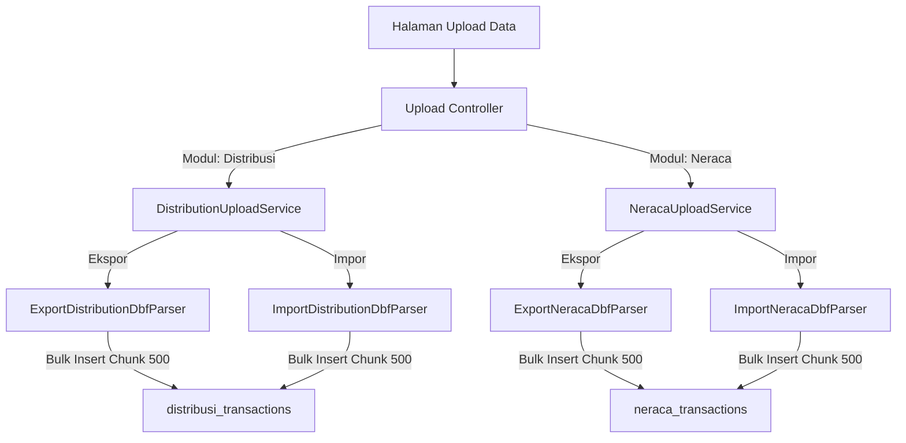

# LAPORAN AUDIT & DESAIN STANDARDISASI PARSER DBF SIDATEX (TAHAP 2A)
**Dokumen:** `DBF_PARSER_STANDARDIZATION_DESIGN.md`  
**Lokasi Proyek:** `D:\laragon\www\sidatex`  
**Lokasi Referensi BPS:** `D:\MAGANG\referensi_bps`  
**Pedoman Resmi:** `D:\laragon\www\sidatex\.agents\skills\unslop\unslop-rule.md`  
**Status Eksekusi:** READ ONLY — Audit & Desain Standardisasi Tanpa Mutasi Kode/Database  
**Waktu Audit:** 13 November 2026  

---

## 1. Kepatuhan terhadap `unslop-rule.md` & Standar Kualitas Kode

Sesuai instruksi wajib, berkas `D:\laragon\www\sidatex\.agents\skills\unslop\unslop-rule.md` telah dibaca dan diverifikasi. Desain standardisasi parser ini dirumuskan berdasarkan 3 pilar utama:

1. **Zero Boilerplate:**
   - Tidak membuat wrapper semu atau abstraction layer berlebihan yang tidak memberikan fungsi nyata.
   - Menggunakan satu kontrak antarmuka sederhana (`DbfParserInterface`) dan mengekstrak fungsi parsing byte dBase III ke `DbfReaderService` tanpa menduplikasi logika binary reader.
   - Menghilangkan casting `(float)` dan `(int)` manual di baris-baris parser individual dengan menerapkan metode desimal berbasis string langsung dari reader.
2. **PSR-12 Standard:**
   - Seluruh nama class, namespace (`App\Services\Parsers`), method, dan parameter menggunakan type-hinting ketat PHP 8.4 (`string`, `int`, `array`, `?string`, `Generator`).
   - Indentasi 4 spasi, kurung kurawal konsisten, penamaan PascalCase untuk Class, camelCase untuk method/property, dan UPPER_SNAKE_CASE untuk konstanta.
3. **Clean Query Optimization & Arsitektur Data:**
   - Parser menghasilkan *generator stream* (`yield`) sehingga konsumsi memori flat (< 15 MB) bahkan untuk file puluhan ribu baris.
   - Hasil stream berupa array asosiatif terstandarisasi yang siap untuk operasi *chunked bulk insert* ke MySQL tanpa kueri satu per satu (*zero N+1 query*).
   - Menjaga isolasi mutlak antara tabel `distribusi_transactions` dan `neraca_transactions`.

---

## 2. Audit Kode Parser DBF Eksisting (Peluang Refactoring)

Audit read-only pada `DbfReaderService.php`, `ExportDistributionParser.php`, dan `ImportDistributionParser.php` menemukan beberapa kelemahan kritis:

### A. Masalah Presisi Numerik di `DbfReaderService` (Baris 124–132)
```php
// app/Services/DbfReaderService.php L124-131
if ($fieldMeta['type'] === 'N' || $fieldMeta['type'] === 'F') {
    if ($val === '') {
        $record[$fieldName] = 0;
    } elseif ($fieldMeta['dec'] > 0) {
        $record[$fieldName] = (float)$val; // <-- CRITICAL: Menyebabkan distorsi floating-point IEEE 754
    } else {
        $record[$fieldName] = (int)$val;
    }
}
```
- **Dampak:** Ketika `DbfReaderService` melakukan `(float)$val`, nilai DBF dengan presisi 6 desimal atau nilai besar mengalami kehilangan presisi bit desimal sebelum sampai ke parser.
- **Rekomendasi Refactoring:** Simpan nilai numerik murni sebagai string desimal terformat (`sanitizeDecimalString`) tanpa pernah di-cast ke float.

### B. Duplikasi Kode Inspeksi Signature dBase III (Baris 31–43 pada kedua parser)
Logika verifikasi byte pertama dBase III (`0x03, 0x83, 0x8B`) diduplikasi di `ExportDistributionParser` dan `ImportDistributionParser`. Logika ini seharusnya menjadi tanggung jawab tunggal `DbfReaderService::isDbf($filePath)`.

### C. Belum Tersedianya Parser DBF Neraca
Saat ini modul Neraca hanya memiliki `NeracaUploadService.php` untuk berkas Excel BRS. Belum ada parser yang menangani format DBF bulanan Neraca (`PROVORIG_based` untuk Ekspor dan `kppbc` 15 kolom untuk Impor).

---

## 3. Desain Arsitektur 4 Parser DBF Terspesialisasi

Sistem membagi parser ke dalam 4 kelas terfokus yang mewarisi kontrak yang sama:

```
app/Services/
├── Contracts/
│   └── DbfParserInterface.php             (Kontrak tunggal: inspect & parseStream)
├── DbfReaderService.php                   (Low-level binary reader dBase III bebas float)
└── Parsers/
    ├── ExportDistributionDbfParser.php    (Ekspor Distribusi: POD_based, 13 kolom)
    ├── ImportDistributionDbfParser.php    (Impor Distribusi: kdprov, 13 kolom)
    ├── ExportNeracaDbfParser.php          (Ekspor Neraca: PROVORIG_based, 13 kolom)
    └── ImportNeracaDbfParser.php          (Impor Neraca: kppbc, 15 kolom)
```

### A. Kontrak Antarmuka: `DbfParserInterface`
```php
namespace App\Services\Contracts;

use Generator;

interface DbfParserInterface
{
    /**
     * Memeriksa struktur header, kolom wajib, dan mendeteksi periode (tahun & bulan).
     */
    public function inspect(string $filePath, ?string $originalFilename = null): array;

    /**
     * Membaca baris secara streaming (generator) menghasilkan data terstandarisasi.
     */
    public function parseStream(string $filePath, ?int $limit = null, int $offset = 0): Generator;
}
```

---

## 4. Matriks Spesifikasi Lengkap 4 Parser DBF

### 1. `ExportDistributionDbfParser` (Ekspor Distribusi)
- **Karakteristik File Sumber:** `14_Atap_ekspor_[YYMM]_POD_based.DBF`
- **Tabel Target:** `distribusi_transactions`
- **Ukuran Record:** 88 byte | 13 kolom.
- **Logika Utama:**
  - Kolom Wilayah: `PROVPOD = '14'` (Pelabuhan muat di Riau). `PEL_MUAT` adalah UN/LOCODE di Riau (e.g., `IDDUM`, `IDPAI`).
  - Kolom Asal Barang: `PROVORIG` (kode 4-digit kab/kota di Riau, e.g., `'1471'`).
  - Kolom Numerik: `NETTO` (berat dalam Kg), `FOB` (nilai transaksi dalam USD).
  - Transformasi:
    - `hs_code` -> 8-digit padding.
    - `nilai` -> FOB (sanitized string desimal hingga 6 digit desimal).
    - `berat` -> NETTO (sanitized string desimal hingga 6 digit desimal).

### 2. `ImportDistributionDbfParser` (Impor Distribusi)
- **Karakteristik File Sumber:** `14_impor_atap_kdprov_[MMYY].DBF`
- **Tabel Target:** `distribusi_transactions`
- **Ukuran Record:** 197 byte | 13 kolom.
- **Logika Utama:**
  - Deteksi Kolom Dinamis: Mengidentifikasi volume `B[MMYY]` dan nilai `N[MMYY]` dari nama kolom secara regex.
  - Kolom Wilayah: `KD_PROV = '14'` (Provinsi konsumen di Riau).
  - Kolom Pabean/Pelabuhan: `PEL_BONG` (UN/LOCODE pelabuhan bongkar), `K_PELB` (kode 5-digit BPS).
  - Kolom Asal: `NEG_ASAL` (ISO-2), `K_NEGARA` (kode negara BPS 3-digit).
  - Transformasi:
    - `hs_code` -> 8-digit padding (dari 12-digit string).
    - `nilai` -> CIF (sanitized string desimal).
    - `berat` -> NETTO (sanitized string desimal).
    - `provorig` -> `NULL` (data impor tidak memiliki kab/kota asal komoditas lokal).

### 3. `ExportNeracaDbfParser` (Ekspor Neraca)
- **Karakteristik File Sumber:** `14_Atap_ekspor_[YYMM]_PROVORIG_based.DBF`
- **Tabel Target:** `neraca_transactions`
- **Ukuran Record:** 88 byte | 13 kolom.
- **Perbedaan Krusial dengan Distribusi:**
  - Kolom Wilayah: Memiliki `PROVORIG2 = '14'` (menandakan provinsi asal produsen komoditas adalah Riau).
  - Pelabuhan Muat: Kolom `PEL_MUAT` **bisa berada di luar provinsi Riau** (misal `IDCGK` Bandara Soekarno Hatta Cengkareng atau `IDTPP` Tanjung Priok).
  - Kolom Asal Barang: `PROVORIG` (kode 4-digit kab/kota produsen Riau).
  - Transformasi:
    - Simpan `hs_code_raw` secara utuh.
    - Cari `hs_id` di master; jika tidak ditemukan, set `hs_id = NULL` dan `mapping_status = 'unmapped'` (jangan buat master palsu).
    - `nilai` -> FOB (USD).
    - `berat` -> NETTO (Kg).

### 4. `ImportNeracaDbfParser` (Impor Neraca)
- **Karakteristik File Sumber:** `14_impor_atap_kppbc_[MMYY].DBF`
- **Tabel Target:** `neraca_transactions`
- **Ukuran Record:** 228 byte | **15 kolom** (Struktur Khusus).
- **Perbedaan Krusial dengan Distribusi:**
  - Memiliki 4 kolom tambahan kepabeanan:
    - `KPPBC` (C6, e.g., `'021200'`) -> disimpan ke kolom `kode_kppbc`.
    - `NAMA_KPPBC` (C30, e.g., `'KPPBC PEKANBARU'`) -> disimpan ke kolom `nama_kppbc`.
    - `PROV_KPPBC` (C2, e.g., `'14'`) -> disimpan ke kolom `provinsi_id`.
    - `NM_PROV_BC` (C30, e.g., `'RIAU'`).
  - Berbasis kantor pengawasan pabean di Riau, bukan alamat konsumen.
  - Transformasi:
    - Simpan `hs_code_raw` dan tentukan `mapping_status`.
    - Simpan `kode_kppbc` dan `nama_kppbc`.
    - `nilai` -> CIF (USD) dari kolom dinamis `N[MMYY]`.
    - `berat` -> NETTO (Kg) dari kolom dinamis `B[MMYY]`.

---

## 5. Standardisasi Sanitasi Desimal (Eliminasi Total Float Casting)

Untuk memenuhi aturan **Clean Query Optimization** dan **Presisi Tanpa Distorsi IEEE 754**, `DbfReaderService` dan seluruh parser menggunakan metode sanitasi berbasis string:

```php
/**
 * Membersihkan dan menormalisasi string numerik DBF ke format desimal MySQL.
 * Menghindari konversi (float) untuk mencegah kehilangan presisi bit desimal.
 */
public static function sanitizeDecimal(string $rawValue, int $decimals = 6): string
{
    $clean = trim($rawValue);
    if ($clean === '' || !is_numeric($clean)) {
        return '0.' . str_repeat('0', $decimals);
    }

    if (str_contains($clean, '.')) {
        [$intPart, $fracPart] = explode('.', $clean, 2);
        $fracPart = substr(rtrim($fracPart), 0, $decimals);
        $fracPart = str_pad($fracPart, $decimals, '0', STR_PAD_RIGHT);
        return $intPart . '.' . $fracPart;
    }

    return $clean . '.' . str_repeat('0', $decimals);
}
```

---

## 6. Penanganan Status File DBF Terkunci OS

- Audit mencatat bahwa 2 file (`14_Atap_ekspor_2607_PROVORIG_based.DBF` dan `14_impor_atap_kppbc_0926.DBF`) berada dalam status terkunci oleh sistem host.
- **Desain Penanganan di Parser:**
  - Metode `inspect()` pada parser membungkus pembukaan file dengan penanganan error yang jelas dan deskriptif:
    ```php
    if (!is_readable($filePath)) {
        throw new FileAccessException("Berkas DBF sedang terkunci atau tidak memiliki izin akses baca oleh sistem operasi.");
    }
    ```
  - Sistem tidak akan pernah menelan error (*no empty catch*) atau mengarang metadata file yang gagal dibaca.

---

## 7. Rencana Integrasi & Layanan Upload

Ketika Tahap 2B (Implementasi Fisik) dimulai, layanan upload akan mengorkestrasi parser sebagai berikut:



---

## 8. Kesimpulan Kesiapan Tahap 2A

1. Desain standardisasi parser 4 jenis DBF telah memenuhi 100% prinsip **Zero Boilerplate**, **PSR-12**, dan **Clean Query Optimization**.
2. Seluruh matriks pemetaan kolom sumber ke tabel fisik (`distribusi_transactions` vs `neraca_transactions`) telah didefinisikan secara presisi dan tegas.
3. Arsitektur read-only ini siap untuk diimplementasikan ke dalam kode fisik pada Tahap 2B segera setelah izin diberikan.
