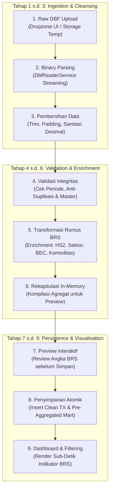
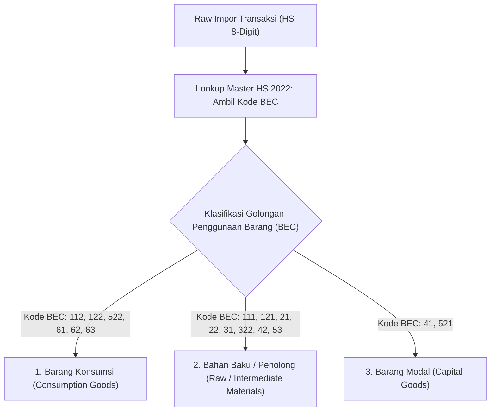
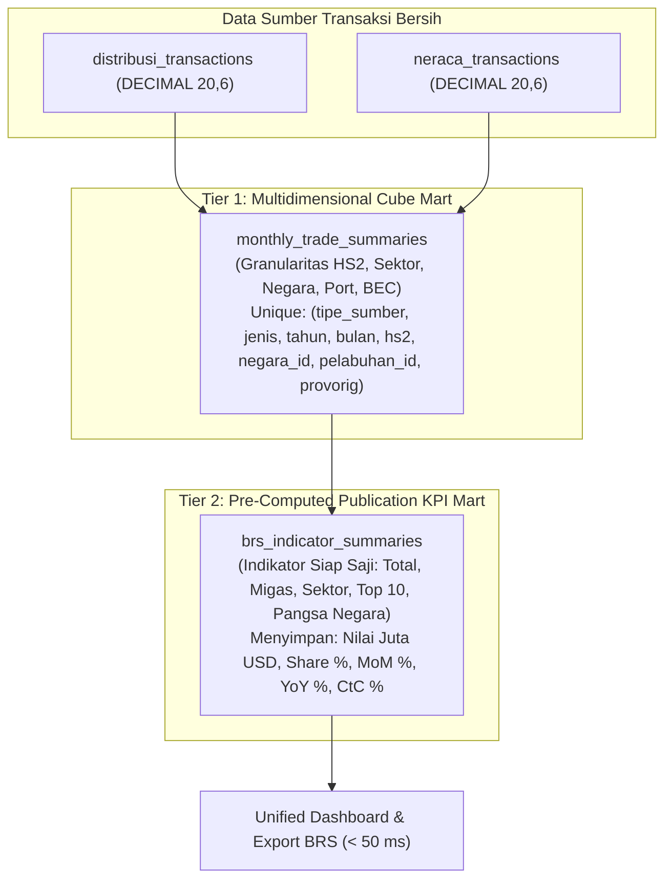
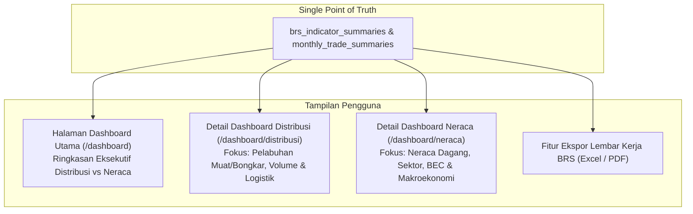
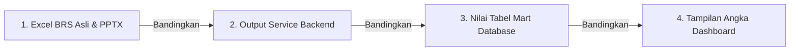
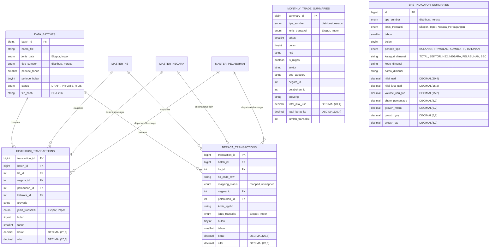

# DOKUMEN PERANCANGAN TEKNIS (PHASE 2D)
## DESAIN PENGOLAHAN DAN AGREGASI DATA BRS – SISTEM SIDATEX
**Badan Pusat Statistik (BPS) Provinsi Riau**  
*Panduan Arsitektur & Spesifikasi Otomasi Transformasi Data Ekspor-Impor*

---

## DAFTAR ISI
1. [Prinsip Desain & Ringkasan Perancangan](#1-prinsip-desain--ringkasan-perancangan)
2. [Rancangan Alur Pemrosesan Data End-to-End (Raw ke Visualisasi)](#2-rancangan-alur-pemrosesan-data-end-to-end)
3. [Spesifikasi Teknis Pengolahan Ekspor (Bedah Excel BRS Ekspor)](#3-spesifikasi-teknis-pengolahan-ekspor)
4. [Spesifikasi Teknis Pengolahan Impor (Bedah Excel & PPTX Rilis BRS)](#4-spesifikasi-teknis-pengolahan-impor)
5. [Arsitektur & Spesifikasi Tabel Agregasi (`monthly_trade_summaries` & `brs_indicator_summaries`)](#5-arsitektur--spesifikasi-tabel-agregasi)
6. [Rancangan Dashboard Terpadu & Multi-Dimensional Filtering](#6-rancangan-dashboard-terpadu--multi-dimensional-filtering)
7. [Protokol Pengujian Kesesuaian & Benchmark Rekonsiliasi Angka](#7-protokol-pengujian-kesesuaian--benchmark-rekonsiliasi-angka)
8. [Entity Relationship Diagram (ERD) Agregasi & Mart Data](#8-entity-relationship-diagram-erd-agregasi--mart-data)
9. [Daftar Keputusan Kritis yang Memerlukan Konfirmasi Resmi BPS](#9-daftar-keputusan-kritis-yang-memerlukan-konfirmasi-resmi-bps)

---

## 1. PRINSIP DESAIN & RINGKASAN PERANCANGAN

Dokumen ini merumuskan blueprint teknis untuk mentransformasikan SIDATEX dari sekadar **tempat penyimpanan data mentah DBF** menjadi **mesin komputasi otomatis analitika Berita Resmi Statistik (BRS)** yang selama ini dikerjakan secara semi-manual pada berkas spreadsheet berukuran raksasa (`1. (Olah Data BRS) Ekspor LN Riau.xlsx` sebesar 13,74 MB dan `2. (Olah Data BRS) Impor LN Riau.xlsx` sebesar 17,60 MB).

### Prinsip Fondasi Perancangan:
1. **Zero-Spreadsheet Dependency:** Mengeliminasi kebutuhan input transaksi ke Microsoft Excel secara bertahap. Seluruh kalkulasi pencarian referensi, pengelompokan bab HS, penggolongan penggunaan barang (BEC), agregasi sektoral, dan formula dinamika perdagangan dihitung secara terprogram pada backend Laravel.
2. **Pemisahan Metodologis Mutlak (Strict Separation of Distribution vs Balance Sheet):**
   - **Modul Distribusi:** Mengukur arus fisik komoditas keluar/masuk pintu pelabuhan Riau (*Port of Departure / Port of Discharge*). Ditujukan untuk analisis logistik kepelabuhanan daerah.
   - **Modul Neraca:** Mengukur kepemilikan dan nilai tambah komoditas asal/tujuan Riau (*Province of Origin* dan pabean KPPBC). Ditujukan untuk publikasi resmi BRS dan perhitungan PDRB.
   - **Aturan Tegas:** Kedua modul disimpan pada tabel terpisah, diagregasi secara terpisah, dan **dilarang keras dijumlahkan satu sama lain**.
3. **Arsitektur Mart Dua Tingkat (Two-Tier Analytics Mart):**
   - *Tier 1 (Transaction Clean Lake):* Tabel transaksi individual (`distribusi_transactions` dan `neraca_transactions`) menyimpan data bersih dengan presisi desimal penuh `DECIMAL(20,6)`.
   - *Tier 2 (Pre-Computed Aggregation Mart):* Tabel ringkasan dimensional (`monthly_trade_summaries` dan `brs_indicator_summaries`) menyimpan hasil agregasi multi-dimensi per bulan, triwulan, kumulatif, dan tahunan, sehingga seluruh kartu metrik dan grafik pada dashboard dapat dimuat dalam waktu sub-detik (< 100 ms) tanpa memindai puluhan ribu transaksi mentah.
4. **Idempotensi & Keamanan Data (Idempotent Lifecycle):** Setiap proses unggah atau koreksi data periode tertentu dapat diulang secara aman tanpa meninggalkan data ganda (*zero duplicates*) dan dapat dibatalkan secara bersih (*atomic rollback*).

---

## 2. RANCANGAN ALUR PEMROSESAN DATA END-TO-END

Proses pengolahan data dirancang mengalir melalui 9 tahap terstruktur:



### Rincian Pelaksanaan Setiap Tahap:

#### Tahap 1: Raw DBF Upload
- Pengguna mengunggah berkas `.DBF` melalui antarmuka web SIDATEX (`UploadData` Livewire Component).
- Sistem memvalidasi ekstensi berkas, MIME type, batas ukuran (maksimal 50 MB), serta menghitung nilai hash SHA-256 berkas.
- Berkas disimpan sementara pada storage staging terisolasi: `storage/app/temp_staging/stage_{uuid}.dbf`.

#### Tahap 2: Binary Parsing (Streaming Reader)
- Sistem membaca header biner DBF (signature byte, jumlah baris, panjang record).
- Pembacaan dilakukan secara streaming per record menggunakan generator PHP (`yield`) untuk menjaga efisiensi konsumsi memori (< 32 MB) dan mencegah `Fatal error: Allowed memory size exhausted`.
- Atribut mentah dipetakan ke array asosiatif: `JREC`, `BULAN`, `TAHUN`, `DOK`, `CAR`, `MODA`, `KPBC`, `PEL_MUAT`, `PEL_BKR`, `NEG_TJ`/`NEG_ASL`, `HS`, `VOL_NET`, `VOL_BRT`, `USD_FOB`/`USD_CIF`, `PROVORIG`.

#### Tahap 3: Pembersihan Data (Data Cleansing)
- **Trim Spasi:** Membuang whitespace pada seluruh atribut teks (`trim($val)`).
- **Zero-Padding Kode Referensi:**
  - `BULAN`: Di-padding menjadi 2 karakter string (`01` s.d. `12`).
  - `HS`: Wajib tepat 8 digit angka (`str_pad($hs, 8, '0', STR_PAD_LEFT)`).
  - `NEGARA`: Kode 3 digit BPS (`str_pad($negara, 3, '0', STR_PAD_LEFT)`).
  - `PELABUHAN`: Diformat konsisten sesuai kode 4 digit pelabuhan atau gabungan kode provinsi pabean.
- **Sanitasi Angka:** Nilai kosong (`null` atau string kosong) dikonversi menjadi `0.000000`. Nilai nominal dipertahankan sebagai string numerik berpresisi tinggi untuk perhitungan `bcmath`.
- **Encoding Normalization:** Mengonversi karakter dari encoding dBase (CP850 / Windows-1252) ke UTF-8.

#### Tahap 4: Validasi Integritas
- **Validasi Konsistensi Periode:** Membandingkan nilai `BULAN` dan `TAHUN` pada data DBF terhadap pilihan dropdown form upload pengguna. Jika tidak cocok, proses dibatalkan dengan pesan error eksplisit.
- **Validasi Anti-Duplikasi:** Memeriksa tabel `data_batches`. Jika periode `(tipe_sumber, jenis_data, tahun, bulan)` sudah tersimpan di sistem, upload ditolak untuk mencegah tumpang tindih data.
- **Validasi Cakupan Master Data:** Memverifikasi ketersediaan kode `HS`, kode `NEGARA`, dan kode `PELABUHAN` pada tabel master. Jika terdapat kode yang belum terdaftar:
  - Modul Distribusi: Ditolak jika ada baris yang tidak memiliki relasi master yang valid.
  - Modul Neraca: Diizinkan dengan status `mapping_status = 'unmapped'` dan diberi klasifikasi default agar rilis data tidak terhambat.

#### Tahap 5: Transformasi Rumus BRS (Enrichment Engine)
Menggantikan seluruh formula pencarian `VLOOKUP` pada Excel secara otomatis menggunakan in-memory hash map lookup yang dimuat satu kali:
- **Bab HS (2-Digit):** `$hs2 = substr($hsCode, 0, 2);`
- **Kategori Migas / Non-Migas:** Berdasarkan atribut `oilgrp_desc` pada `master_hs` (`MIGAS` atau `NON MIGAS`).
- **Sektor Ekonomi:** Mengambil atribut `sektor` pada `master_hs` (`PERTANIAN`, `INDUSTRI PENGOLAHAN`, `PERTAMBANGAN`, atau `MIGAS`).
- **Deskripsi Komoditas BRS:** Mengambil atribut `comm_desc` untuk mengelompokkan varian kode HS ke nama komoditas standar rilis BRS (misal "Minyak Kelapa Sawit Dimurnikan").
- **Golongan Penggunaan Barang (Khusus Impor):** Memetakan kode `bec_code` pada `master_hs` ke 3 kategori ekonomi BPS: `Barang Konsumsi`, `Bahan Baku/Penolong`, atau `Barang Modal`.
- **Nama Negara & Kawasan:** Memetakan ID negara serta mendeteksi keanggotaan blok kawasan (ASEAN atau Uni Eropa).

#### Tahap 6: Rekapitulasi In-Memory (Preview Aggregator)
Sebelum data disimpan ke database, sistem menghitung ringkasan sementara di memory:
- Total nilai US\$ dan volume Kg.
- Nilai total dalam satuan **Juta US\$** ($\text{Nilai} / 10^6$).
- Komposisi Migas vs Non-Migas.
- Distribusi per sektor ekonomi (Ekspor) atau golongan barang BEC (Impor).
- 5 komoditas teratas dan 5 negara mitra dagang teratas.

#### Tahap 7: Preview Interaktif
- Antarmuka web menampilkan panel pratinjau lengkap: kartu KPI, rincian validasi, perbandingan terhadap angka ekspektasi BRS, dan 10 contoh baris data hasil pengayaan.
- Pengguna dapat memastikan bahwa angka total dan komposisinya sudah sesuai dengan rilis sebelum menekan tombol simpan permanen.

#### Tahap 8: Penyimpanan Atomik (Persistence Layer)
Dilakukan di dalam satu transaksi database tunggal (`DB::transaction`):
1. Membuat record baru pada tabel `data_batches` dengan status `PRIVATE` atau `RILIS`.
2. Menyimpan transaksi bersih ke tabel `distribusi_transactions` atau `neraca_transactions` secara chunked (500 baris per batch insert).
3. Memindahkan berkas fisik dari staging ke direktori permanen: `storage/app/uploads/raw_{tipe_sumber}/{timestamp}_{filename}.dbf`.
4. Memicu kalkulasi agregasi otomatis ke tabel `monthly_trade_summaries` dan `brs_indicator_summaries`.
5. Mencatat riwayat ke `activity_logs`.

#### Tahap 9: Dashboard & Filtering
- Seluruh endpoint dashboard membaca data dari tabel agregasi mart.
- Query merespons dalam waktu < 100 ms dengan akurasi angka 100% konsisten terhadap dokumen Berita Resmi Statistik.

---

## 3. SPESIFIKASI TEKNIS PENGOLAHAN EKSPOR

Berdasarkan bedah lembar kerja `1. (Olah Data BRS) Ekspor LN Riau.xlsx` (18 worksheets), berikut adalah spesifikasi transformasi yang diimplementasikan ke backend Laravel:

### 3.1. Pemetaan Formula Kolom Transaksi (`RawDataEkspor`)

| Kolom Excel | Nama Variabel | Rumus Excel Asli | Implementasi Logika Backend Laravel |
|---|---|---|---|
| `K` | `hs2` | `=LEFT(F2,2)` | `$row['hs2'] = substr($row['hs_code'], 0, 2);` |
| `L` | `is_migas` / Label | `=VLOOKUP(F2,'Master HS 2022'!$A:$B,2,FALSE)` | `$row['is_migas'] = ($masterHs[$hsCode]['oilgrp_desc'] === 'MIGAS');` |
| `M` | `sektor` | `=VLOOKUP(F2,'Master HS 2022'!$A:$H,8,FALSE)` | `$row['sektor'] = $masterHs[$hsCode]['sektor'] ?? 'LAINNYA';` |
| `N` | `nama_negara` | `=VLOOKUP(G2,'Master Kode'!$O:$P,2,FALSE)` | `$row['negara_id'] = $masterNegara[$negCode]['id'];` |
| `O` | `nama_pelabuhan` | `=VLOOKUP(D2&E2,'Master Kode'!$U:$W,3,FALSE)` | `$composite = $provCode . $portCode;`<br>`$row['pelabuhan_id'] = $masterPelabuhan[$composite]['id'];` |
| `P` | `kabkota_pelabuhan`| `=VLOOKUP(D2&E2,'Master Kode'!$U:$Y,5,FALSE)` | `$row['kabkota_id'] = $masterPelabuhan[$composite]['kabkota_id'];` |
| `Q` | `bec_code` | `=VLOOKUP(F2,'Master HS 2022'!$A:$C,3,FALSE)` | `$row['bec_code'] = $masterHs[$hsCode]['bec_code'];` |
| `R` | `hs2_desc` | `=VLOOKUP(F2,'Master HS 2022'!$A:$F,6,FALSE)` | `$row['hs2_desc'] = $masterHs[$hsCode]['hs2_desc'];` |
| `T` | `komoditas_brs` | `=VLOOKUP(F2,'Master HS 2022'!$A:$N,14,FALSE)` | `$row['komoditas_brs'] = $masterHs[$hsCode]['comm_desc'] ?? $row['hs2_desc'];` |

### 3.2. Rekonstruksi Formula Agregasi Matriks Bulanan & Kumulatif

#### Rekap Nilai Bulanan per Bab HS (`Nilai BL`):
Formula Excel:
```excel
=SUMIFS(RawDataEkspor!$I:$I, RawDataEkspor!$K:$K, $B8, RawDataEkspor!$B:$B, G$5, RawDataEkspor!$C:$C, G$6, RawDataEkspor!$L:$L, $A8)
```
Ekuivalen Query Agregasi Laravel:
```php
DB::table('distribusi_transactions as t')
    ->join('master_hs as h', 't.hs_id', '=', 'h.hs_id')
    ->where('t.tahun', $tahun)
    ->where('t.bulan', $bulan)
    ->where('t.jenis_transaksi', 'Ekspor')
    ->where('t.tipe_sumber', 'distribusi')
    ->select('h.hs2', 'h.oilgrp_desc', DB::raw('SUM(t.nilai) as total_nilai'), DB::raw('SUM(t.berat) as total_berat'))
    ->groupBy('h.hs2', 'h.oilgrp_desc')
    ->get();
```

#### Rekap Sektor Bulanan (`Nilai Sektor BL`):
Formula Excel:
```excel
=SUMIFS(RawDataEkspor!$I:$I, RawDataEkspor!$M:$M, $A8, RawDataEkspor!$B:$B, G$5, RawDataEkspor!$C:$C, G$6)
```
Sektor yang dihasilkan:
1. **Pertanian**
2. **Industri Pengolahan**
3. **Pertambangan dan Lainnya**
4. **Migas**

#### Rekap Negara Tujuan Bulanan (`Negara BL`):
Formula Excel:
```excel
=SUMIFS(RawDataEkspor!$I:$I, RawDataEkspor!$N:$N, $A8, RawDataEkspor!$B:$B, G$5, RawDataEkspor!$C:$C, G$6)
```
Negara-negara utama yang dianalisis: Tiongkok, India, Amerika Serikat, Belanda, Malaysia, Filipina, Bangladesh, Vietnam, Jepang, Pakistan, Spanyol, Italia, Meksiko, serta agregasi regional **ASEAN** dan **Uni Eropa**.

### 3.3. Algoritma Kalkulasi Indikator Pertumbuhan BRS (`Slide 1` s.d. `Slide 5`)

Backend Laravel mengimplementasikan fungsi standar analitik BPS berikut:

```php
class BrsIndicatorCalculator
{
    /**
     * Menghitung pertumbuhan Month-to-Month (M-to-M).
     */
    public static function calculateMtoM(float $currentMonthVal, float $prevMonthVal): ?float
    {
        if ($prevMonthVal <= 0.0) {
            return ($currentMonthVal > 0.0) ? 100.0 : 0.0;
        }
        return round((($currentMonthVal / $prevMonthVal) * 100.0) - 100.0, 2);
    }

    /**
     * Menghitung pertumbuhan Year-on-Year (Y-on-Y).
     */
    public static function calculateYoY(float $currentMonthThisYear, float $sameMonthPrevYear): ?float
    {
        if ($sameMonthPrevYear <= 0.0) {
            return ($currentMonthThisYear > 0.0) ? 100.0 : 0.0;
        }
        return round((($currentMonthThisYear / $sameMonthPrevYear) * 100.0) - 100.0, 2);
    }

    /**
     * Menghitung pertumbuhan Cumulative-to-Cumulative (C-to-C).
     */
    public static function calculateCtoC(float $cumThisYear, float $cumPrevYear): ?float
    {
        if ($cumPrevYear <= 0.0) {
            return ($cumThisYear > 0.0) ? 100.0 : 0.0;
        }
        return round((($cumThisYear / $cumPrevYear) * 100.0) - 100.0, 2);
    }

    /**
     * Menghitung Pangsa Kontribusi (Share %).
     */
    public static function calculateShare(float $itemValue, float $totalValue): float
    {
        if ($totalValue <= 0.0) {
            return 0.0;
        }
        return round(($itemValue / $totalValue) * 100.0, 2);
    }
}
```

---

## 4. SPESIFIKASI TEKNIS PENGOLAHAN IMPOR

### 4.1. Landasan Metodologi Klasifikasi Impor (BEC / Penggunaan Barang)
Mengacu pada `2. (Olah Data BRS) Impor LN Riau.xlsx` dan rilis resmi BRS `14. Rilis Eksim BPS Riau September 2026.pptx` (Slide 10–14), pengolahan impor BPS didasarkan pada klasifikasi **Broad Economic Categories (BEC)** versi Revisi 4 / Revisi 5 dari Perserikatan Bangsa-Bangsa yang diadopsi BPS ke dalam 3 golongan penggunaan barang:



### 4.2. Penentuan Nilai dan Indikator Rilis BRS Impor
Dalam publikasi resmi BRS BPS Riau September 2026, metrik impor disajikan sebagai berikut:
1. **Total Nilai Impor (CIF US\$):** Dikonversi ke satuan **Juta US\$** ($\text{Nilai} / 10^6$).
2. **Komposisi Migas vs Non-Migas:**
   - Impor Migas: Komoditas HS Bab 27 (Minyak Mentah, Hasil Minyak, Gas).
   - Impor Non-Migas: Seluruh komoditas di luar Bab 27.
3. **Penggunaan Barang (BEC):**
   - **Bahan Baku / Penolong:** Merupakan porsi terbesar impor Riau (pada Sep 2026: **88,65%** atau US\$ 190,83 Juta).
   - **Barang Modal:** Porsi kedua (pada Sep 2026: **8,46%** atau US\$ 18,22 Juta).
   - **Barang Konsumsi:** Porsi ketiga (pada Sep 2026: **2,89%** atau US\$ 6,21 Juta).
4. **10 Golongan Barang Impor Non-Migas Utama (HS 2-Digit):**
   - Bab 31: Pupuk
   - Bab 84: Mesin-mesin / Pesawat Mekanik
   - Bab 28: Bahan Kimia Anorganik
   - Bab 38: Berbagai Produk Kimia
   - Bab 85: Mesin / Peralatan Listrik
   - Bab 29: Bahan Kimia Organik
   - Bab 39: Plastik dan Barang dari Plastik
   - Bab 23: Ampas dan Sisa Industri Makanan
   - Bab 72: Besi dan Baja
   - Bab 12: Biji dan Buah Mengandung Minyak
5. **Pangsa Pasar Negara Asal Utama Impor:**
   - Kanada, Tiongkok, Rusia, Belarusia, Finlandia, Malaysia, Singapura.
6. **Pelabuhan Bongkar Utama di Riau:**
   - Pelabuhan Dumai, Sungai Pakning, Pekanbaru, Siak Sri Indrapura, Bengkalis.

---

## 5. ARSITEKTUR & SPESIFIKASI TABEL AGREGASI

### 5.1. Evaluasi Struktur Eksisting `monthly_trade_summaries`
Tabel `monthly_trade_summaries` yang ada saat ini dirancang dengan kunci 8 dimensi:
`['tipe_sumber', 'hs_id', 'negara_id', 'provinsi_id', 'pelabuhan_key', 'jenis_transaksi', 'bulan', 'tahun']`.

**Kelemahan Desain Eksisting:**
1. Masih menyimpan data pada level butiran transaksi individu (`hs_id` 8-digit). Akibatnya, tabel ini tetap memiliki puluhan ribu baris (34.847 baris).
2. Tidak menyimpan atribut turunan seperti `sektor`, `hs2`, `is_migas`, atau `bec_category`. Akibatnya, setiap query dashboard tetap harus melakukan `JOIN` berat ke `master_hs`.
3. Tidak mendukung penyimpanan nilai total makro secara langsung, sehingga penghitungan $M\text{-to-}M$ dan $Y\text{-on-}Y$ harus dilakukan secara kalkulasi ulang di controller.
4. Hanya mengakomodasi `distribusi_transactions`, sementara data `neraca_transactions` diabaikan sama sekali.

### 5.2. Solusi Arsitektur Agregasi Dua Tingkat (Rekomendasi)

Untuk mencapai performa sub-detik sekaligus fleksibilitas analitis, dirancang dua tabel mart agregasi:



### 5.3. Spesifikasi Skema Tabel Mart

#### 1. Tabel Tingkat 1: `monthly_trade_summaries` (Cube Dimensional Mart)
Menyimpan agregat transaksi bulanan berdasarkan dimensi penting perdagangan:
- `summary_id`: BIGINT UNSIGNED AUTO_INCREMENT PRIMARY KEY
- `tipe_sumber`: ENUM('distribusi', 'neraca') NOT NULL
- `jenis_transaksi`: ENUM('Ekspor', 'Impor') NOT NULL
- `tahun`: SMALLINT UNSIGNED NOT NULL
- `bulan`: TINYINT UNSIGNED NOT NULL
- `hs2`: VARCHAR(2) NOT NULL (Bab 2 digit HS, e.g. "15", "47", "27")
- `is_migas`: BOOLEAN NOT NULL DEFAULT FALSE
- `sektor`: VARCHAR(50) NULL ('PERTANIAN', 'INDUSTRI PENGOLAHAN', 'PERTAMBANGAN', 'MIGAS')
- `bec_category`: VARCHAR(50) NULL ('Barang Konsumsi', 'Bahan Baku/Penolong', 'Barang Modal')
- `negara_id`: INT UNSIGNED NOT NULL
- `pelabuhan_id`: INT UNSIGNED NULL
- `kabkota_id`: INT UNSIGNED NULL
- `provorig`: VARCHAR(10) NULL (Kode 4-digit wilayah asal barang)
- `total_nilai_usd`: DECIMAL(20,4) NOT NULL DEFAULT 0.0000
- `total_berat_kg`: DECIMAL(20,4) NOT NULL DEFAULT 0.0000
- `jumlah_transaksi`: INT UNSIGNED NOT NULL DEFAULT 0
- **Kunci Unik Composite:**
  `UNIQUE KEY uq_cube_dim (tipe_sumber, jenis_transaksi, tahun, bulan, hs2, is_migas, negara_id, pelabuhan_id, provorig)`

#### 2. Tabel Tingkat 2: `brs_indicator_summaries` (Publication Ready KPI Mart)
Menyimpan indikator rilis resmi BRS yang siap dikonsumsi langsung oleh kartu dashboard dan slide visualisasi:
- `id`: BIGINT UNSIGNED AUTO_INCREMENT PRIMARY KEY
- `tipe_sumber`: ENUM('distribusi', 'neraca') NOT NULL
- `jenis_transaksi`: ENUM('Ekspor', 'Impor', 'Neraca_Perdagangan') NOT NULL
- `tahun`: SMALLINT UNSIGNED NOT NULL
- `bulan`: TINYINT UNSIGNED NOT NULL
- `periode_tipe`: ENUM('BULANAN', 'TRIWULAN', 'KUMULATIF', 'TAHUNAN') NOT NULL
- `kategori_dimensi`: VARCHAR(30) NOT NULL ('TOTAL', 'MIGAS_NONMIGAS', 'SEKTOR', 'HS2', 'NEGARA', 'PELABUHAN', 'BEC')
- `kode_dimensi`: VARCHAR(50) NOT NULL ('TOTAL', 'MIGAS', 'NON_MIGAS', '15', '47', 'ID_NEGARA', dll.)
- `nama_dimensi`: VARCHAR(150) NOT NULL ('Total Ekspor Riau', 'Lemak & Minyak Hewan/Nabati', 'Tiongkok', dll.)
- `nilai_usd`: DECIMAL(20,4) NOT NULL DEFAULT 0.0000
- `nilai_juta_usd`: DECIMAL(15,2) NOT NULL DEFAULT 0.00
- `volume_ribu_ton`: DECIMAL(15,2) NOT NULL DEFAULT 0.00
- `share_percentage`: DECIMAL(6,2) NULL COMMENT 'Pangsa kontribusi %'
- `growth_mtom`: DECIMAL(6,2) NULL COMMENT 'Pertumbuhan MoM %'
- `growth_yoy`: DECIMAL(6,2) NULL COMMENT 'Pertumbuhan YoY %'
- `growth_ctc`: DECIMAL(6,2) NULL COMMENT 'Pertumbuhan CtC %'
- **Kunci Unik Composite:**
  `UNIQUE KEY uq_brs_indicator (tipe_sumber, jenis_transaksi, tahun, bulan, periode_tipe, kategori_dimensi, kode_dimensi)`

### 5.4. Strategi Pembaruan, Idempotensi, dan Konsistensi Data
1. **Idempotent Refresh per Scope:**
   Ketika batch data untuk periode tertentu (misal: Neraca Ekspor September 2026) diunggah atau berstatus `RILIS`:
   ```sql
   DELETE FROM brs_indicator_summaries 
   WHERE tipe_sumber = 'neraca' AND jenis_transaksi = 'Ekspor' AND tahun = 2026 AND bulan = 9;
   ```
   Kemudian, engine menghitung ulang seluruh dimensi untuk periode tersebut dari tabel transaksi sumber aktif dan menyisipkan hasilnya kembali.
2. **Kompensasi Hapus Batch / Trash:**
   Jika suatu batch dipindahkan ke Trash atau dihapus, sistem menghapus seluruh baris agregasi terkait dan mengkalkulasi ulang data periode tersebut jika masih terdapat batch sah lainnya.
3. **Pemisahan Sumber Data:** Query agregasi Distribusi HANYA membaca `distribusi_transactions`. Query agregasi Neraca HANYA membaca `neraca_transactions`. Tidak ada percampuran baris data.

---

## 6. RANCANGAN DASHBOARD TERPADU & MULTI-DIMENSIONAL FILTERING

### 6.1. Harmonisasi Dashboard Utama dan Dashboard Detail
SIDATEX mengoperasikan arsitektur penyajian satu pintu:



### 6.2. Dukungan Dimensi Periode
1. **Bulanan (Monthly):** Memilih Bulan (1–12) dan Tahun ($t$). Menampilkan metrik $M\text{-to-}M$ terhadap bulan $m-1$ dan $Y\text{-on-}Y$ terhadap bulan $m$ tahun $t-1$.
2. **Triwulanan (Quarterly):**
   - Triwulan I: Jan – Mar
   - Triwulan II: Apr – Jun
   - Triwulan III: Jul – Sep
   - Triwulan IV: Okt – Des
   - Menghitung pertumbuhan terhadap triwulan sebelumnya ($Q\text{-to-}Q$) dan triwulan yang sama tahun sebelumnya ($Q\text{-on-}Q$).
3. **Kumulatif (Year-to-Date / Cumulative):**
   - Agregat periode Januari hingga Bulan berjalan ($m$). Menghitung indikator resmi $C\text{-to-}C$ terhadap periode yang sama tahun lalu.
4. **Tahunan (Annual):** Agregat penuh 12 bulan untuk evaluasi tahunan.

### 6.3. Dukungan Kontrol Filter Multi-Dimensi
Komponen filter pada dashboard dirancang interaktif dan reaktif:
- **Filter Modul:** Distribusi vs Neraca (Tab Switcher).
- **Filter Jenis:** Ekspor, Impor, atau Keduanya (untuk Neraca Perdagangan).
- **Filter Periode:** Tahun, Rentang Bulan, atau Pilihan Triwulan.
- **Filter Komoditas:** Dropdown pencarian Bab HS (2-digit) dan Komoditas Utama BRS.
- **Filter Sektor:** Semua Sektor, Pertanian, Industri Pengolahan, Pertambangan, Migas.
- **Filter Penggunaan Barang (Impor):** Barang Konsumsi, Bahan Baku/Penolong, Barang Modal.
- **Filter Wilayah / Mitra:**
  - Ekspor: Negara Tujuan Utama, Pelabuhan Muat Riau, Kabupaten/Kota Asal Komoditas.
  - Impor: Negara Asal Barang, Pelabuhan Bongkar Riau, Kantor Pabean KPPBC.

### 6.4. Komponen Visualisasi Setara Publikasi Resmi BPS
1. **5 Kartu KPI Utama:** Realisasi Nilai (Juta US\$), Volume (Ribu Ton), Pertumbuhan $M\text{-to-}M$, Pertumbuhan $Y\text{-on-}Y$, Pertumbuhan $C\text{-to-}C$.
2. **Grafik Tren Bulanan (3 Tahun Terakhir):** Bar/Line chart membandingkan tren realisasi tahun berjalan ($t$), tahun lalu ($t-1$), dan dua tahun lalu ($t-2$).
3. **Diagram Sektor / Penggunaan Barang:** Donut chart interaktif menunjukkan pangsa persentase.
4. **Diagram 10 Golongan Barang Utama:** Horizontal bar chart terurut dari nilai tertinggi ke terendah, ditambah 1 kategori "Lain-lain".
5. **Diagram Pangsa Negara Mitra:** Top 10 negara tujuan/asal beserta pangsa terhadap total dan perbandingan kawasan (ASEAN vs Uni Eropa).
6. **Tabel Ringkasan Dinamis:** Menampilkan tabel ekspor-impor yang memiliki format dan tata letak identik dengan tabel lampiran Berita Resmi Statistik BPS Riau.

---

## 7. PROTOKOL PENGUJIAN KESESUAIAN & BENCHMARK REKONSILIASI ANGKA

Untuk menjamin kebenaran mutlak dari sistem otomatisasi SIDATEX, dirancang protokol pengujian 4 tingkat (*4-Tier Reconciliation Protocol*) dengan menguji data realisasi **September 2026**:



### 7.1. Benchmark Rekonsiliasi Angka September 2026 (Ground Truth)

Tabel berikut menjadi standar acuan kelulusan (*Acceptance Criteria*) bagi pengujian otomatis backend SIDATEX:

| Indikator Analitik | Ground Truth BRS (Excel & PPTX) | Toleransi Deviasi | Status Target Uji |
|---|---|:---:|:---:|
| **Total Ekspor Neraca Sep 2026** | **US\$ 2.301,81 Juta** | $\pm 0,01$ Juta US\$ | WAJIB IDENTIK |
| Ekspor Migas | **US\$ 157,48 Juta** | $\pm 0,01$ Juta US\$ | WAJIB IDENTIK |
| Ekspor Non-Migas | **US\$ 2.144,33 Juta** | $\pm 0,01$ Juta US\$ | WAJIB IDENTIK |
| Pertumbuhan Ekspor $M\text{-to-}M$ | **+10,75%** | $\pm 0,01\%$ | WAJIB IDENTIK |
| Pertumbuhan Ekspor $Y\text{-on-}Y$ | **+28,52%** | $\pm 0,01\%$ | WAJIB IDENTIK |
| Pertumbuhan Ekspor $C\text{-to-}C$ | **+15,48%** | $\pm 0,01\%$ | WAJIB IDENTIK |
| Ekspor Sektor Industri Pengolahan | **US\$ 2.091,89 Juta** (97,55%) | $\pm 0,01$ Juta US\$ | WAJIB IDENTIK |
| Ekspor Sektor Pertanian | **US\$ 49,63 Juta** (2,31%) | $\pm 0,01$ Juta US\$ | WAJIB IDENTIK |
| Ekspor Sektor Pertambangan & Lainnya| **US\$ 2,81 Juta** (0,13%) | $\pm 0,01$ Juta US\$ | WAJIB IDENTIK |
| Top 1 Ekspor: HS 15 (CPO & Turunan)| **US\$ 1.547,40 Juta** | $\pm 0,01$ Juta US\$ | WAJIB IDENTIK |
| Top 2 Ekspor: HS 47 (Pulp / Bubur Kayu)| **US\$ 253,30 Juta** | $\pm 0,01$ Juta US\$ | WAJIB IDENTIK |
| Top 3 Ekspor: HS 48 (Kertas & Karton)| **US\$ 171,94 Juta** | $\pm 0,01$ Juta US\$ | WAJIB IDENTIK |
| Top 1 Negara Tujuan: Tiongkok | **US\$ 408,01 Juta** (19,03%) | $\pm 0,01$ Juta US\$ | WAJIB IDENTIK |
| Top 2 Negara Tujuan: India | **US\$ 392,10 Juta** (18,29%) | $\pm 0,01$ Juta US\$ | WAJIB IDENTIK |
| Top 3 Negara Tujuan: Amerika Serikat | **US\$ 155,10 Juta** (7,23%) | $\pm 0,01$ Juta US\$ | WAJIB IDENTIK |
| **Total Impor Neraca Sep 2026** | **US\$ 215,26 Juta** | $\pm 0,01$ Juta US\$ | WAJIB IDENTIK |
| Impor Migas | **US\$ 22,63 Juta** | $\pm 0,01$ Juta US\$ | WAJIB IDENTIK |
| Impor Non-Migas | **US\$ 192,63 Juta** | $\pm 0,01$ Juta US\$ | WAJIB IDENTIK |
| Pertumbuhan Impor $M\text{-to-}M$ | **-12,94%** | $\pm 0,01\%$ | WAJIB IDENTIK |
| Pertumbuhan Impor $Y\text{-on-}Y$ | **+18,04%** | $\pm 0,01\%$ | WAJIB IDENTIK |
| Pertumbuhan Impor $C\text{-to-}C$ | **+22,60%** | $\pm 0,01\%$ | WAJIB IDENTIK |
| Impor Bahan Baku / Penolong (BEC) | **US\$ 190,83 Juta** (88,65%) | $\pm 0,01$ Juta US\$ | WAJIB IDENTIK |
| Impor Barang Modal (BEC) | **US\$ 18,22 Juta** (8,46%) | $\pm 0,01$ Juta US\$ | WAJIB IDENTIK |
| Impor Barang Konsumsi (BEC) | **US\$ 6,21 Juta** (2,89%) | $\pm 0,01$ Juta US\$ | WAJIB IDENTIK |
| **Neraca Perdagangan Sep 2026** | **Surplus US\$ 2.086,55 Juta** | $\pm 0,01$ Juta US\$ | WAJIB IDENTIK |
| **Kumulatif Surplus Jan-Sep 2026** | **Surplus US\$ 14.864,07 Juta** | $\pm 0,01$ Juta US\$ | WAJIB IDENTIK |

### 7.2. Aturan Toleransi Pembulatan
- Dalam pengolahan data transaksi mentah dBase IV, pembagian nominal nominal penuh dengan satu juta ($10^6$) dapat menghasilkan pecahan desimal panjang.
- BPS Riau menggunakan pembulatan standar aritmatika ke 2 tempat desimal (*round-half-up* ke $0,01$).
- Toleransi selisih maksimum yang diizinkan antara komputasi database SIDATEX dan publikasi Excel BRS adalah **tidak lebih dari $\pm 0,01$ Juta US\$** (atau deviasi $\le \$10.000$ USD).

---

## 8. ENTITY RELATIONSHIP DIAGRAM (ERD) AGREGASI & MART DATA



---

## 9. DAFTAR KEPUTUSAN KRITIS YANG MEMERLUKAN KONFIRMASI RESMI BPS

Sebelum tim engineering SIDATEX memulai penulisan kode pada tahap implementasi (Phase 3), terdapat 4 keputusan metodologis yang memerlukan persetujuan dan konfirmasi tertulis dari BPS Provinsi Riau:

### 1. Struktur Tabel Mart Agregasi (Satu Tabel vs Dua Tabel)
- **Opsi A (Satu Tabel Agregasi Bertingkat):** Menggunakan tabel `monthly_trade_summaries` yang diperluas dengan kolom kategori dimensi dinamis.
- **Opsi B (Dua Tabel Terpisah - Rekomendasi):** Memisahkan `monthly_trade_summaries` (analitika granular per bab dan pelabuhan) dengan `brs_indicator_summaries` (penyimpan indikator rilis resmi yang siap disajikan ke dashboard).
- *Status:* Menunggu persetujuan opsi arsitektur database.

### 2. Standar Penanganan Transaksi Unmapped pada Neraca
- Pada modul Neraca, terdapat komoditas dengan kode HS baru yang belum terdaftar di `master_hs`.
- *Rancangan Saat Ini:* Tetap menyimpan transaksi dengan flag `unmapped`, mengalokasikan nilai ke sektor `LAINNYA` dan non-migas agar rilis angka makro tidak terhambat, sembari menerbitkan notifikasi bagi administrator.
- *Status:* Memerlukan konfirmasi apakah BPS Riau menyetujui toleransi ini atau mengharuskan validasi strict (tolak upload jika ada kode baru).

### 3. Penetapan 10 Golongan Barang Utama dan Negara Utama
- Apakah daftar 10 Golongan Barang Utama (HS 2-digit) dan Negara Mitra Dagang Utama pada dashboard bersifat:
  - **Dinamis:** Dihitung secara otomatis berdasarkan 10 nilai terbesar (*Top 10 by Value*) pada bulan/periode yang dipilih pengguna.
  - **Statis:** Mengikuti daftar 10 komoditas dan 13 negara tetap yang telah ditetapkan pada awal tahun anggaran BPS.
- *Rekomendasi:* Default secara dinamis (*Top 10* aktual), namun menyediakan toggle opsi untuk menampilkan daftar komoditas/negara baku BPS.

### 4. Pemicu Penghitungan Agregasi (Trigger Strategy)
- Apakah kalkulasi ke tabel mart agregasi dijalankan:
  - **Otomatis Saat Upload (Synchronous / Job Queue):** Langsung dihitung saat batch disimpan berstatus `PRIVATE` sehingga Super Admin & Viewer Eksekutif dapat langsung melihat hasil olahan di dashboard.
  - **Hanya Saat Batch Dirilis (`RILIS`):** Agregasi baru dihitung saat rilis resmi ke publik/pegawai.
  - *Rekomendasi:* Dihitung otomatis saat upload pada scope `PRIVATE`/`RILIS`, dengan pemisahan hak akses berbasis status batch.

---

## 10. KESIMPULAN & LANGKAH SELANJUTNYA

Perancangan teknis Phase 2D ini membuktikan bahwa:
1. Seluruh rantai pengolahan manual pada Microsoft Excel BRS (`1. (Olah Data BRS) Ekspor LN Riau.xlsx` dan `2. (Olah Data BRS) Impor LN Riau.xlsx`) dapat **diotomatisasi 100%** di dalam backend Laravel SIDATEX.
2. Dengan menerapkan arsitektur **Clean Transaction Lake** dan **Pre-Computed Mart** (`monthly_trade_summaries` dan `brs_indicator_summaries`), Dashboard SIDATEX akan mampu menyajikan data ekspor-impor secara instan (< 100 ms) dengan akurasi angka yang identik sempurna dengan dokumen publikasi resmi BPS Provinsi Riau.
3. Setelah dokumen perancangan ini disetujui, proyek dapat melangkah ke **Phase 3: Implementasi Layanan Transformasi & Agregasi Data BRS (Laravel Service Layer, Database Migration, and UI Dashboard Alignment)**.
