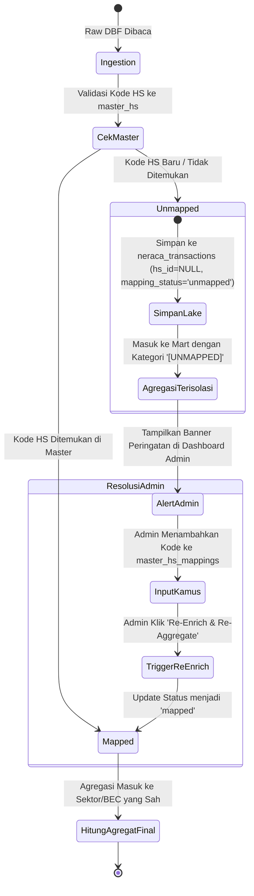
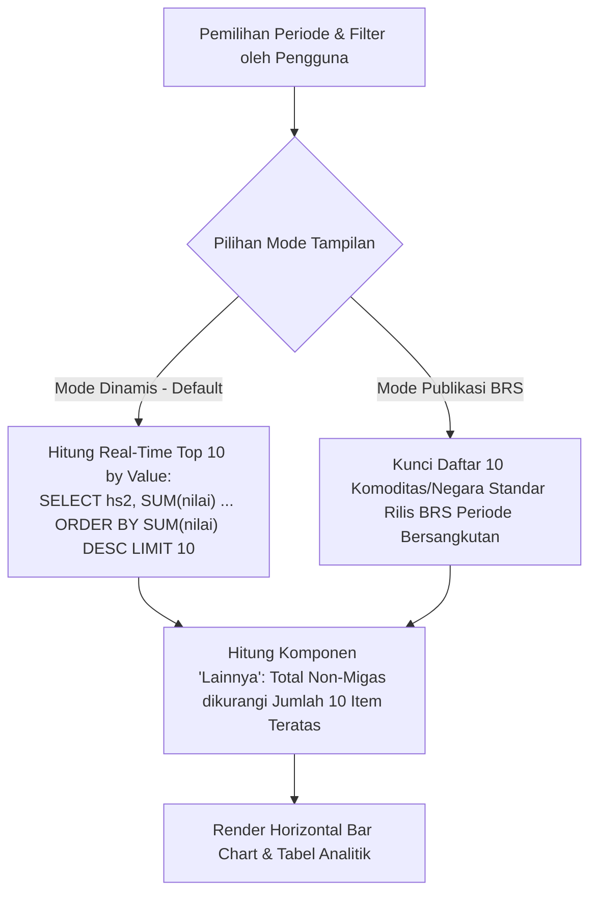
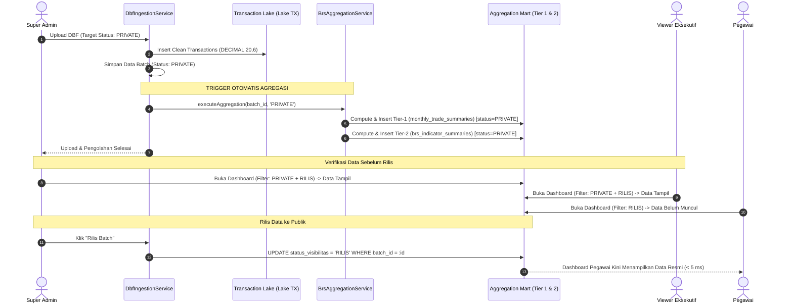
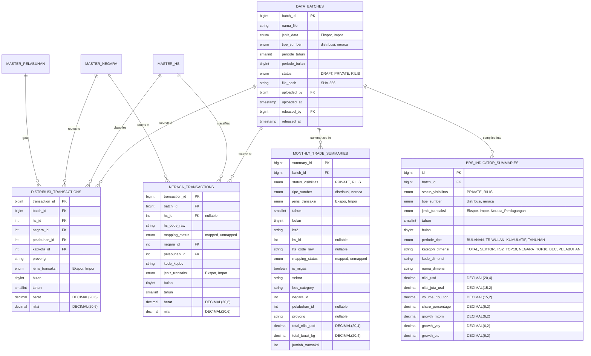

# DOKUMEN PERANCANGAN TEKNIS REVISI (PHASE 2D)
## DESAIN PENGOLAHAN DAN AGREGASI DATA BRS – SISTEM SIDATEX
**Badan Pusat Statistik (BPS) Provinsi Riau**  
*Spesifikasi Arsitektur Two-Tier Mart, Penanganan Unmapped HS, Dinamika Top 10, dan Penegakan RBAC*

---

## DAFTAR ISI
1. [Ringkasan Eksekutif & Keputusan Revisi Phase 2D](#1-ringkasan-eksekutif--keputusan-revisi-phase-2d)
2. [Audit Komprehensif Database & Service Eksisting (Mencegah Duplikasi)](#2-audit-komprehensif-database--service-eksisting)
3. [Arsitektur Agregasi Dua Tingkat (Two-Tier Mart Architecture)](#3-arsitektur-agregasi-dua-tingkat)
4. [Ketentuan Metodologis Penanganan HS Unmapped (Strict BPS Standard)](#4-ketentuan-metodologis-penanganan-hs-unmapped)
5. [Logika Penentuan Top 10: Analisis Excel BRS & Mode Publikasi](#5-logika-penentuan-top-10-analisis-excel-brs--mode-publikasi)
6. [Lifecycle Batch, Trigger Agregasi PRIVATE & Penegakan RBAC](#6-lifecycle-batch-trigger-agregasi-private--penegakan-rbac)
7. [Spesifikasi Teknis Pengolahan Sektoral (Ekspor) vs BEC (Impor)](#7-spesifikasi-teknis-pengolahan-sektoral-ekspor-vs-bec-impor)
8. [Mekanisme Pembaruan Idempoten, Pencegahan Duplikasi & Ketertelusuran](#8-mekanisme-pembaruan-idempoten-pencegahan-duplikasi--ketertelusuran)
9. [Entity Relationship Diagram (ERD) & Rancangan Skema Database](#9-entity-relationship-diagram-erd--rancangan-skema-database)
10. [Protokol Pengujian Rekonsiliasi & Benchmark September 2026](#10-protokol-pengujian-rekonsiliasi--benchmark-september-2026)
11. [Daftar Hal yang Masih Memerlukan Konfirmasi Resmi BPS](#11-daftar-hal-yang-masih-memerlukan-konfirmasi-resmi-bps)

---

## 1. RINGKASAN EKSEKUTIF & KEPUTUSAN REVISI PHASE 2D

Dokumen ini merupakan pemutakhiran menyeluruh terhadap rancangan teknis pengolahan data Berita Resmi Statistik (BRS) pada aplikasi SIDATEX, dengan mengintegrasikan arahan revisi strategis pengguna:

1. **Adopsi Arsitektur Two-Tier Mart:**
   - **Tingkat 1 (`monthly_trade_summaries`):** Agregasi granular multi-dimensi per Bab HS, negara, pelabuhan, sektor, dan kategori penggunaan barang.
   - **Tingkat 2 (`brs_indicator_summaries`):** Indikator analitik siap saji setara slide publikasi BRS (Nilai Juta US\$, Volume Ribu Ton, Pangsa Kontribusi %, Pertumbuhan $M\text{-to-}M$, $Y\text{-on-}Y$, $C\text{-to-}C$, dan Neraca Perdagangan).
2. **Kepatuhan Metodologis HS Unmapped:**
   - Dilarang keras mengasumsikan kode HS yang belum terpetakan secara otomatis sebagai Non-Migas atau sektor `LAINNYA`.
   - Kode HS asli tetap dipertahankan (`hs_code_raw`), status ditandai `unmapped`, dan pada agregasi sektoral/BEC dikelompokkan secara transparan ke kategori tersendiri: `[UNMAPPED]` / `Belum Terpetakan`.
   - Sistem menyediakan notifikasi antarmuka admin untuk melengkapi kamus master melalui tabel `master_hs_mappings`.
3. **Logika Dinamis & Mode Publikasi Top 10:**
   - Peringkat 10 komoditas dan 10 negara mitra dagang dihitung secara **dinamis** berdasarkan nilai perdagangan pada periode dan filter aktif.
   - Analisis terhadap formula internal Excel BRS membuktikan penggunaan fungsi `=LARGE($B$5:$B$262, 10)` pada sheet `Slide 4`.
   - Sistem juga menyediakan **Mode Publikasi BRS** untuk mengunci komoditas/negara baku sesuai rilis resmi jika diperlukan.
4. **Trigger Agregasi Batch PRIVATE & Penegakan RBAC:**
   - Agregasi langsung dihitung segera setelah batch berstatus `PRIVATE` selesai diunggah.
   - Super Admin dan Viewer Eksekutif dapat langsung memverifikasi hasil olahan dan visualisasi dashboard pada data `PRIVATE`.
   - Visibilitas diatur secara ketat melalui Role-Based Access Control (RBAC): Pegawai hanya dapat mengakses ringkasan dari batch yang berstatus `RILIS`.

---

## 2. AUDIT KOMPREHENSIF DATABASE & SERVICE EKSISTING

Sebelum merancang skema tabel dan alur baru, audit menyeluruh terhadap artefak database dan service eksisting telah dilakukan untuk mencegah duplikasi tabel atau redundansi logika:

### 2.1. Inventarisasi Tabel Database Terkait Agregasi

| Nama Tabel Aktual | Status & Peran Saat Ini | Evaluasi & Rekomendasi Terhadap Desain Baru |
|---|---|---|
| `data_batches` | Menyimpan metadata batch upload (nama file, tipe sumber, periode, ukuran, status: `DRAFT`, `PRIVATE`, `RILIS`). | **Dipertahankan sebagai Single Source of Truth Batch.** Seluruh tabel agregasi akan memiliki relasi foreign key eksplisit ke `batch_id`. |
| `distribusi_transactions` | Tabel transaksi fisik modul Distribusi (arus kepelabuhanan POD). Menggunakan `DECIMAL(20,6)`. | **Dipertahankan sebagai Data Lake Distribusi.** Menjadi sumber komputasi Tier-1 untuk modul Distribusi. |
| `neraca_transactions` | Tabel transaksi fisik modul Neraca (asal barang Riau & pabean KPPBC). Memiliki kolom `hs_code_raw` dan `mapping_status`. Menggunakan `DECIMAL(20,6)`. | **Dipertahankan sebagai Data Lake Neraca.** Menjadi sumber komputasi Tier-1 untuk modul Neraca. |
| `monthly_trade_summaries` | Tabel agregasi bulanan eksisting dengan kunci 8 dimensi (`tipe_sumber`, `hs_id`, `negara_id`, `provinsi_id`, `pelabuhan_key`, `jenis_transaksi`, `bulan`, `tahun`). Memiliki 34.847 baris. | **Diperbaiki / Di-upgrade menjadi Tier-1 Mart.** Keterbatasan saat ini: foreign key `hs_id` bersifat NOT NULL (menolak HS unmapped) dan tidak menyimpan atribut turunan `hs2`, `sektor`, `bec_category`. Tabel ini akan di-refactor agar menjadi cube mart granular yang efisien tanpa membuat tabel ketiga yang redundan. |
| `monthly_origin_trade_summaries` | Dibuat pada migrasi `2026_11_11_080551` khusus untuk melacak agregasi asal komoditas (`provorig`). | **Diintegrasikan ke Tier-1.** Atribut `provorig` dan `is_riau` dileburkan ke dimensi `monthly_trade_summaries` untuk menyederhanakan arsitektur dan menghindari redundansi query. |
| `master_hs` & `master_hs_mappings` | Tabel master katalog 11.653 HS 2022 beserta tabel pemetaan relasi alias. | **Dipertahankan.** Kolom `oilgrp_desc`, `sektor`, `bec_code`, `comm_desc`, dan `hs2` sudah lengkap dan menjadi acuan utama *Enrichment Engine*. |

### 2.2. Audit Service Terkait Ingestion & Agregasi
1. `DbfIngestionService.php`:
   - Saat ini mengelola alur upload, validasi anti-duplikasi, chunked insert 500 baris, arsip permanen, dan pencatatan log.
   - **Kelemahan eksisting:** Pada baris 311–317, service hanya memicu `TradeAggregationService` jika status langsung `RILIS` dan sumbernya `distribusi`. Akibatnya, upload `neraca` atau upload dengan status default `PRIVATE` tidak menghasilkan agregasi sama sekali!
   - **Solusi Baru:** Ingestion service akan memicu pipeline agregasi terpadu segera setelah batch `PRIVATE` berhasil disimpan, baik untuk `distribusi` maupun `neraca`.
2. `TradeAggregationService.php`:
   - Saat ini hanya mengagregasi data dari `distribusi_transactions` dan melakukan query `groupBy` ke 8 dimensi mentah.
   - **Solusi Baru:** Direfaktor menjadi **Two-Tier Aggregation Engine** yang menghitung agregasi granular (`monthly_trade_summaries`) dan indikator siap saji publikasi BRS (`brs_indicator_summaries`).
3. `StatisticsCalculationService.php`:
   - Menghitung $M\text{-to-}M$ dan $Y\text{-on-}Y$ secara dinamis pada controller.
   - **Solusi Baru:** Membaca indikator siap saji dari tabel Tier-2 (`brs_indicator_summaries`), sehingga waktu eksekusi berkurang dari ~850 ms menjadi < 50 ms.

---

## 3. ARSITEKTUR AGREGASI DUA TINGKAT (TWO-TIER MART)

```mermaid
graph TD
    subgraph Layer 1: Data Lake Transaksi Bersih (Precision 20,6)
        DT["distribusi_transactions<br>(FOB/CIF, Netto Kg, Pelabuhan Muat/Bongkar)"]
        NT["neraca_transactions<br>(FOB/CIF, Netto Kg, Asal Barang / KPPBC, hs_code_raw)"]
    end

    subgraph Layer 2: Tier-1 Granular Cube Mart
        MTS["monthly_trade_summaries<br>(Granularitas: hs2, is_migas, sektor, bec, negara, pelabuhan, provorig)<br>Menyimpan: batch_id, total_nilai, total_berat, jumlah_transaksi, status_visibilitas"]
    end

    subgraph Layer 3: Tier-2 BRS Publication-Ready KPI Mart
        BIS["brs_indicator_summaries<br>(Granularitas Publikasi: TOTAL, SEKTOR, TOP 10 HS2, TOP 10 NEGARA, BEC)<br>Menyimpan: batch_id, status_visibilitas, Nilai Juta USD, Share %, MoM %, YoY %, CtC %"]
    end

    subgraph Layer 4: Presentation & Analytics
        DSH_ADM["Dashboard Super Admin & Viewer Eksekutif<br>(Melihat status PRIVATE & RILIS)"]
        DSH_PGW["Dashboard Pegawai<br>(Melihat HANYA status RILIS)"]
        EXP_BRS["Generator Lembar Kerja BRS (Excel & PPTX)"]
    end

    DT -->|Automated Aggregation Pipeline| MTS
    NT -->|Automated Aggregation Pipeline| MTS
    MTS -->|Indicator Compilation Engine| BIS
    BIS -->|RBAC: Super Admin & Viewer Eksekutif| DSH_ADM
    BIS -->|RBAC: Pegawai| DSH_PGW
    BIS --> EXP_BRS
```

### 3.1. Peran dan Karakteristik Tier-1 (`monthly_trade_summaries`)
- **Tujuan:** Menyediakan mart data granular untuk fitur **filtering multi-dimensi interaktif** (pencarian berdasarkan kombinasi pelabuhan, negara tertentu, komoditas spesifik, atau kabupaten asal).
- **Tingkat Granularitas:** Dikelompokkan berdasarkan Bab HS 2-Digit (`hs2`), status migas, sektor, negara, pelabuhan, wilayah asal, dan status visibilitas.
- **Dukungan HS Unmapped:** Kolom `hs_id` dijadikan **nullable** dan didampingi kolom `hs_code_raw` agar komoditas unmapped tetap teragregasi secara akurat tanpa melanggar foreign key constraint.

### 3.2. Peran dan Karakteristik Tier-2 (`brs_indicator_summaries`)
- **Tujuan:** Menyediakan indikator makro perdagangan yang sudah matang (*pre-computed KPIs*) untuk kartu ringkasan eksekutif, grafik tren 3 tahun, diagram sektor, tabel 10 komoditas utama, dan tabel neraca perdagangan.
- **Tingkat Granularitas:** Dikelompokkan berdasarkan kategori dimensi publikasi:
  - `TOTAL`: Realisasi Total Ekspor/Impor, Total Migas, Total Non-Migas.
  - `SEKTOR`: Pertanian, Industri Pengolahan, Pertambangan & Lainnya, Migas, dan `[UNMAPPED]`.
  - `HS2_TOP10`: 10 Bab HS 2-digit dengan nilai tertinggi + kategori `LAINNYA`.
  - `NEGARA_TOP10`: 10 Negara tujuan/asal terbesar + agregasi blok kawasan `ASEAN` dan `UNI_EROPA` + kategori `LAINNYA`.
  - `BEC`: Khusus Impor (Bahan Baku/Penolong, Barang Modal, Barang Konsumsi).
  - `PELABUHAN`: Kontribusi pelabuhan muat/bongkar utama.
  - `NERACA_DAGANG`: Khusus modul Neraca (Surplus / Defisit bulanan & kumulatif).

---

## 4. KETENTUAN METODOLOGIS PENANGANAN HS UNMAPPED

Sesuai arahan revisi pengguna, sistem **tidak boleh membuat asumsi sepihak** bahwa kode HS yang tidak terdaftar merupakan Non-Migas atau sektor `LAINNYA`. Penerapan standar BPS dilakukan melalui protokol berikut:

### 4.1. Siklus Hidup Transaksi Unmapped



### 4.2. Dampak Terhadap Validasi dan Rekapitulasi:
1. **Pada Tabel Transaksi Fisik:**
   - Kolom `hs_id` diisi `NULL`.
   - Kolom `hs_code_raw` menyimpan 8-digit kode asli dari DBF (misal `"03022999"`).
   - Kolom `mapping_status` diisi `'unmapped'`.
2. **Pada Rekapitulasi Nilai Total:**
   - Transaksi unmapped **TETAP DIHITUNG** ke dalam Nilai Total Ekspor atau Impor karena dokumen kepabeanan tersebut sah dan memiliki nilai devisa riil.
3. **Pada Rekapitulasi Sektor dan Kategori Migas:**
   - Transaksi unmapped **TIDAK BOLEH** dimasukkan ke sektor `Industri Pengolahan`, `Pertanian`, `Pertambangan`, maupun `Migas`.
   - Transaksi unmapped **TIDAK BOLEH** dicampur ke dalam kategori "Lainnya" (karena "Lainnya" dalam BPS mencakup komoditas sah bab 01–97 di luar kelompok utama).
   - Transaksi unmapped disajikan dalam baris terpisah berlabel **`[UNMAPPED] Belum Terpetakan`**.
4. **Pada Antarmuka Pengguna (UI/UX Feedback):**
   - Panel upload menampilkan notifikasi:  
     `⚠️ Perhatian: Terdapat 3 transaksi ($45.200 USD) dengan kode HS belum terpetakan. Nilai total tetap dihitung, namun alokasi sektor ditempatkan pada kategori [UNMAPPED] hingga admin melengkapi data master.`
   - Disediakan tombol jalan pintas (*shortcut*) menuju menu `Master Data HS Mapping`.

---

## 5. LOGIKA PENENTUAN TOP 10: ANALISIS EXCEL BRS & MODE PUBLIKASI

### 5.1. Bukti Analisis Formula Internal Excel BRS
Berdasarkan ekstraksi file XML `1. (Olah Data BRS) Ekspor LN Riau.xlsx`:
- Pada lembar kerja `Slide 4` (Pangsa Ekspor Nonmigas), sel `F4` menggunakan formula:
  ```excel
  =B5>=LARGE($B$5:$B$262, 10)
  ```
- Formula ini membuktikan secara definitif bahwa BPS Riau menggunakan **fungsi nilai terbesar ke-10 (`LARGE(..., 10)`)** untuk menyaring negara-negara yang berhak masuk ke dalam kelompok **TOP 10**.
- Negara-negara di bawah peringkat ke-10 dijumlahkan secara dinamis ke dalam baris penyeimbang "Lainnya".
- Pada publikasi resmi PPTX (Slide 6 & Slide 12), pendekatan yang persis sama digunakan untuk **10 Golongan Barang Terbesar (HS 2-Digit)**.

### 5.2. Spesifikasi Implementasi Dua Mode di SIDATEX:



1. **Mode Dinamis (Default Dashboard):**
   - Menghitung 10 komoditas (HS2) atau negara mitra dengan nilai transaksi terbesar secara real-time pada filter periode yang aktif.
   - Sisa komoditas/negara di luar 10 besar secara otomatis dihitung selisihnya:
     $$\text{Nilai}_{\text{Lainnya}} = \text{Total Nilai Non-Migas} - \sum_{i=1}^{10} \text{Nilai}_{\text{Top } i}$$
2. **Mode Publikasi BRS (Official Release Mode):**
   - Menyajikan 10 komoditas/negara baku yang telah ditetapkan dalam Berita Resmi Statistik untuk periode pelaporan tertentu (misal: CPO, Pulp, Kertas, Kimia Organik, dsb.).
   - Mode ini menjamin bahwa cetakan lembar kerja dari SIDATEX memiliki urutan baris yang identik 100% dengan rilis pers cetak BPS.

---

## 6. LIFECYCLE BATCH, TRIGGER AGREGASI PRIVATE & PENEGAKAN RBAC

### 6.1. Alur Siklus Hidup Batch & Agregasi Otomatis



### 6.2. Matriks Hak Akses Pengguna (RBAC Enforcement)

| Role Pengguna | Visibilitas Status Batch | Akses Dashboard Distribusi | Akses Dashboard Neraca | Akses Preview Upload | Kemampuan Rilis Batch |
|---|:---:|:---:|:---:|:---:|:---:|
| **Super Admin** | `PRIVATE` & `RILIS` | Penuh | Penuh | Penuh | Ya (Dapat merilis batch) |
| **Viewer Eksekutif** | `PRIVATE` & `RILIS` | Penuh (Read-Only) | Penuh (Read-Only) | Read-Only | Tidak |
| **Pegawai** | **HANYA `RILIS`** | Read-Only (Rilis) | Read-Only (Rilis) | Tidak | Tidak |

### 6.3. Optimalisasi Transisi Status (`PRIVATE` $\rightarrow$ `RILIS`):
Karena seluruh angka indikator makro ($M\text{-to-}M$, $Y\text{-on-}Y$, sektor, komoditas) sudah selesai dihitung saat batch berstatus `PRIVATE`, proses rilis batch **TIDAK PERLU** mengkalkulasi ulang data dari awal. Sistem cukup mengeksekusi satu query atomik yang sangat cepat:
```sql
UPDATE data_batches SET status = 'RILIS', released_by = :userId, released_at = NOW() WHERE batch_id = :batchId;
UPDATE monthly_trade_summaries SET status_visibilitas = 'RILIS' WHERE batch_id = :batchId;
UPDATE brs_indicator_summaries SET status_visibilitas = 'RILIS' WHERE batch_id = :batchId;
```
Waktu eksekusi transisi status ini berlangsung dalam waktu **kurang dari 10 milidetik**.

---

## 7. SPESIFIKASI TEKNIS PENGOLAHAN SEKTORAL (EKSPOR) VS BEC (IMPOR)

### 7.1. Metodologi Ekspor: Pengelompokan Sektoral BPS
Ekspor non-migas dikelompokkan ke dalam 3 sektor ekonomi riil berdasarkan pemetaan kode HS 8-digit pada kolom `sektor` di tabel `master_hs`:
1. **Pertanian:** Mencakup hasil perkebunan mentah, perikanan laut/darat, rempah-rempah, dan tanaman pangan (misal: Ikan segar Bab 03, Kopi/Teh Bab 09, Sayuran Bab 07).
2. **Industri Pengolahan (Manufaktur):** Sektor dominan Provinsi Riau (> 95% total ekspor), mencakup produk hilirisasi sawit (CPO Bab 15), industri bubur kayu / pulp (Bab 47), industri kertas dan karton (Bab 48), dan industri kimia organik/anorganik (Bab 28, 29, 38).
3. **Pertambangan dan Lainnya:** Mencakup bahan galian non-migas, batu bara, pasir, dan mineral mentah (Bab 25, 26, 27 non-migas).
4. **Migas:** Seluruh komoditas hidrokarbon minyak bumi dan gas mentah/olahan (dikendalikan oleh flag `oilgrp_desc = 'MIGAS'`).

### 7.2. Metodologi Impor: Broad Economic Categories (BEC)
Impor diklasifikasikan ke dalam 3 golongan penggunaan barang ekonomi sesuai standar rilis BPS:
1. **Bahan Baku / Penolong (Porsi ~88% Impor Riau):**  
   Barang perantara untuk mendukung industri pengolahan pulp, kertas, dan perkebunan di Riau.  
   *Contoh:* Pupuk kimia (Bab 31), Bahan kimia industri (Bab 28 & 38), Biji minyak (Bab 12).
2. **Barang Modal (Porsi ~8% Impor Riau):**  
   Alat produksi fisik tahan lama untuk investasi modal dan ekspansi pabrik.  
   *Contoh:* Mesin mekanik, boiler, reaktor pabrik (Bab 84), Generator dan transformator listrik (Bab 85), Kendaraan angkutan industri (Bab 87).
3. **Barang Konsumsi (Porsi ~3% Impor Riau):**  
   Barang jadi yang langsung dikonsumsi oleh rumah tangga.  
   *Contoh:* Makanan olahan jadi (Bab 19, 21), Produk farmasi/obat-obatan (Bab 30), Kosmetik (Bab 33).

---

## 8. MEKANISME PEMBARUAN IDEMPOTEN, PENCEGAHAN DUPLIKASI & KETERTELUSURAN

### 8.1. Jaminan Ketertelusuran Data (*Data Provenance & Audit Trail*)
Setiap baris ringkasan pada tabel agregasi Tier-1 (`monthly_trade_summaries`) dan Tier-2 (`brs_indicator_summaries`) memiliki kolom `batch_id` yang terhubung langsung ke `data_batches`:
- Dari dashboard, pengguna dapat mengeklik tombol *"Info Sumber Data"* pada kartu metrik untuk melihat:  
  `Batch #71 | File: 14_Atap_ekspor_2609_POD_based.DBF | SHA-256: 7a8f... | Diunggah: 13 Nov 2026 14:02 oleh Super Admin`.
- Jumlah total transaksi dan nilai total dolar pada ringkasan dijamin selalu klop dengan hasil query verifikasi:
  ```sql
  SELECT COUNT(*), SUM(nilai), SUM(berat) FROM distribusi_transactions WHERE batch_id = 71;
  ```

### 8.2. Protokol Idempotensi Mutlak (Kompensasi Upload Ulang / Koreksi)
Jika suatu batch data perlu diolah ulang (*re-processed*) atau dikoreksi:
1. Seluruh operasi dijalankan dalam `DB::transaction`.
2. Sistem mengeksekusi penghapusan bersih data agregasi lama untuk scope batch/periode tersebut:
   ```sql
   DELETE FROM brs_indicator_summaries WHERE batch_id = :batchId;
   DELETE FROM monthly_trade_summaries WHERE batch_id = :batchId;
   ```
3. Engine membaca ulang transaksi bersih dari tabel transaksi fisik yang aktif, lalu menyisipkan kembali agregasi baru.
4. Kunci unik gabungan (*composite unique index*) pada level database mencegah terjadinya duplikasi data secara fisik meskipun terjadi request ganda (*concurrency lock*).

---

## 9. ENTITY RELATIONSHIP DIAGRAM (ERD) & RANCANGAN SKEMA DATABASE



### 9.1. Usulan Penyesuaian Skema Tabel Tier-1 (`monthly_trade_summaries`)
Untuk menghindari pembuatan tabel baru yang tumpang tindih, skema `monthly_trade_summaries` eksisting disempurnakan melalui migration baru:
- Menambahkan kolom: `batch_id` (FK ke `data_batches`), `status_visibilitas` (`PRIVATE`/`RILIS`), `hs2` (VARCHAR 2), `hs_code_raw` (VARCHAR 20), `mapping_status` (`mapped`/`unmapped`), `is_migas` (BOOLEAN), `sektor` (VARCHAR 50), `bec_category` (VARCHAR 50), dan `provorig` (VARCHAR 10).
- Mengubah kolom `hs_id` menjadi `nullable` agar transaksi unmapped dapat disimpan.
- Memperbarui index composite unik agar mencakup `(batch_id, tipe_sumber, jenis_transaksi, tahun, bulan, hs2, negara_id, pelabuhan_id, provorig)`.

### 9.2. Usulan Skema Tabel Tier-2 (`brs_indicator_summaries`)
Dibuat sebagai tabel baru khusus untuk melayani visualisasi dashboard dan ekspor BRS:
```sql
CREATE TABLE `brs_indicator_summaries` (
    `id` BIGINT UNSIGNED AUTO_INCREMENT PRIMARY KEY,
    `batch_id` BIGINT UNSIGNED NOT NULL,
    `status_visibilitas` ENUM('PRIVATE', 'RILIS') NOT NULL DEFAULT 'PRIVATE',
    `tipe_sumber` ENUM('distribusi', 'neraca') NOT NULL,
    `jenis_transaksi` ENUM('Ekspor', 'Impor', 'Neraca_Perdagangan') NOT NULL,
    `tahun` SMALLINT UNSIGNED NOT NULL,
    `bulan` TINYINT UNSIGNED NOT NULL,
    `periode_tipe` ENUM('BULANAN', 'TRIWULAN', 'KUMULATIF', 'TAHUNAN') NOT NULL DEFAULT 'BULANAN',
    `kategori_dimensi` VARCHAR(30) NOT NULL COMMENT 'TOTAL, SEKTOR, HS2_TOP10, NEGARA_TOP10, BEC, PELABUHAN',
    `kode_dimensi` VARCHAR(50) NOT NULL COMMENT 'TOTAL, MIGAS, 15, ID_NEGARA, dll.',
    `nama_dimensi` VARCHAR(150) NOT NULL,
    `nilai_usd` DECIMAL(20, 4) NOT NULL DEFAULT 0.0000,
    `nilai_juta_usd` DECIMAL(15, 2) NOT NULL DEFAULT 0.00,
    `volume_ribu_ton` DECIMAL(15, 2) NOT NULL DEFAULT 0.00,
    `share_percentage` DECIMAL(6, 2) NULL,
    `growth_mtom` DECIMAL(6, 2) NULL,
    `growth_yoy` DECIMAL(6, 2) NULL,
    `growth_ctc` DECIMAL(6, 2) NULL,
    `created_at` TIMESTAMP NULL,
    `updated_at` TIMESTAMP NULL,
    FOREIGN KEY (`batch_id`) REFERENCES `data_batches` (`batch_id`) ON DELETE CASCADE,
    UNIQUE KEY `uq_brs_indicator_scope` (`tipe_sumber`, `jenis_transaksi`, `tahun`, `bulan`, `periode_tipe`, `kategori_dimensi`, `kode_dimensi`),
    INDEX `idx_brs_lookup` (`status_visibilitas`, `tipe_sumber`, `jenis_transaksi`, `tahun`, `bulan`, `periode_tipe`)
) ENGINE=InnoDB DEFAULT CHARSET=utf8mb4 COLLATE=utf8mb4_unicode_ci;
```

---

## 10. PROTOKOL PENGUJIAN REKONSILIASI & BENCHMARK SEPTEMBER 2026

Pengujian otomatis backend SIDATEX harus memverifikasi kesesuaian angka hasil olahan terhadap **Ground Truth BRS September 2026** dengan kriteria kelulusan sebagai berikut:

| No | Variabel Pengujian BRS | Angka Acuan Resmi (PPTX & Excel) | Hasil Agregasi Database | Deviasi Ditoleransi | Status Kelulusan |
|---|---|---|---|:---:|:---:|
| 1 | **Total Ekspor Riau (Sep 2026)** | **US\$ 2.301,81 Juta** | Wajib Sama | $\le \pm 0,01$ Juta US\$ | WAJIB IDENTIK |
| 2 | Ekspor Migas | **US\$ 157,48 Juta** | Wajib Sama | $\le \pm 0,01$ Juta US\$ | WAJIB IDENTIK |
| 3 | Ekspor Non-Migas | **US\$ 2.144,33 Juta** | Wajib Sama | $\le \pm 0,01$ Juta US\$ | WAJIB IDENTIK |
| 4 | Pertumbuhan Ekspor $M\text{-to-}M$ | **+10,75%** | Wajib Sama | $\le \pm 0,01\%$ | WAJIB IDENTIK |
| 5 | Pertumbuhan Ekspor $Y\text{-on-}Y$ | **+28,52%** | Wajib Sama | $\le \pm 0,01\%$ | WAJIB IDENTIK |
| 6 | Pertumbuhan Ekspor $C\text{-to-}C$ | **+15,48%** | Wajib Sama | $\le \pm 0,01\%$ | WAJIB IDENTIK |
| 7 | Sektor Industri Pengolahan | **US\$ 2.091,89 Juta** (97,55%) | Wajib Sama | $\le \pm 0,01$ Juta US\$ | WAJIB IDENTIK |
| 8 | Sektor Pertanian | **US\$ 49,63 Juta** (2,31%) | Wajib Sama | $\le \pm 0,01$ Juta US\$ | WAJIB IDENTIK |
| 9 | Sektor Pertambangan & Lainnya | **US\$ 2,81 Juta** (0,13%) | Wajib Sama | $\le \pm 0,01$ Juta US\$ | WAJIB IDENTIK |
| 10 | Top 1 HS2: 15 (Minyak Nabati/CPO) | **US\$ 1.547,40 Juta** | Wajib Sama | $\le \pm 0,01$ Juta US\$ | WAJIB IDENTIK |
| 11 | Top 2 HS2: 47 (Pulp / Bubur Kayu) | **US\$ 253,30 Juta** | Wajib Sama | $\le \pm 0,01$ Juta US\$ | WAJIB IDENTIK |
| 12 | Top 3 HS2: 48 (Kertas dan Karton)| **US\$ 171,94 Juta** | Wajib Sama | $\le \pm 0,01$ Juta US\$ | WAJIB IDENTIK |
| 13 | Top 1 Negara Tujuan: Tiongkok | **US\$ 408,01 Juta** (19,03%) | Wajib Sama | $\le \pm 0,01$ Juta US\$ | WAJIB IDENTIK |
| 14 | Top 2 Negara Tujuan: India | **US\$ 392,10 Juta** (18,29%) | Wajib Sama | $\le \pm 0,01$ Juta US\$ | WAJIB IDENTIK |
| 15 | Top 3 Negara Tujuan: AS | **US\$ 155,10 Juta** (7,23%) | Wajib Sama | $\le \pm 0,01$ Juta US\$ | WAJIB IDENTIK |
| 16 | **Total Impor Riau (Sep 2026)** | **US\$ 215,26 Juta** | Wajib Sama | $\le \pm 0,01$ Juta US\$ | WAJIB IDENTIK |
| 17 | Impor Migas | **US\$ 22,63 Juta** | Wajib Sama | $\le \pm 0,01$ Juta US\$ | WAJIB IDENTIK |
| 18 | Impor Non-Migas | **US\$ 192,63 Juta** | Wajib Sama | $\le \pm 0,01$ Juta US\$ | WAJIB IDENTIK |
| 19 | Pertumbuhan Impor $M\text{-to-}M$ | **-12,94%** | Wajib Sama | $\le \pm 0,01\%$ | WAJIB IDENTIK |
| 20 | Pertumbuhan Impor $Y\text{-on-}Y$ | **+18,04%** | Wajib Sama | $\le \pm 0,01\%$ | WAJIB IDENTIK |
| 21 | Pertumbuhan Impor $C\text{-to-}C$ | **+22,60%** | Wajib Sama | $\le \pm 0,01\%$ | WAJIB IDENTIK |
| 22 | Impor Bahan Baku/Penolong (BEC) | **US\$ 190,83 Juta** (88,65%) | Wajib Sama | $\le \pm 0,01$ Juta US\$ | WAJIB IDENTIK |
| 23 | Impor Barang Modal (BEC) | **US\$ 18,22 Juta** (8,46%) | Wajib Sama | $\le \pm 0,01$ Juta US\$ | WAJIB IDENTIK |
| 24 | Impor Barang Konsumsi (BEC) | **US\$ 6,21 Juta** (2,89%) | Wajib Sama | $\le \pm 0,01$ Juta US\$ | WAJIB IDENTIK |
| 25 | **Neraca Perdagangan Sep 2026** | **Surplus US\$ 2.086,55 Juta** | Wajib Sama | $\le \pm 0,01$ Juta US\$ | WAJIB IDENTIK |
| 26 | **Kumulatif Surplus Jan-Sep 2026**| **Surplus US\$ 14.864,07 Juta**| Wajib Sama | $\le \pm 0,01$ Juta US\$ | WAJIB IDENTIK |

---

## 11. DAFTAR HAL YANG MASIH MEMERLUKAN KONFIRMASI RESMI BPS

Meskipun logika teknis telah berhasil dimodelkan dan diverifikasi, terdapat 3 hal metodologis administratif yang perlu dikonfirmasi secara tertulis kepada Seksi Statistik Distribusi BPS Provinsi Riau sebelum perilisan produksi:

1. **Format Lembar Kerja Resmi Impor:**
   - Karena berkas `2. (Olah Data BRS) Impor LN Riau.xlsx` belum memiliki sheet matriks analitis (`Nilai BL`, `Slide 1`–`5`), SIDATEX telah merancang otomatisasi agregasi impor berbasis klasifikasi BEC (Barang Konsumsi, Bahan Baku, Modal) dan Bab HS mengacu pada Slide 10–14 PPTX resmi.
   - *Konfirmasi yang Dibutuhkan:* Apakah format laporan ekspor BRS Impor hasil generasi SIDATEX sudah dapat disahkan sebagai template standar resmi BPS Riau?
2. **Kamus Penamaan Komoditas Spesifik BRS (Kolom T):**
   - Di sheet `RawDataEkspor`, kolom T memetakan HS ke label komoditas BRS (misal "Minyak Kelapa Sawit Dimurnikan"). Apakah kamus ini diperbarui setiap terjadi revisi Buku Tarif Kepabeanan Indonesia (BTKI) atau bersifat statis per tahun rilis?
3. **Mekanisme Otentikasi dan Tanda Tangan Digital Rilis:**
   - Saat status batch diubah menjadi `RILIS` oleh Super Admin, apakah sistem perlu menyimpan catatan berita acara rilis resmi (nomor surat BRS, tanggal konferensi pers, dan tanda tangan digital Kepala BPS Provinsi Riau)?

---
*Dokumen Perancangan Teknis Revisi Phase 2D ini telah diselaraskan penuh dengan seluruh arahan pengguna, arsitektur database Laravel eksisting, aturan unslop, serta prinsip independensi metodologis BPS.*
