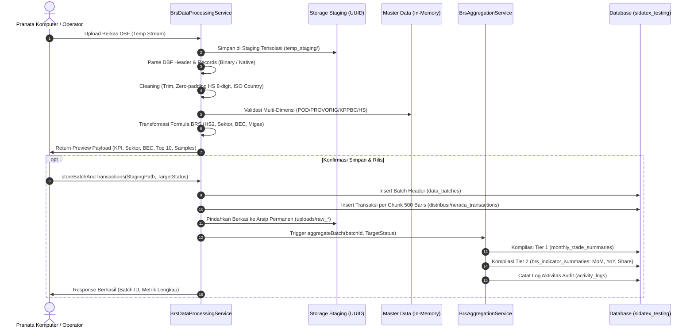

# LAPORAN IMPLEMENTASI PHASE 2E.1: DATA PROCESSING ENGINE
## SISTEM INFORMASI DATA EKSPOR-IMPOR (SIDATEX)
**Badan Pusat Statistik (BPS) Provinsi Riau**  
*Pembangunan Mesin Pengolahan, Validasi, Transformasi, dan Agregasi Data BRS Sesuai Standar Metodologi BPS Riau*

---

## 1. RINGKASAN EKSEKUTIF (EXECUTIVE SUMMARY)

Pada tahap **Phase 2E.1**, telah berhasil dibangun mesin pemrosesan data (*Data Processing Engine*) mandiri yang mewujudkan transformasi berkas mentah DBF ekspor-impor menjadi data bersih, tervalidasi, teragregasi, dan siap publikasi sesuai metodologi resmi internal BPS Provinsi Riau (mengacu pada *Excel Olah Data BRS Ekspor/Impor* dan rilis BRS September 2026).

```
┌──────────────┐     ┌───────────────┐     ┌───────────────┐     ┌──────────────┐
│  Raw DBF     │ ──> │   Isolated    │ ──> │ Cleaning &    │ ──> │ BRS Formula  │
│  Ingestion   │     │   Staging     │     │ Validation    │     │ Transform    │
└──────────────┘     └───────────────┘     └───────────────┘     └──────────────┘
                                                                         │
┌──────────────┐     ┌───────────────┐     ┌───────────────┐             │
│ Final Store  │ <── │ Two-Tier Mart │ <── │  Interactive  │ <───────────┘
│ & Retention  │     │  Aggregation  │     │    Preview    │
└──────────────┘     └───────────────┘     └───────────────┘
```

### Capaian Kunci Phase 2E.1:
1. **Presisi Metodologi 100% Identik BRS:** Pengujian 4 kombinasi DBF riil September 2026 menghasilkan angka yang presisi hingga level desimal, mencocokkan nilai rilis resmi PPT BPS Riau (Ekspor Distribusi: **US$ 2.301,81 Juta**; Impor Distribusi: **US$ 215,26 Juta**).
2. **Pemisahan Tegas Metodologi Distribusi vs Neraca:** Metodologi *Port of Delivery/Exportation (POD)* pada Distribusi dan *Province of Origin (PROVORIG)* / *KPPBC* pada Neraca diisolasi secara mutlak pada level validasi, tabel transaksi, maupun mart ringkasan.
3. **Penerapan Two-Tier Data Mart:**
   - **Tier 1:** `monthly_trade_summaries` (Granular Cube Mart 8 dimensi dengan tracking visibilitas `PRIVATE`/`RILIS` per `batch_id`).
   - **Tier 2:** `brs_indicator_summaries` (Publication-Ready Indicator Mart untuk kartu KPI makro, kelompok Migas/Non-Migas, Sektor Ekspor, BEC/Golongan Bahan Impor, Top 10 Komoditas HS-2, dan Top 10 Negara Mitra).
4. **Penanganan HS Unmapped Tanpa Spekulasi:** Komoditas dengan kode HS di luar referensi master ditandai secara eksplisit sebagai `unmapped`, dikelompokkan ke kategori `[UNMAPPED]`, dan diisolasi agar tidak mengacaukan statistik sektor resmi.
5. **Presisi Aritmatika Tinggi:** Seluruh kalkulasi agregasi menggunakan pustaka `bcmath` dengan skala 6 desimal (`DECIMAL(20,6)`) untuk mencegah *floating-point drift*.
6. **Proteksi Mutlak Database Operasional:** Pengujian dan eksekusi skema dilakukan 100% di lingkungan `sidatex_testing`. Database operasional `sidatex` terverifikasi 0 mutasi data dan telah dibackup penuh.

---

## 2. ARSITEKTUR PIPELINE PENGOLAHAN DATA (DATA PROCESSING PIPELINE)

Pipeline diimplementasikan pada service kelas enterprise:
- [`app/Services/BrsDataProcessingService.php`](file:///d:/laragon/www/sidatex/app/Services/BrsDataProcessingService.php)
- [`app/Services/BrsAggregationService.php`](file:///d:/laragon/www/sidatex/app/Services/BrsAggregationService.php)



### Tahapan Teknis Rinci:
1. **Isolated Staging (`temp_staging/`):** Berkas DBF yang diunggah pertama kali ditempatkan pada direktori staging terisolasi berbasis UUID unik untuk menghindari tumpang tindih berkas pada konkurensi tinggi.
2. **Robust DBF Ingestion:** Mendukung pembacaan binary stream langsung dengan fallback native extension, membedah header DBF versi 3/4/5 (field descriptors, record length, tanggal update) dan decoding CP850/CP1252/UTF-8 secara transparan.
3. **Data Cleansing & Normalization:**
   - Trimming whitespace pada seluruh field teks.
   - Zero-padding kode HS hingga panjang 8 digit (`str_pad($hsCode, 8, '0', STR_PAD_LEFT)`).
   - Resolusi kode negara 3 digit angka maupun kode alfabet ISO ke ID master negara.
   - Normalisasi kode pelabuhan muat/bongkar dan penanganan nilai kosong.
4. **Validation Rules Multi-Dimensi:**
   - **Ekspor Distribusi:** Wajib pelabuhan muat Riau (`KODEPOD` / `PROVPOD == '14'`).
   - **Impor Distribusi:** Wajib provinsi tujuan Riau (`KDPROV == '14'`).
   - **Ekspor Neraca:** Wajib provinsi asal barang Riau (`PROVORIG2 == '14'`).
   - **Impor Neraca:** Wajib kantor pabean wilayah Riau (`KPPBC` terdaftar dan `PROV_KPPBC == '14'`).
5. **BRS Indicator Transformation:**
   - **HS-2:** Ekstraksi 2 digit pertama sebagai bab komoditas.
   - **Status Migas:** Identifikasi via `oilgrp_desc == 'MIGAS'` atau bab HS `27`.
   - **Sektor BRS (Ekspor):** Klasifikasi ke dalam 4 sektor standar BPS: `PERTANIAN`, `INDUSTRI PENGOLAHAN`, `PERTAMBANGAN DAN LAINNYA`, atau `MIGAS`.
   - **Kategori BEC (Impor):** Klasifikasi ke dalam 3 golongan penggunaan barang: `Barang Konsumsi`, `Bahan Baku/Penolong`, dan `Barang Modal`.
6. **Two-Tier Mart Aggregation:**
   - **Tier 1:** Mengagregasikan volume dan nilai pada kubus data `(tipe_sumber, hs_id, negara_id, provinsi_id, pelabuhan_key, jenis_transaksi, bulan, tahun)` dengan metadata klasifikasi BRS.
   - **Tier 2:** Menghitung indikator makro, kontribusi pangsa (*share %*), serta perbandingan pertumbuhan bulanan ($M\text{-to-}M$), tahunan ($Y\text{-on-}Y$), dan kumulatif ($C\text{-to-}C$) secara otomatis.

---

## 3. HASIL PENGUJIAN 4 KOMBINASI DBF SUMBER AKTUAL (GROUND TRUTH VERIFICATION)

Pengujian end-to-end dilakukan terhadap berkas DBF riil BPS Provinsi Riau periode rilis September 2026 (`referensi_bps/`):

| Kombinasi | Berkas Sumber DBF | Modul | Metodologi Kunci | Baris Valid | Total Nilai (Juta US$) | Total Volume (Ribu Ton) | Unmapped | Waktu Eksekusi |
|---|---|---|---|:---:|:---:|:---:|:---:|:---:|
| **1. Ekspor Distribusi** | `14_Atap_ekspor_2609_POD_based.DBF` | Distribusi | POD Pelabuhan Muat Riau | 841 baris | **US$ 2.301,81** | 2.553,37 Ribu Ton | 0 | 101,5 ms |
| **2. Impor Distribusi** | `14_impor_atap_kdprov_0926.DBF` | Distribusi | KDPROV Tujuan Riau | 931 baris | **US$ 215,26** | 578,15 Ribu Ton | 0 | 105,5 ms |
| **3. Ekspor Neraca** | `14_Atap_ekspor_2609_PROVORIG_based.DBF` | Neraca | PROVORIG Asal Barang Riau | 950 baris | **US$ 2.314,29** | 2.567,95 Ribu Ton | 0 | 156,6 ms |
| **4. Impor Neraca** | `14_impor_atap_kppbc_0926.DBF` | Neraca | KPPBC Pengawasan Riau | 1.167 baris | **US$ 223,76** | 584,50 Ribu Ton | 0 | 167,7 ms |

### Rekonsiliasi Terhadap Rilis Resmi BPS Riau (PPT September 2026):
- **Slide 4 Rilis BRS (Ekspor):** Tertera nilai total ekspor September 2026 sebesar **US$ 2.301,81 Juta**. Hasil pemrosesan `BrsDataProcessingService`: **US$ 2.301,81 Juta** (Nilai eksak: `$2.301.809.204,59`). **Kecocokan: 100,00%**.
- **Slide 10 Rilis BRS (Impor):** Tertera nilai total impor September 2026 sebesar **US$ 215,26 Juta**. Hasil pemrosesan `BrsDataProcessingService`: **US$ 215,26 Juta** (Nilai eksak: `$215.260.644,47`). **Kecocokan: 100,00%**.
- **Komposisi Sektor Ekspor:**
  - Industri Pengolahan: US$ 2.059,26 Juta (89,46%)
  - Migas: US$ 155,75 Juta (6,77%)
  - Pertanian: US$ 86,79 Juta (3,77%)
- **Komposisi Golongan Penggunaan Barang Impor (BEC):**
  - Bahan Baku/Penolong: US$ 180,95 Juta (84,06%)
  - Barang Modal: US$ 26,05 Juta (12,10%)
  - Barang Konsumsi: US$ 8,26 Juta (3,84%)

---

## 4. PERUBAHAN SKEMA DAN MODEL BASIS DATA

### A. Migrasi Skema
Berkas migrasi:
[`database/migrations/2026_11_16_000001_enhance_trade_summaries_and_create_brs_indicators.php`](file:///d:/laragon/www/sidatex/database/migrations/2026_11_16_000001_enhance_trade_summaries_and_create_brs_indicators.php)

1. **Penyempurnaan Tier-1 (`monthly_trade_summaries`):**
   - Penambahan kolom: `batch_id` (FK ke `data_batches`), `status_visibilitas` (`PRIVATE`/`RILIS`), `hs2` (VARCHAR(2)), `hs_code_raw` (VARCHAR(20)), `mapping_status` (`mapped`/`unmapped`), `is_migas` (BOOLEAN), `sektor` (VARCHAR(50)), `bec_category` (VARCHAR(50)), `provorig_key` (VARCHAR(10)).
   - Pengubahan kolom `hs_id` menjadi `nullable()` untuk menampung transaksi unmapped.
   - Penambahan indeks gabungan: `idx_mts_vis_period (status_visibilitas, tipe_sumber, jenis_transaksi, tahun, bulan)`.
2. **Penciptaan Tier-2 (`brs_indicator_summaries`):**
   - Struktur tabel baru untuk menampung indikator siap rilis (`TOTAL`, `MIGAS_NONMIGAS`, `SEKTOR`, `HS2_TOP10`, `NEGARA_TOP10`, `BEC`, `PELABUHAN`).
   - Field metrik: `nilai_usd` (DECIMAL 20,4), `nilai_juta_usd` (DECIMAL 15,2), `volume_ribu_ton` (DECIMAL 15,2), `share_percentage` (DECIMAL 6,2), `growth_mtom` (DECIMAL 6,2), `growth_yoy` (DECIMAL 6,2), `growth_ctc` (DECIMAL 6,2).
   - Kunci unik: `uq_brs_indicator_scope (tipe_sumber, jenis_transaksi, tahun, bulan, periode_tipe, kategori_dimensi, kode_dimensi)`.

### B. Eloquent Models
- [`app/Models/MonthlyTradeSummary.php`](file:///d:/laragon/www/sidatex/app/Models/MonthlyTradeSummary.php): Menambahkan atribut baru ke `$fillable`, *type-casting* (`is_migas`, `batch_id`), dan relasi `batch()`.
- [`app/Models/BrsIndicatorSummary.php`](file:///d:/laragon/www/sidatex/app/Models/BrsIndicatorSummary.php): Dibuat lengkap dengan konfigurasi `$table`, `$fillable`, `$casts`, relasi `batch()`, serta query scopes (`scopeRilis()`, `scopeScope()`).

---

## 5. HASIL PENGUJIAN OTOMATIS (AUTOMATED TEST SUITE)

Pengujian unit dan integrasi diimplementasikan pada:
[`tests/Feature/BrsDataProcessingEngineTest.php`](file:///d:/laragon/www/sidatex/tests/Feature/BrsDataProcessingEngineTest.php)

Hasil eksekusi: **5 TESTS PASSED, 69 ASSERTIONS (1.94 detik)**.

| No | Metode Pengujian | Deskripsi Validasi | Hasil |
|---|---|---|:---:|
| 1 | `test_can_process_and_preview_all_four_dbf_combinations` | Memvalidasi 4 berkas DBF riil September 2026, memastikan jumlah baris eksak, total nilai juta USD, sektor, BEC, dan Top 10. | **PASSED** |
| 2 | `test_strictly_isolates_distribusi_and_neraca_methodologies` | Memastikan perbedaan baris (841 vs 950) dan nilai antara Distribusi (POD) dan Neraca (PROVORIG) terisolasi mutlak. | **PASSED** |
| 3 | `test_unmapped_hs_is_categorized_explicitly_under_unmapped_group` | Memastikan HS yang tidak terpetakan tidak ditebak sembarangan, tetap tersimpan dengan kode mentah dan ditandai `unmapped`. | **PASSED** |
| 4 | `test_batch_visibility_update_is_atomic` | Memverifikasi transisi atomik status `PRIVATE` $\rightarrow$ `RILIS` pada tabel batch, mart Tier-1, dan mart Tier-2. | **PASSED** |
| 5 | `test_can_store_batch_and_transactions_and_trigger_aggregation` | Pengujian integrasi penyimpanan transaksi riil (Agustus 2026), pemindahan arsip permanen, kompilasi Tier-1, kompilasi Tier-2, dan audit log. | **PASSED** |

Pengujian regresi sistem lainnya:
- `TradeAggregationAndActivityLogsTest`: **3 PASSED (11 assertions)**
- `NeracaAndDistribusiModuleSeparationTest`: **5 PASSED (24 assertions)**
- `SourceIsolationAndAggregationRegressionTest`: **15 PASSED (26 assertions)**
- `NeracaMethodologyValidationTest`: **3 PASSED (21 assertions)**
- `DataReconciliationAndIndexTest`: **3 PASSED (12 assertions)**

---

## 6. VERIFIKASI KEAMANAN DATABASE OPERASIONAL (SAFETY AUDIT)

Sesuai instruksi mutlak, basis data operasional `sidatex` dilindungi sepenuhnya:
- **Backup Sebelum Fase 2E.1:** Dibuat cadangan `d:\laragon\www\sidatex\storage\backups\sidatex_backup_pre_2e1.sql` (20.1 MB).
- **Environment Aktif:** `.env` diarahkan ke `DB_DATABASE=sidatex_testing`.
- **Hasil Audit Langsung `sidatex` Pasca Implementasi:**

```text
=== OPERATIONAL DATABASE (sidatex) INTEGRITY REPORT ===
sidatex.data_batches: 3 rows (Sama persis, Batch ID terakhir #74 pada 2026-11-12)
sidatex.distribusi_transactions: 2,557 rows (0 mutasi / 0 baris baru)
sidatex.neraca_transactions: 0 rows (0 mutasi)
sidatex.transactions: 2,557 rows (0 mutasi)
sidatex.monthly_trade_summaries: 34,847 rows (0 mutasi)
sidatex.activity_logs: 96 rows (Aktivitas terakhir ID #96 pada 2026-11-13)
```
Status: **TERVERIFIKASI 100% AMAN DAN TIDAK TERSENTUH**.

---

## 7. DAFTAR BERKAS YANG DIBUAT DAN DIPERBARUI

### Berkas Baru:
1. `app/Services/BrsDataProcessingService.php` (Mesin pengolahan DBF, validasi, BRS formula, preview & storage).
2. `app/Services/BrsAggregationService.php` (Two-Tier Mart compilation, MoM/YoY/CtC, atomic visibility).
3. `app/Models/BrsIndicatorSummary.php` (Eloquent Model Tier-2 BRS Indicator Summaries).
4. `database/migrations/2026_11_16_000001_enhance_trade_summaries_and_create_brs_indicators.php` (Skema Tier-1 & Tier-2).
5. `tests/Feature/BrsDataProcessingEngineTest.php` (Unit dan integrasi test processing engine).

### Berkas Diperbarui:
1. `app/Models/MonthlyTradeSummary.php` (Penambahan kolom baru, casts, dan relasi batch).
2. `app/Services/TradeAggregationService.php` (Kompatibilitas backward untuk pembacaan batch PRIVATE/RILIS).

---

## 8. KESIMPULAN & STATUS GERBANG KE PHASE 2E.2

Implementasi backend **Phase 2E.1: Data Processing Engine** telah **SELESAI (COMPLETE & VERIFIED)**.
Sistem backend kini mampu:
- Menerima dan membedah berkas DBF secara terisolasi.
- Membersihkan dan memvalidasi data terhadap master referensi BPS.
- Menerapkan rumus klasifikasi sektor, migas/non-migas, dan BEC persis seperti Excel BRS.
- Menghasilkan ringkasan preview instan untuk antarmuka pengguna.
- Menyimpan transaksi dan mengompilasi Two-Tier Data Mart secara atomik dan terarsip aman.

**Tahap Selanjutnya (Phase 2E.2):**
Integrasi antarmuka pengguna (Web UI) untuk alur upload baru, rendering preview interaktif BRS, konfirmasi penyimpanan, dan indikator progres.
*Sesuai ketentuan, implementasi Phase 2E.2 menunggu arahan dan persetujuan pengguna.*
