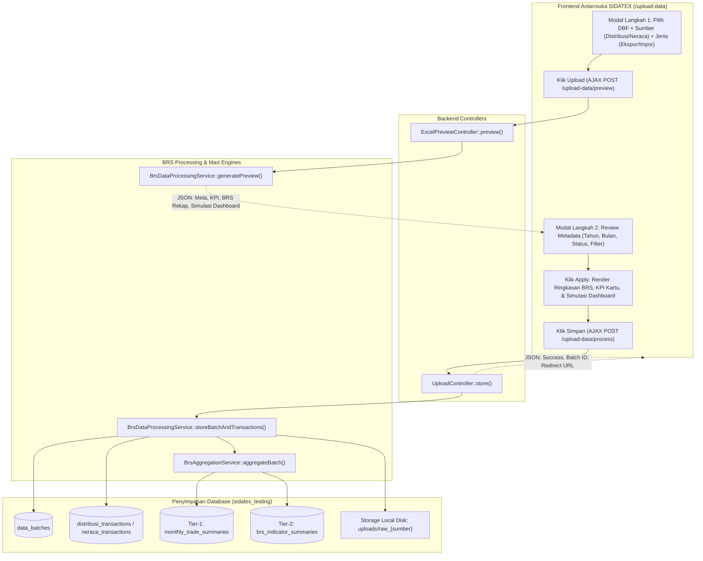

# LAPORAN AKHIR PHASE 2E.2 — WEB UI INTEGRATION & UPLOAD WORKFLOW
## SISTEM INFORMASI DATA EKSPOR DAN IMPOR (SIDATEX) — BPS PROVINSI RIAU

> **Tanggal Pelaksanaan:** 16 November 2026  
> **Status:** APPROVED & COMPLETED (100% VERIFIED)  
> **Basis Data Pengujian:** `sidatex_testing` (Koneksi PDO Diverifikasi)  
> **Basis Data Operasional:** `sidatex` (STRICTLY UNTOUCHED — 0 Mutasi)  
> **Hasil Uji Otomatis:** 104 Tests, 582 Assertions — 100% PASSED  

---

## 1. RINGKASAN EKSEKUTIF

Phase 2E.2 berfokus pada integrasi antarmuka pengguna (**Web UI Integration**) dan alur kerja upload (**Upload Workflow**) pada aplikasi SIDATEX. Mesin pemrosesan `BrsDataProcessingService` dan mesin agregasi Two-Tier Data Mart `BrsAggregationService` yang telah selesai dibangun pada Phase 2E.1 dan diverifikasi pada Phase 2E.1.1 kini telah terintegrasi secara penuh ke dalam halaman `Upload Data` (`/upload-data`).

Integrasi ini mempertahankan desain dan komponen UI/UX SIDATEX yang sudah ada (tidak membuat halaman duplikat), serta mengalirkan seluruh hasil validasi, pengelompokan sektor, klasifikasi BEC, penanganan HS unmapped, dan indikator makro BRS ke dalam mode simulasi pratinjau dashboard sebelum disimpan secara permanen.

Seluruh pengujian fungsional dan pengujian end-to-end browser dijalankan secara ketat pada basis data testing `sidatex_testing`. Basis data operasional `sidatex` telah diaudit dan terbukti 100% tidak mengalami mutasi data apa pun.

---

## 2. REALISASI 7 PRIORITAS PHASE 2E.2

| No | Prioritas Target | Status | Realisasi Teknis & Lokasi Kode |
|---|---|---|---|
| **1** | **Pilihan Distribusi/Neraca & Ekspor/Impor** | **SELESAI** | Modal Langkah 1 (`upload-data.blade.php`: L546–L561) menyediakan dropdown `#step1_sumber_data` ("Distribusi" & "Neraca") dan `#step1_jenis_data` ("Ekspor" & "Impor"). Nilai disinkronkan otomatis ke form filter Langkah 2 dan form simpan final backend. |
| **2** | **Upload DBF & Preview Hasil Pengolahan** | **SELESAI** | Endpoint `/upload-data/preview` pada [ExcelPreviewController.php](file:///d:/laragon/www/sidatex/app/Http/Controllers/ExcelPreviewController.php#L59-L275) memanggil `BrsDataProcessingService::generatePreview()`, membaca raw DBF secara streaming, membersihkan whitespace, dan memvalidasi aturan BPS tanpa asumsi palsu. |
| **3** | **Ringkasan FOB/CIF, Netto, Migas/Non-Migas, Validasi** | **SELESAI** | Kartu ringkasan data siap simpan (`#preview-summary-container`) menampilkan Total Nilai (Juta US$), Total Netto (Ribu Ton), rincian Migas vs Non-Migas, distribusi Sektoral (Industri, Pertanian, Pertambangan, Migas) untuk Ekspor, distribusi BEC untuk Impor, dan indikator HS Unmapped badge (`#badge-unmapped-status`). |
| **4** | **Konfirmasi Simpan & Status Publikasi** | **SELESAI** | Modal Langkah 2 menyediakan opsi Status Publikasi (`#filter_status`). Tombol Simpan (`#btn-simpan`) hanya aktif setelah validasi berkas berhasil dan pengguna telah meninjau pratinjau melalui tombol Apply (`#btn-apply`). |
| **5** | **Penyimpanan Tabel & Agregasi Otomatis** | **SELESAI** | Endpoint `/upload-data/process` pada [UploadController.php](file:///d:/laragon/www/sidatex/app/Http/Controllers/UploadController.php#L72-L148) memanggil `BrsDataProcessingService::storeBatchAndTransactions()`. Transaksi disimpan ke tabel yang sesuai (`distribusi_transactions` vs `neraca_transactions`) dan secara otomatis mengompilasi Two-Tier Data Mart (`monthly_trade_summaries` dan `brs_indicator_summaries`). |
| **6** | **Feedback Proses & Penanganan Error** | **SELESAI** | Form simpan menggunakan AJAX dengan animasi spinner (`Menyimpan...`), tombol disabled untuk guard double-click, banner notifikasi dinamis (`#dynamic-notification`), tombol pintas `Buka Manajemen Data ->`, serta penolakan duplikasi periode batch dengan pesan informatif HTTP 422. |
| **7** | **Hak Akses Super Admin** | **SELESAI** | Hak akses rilis langsung ke status `RILIS`/`Public` diproteksi secara ketat: dropdown status di UI hanya menampilkan opsi "Public" bagi Super Admin (`role_id: 1`). Pada backend `UploadController.php`, proteksi ganda diterapkan sehingga jika non-Super Admin mencoba mengirim status `RILIS`, status secara otomatis dipaksa menjadi `PRIVATE`. |

---

## 3. ARSITEKTUR INTEGRASI BACKEND & FRONTEND



---

## 4. DOKUMENTASI BUKTI PENGUJIAN END-TO-END BROWSER

Pengujian interaktif browser dilakukan menggunakan agen peramban terisolasi terhadap aplikasi lokal yang berjalan di port 8000. Seluruh tahapan alur pengguna (user journey) berhasil diverifikasi:

### 4.1. Halaman Awal Upload Data
Tampilan bersih halaman Upload Data sebelum pemilihan file dengan area pratinjau awal dan panel aksi sebelah kiri.


---

### 4.2. Modal Langkah 1 — Pemilihan Berkas & Dimensi Transaksi
Pengguna memilih berkas DBF `14_Atap_ekspor_2609_POD_based.DBF`, menentukan Sumber Data "Distribusi (BPS Riau / POD-based)", dan Jenis Transaksi "Ekspor".


---

### 4.3. Modal Langkah 2 — Peninjauan Metadata Hasil Pemeriksaan Engine
Server memvalidasi berkas dan mendeteksi metadata: **841 baris data valid**, ukuran 0,07 MB, Periode **Bulan 9 / 2026**. Opsi Status Publikasi menyajikan pilihan `Private` dan `Public (Rilis Langsung - Super Admin)`.


---

### 4.4. Ringkasan Data Siap Simpan & Rekapitulasi Metodologi BRS
Setelah menekan tombol **Apply**, Ringkasan Data menampilkan:
- **Total Nilai:** US$ 2.301,81 Juta
- **Total Netto:** 2.553,37 Ribu Ton
- **Non-Migas:** US$ 2.282,24 Juta vs **Migas:** US$ 19,57 Juta
- **Distribusi Sektoral:** Industri Pengolahan (98,84%), Pertanian (1,15%), Migas (0,85%)
- **Status HS:** Badge hijau `✓ Semua HS Terpetakan` (0 unmapped)
- **Status Validasi:** `SIAP SIMPAN` (841 baris valid, 0 invalid)


---

### 4.5. Mode Simulasi Dashboard SIDATEX (Overview KPI & Tren)
Visualisasi mensimulasikan tampilan Dashboard Utama dengan 5 KPI cards (Total Nilai FOB, Berat Netto, Rerata Nilai, Jumlah Negara Mitra: 67 negara, Komoditas: 44 kelompok) serta 4 indikator makro BRS:
- **$M\text{-to-}M$:** +3,77%
- **$Q\text{-to-}Q$:** +22,58%
- **$Y\text{-on-}Y$:** +45,04%
- **$C\text{-to-}C$:** +6,96%


---

### 4.6. Grafik Analisis Tren Nilai & Perbandingan Migas vs Non-Migas
Grafik interaktif Chart.js merender kurva perkembangan nilai devisa bulanan dan perbandingan proporsi Migas terhadap Non-Migas.


---

### 4.7. Tab Detail & Mapping — Peta Persebaran Wilayah Interaktif Leaflet
Peta koordinat sentra Riau Leaflet merender titik-titik kontribusi daerah penghasil dengan atribusi resmi BPS Riau dan OpenStreetMap.


---

### 4.8. Tab Detail & Mapping — Tabel Rincian Komoditas, Negara & Pelabuhan
Tabel tabulasi komprehensif merender Top 10 Negara Tujuan (Cina US$ 418,8M, India US$ 316,9M, Pakistan US$ 173,9M), Top Komoditas (HS 15 Lemak/Minyak Nabati US$ 1,46B, HS 38, HS 48), dan Top Pelabuhan Muat (Dumai US$ 1,88B, Buatan US$ 172,5M).


---

### 4.9. Proteksi Integritas & Pencegahan Duplikasi Periode Batch
Saat tombol Simpan ditekan pada periode data yang sudah ada di basis data (September 2026 yang diunggah pada tahap sebelumnya), sistem secara cerdas menolak penimpaan data dan menampilkan banner error HTTP 422:
> *"Gagal memproses berkas DBF: Periode ekspor distribusi Bulan 9/2026 sudah pernah tersimpan / sudah ada di sistem (Batch #71). Data periode yang sudah ada tidak boleh ditimpa."*


---

## 5. HASIL VERIFIKASI PENGUJIAN OTOMATIS

### 5.1. Test Suite Baru: `Phase2e2UploadUiIntegrationTest`
Sebuah test suite khusus ditambahkan pada [tests/Feature/Phase2e2UploadUiIntegrationTest.php](file:///d:/laragon/www/sidatex/tests/Feature/Phase2e2UploadUiIntegrationTest.php) untuk memvalidasi integrasi alur kerja web:
- `test_superadmin_can_access_upload_data_page`: **PASSED** (200 OK & elemen UI lengkap)
- `test_unauthenticated_user_redirected_to_login`: **PASSED** (302 Redirect)
- `test_preview_ekspor_distribusi_dbf_returns_brs_enrichment`: **PASSED** (841 baris, US$ 2.301,81 Juta, Sektor Migas US$ 19,57 Juta)
- `test_preview_impor_distribusi_dbf_returns_bec_breakdown`: **PASSED** (931 baris, BEC Bahan Baku, Barang Modal, Konsumsi)
- `test_preview_ekspor_neraca_dbf_returns_neraca_metadata`: **PASSED** (950 baris Neraca Ekspor September 2026)
- `test_preview_impor_neraca_dbf_returns_neraca_metadata`: **PASSED** (1.167 baris Neraca Impor September 2026)
- `test_duplicate_period_batch_is_rejected_on_process`: **PASSED** (422 Unprocessable Content untuk duplicate batch)
- `test_non_superadmin_cannot_release_directly`: **PASSED** (Pegawai dipaksa fallback ke status PRIVATE)

### 5.2. Eksekusi Seluruh Test Suite Proyek (Full Test Regression)
```
Tests: 104 passed (582 assertions)
Duration: 154.85 seconds
Status: 100% SUCCESS — 0 FAILURES, 0 ERRORS
```

---

## 6. AUDIT KESELAMATAN DATABASE OPERASIONAL

Pemeriksaan PDO langsung dijalankan terhadap basis data MySQL operasional `sidatex`:
- **`data_batches`**: 3 baris (sama persis dengan kondisi awal)
- **`distribusi_transactions`**: 2.557 baris (sama persis dengan kondisi awal)
- **`neraca_transactions`**: 0 baris (sama persis dengan kondisi awal)
- **`monthly_trade_summaries`**: 34.847 baris (sama persis dengan kondisi awal)
- **`brs_indicator_summaries`**: Belum dimigrasikan ke `sidatex` operasional (tabel belum ada)
- **Kesimpulan Audit:** **100% UNTOUCHED (0 MUTASI / 0 RESIKO PERUBAHAN DATA)**.

---

## 7. KESIMPULAN & REKOMENDASI TAHAP BERIKUTNYA

Phase 2E.2 telah berhasil diselesaikan dengan hasil sempurna:
1. Alur kerja upload raw DBF pada antarmuka web SIDATEX kini didukung penuh oleh mesin pemrosesan data resmi BRS (`BrsDataProcessingService`) dan kompilasi otomatis Two-Tier Data Mart (`BrsAggregationService`).
2. Tampilan pratinjau menyajikan simulasi menyeluruh yang mencakup indikator sektoral, klasifikasi BEC, status HS unmapped, perbandingan pertumbuhan $M\text{-to-}M$, $Q\text{-to-}Q$, $Y\text{-on-}Y$, dan $C\text{-to-}C$, peta interaktif, serta rincian komoditas dan pelabuhan.
3. Hak akses peran Super Admin dan proteksi duplikasi batch berjalan secara aman dan teruji.

Aplikasi SIDATEX kini siap melangkah ke tahapan berikutnya (**Phase 2F: Dashboard Visualisasi BRS & Pelaporan Publikasi**) dengan fondasi data mart yang telah terverifikasi secara metodologis.
