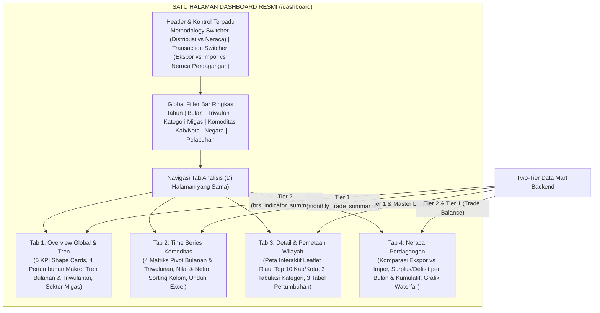

# SIDATEX — PHASE 2F.1: LAPORAN DESAIN ARSITEKTUR SINGLE DASHBOARD
**Dokumen Desain Teknis & Spesifikasi Antarmuka Dashboard Tunggal**  
*Sistem Informasi Data Ekspor-Impor (SIDATEX) — Badan Pusat Statistik (BPS) Provinsi Riau*

---

## DAFTAR ISI
1. [Ringkasan Eksekutif & Keputusan Arsitektur](#1-ringkasan-eksekutif--keputusan-arsitektur)
2. [Analisis Menyeluruh File Referensi AppScript BPS Riau (VORTEX)](#2-analisis-menyeluruh-file-referensi-appscript-bps-riau-vortex)
   - 2.1 [Latar Belakang & Peran Proyek VORTEX](#21-latar-belakang--peran-proyek-vortex)
   - 2.2 [Arsitektur Teknis Google Apps Script Web App](#22-arsitektur-teknis-google-apps-script-web-app)
   - 2.3 [Struktur Halaman dan Pola Navigasi SPA](#23-struktur-halaman-dan-pola-navigasi-spa)
   - 2.4 [Katalog Indikator, Visualisasi Grafik, dan Tabel Tabulasi](#24-katalog-indikator-visualisasi-grafik-dan-tabel-tabulasi)
   - 2.5 [Sistem Filter dan Fitur Interaktif](#25-sistem-filter-dan-fitur-interaktif)
   - 2.6 [Identitas Visual dan Palet Warna BPS Riau](#26-identitas-visual-dan-palet-warna-bps-riau)
3. [Perbandingan Arsitektur: VORTEX AppScript vs SIDATEX Laravel](#3-perbandingan-arsitektur-vortex-appscript-vs-sidatex-laravel)
   - 3.1 [Cakupan Transaksi & Neraca Perdagangan](#31-cakupan-transaksi--neraca-perdagangan)
   - 3.2 [Pemisahan Metodologi BPS: Distribusi vs Neraca](#32-pemisahan-metodologi-bps-distribusi-vs-neraca)
   - 3.3 [Penyimpanan & Arsitektur Dua Tingkat (Two-Tier Data Mart)](#33-penyimpanan--arsitektur-dua-tingkat-two-tier-data-mart)
   - 3.4 [Keamanan Data & Role-Based Access Control (RBAC)](#34-keamanan-data--role-based-access-control-rbac)
4. [Rancangan Struktur Akhir Single Dashboard SIDATEX](#4-rancangan-struktur-akhir-single-dashboard-sidatex)
   - 4.1 [Prinsip Navigasi: SATU Halaman, SATU Menu Sidebar](#41-prinsip-navigasi-satu-halaman-satu-menu-sidebar)
   - 4.2 [Kontrol Header: Methodology Switcher & Transaction Switcher](#42-kontrol-header-methodology-switcher--transaction-switcher)
   - 4.3 [Navigasi Tab Analisis Terintegrasi (4 Bagian Utama)](#43-navigasi-tab-analisis-terintegrasi-4-bagian-utama)
   - 4.4 [Panel Filter Global Cepat](#44-panel-filter-global-cepat)
5. [Pemetaan Setiap Widget ke Sumber Data SIDATEX](#5-pemetaan-setiap-widget-ke-sumber-data-sidatex)
   - 5.1 [Pemetaan Tab 1: Overview Global & Tren Perdagangan](#51-pemetaan-tab-1-overview-global--tren-perdagangan)
   - 5.2 [Pemetaan Tab 2: Tabulasi Time Series Komoditas](#52-pemetaan-tab-2-tabulasi-time-series-komoditas)
   - 5.3 [Pemetaan Tab 3: Detail Analisis & Pemetaan Wilayah](#53-pemetaan-tab-3-detail-analisis--pemetaan-wilayah)
   - 5.4 [Pemetaan Tab 4: Neraca Perdagangan (Trade Balance)](#54-pemetaan-tab-4-neraca-perdagangan-trade-balance)
6. [Mockup & Wireframe Antarmuka Pengguna](#6-mockup--wireframe-antarmuka-pengguna)
   - 6.1 [Wireframe Layout Utama (Shell, Header, & Filter Bar)](#61-wireframe-layout-utama-shell-header--filter-bar)
   - 6.2 [Wireframe Tab 1 (Overview & Tren)](#62-wireframe-tab-1-overview--tren)
   - 6.3 [Wireframe Tab 2 (Time Series Komoditas)](#63-wireframe-tab-2-time-series-komoditas)
   - 6.4 [Wireframe Tab 3 (Detail & Pemetaan Wilayah)](#64-wireframe-tab-3-detail--pemetaan-wilayah)
   - 6.5 [Wireframe Tab 4 (Neraca Perdagangan)](#65-wireframe-tab-4-neraca-perdagangan)
7. [Rencana Penyesuaian Menu Sidebar dan Routing](#7-rencana-penyesuaian-menu-sidebar-dan-routing)
   - 7.1 [Pembersihan Sidebar Navigation](#71-pembersihan-sidebar-navigation)
   - 7.2 [Pengalihan Rute Bersahabat (Backward Compatibility)](#72-pengalihan-rute-bersahabat-backward-compatibility)
8. [Rencana Implementasi Teknis & Verifikasi (Phase 2F.2 & 2F.3)](#8-rencana-implementasi-teknis--verifikasi-phase-2f2--2f3)

---

## 1. RINGKASAN EKSEKUTIF & KEPUTUSAN ARSITEKTUR

Berdasarkan arahan resmi tim BPS Provinsi Riau (Kak Bekti) melalui artefak referensi `referensi_bps/appscript.txt` (proyek **VORTEX: Visualization of Riau Trade Exchange - Executive Edition**) dan hasil evaluasi menyeluruh terhadap arsitektur SIDATEX saat ini, ditetapkan **Koreksi Arsitektur Utama untuk Phase 2F**:

> [!IMPORTANT]
> **KEPUTUSAN ARSITEKTUR UTAMA — SINGLE DASHBOARD POLICY:**
> 1. **Strictly SATU Menu Dashboard**: SIDATEX tidak boleh memiliki 3 menu navigasi terpisah di sidebar (`Dashboard Utama`, `Dashboard Distribusi`, `Dashboard Neraca`) dan tidak boleh memiliki 3 halaman URL terpisah yang membingungkan pengguna eksekutif maupun publik.
> 2. **Strictly SATU Halaman Antarmuka Terpadu**: Cukup **SATU menu Dashboard** (`/dashboard`) di sidebar yang menyajikan seluruh kapabilitas analisis ekspor-impor Provinsi Riau secara komprehensif.
> 3. **Pemisahan Metodologi Tanpa Agregasi Buta**: Metodologi **Distribusi** (berbasis pelabuhan muat/bongkar di Riau) dan **Neraca** (berbasis provinsi asal barang Riau dan kantor pabean) memiliki konsep statistik yang berbeda. Sistem **TIDAK BOLEH menjumlahkan kedua sumber menjadi satu angka total**. Pemisahan disajikan melalui *Methodology Switcher* yang elegan di bagian atas dashboard.
> 4. **Navigasi Analisis Berbasis Tab/Bagian**: Pengguna dapat menjelajahi berbagai dimensi analisis (Overview Global, Time Series Komoditas, Detail Mapping Per Daerah, dan Neraca Perdagangan) melalui navigasi tab horizontal tanpa perlu reload halaman (*Single-Page Experience*).
> 5. **Arsitektur Berbasis Two-Tier Data Mart**: Seluruh visualisasi grafik dan tabel didukung langsung oleh data terolah pada Tier 1 (`monthly_trade_summaries`) dan Tier 2 (`brs_indicator_summaries`) serta data transaksi bersih, menjamin performa render instan (< 100 ms).

Dokumen ini menyajikan hasil bedah mendalam terhadap file referensi AppScript BPS Riau, perbandingan komparatif dengan backend SIDATEX, rancangan struktur halaman tunggal, pemetaan indikator ke tabel basis data, mockup visual, rencana pembersihan menu sidebar, serta langkah eksekusi teknis berikutnya.

---

## 2. ANALISIS MENYELURUH FILE REFERENSI APPSCRIPT BPS RIAU (VORTEX)

File referensi `referensi_bps/appscript.txt` memiliki ukuran **88.702 bytes** yang berisi kode lengkap Google Apps Script dan HTML/CSS/JavaScript front-end untuk dashboard resmi BPS Provinsi Riau yang dinamakan **VORTEX: Visualization of Riau Trade Exchange (Executive Edition)**.

### 2.1 Latar Belakang & Peran Proyek VORTEX
VORTEX dikembangkan oleh tim Nerwilis / Distribusi BPS Provinsi Riau (Kak Bekti) sebagai purwarupa dashboard eksekutif untuk memvisualisasikan data perdagangan luar negeri Riau secara interaktif. Purwarupa ini dirancang untuk menjawab kebutuhan pimpinan (Kepala BPS, Disperindag, Gubernur, dan publik) agar tidak hanya membaca angka statis pada Berita Resmi Statistik (BRS) dalam bentuk PDF/PPT, melainkan dapat melihat dinamika data secara fleksibel.

### 2.2 Arsitektur Teknis Google Apps Script Web App
File `appscript.txt` terdiri dari dua komponen utama:
1. **Komponen Backend (`code.gs`)**:
   - `doGet()`: Fungsi entry-point Google Apps Script yang menyajikan berkas HTML `Index` sebagai Web App publik dengan izin XFrame.
   - `getSheetData()`: Mengambil seluruh baris data dari Google Spreadsheet pada sheet bernama `Ekspor` dan mengubahnya menjadi larik objek JSON (`[{BULAN, KODE_BULAN, TRIWULAN, TAHUN, KELOMPOK_KOMODITI, NEGARA, KABKOTA, MIGAS, PELABUHAN, FOB, NETTO}, ...]`).
   - `updateDataRow()`: Fungsi penambahan data baru secara langsung ke Google Sheets (fitur input manual ad-hoc).
2. **Komponen Frontend (`index.html`)**:
   - Berisi antarmuka web responsif berbasis CSS Flexbox/Grid modern, menggunakan pustaka eksternal: **Chart.js** untuk grafik statistik, **Leaflet.js & OpenStreetMap** untuk visualisasi spasial peta daerah, serta **SheetJS (`xlsx.full.min.js`)** untuk ekspor langsung tabel HTML ke format Excel (.xlsx).

### 2.3 Struktur Halaman dan Pola Navigasi SPA
VORTEX mengadopsi pola *Single Page Application (SPA)* murni. Di dalam antarmuka, terdapat kontainer navigasi tab horizontal di bagian atas (`.page-nav-container` dengan tombol `.nav-tab-btn`) yang mengatur visibilitas 3 seksi halaman melalui fungsi JavaScript `switchPage(pageId, btnElement)`:
- `page1`: **Halaman 1 — Overview Global & Tren Ekspor**
- `page2`: **Halaman 2 — Tabulasi Time Series Komoditas**
- `page3`: **Halaman 3 — Detail Dashboard & Mapping Per Daerah**

Setiap seksi halaman memiliki kelas CSS `.page-section`, di mana hanya seksi yang memiliki kelas `.active` yang ditampilkan (`display: flex` / `display: block`), sedangkan seksi lainnya disembunyikan (`display: none`). Saat pengguna berpindah ke `page3`, sistem secara otomatis memanggil `leafletMap.invalidateSize()` dengan `setTimeout` 100 ms agar render tile OpenStreetMap tidak patah.

### 2.4 Katalog Indikator, Visualisasi Grafik, dan Tabel Tabulasi

Berdasarkan audit fungsi JavaScript pada `appscript.txt`, berikut adalah katalog lengkap indikator, grafik, dan tabel yang dibangun di dalam VORTEX:

#### A. Indikator Shape Cards (KPI Metrics)
- **Halaman 1 (5 KPI Cards)**:
  1. `p1KpiFob`: **Total Nilai FOB (US$)** — Agregasi total devisa ekspor.
  2. `p1KpiNetto`: **Total Volume NETTO (kg / Ribu Ton)** — Agregasi volume muatan bersih.
  3. `p1KpiAvgAvg`: **Rata-Rata per Transaksi (US$)** — Total nilai dibagi jumlah catatan transaksi (`totalFob / transactionCount`).
  4. `p1KpiNegara`: **Jumlah Negara Mitra** — Jumlah unik negara tujuan (`Set(NEGARA).size`).
  5. `p1KpiKomoditi`: **Jumlah Kelompok Komoditas** — Jumlah unik golongan barang (`Set(KELOMPOK_KOMODITI).size`).
- **Halaman 3 (2 KPI Cards Terfilter)**:
  1. `kpiFob`: **Nilai FOB Terfilter (US$)** dengan rincian sub-sektor Migas vs Non-Migas.
  2. `kpiNetto`: **Volume Netto Terfilter (kg)** dengan rincian sub-sektor Migas vs Non-Migas.

#### B. Visualisasi Grafik (12 Grafik Chart.js)
- **Grafik Tren Halaman 1 (8 Line Charts Kronologis)**:
  1. `p1ChartTrenFobBulan`: Tren Nilai FOB Bulanan (Full Periode Kronologis Jan–Des).
  2. `p1ChartTrenVolBulan`: Tren Volume Netto Bulanan (Full Periode Kronologis Jan–Des).
  3. `p1ChartTrenMigasFob`: Tren Migas vs Non-Migas Bulanan — Nilai FOB (Dual Line Chart).
  4. `p1ChartTrenMigasNetto`: Tren Migas vs Non-Migas Bulanan — Volume Netto (Dual Line Chart).
  5. `p1ChartTrenTriwulanFob`: Tren Nilai FOB Triwulanan Full dari Tahun ke Tahun (Q1–Q4).
  6. `p1ChartTrenTriwulanNetto`: Tren Volume Netto Triwulanan Full dari Tahun ke Tahun (Q1–Q4).
  7. `p1ChartTrenTriwulanMigasFob`: Tren Migas vs Non-Migas Triwulanan — Nilai FOB (Dual Line).
  8. `p1ChartTrenTriwulanMigasNetto`: Tren Migas vs Non-Migas Triwulanan — Volume Netto (Dual Line).
- **Grafik Detail Halaman 3 (4 Grafik)**:
  9. `chartNilaiBulan`: Nilai FOB per Bulan (Bar / Line Chart terfilter).
  10. `chartVolBulan`: Volume Netto per Bulan (Bar / Line Chart terfilter).
  11. `chartNilaiTriwulan`: Nilai FOB per Triwulan (Bar Chart Q1–Q4 terfilter).
  12. `chartMigas`: Proporsi Ekspor Migas vs Non-Migas (Pie / Doughnut Chart).
  13. `chartKabkotaBar` (via `renderGraduatedRegionChart`): Horizontal Bar Chart Top 10 Kabupaten/Kota Riau penghasil ekspor.

#### C. Visualisasi Spasial Peta Interaktif (Leaflet)
- `mapInteractive`: Kontainer peta interaktif Provinsi Riau menggunakan OpenStreetMap.
- Titik koordinat sentra kabupaten/kota di Provinsi Riau didefinisikan pada objek `kabCoordsMap`:
  - Pekanbaru `[0.5071, 101.4478]`, Dumai `[1.6671, 101.4431]`, Bengkalis `[1.4822, 102.0789]`, Siak `[0.7937, 102.0494]`, Kampar `[0.3394, 101.0253]`, Rokan Hilir `[2.1585, 100.8239]`, Rokan Hulu `[0.8631, 100.5283]`, Indragiri Hilir `[-0.3236, 103.1558]`, Indragiri Hulu `[-0.5517, 102.3168]`, Pelalawan `[0.2238, 102.0833]`, Kuantan Singingi `[-0.5303, 101.4485]`, Kepulauan Meranti `[1.0113, 102.7118]`.
- Gradasi lingkaran (CircleMarker) memiliki radius dinamis dan skala warna 5 tingkat:
  - Sangat Tinggi (>75% total nilai): `#0f172a` (Deep Navy)
  - Tinggi (50% – 75%): `#1e3a8a` (Corporate Blue)
  - Sedang (20% – 50%): `#0284c7` (Sky Blue)
  - Sedang-Rendah (8% – 20%): `#d97706` (Amber)
  - Rendah (<8%): `#f59e0b` (Yellow Bright)

#### D. Tabel Tabulasi & Analisis Pertumbuhan (10 Tabel)
- **Halaman 2 (4 Matriks Time Series Pivot Komoditas)**:
  1. `tableTsBulanFob`: Baris = Komoditas, Kolom = Jan s.d. Des + Total Tahunan + Pertumbuhan MoM (%).
  2. `tableTsBulanNetto`: Baris = Komoditas, Kolom = Jan s.d. Des + Total Tahunan Netto.
  3. `tableTsTriwulanFob`: Baris = Komoditas, Kolom = Q1, Q2, Q3, Q4 + Total Nilai Kumulatif.
  4. `tableTsTriwulanNetto`: Baris = Komoditas, Kolom = Q1, Q2, Q3, Q4 + Total Netto Kumulatif.
  *(Seluruh tabel memiliki tombol ekspor Excel langsung via SheetJS `downloadTableExcel` dan sorting dinamis per kolom).*
- **Halaman 3 (3 Tabel Rincian Detail Kategori)**:
  5. `tableKomoditi`: Tabulasi Kelompok Komoditi (Rank, Komoditi, FOB US$, Netto kg).
  6. `tableNegara`: Tabulasi Negara Tujuan (Rank, Negara Mitra, FOB US$, Netto kg).
  7. `tablePelabuhan`: Tabulasi Pelabuhan Muat (Rank, Nama Pelabuhan, FOB US$, Netto kg).
- **Halaman 3 (3 Tabel Analisis Pertumbuhan & Kumulatif)**:
  8. `tableGrowthBulan`: Pertumbuhan Bulanan (MoM) — Periode Bulan, Nilai FOB, Pertumbuhan MoM (%), Nilai Kumulatif Berjalan.
  9. `tableGrowthTriwulan`: Pertumbuhan Triwulan (QoQ) — Triwulan, Nilai FOB, Pertumbuhan QoQ (%), Nilai Kumulatif Berjalan.
  10. `tableGrowthTahun`: Pertumbuhan Tahunan (YoY) — Tahun, Nilai FOB, Pertumbuhan YoY (%), Nilai Kumulatif Berjalan.

### 2.5 Sistem Filter dan Fitur Interaktif
Sidebar VORTEX menyediakan kontrol pemfilteran data lengkap:
1. `filterTahun`: Memilih tahun spesifik atau Semua Tahun.
2. `filterBulan`: Memilih bulan spesifik (Jan–Des) atau Semua Bulan.
3. `filterTriwulan`: Memilih Triwulan (Tw-I s.d. Tw-IV) yang secara otomatis menyaring rentang 3 bulan terkait.
4. `filterKomoditi`: Memilih kelompok komoditas tertentu.
5. `filterKabkota`: Memilih kabupaten/kota asal transaksi di Provinsi Riau.
6. `filterNegara`: Memilih negara tujuan transaksi.
7. `resetFilters()`: Tombol mengembalikan seluruh filter ke kondisi default (`ALL`).
8. Fitur Sortir Kolom: Pengguna dapat mengklik judul kolom (header `<th>`) pada tabel tabulasi untuk mengurutkan baris secara alfabetis maupun numerik dari terbesar ke terkecil.
9. Fitur Ekspor Excel: Setiap tabel dilengkapi tombol unduh berkas `.xlsx` secara instan tanpa perlu reload ke server.

### 2.6 Identitas Visual dan Palet Warna BPS Riau
Desain VORTEX menggunakan identitas visual khas Badan Pusat Statistik yang formal, berwibawa, dan kontras tinggi:
- **Corporate Navy (`#0f172a`, `#1e3a8a`)**: Warna dasar header, judul tabel, sidebar, dan nilai dominan (Non-Migas).
- **Vibrant Gold / Amber (`#f59e0b`, `#eab308`)**: Warna aksen untuk menonjolkan komponen Migas, baris ringkasan, dan kartu KPI utama.
- **Sky Blue (`#0284c7`)**: Warna aksen interaktif untuk tombol aktif, link navigasi, dan indikator volume.
- **Soft Light Slate (`#f8fafc`, `#f0f4f8`)**: Warna latar belakang halaman dan kartu agar mata pengguna tidak cepat lelah saat membaca angka tabel yang padat.

---

## 3. PERBANDINGAN ARSITEKTUR: VORTEX APPSCRIPT VS SIDATEX LARAVEL

Meskipun VORTEX menyajikan desain antarmuka yang sangat disukai oleh pimpinan BPS Riau, implementasinya pada Google Apps Script memiliki berbagai keterbatasan sistemik yang harus ditingkatkan saat diintegrasikan ke dalam ekosistem Laravel SIDATEX.

Berikut adalah matriks perbandingan arsitektural antara VORTEX dan SIDATEX:

| Parameter Arsitektur | Purwarupa BPS (VORTEX AppScript) | Sistem Terintegrasi SIDATEX (Laravel 12 + MySQL) |
| :--- | :--- | :--- |
| **Cakupan Transaksi** | Hanya menangani transaksi **Ekspor**. | Menangani **Ekspor**, **Impor**, dan **Neraca Perdagangan** (*Trade Balance*). |
| **Metodologi Pencatatan** | Single-source tanpa distingsi metodologi kepabeanan BPS. | Memisahkan secara ketat **Distribusi (POD/KDPROV)** dan **Neraca (PROVORIG/KPPBC)** sesuai kaidah BPS. |
| **Mesin Penyimpanan** | Google Spreadsheet (`SpreadsheetApp.getActiveSpreadsheet()`). | Basis data relasional MySQL Enterprise dengan indexing komposit optimal. |
| **Skalabilitas Data** | Flat JSON array di memori browser. Rentan *memory leak* dan *script timeout* jika data > 10.000 baris. | **Two-Tier Data Mart**: Tier 1 (`monthly_trade_summaries`) dan Tier 2 (`brs_indicator_summaries`), mampu melayani jutaan baris instan. |
| **Integritas Master Data** | Teks string mentah (raw text) rentan *typo* penulisan nama negara/komoditas. | Relasi terstandar ke master resmi BPS: `master_hs`, `master_negara`, `master_kabkota`, `master_pelabuhan`. |
| **Keamanan & Otorisasi** | Tanpa hak akses (*unauthenticated* / terbuka untuk siapa saja yang memiliki link). | **BPS Enterprise RBAC**: Pemisahan hak akses Super Admin (1), Pegawai (2), dan Viewer Eksekutif (3). |
| **Status Publikasi Data** | Seluruh data yang ada langsung terlihat tanpa verifikasi. | Menjamin hanya data berstatus **RILIS** yang tampil ke publik/pegawai, sementara data **PRIVATE** hanya dapat diakses pimpinan eksekutif. |
| **Presisi Perhitungan** | Tipe data JavaScript floating-point (`parseFloat`) rentan galat pembulatan desimal. | Perhitungan backend menggunakan `DECIMAL(20,6)` dan fungsi `bcmath` dengan rekonsiliasi audit 100% presisi. |

### 3.1 Cakupan Transaksi & Neraca Perdagangan
Pada VORTEX, seluruh kalkulasi diasumsikan hanya untuk Ekspor (nilai FOB). Sementara pada SIDATEX, sistem harus mampu menyajikan transaksi Ekspor (FOB), Impor (CIF), serta menghitung **Neraca Perdagangan** (Surplus/Defisit).
- Rumus Neraca Perdagangan resmi BPS:
  $$\text{Neraca Perdagangan} = \text{Total Ekspor (FOB)} - \text{Total Impor (CIF)}$$
- Jika $\text{Ekspor} > \text{Impor} \rightarrow \text{Surplus}$ (ditandai warna hijau `#16a34a`).
- Jika $\text{Ekspor} < \text{Impor} \rightarrow \text{Defisit}$ (ditandai warna merah `#dc2626`).
- **Kaidah Metodologis Validasi**: Surplus/Defisit hanya boleh dihitung apabila kedua sisi data (Ekspor dan Impor) pada periode yang sama telah tersedia. Jika salah satu sisi belum diunggah, sistem harus menampilkan keterangan metodologis *"Data Belum Lengkap untuk Menghitung Neraca Perdagangan"*, bukan menghasilkan angka menyesatkan.

### 3.2 Pemisahan Metodologi BPS: Distribusi vs Neraca
Salah satu temuan paling krusial pada audit SIDATEX adalah pemahaman konsep metodologi BPS:
1. **Konsep Distribusi**:
   - Ekspor: Berdasarkan pelabuhan muat kepabeanan di Riau (**POD - Port of Destination / Loading**).
   - Impor: Berdasarkan kode provinsi tujuan bongkar di Riau (**KDPROV**).
   - Menggambarkan pergerakan fisik barang logistik yang keluar-masuk melalui infrastruktur Provinsi Riau.
2. **Konsep Neraca Perdagangan / BRS**:
   - Ekspor: Berdasarkan provinsi asal komoditas barang diproduksi (**PROVORIG = 14 Riau**).
   - Impor: Berdasarkan kantor pelayanan bea cukai yang menerbitkan dokumen pabean di Riau (**KPPBC**).
   - Menggambarkan kontribusi murni komoditas asal Riau terhadap Produk Domestik Regional Bruto (PDRB) dan rilis resmi BRS.

> [!CAUTION]
> **ATURAN MUTLAK METODOLOGI:**
> Jangan pernah menjumlahkan nilai Distribusi dan Neraca menjadi satu angka total! Keduanya mengukur fenomena ekonomi yang berbeda. Di dalam Single Dashboard SIDATEX, pemisahan ini disajikan melalui **Methodology Switcher**, di mana seluruh kartu KPI, grafik, dan tabel akan merespons sesuai metodologi yang sedang aktif.

### 3.3 Penyimpanan & Arsitektur Dua Tingkat (Two-Tier Data Mart)
Di dalam SIDATEX, dashboard tidak melakukan pembacaan berulang ke ribuan baris transaksi mentah setiap kali pengguna mengklik filter. Sebaliknya, dashboard memanfaatkan arsitektur **Two-Tier Data Mart**:
1. **Tier 1: `monthly_trade_summaries` (Granular Cube Mart)**
   - Menyimpan rekapitulasi data pada level kombinasi: `batch_id`, `status_visibilitas`, `tipe_sumber`, `jenis_transaksi`, `tahun`, `bulan`, `hs2`, `hs_id`, `negara_id`, `kabkota_id`, `pelabuhan_id`, `is_migas`, `sektor`, `bec_category`.
   - Digunakan untuk melayani filter multi-dimensi yang dinamis pada Tab 2 (Time Series Komoditas) dan Tab 3 (Detail & Pemetaan Wilayah).
2. **Tier 2: `brs_indicator_summaries` (Publication-Ready Pre-aggregated Mart)**
   - Menyimpan metrik agregasi makro resmi BRS yang telah dihitung saat DBF diunggah: angka total bulanan, triwulanan, kumulatif, top 10 komoditas, top 10 negara, sektor industri/pertanian/migas, serta laju pertumbuhan MoM, QoQ, YoY, C-to-C, dan pangsa persentase (*share percentage*).
   - Digunakan untuk merender Tab 1 (Overview Global) secara instan tanpa membebani server basis data.

### 3.4 Keamanan Data & Role-Based Access Control (RBAC)
Sesuai standar operasional BPS, data statistik yang baru diolah berstatus **PRIVATE (Internal/Draft)** hingga tiba tanggal rilis resmi yang dijadwalkan.
- **Super Admin (`role_id: 1`) & Viewer Eksekutif (`role_id: 3`)**: Dapat melihat data berstatus `RILIS` maupun `PRIVATE` (disertai penanda visual *Executive Mode* berwarna kuning/amber), memungkinkan pimpinan menelaah angka sebelum konferensi pers BRS.
- **Pegawai BPS (`role_id: 2`) & Pengguna Publik**: Secara ketat *hanya dapat melihat data berstatus `RILIS`*. Data `PRIVATE` tidak akan bocor ke kueri basis data.

---

## 4. RANCANGAN STRUKTUR AKHIR SINGLE DASHBOARD SIDATEX

Menjawab koreksi penting dari pengguna, berikut adalah rancangan arsitektur antarmuka dan interaksi **Single Dashboard SIDATEX**.



### 4.1 Prinsip Navigasi: SATU Halaman, SATU Menu Sidebar
1. Pada navigasi sidebar aplikasi SIDATEX (`resources/views/layouts/app.blade.php`), menu di bawah label **Dashboard** disederhanakan menjadi **SATU tautan tunggal**:
   - Label: **Dashboard Perdagangan Luar Negeri**
   - Rute: `route('dashboard')` (`/dashboard`)
   - Menghapus tautan terpisah `Dashboard Distribusi` dan `Dashboard Neraca`.
2. Seluruh eksplorasi data dilakukan di dalam halaman `/dashboard` tanpa berpindah URL browser, menjaga konsistensi konteks analisis pengguna.

### 4.2 Kontrol Header: Methodology Switcher & Transaction Switcher
Di bagian atas kartu header dashboard, terdapat dua kelompok *segmented switchers*:
1. **Methodology Switcher (Pilihan Sumber Data)**:
   - Tombol Pill 1: `Distribusi (POD / KDPROV)` — Default untuk analisis logistik kepabeanan.
   - Tombol Pill 2: `Neraca (PROVORIG / KPPBC)` — Khusus untuk analisis Berita Resmi Statistik (BRS) dan PDRB.
   - Terdapat catatan metodologis dinamis di bawah judul yang menerangkan arti sumber data yang sedang aktif.
2. **Transaction Switcher (Pilihan Jenis Transaksi)**:
   - Tombol Pill 1: `Ekspor (FOB)` — Menganalisis kinerja ekspor luar negeri.
   - Tombol Pill 2: `Impor (CIF)` — Menganalisis aliran barang impor masuk.
   - Tombol Pill 3: `Neraca Perdagangan` — Mengaktifkan mode komparasi surplus/defisit perdagangan (Ekspor vs Impor).

### 4.3 Navigasi Tab Analisis Terintegrasi (4 Bagian Utama)
Tepat di bawah switcher dan filter bar, terdapat 4 tombol tab horizontal dengan transisi mulus:
- **Tab 1: Overview Global & Tren Perdagangan** (Mengadopsi keunggulan *Halaman 1 VORTEX*).
- **Tab 2: Tabulasi Time Series Komoditas** (Mengadopsi keunggulan *Halaman 2 VORTEX* dengan 4 matriks pivot dan ekspor Excel).
- **Tab 3: Detail Analisis & Pemetaan Wilayah** (Mengadopsi keunggulan *Halaman 3 VORTEX* dengan Peta Leaflet Riau, Top 10 Kab/Kota, dan tabel pertumbuhan).
- **Tab 4: Neraca Perdagangan & Analisis Makro** (Menyajikan komparasi mendalam Ekspor vs Impor, dinamika surplus/defisit, dan dekomposisi komoditas pemicu defisit/surplus).

### 4.4 Panel Filter Global Cepat
Disusun dalam satu baris kisi yang ringkas dan responsif:
- **Tahun**: Pilihan dinamis dari tahun-tahun yang tersedia di basis data (misal: 2026, 2025, 2024, 2023, Semua Tahun).
- **Bulan**: Pilihan Semua Bulan atau Januari s.d. Desember.
- **Triwulan**: Pilihan Semua Triwulan atau Triwulan I s.d. IV (otomatis memicu filter 3 bulan terkait).
- **Kategori Migas**: Semua, Non-Migas, atau Migas.
- **Kabupaten / Kota**: Dropdown 12 kabupaten/kota di Provinsi Riau (berdasarkan `master_kabkota`).
- **Komoditas**: Dropdown Golongan HS 2-Digit (berdasarkan `master_hs`).
- **Negara Mitra**: Dropdown negara tujuan/asal (berdasarkan `master_negara`).
- **Pelabuhan**: Dropdown pelabuhan muat/bongkar di Riau (berdasarkan `master_pelabuhan`).
- **Tombol Reset Filter**: Mengembalikan semua parameter ke default tanpa me-reload halaman.

---

## 5. PEMETAAN SETIAP WIDGET KE SUMBER DATA SIDATEX

Untuk menjamin tidak ada angka fiktif atau statis, tabel berikut mendefinisikan pemetaan teknis dari setiap komponen antarmuka ke sumber data basis data SIDATEX:

### 5.1 Pemetaan Tab 1: Overview Global & Tren Perdagangan

| Nama Komponen / Widget | Jenis Tampilan | Formula / Logika Perhitungan | Sumber Data Utama (Tier 2) | Sumber Data Granular (Tier 1) |
| :--- | :--- | :--- | :--- | :--- |
| **KPI Total Nilai (FOB/CIF)** | Large Number Card | $\sum \text{Nilai (US\$)}$ pada periode terfilter. | `brs_indicator_summaries`<br/>`kategori_dimensi = 'TOTAL'` | `monthly_trade_summaries`<br/>`SUM(total_nilai)` |
| **KPI Total Volume (Netto)** | Large Number Card | $\sum \text{Berat (kg / Ribu Ton)}$ pada periode terfilter. | `brs_indicator_summaries`<br/>`kategori_dimensi = 'TOTAL'` | `monthly_trade_summaries`<br/>`SUM(total_berat)` |
| **KPI Rata-Rata Transaksi** | Metric Card | $\text{Total Nilai} / \text{Jumlah Transaksi}$ (US\$). | Dihitung dari rasio total transaksi. | `monthly_trade_summaries`<br/>`SUM(total_nilai) / SUM(jumlah_transaksi)` |
| **KPI Jumlah Negara Mitra** | Metric Card | $\text{COUNT(DISTINCT negara\_id)}$. | Master Negara terhubung. | `monthly_trade_summaries`<br/>`COUNT(DISTINCT negara_id)` |
| **KPI Kelompok Komoditas** | Metric Card | $\text{COUNT(DISTINCT hs2)}$. | Master HS terhubung. | `monthly_trade_summaries`<br/>`COUNT(DISTINCT hs2)` |
| **Pill Pertumbuhan M-to-M** | Growth Badge | $\frac{\text{Nilai}_m - \text{Nilai}_{m-1}}{\text{Nilai}_{m-1}} \times 100\%$ | `brs_indicator_summaries`<br/>`growth_mtom` | Perbandingan bulanan berjalan. |
| **Pill Pertumbuhan Q-to-Q** | Growth Badge | $\frac{\text{Nilai}_q - \text{Nilai}_{q-1}}{\text{Nilai}_{q-1}} \times 100\%$ | Dihitung dari agregasi triwulan. | Perbandingan triwulan berjalan. |
| **Pill Pertumbuhan Y-on-Y** | Growth Badge | $\frac{\text{Nilai}_{m,y} - \text{Nilai}_{m,y-1}}{\text{Nilai}_{m,y-1}} \times 100\%$ | `brs_indicator_summaries`<br/>`growth_yoy` | Perbandingan bulan sama tahun lalu. |
| **Pill Pertumbuhan C-to-C** | Growth Badge | $\frac{\sum_{i=1}^m \text{Nilai}_{i,y} - \sum_{i=1}^m \text{Nilai}_{i,y-1}}{\sum_{i=1}^m \text{Nilai}_{i,y-1}} \times 100\%$ | `brs_indicator_summaries`<br/>`growth_ctc` | Perbandingan kumulatif tahun berjalan. |
| **Tren Nilai Bulanan** | Line Chart (Chart.js) | Nilai US\$ urut kronologis Jan–Des. | `brs_indicator_summaries`<br/>`periode_tipe = 'BULANAN'` | `monthly_trade_summaries`<br/>`GROUP BY bulan` |
| **Tren Netto Bulanan** | Line Chart (Chart.js) | Berat kg / Ribu Ton Jan–Des. | `brs_indicator_summaries`<br/>`volume_ribu_ton` | `monthly_trade_summaries`<br/>`GROUP BY bulan` |
| **Tren Migas vs Non-Migas Nilai** | Dual Line Chart | Garis Nilai Migas (`is_migas=1`) vs Non-Migas (`is_migas=0`). | `brs_indicator_summaries`<br/>`kategori_dimensi = 'MIGAS_NONMIGAS'` | `monthly_trade_summaries`<br/>`GROUP BY bulan, is_migas` |
| **Tren Migas vs Non-Migas Netto** | Dual Line Chart | Garis Netto Migas vs Non-Migas. | `brs_indicator_summaries`<br/>`kategori_dimensi = 'MIGAS_NONMIGAS'` | `monthly_trade_summaries`<br/>`GROUP BY bulan, is_migas` |
| **Tren Nilai Triwulanan** | Line Chart | Nilai US\$ agregasi Q1 s.d. Q4. | `brs_indicator_summaries`<br/>`periode_tipe = 'TRIWULAN'` | Agregasi slice 3 bulanan. |
| **Tren Netto Triwulanan** | Line Chart | Berat agregasi Q1 s.d. Q4. | `brs_indicator_summaries`<br/>`periode_tipe = 'TRIWULAN'` | Agregasi slice 3 bulanan. |

### 5.2 Pemetaan Tab 2: Tabulasi Time Series Komoditas

| Nama Komponen / Widget | Fitur Interaktif | Struktur Baris & Kolom | Sumber Data Backend |
| :--- | :--- | :--- | :--- |
| **Tabel 1: Tabulasi Bulanan Nilai (FOB/CIF US\$)** | - Klik header sort<br/>- Unduh Excel (.xlsx)<br/>- Filter Migas/Non-Migas | **Baris**: Komoditas HS2 (`hs2_desc`)<br/>**Kolom**: Jan s.d. Des, Total Tahunan, Pertumbuhan MoM (%) | `monthly_trade_summaries`<br/>Pivot agregasi per `hs2` dan `bulan`. |
| **Tabel 2: Tabulasi Bulanan Netto (kg / Ton)** | - Klik header sort<br/>- Unduh Excel (.xlsx) | **Baris**: Komoditas HS2 (`hs2_desc`)<br/>**Kolom**: Jan s.d. Des, Total Tahunan Netto | `monthly_trade_summaries`<br/>Pivot agregasi berat per `hs2` dan `bulan`. |
| **Tabel 3: Tabulasi Triwulanan Nilai (US\$)** | - Klik header sort<br/>- Unduh Excel (.xlsx) | **Baris**: Komoditas HS2 (`hs2_desc`)<br/>**Kolom**: Q1 (Jan–Mar), Q2 (Apr–Jun), Q3 (Jul–Sep), Q4 (Okt–Des), Total Nilai | `monthly_trade_summaries`<br/>Agregasi per kuartal. |
| **Tabel 4: Tabulasi Triwulanan Netto (kg / Ton)** | - Klik header sort<br/>- Unduh Excel (.xlsx) | **Baris**: Komoditas HS2 (`hs2_desc`)<br/>**Kolom**: Q1, Q2, Q3, Q4, Total Netto | `monthly_trade_summaries`<br/>Agregasi berat per kuartal. |

### 5.3 Pemetaan Tab 3: Detail Analisis & Pemetaan Wilayah

| Nama Komponen / Widget | Format Tampilan | Logika Pemetaan & Skala | Sumber Data Backend |
| :--- | :--- | :--- | :--- |
| **KPI Sektoral Nilai & Netto** | Dual Split Card | Total terfilter disertai rincian proporsi Migas & Non-Migas. | `monthly_trade_summaries`<br/>`SUM(total_nilai)`, `SUM(total_berat)` |
| **Peta Interaktif Leaflet Riau** | Spasial Geografis (OpenStreetMap) | - Titik koordinat 12 Kab/Kota Riau.<br/>- Radius lingkaran proporsional terhadap nilai devisa.<br/>- Warna gradasi 5 tingkat (Navy >75% s.d. Amber <8%). | `monthly_trade_summaries`<br/>Join `master_kabkota`<br/>`GROUP BY kabkota_id` |
| **Top 10 Kabupaten / Kota** | Horizontal Bar Chart | Peringkat 10 daerah terbesar penghasil nilai ekspor/impor di Riau. | `monthly_trade_summaries`<br/>Join `master_kabkota`<br/>`ORDER BY nilai DESC LIMIT 10` |
| **Tabulasi Detail Komoditas** | Tabel Interaktif (3 Kolom) | Peringkat, Kelompok Komoditas, Nilai (US\$), Volume (kg). | `monthly_trade_summaries`<br/>Join `master_hs`<br/>`ORDER BY nilai DESC LIMIT 15` |
| **Tabulasi Detail Negara Mitra** | Tabel Interaktif (3 Kolom) | Peringkat, Nama Negara, Nilai (US\$), Volume (kg). | `monthly_trade_summaries`<br/>Join `master_negara`<br/>`ORDER BY nilai DESC LIMIT 15` |
| **Tabulasi Detail Pelabuhan** | Tabel Interaktif (3 Kolom) | Peringkat, Pelabuhan Muat/Bongkar, Nilai (US\$), Volume (kg). | `monthly_trade_summaries`<br/>Join `master_pelabuhan`<br/>`ORDER BY nilai DESC LIMIT 15` |
| **Tabel Pertumbuhan MoM** | Data Table (4 Kolom) | Bulan, Nilai (US\$), Pertumbuhan MoM (%), Kumulatif Berjalan. | `monthly_trade_summaries`<br/>Agregasi bulanan berurutan. |
| **Tabel Pertumbuhan QoQ** | Data Table (4 Kolom) | Triwulan, Nilai (US\$), Pertumbuhan QoQ (%), Kumulatif Berjalan. | `monthly_trade_summaries`<br/>Agregasi kuartalan berurutan. |
| **Tabel Pertumbuhan YoY** | Data Table (4 Kolom) | Tahun, Nilai (US\$), Pertumbuhan YoY (%), Kumulatif Berjalan. | `monthly_trade_summaries`<br/>Agregasi tahunan berurutan. |

### 5.4 Pemetaan Tab 4: Neraca Perdagangan (Trade Balance)

| Nama Komponen / Widget | Format Tampilan | Logika Pemetaan & Rumus | Sumber Data Backend |
| :--- | :--- | :--- | :--- |
| **Ringkasan Neraca Perdagangan** | Hero Status Card | $\text{Surplus/Defisit} = \text{Ekspor} - \text{Impor}$. Disertai badge status hijau (Surplus) atau merah (Defisit). | Perbandingan total `Ekspor` dan `Impor` pada periode sama. |
| **Grafik Komparasi Ekspor vs Impor** | Grouped Bar / Line Chart | Batang Ekspor (Biru `#0284c7`) berdampingan dengan Batang Impor (Merah/Oranye `#ea580c`) per bulan. | `monthly_trade_summaries`<br/>Kombinasi `Ekspor` dan `Impor`. |
| **Tabel Time Series Neraca** | Matrix Table (6 Kolom) | Bulan, Ekspor (US\$), Impor (US\$), Neraca (US\$), Status, Kumulatif Devisa Berjalan. | Kueri gabungan `Ekspor` dan `Impor` pada tahun berjalan. |
| **Top Komoditas Kontributor Surplus/Defisit** | Analisis Pemicu | Daftar komoditas dengan selisih net ekspor terbesar (pemicu surplus) vs net impor terbesar (pemicu defisit). | `monthly_trade_summaries`<br/>Net trade per bab HS. |

---

## 6. MOCKUP & WIREFRAME ANTARMUKA PENGGUNA

### 6.1 Wireframe Layout Utama (Shell, Header, & Filter Bar)

```
+---------------------------------------------------------------------------------------------------------+
| [LOGO BPS] SIDATEX — Sistem Informasi Data Ekspor Impor Riau                       [👤 Super Admin ▼]   |
+---------------------------------------------------------------------------------------------------------+
| [Sidebar]       | [KARTU HEADER DASHBOARD UTAMA]                                                        |
|                 | ╔═══════════════════════════════════════════════════════════════════════════════════╗  |
| 📊 Dashboard    | ║ DASHBOARD STATISTIK PERDAGANGAN LUAR NEGERI PROVINSI RIAU                         ║  |
|    (Single Menu)| ║ Badan Pusat Statistik Provinsi Riau — Sistem Terintegrasi Multi-Metodologi        ║  |
|                 | ║                                                                                   ║  |
| 📁 Upload Data  | ║ [Sumber Data: (•) DISTRIBUSI (POD/KDPROV)   ( ) NERACA PERDAGANGAN (PROVORIG/KPPBC)]║  |
| 🔍 Filtering    | ║ [Jenis Data : [•] EKSPOR (FOB)    [ ] IMPOR (CIF)    [ ] NERACA PERDAGANGAN       ]║  |
| 📑 Manajemen    | ║ Status Akses: [● DATA RESMI PUBLIK (RILIS)]  [ℹ️ Menampilkan data rilis resmi BRS] ║  |
| 🗑️ Trash        | ╚═══════════════════════════════════════════════════════════════════════════════════╝  |
| 📈 Analisis     |                                                                                       |
| 📋 Log Sistem   | [BAR KONTROL FILTER RINGKAS]                                                          |
|                 | ┌───────┬───────┬──────────┬──────────┬───────────┬──────────────┬──────────┬───────┐  |
|                 | │ Tahun │ Bulan │ Triwulan │ Kategori │ Komoditas │ Kab/Kota Riau│  Negara  │ Reset │  |
|                 | │[2026▼]│[Sep ▼]│ [Semua▼] │ [Semua ▼]│ [Semua  ▼]│ [Semua     ▼]│ [Semua ▼]│ [ ↺ ] │  |
|                 | └───────┴───────┴──────────┴──────────┴───────────┴──────────────┴──────────┴───────┘  |
|                 |                                                                                       |
|                 | [TABS NAVIGASI ANALISIS]                                                              |
|                 | ┌──────────────────────┬──────────────────────┬─────────────────────┬───────────────┐ |
|                 | │ 🌐 Overview & Tren   │ 📈 Time Series HS    │ 🗺️ Detail & Mapping │ ⚖️ Neraca Dagang│ |
|                 | │     [AKTIF]          │                      │                     │               │ |
|                 | └──────────────────────┴──────────────────────┴─────────────────────┴───────────────┘ |
+---------------------------------------------------------------------------------------------------------+
```

### 6.2 Wireframe Tab 1 (Overview & Tren)

```
+---------------------------------------------------------------------------------------------------------+
| [Tab 1: Overview Global & Analisis Tren Perdagangan]                                                    |
|                                                                                                         |
| 4 INDIKATOR PERTUMBUHAN MAKRO BRS (Pertumbuhan Resmi BPS):                                              |
| +-------------------------+-------------------------+-------------------------+-----------------------+ |
| | Pertumbuhan M-to-M      | Pertumbuhan Q-to-Q      | Pertumbuhan Y-on-Y      | Pertumbuhan C-to-C    | |
| |    +3,77% (Bln lalu)    |    +18,24% (Tw lalu)    |    +45,03% (Thn lalu)   |    +12,85% (Kumulatif)| |
| +-------------------------+-------------------------+-------------------------+-----------------------+ |
|                                                                                                         |
| 5 KARTU KPI UTAMA BPS (Shape Cards VORTEX):                                                             |
| +-----------------+-----------------+-----------------+--------------------+--------------------------+ |
| | Total Nilai FOB | Total Berat Net | Rerata Transaksi| Jumlah Mitra Negara| Kelompok Komoditas Aktif | |
| | US$ 2.301,81 M  | 2.553,37 Rb Ton | US$ 2.736.990   | 78 Negara          | 47 Golongan HS           | |
| +-----------------+-----------------+-----------------+--------------------+--------------------------+ |
|                                                                                                         |
| GRAFIK TREN BULANAN KRONOLOGIS (Jan s.d. Des):                                                          |
| +-----------------------------------------------+-----------------------------------------------------+ |
| | [Tren Nilai FOB Bulanan (US$)]                | [Tren Volume Bersih Netto (Ribu Ton)]               | |
| |  $2.4B|         _/\_                          |  2.6M|         _/\_                         | |
| |  $1.8B|__/\_/\_/    \                         |  2.0M|__/\_/\_/    \                        | |
| |       Jan Feb Mar Apr Mei Jun Jul Agu Sep     |       Jan Feb Mar Apr Mei Jun Jul Agu Sep           | |
| +-----------------------------------------------+-----------------------------------------------------+ |
|                                                                                                         |
| GRAFIK KOMPARASI SEKTOR MIGAS VS NON-MIGAS:                                                             |
| +-----------------------------------------------+-----------------------------------------------------+ |
| | [Nilai FOB: Non-Migas vs Migas (US$)]         | [Volume Netto: Non-Migas vs Migas (kg)]             | |
| |  --- Non-Migas: US$ 2.282,24 M (99,15%)       |  --- Non-Migas: 2.541,96 Ribu Ton (99,55%)          | |
| |  --- Migas    : US$    19,57 M ( 0,85%)       |  --- Migas    :    11,41 Ribu Ton ( 0,45%)          | |
| +-----------------------------------------------+-----------------------------------------------------+ |
+---------------------------------------------------------------------------------------------------------+
```

### 6.3 Wireframe Tab 2 (Time Series Komoditas)

```
+---------------------------------------------------------------------------------------------------------+
| [Tab 2: Tabulasi Time Series Komoditas (Matriks Penuh)]                                                 |
| Filter Khusus: (•) Semua Komoditas   ( ) Khusus Non-Migas   ( ) Khusus Migas                            |
|                                                                                                         |
| 1. TABEL PERKEMBANGAN NILAI FOB BULANAN BERDASARKAN KOMODITAS (US$)        [📥 Ekspor Tabel ke Excel]   |
| +--------------------+--------+--------+--------+-----+--------+---------------+----------------------+ |
| | Golongan Komoditas | Jan    | Feb    | Mar    | ... | Sep    | Total FOB US$ | Pertumbuhan MoM (%)  | |
| +--------------------+--------+--------+--------+-----+--------+---------------+----------------------+ |
| | Bab 15 Lemak & Mnyk| 1.250M | 1.180M | 1.410M | ... | 1.460M | 11.890M (63%) |  +4,12% [▲ Hijau]    | |
| | Bab 38 Kimia Organ |   210M |   195M |   225M | ... |   249M |  1.980M (11%) |  +1,85% [▲ Hijau]    | |
| | Bab 48 Kertas/Karton|  160M |   155M |   170M | ... |   177M |  1.450M ( 8%) |  -0,95% [▼ Merah]    | |
| | Bab 47 Bubur Kayu  |   140M |   135M |   150M | ... |   169M |  1.320M ( 7%) |  +2,30% [▲ Hijau]    | |
| +--------------------+--------+--------+--------+-----+--------+---------------+----------------------+ |
|                                                                                                         |
| 2. TABEL PERKEMBANGAN VOLUME NETTO BULANAN BERDASARKAN KOMODITAS (KG)     [📥 Ekspor Tabel ke Excel]   |
| +--------------------+--------+--------+--------+-----+--------+---------------+----------------------+ |
| | Golongan Komoditas | Jan    | Feb    | Mar    | ... | Sep    | Total Netto kg| Pangsa Volume (%)    | |
| +--------------------+--------+--------+--------+-----+--------+---------------+----------------------+ |
| | Bab 15 Lemak & Mnyk| 1.100M | 1.050M | 1.180M | ... | 1.230M | 10.450M kg    |  48,15%              | |
| | Bab 47 Bubur Kayu  |   280M |   270M |   310M | ... |   320M |  2.650M kg    |  12,50%              | |
| +--------------------+--------+--------+--------+-----+--------+---------------+----------------------+ |
+---------------------------------------------------------------------------------------------------------+
```

### 6.4 Wireframe Tab 3 (Detail & Pemetaan Wilayah)

```
+---------------------------------------------------------------------------------------------------------+
| [Tab 3: Detail Analisis & Pemetaan Wilayah Riau]                                                        |
|                                                                                                         |
| 2 KARTU KPI BESAR SEKTORAL:                                                                             |
| +-----------------------------------------------+-----------------------------------------------------+ |
| | NILAI FOB TERFILTER                           | BERAT BERSIH NETTO TERFILTER                        | |
| | US$ 2.301.809.204,54                          | 2.553.373.143,52 kg                                 | |
| | Non-Migas: US$ 2.282.24 M | Migas: US$ 19.57 M| Non-Migas: 2.541.96 Rb Ton | Migas: 11.41 Rb Ton    | |
| +-----------------------------------------------+-----------------------------------------------------+ |
|                                                                                                         |
| VISUALISASI SPASIAL PETA RIAU & TOP 10 DAERAH PENGHASIL:                                                |
| +-----------------------------------------------+-----------------------------------------------------+ |
| | 🗺️ PETA PERSEBARAN EKSPOR RIAU (Leaflet Map) | 📊 TOP 10 KABUPATEN / KOTA PENGHASIL (FOB US$)      | |
| |                                               |                                                     | |
| |        [Dumai ● US$ 890M]                     | 1. Kota Dumai           ██████████████████ US$ 890M | |
| |             \                                 | 2. Kab. Pelalawan       ████████████       US$ 450M | |
| |    [Bengkalis ● US$ 320M]                     | 3. Kab. Siak            ██████████         US$ 380M | |
| |          \                                    | 4. Kab. Bengkalis       ████████           US$ 320M | |
| |   [Pekanbaru ● US$ 210M]  [Siak ● US$ 380M]   | 5. Kota Pekanbaru       █████              US$ 210M | |
| |         |                      /              | 6. Kab. Indragiri Hilir ████               US$ 140M | |
| |   [Kampar ●]            [Pelalawan ● US$ 450M]| 7. Kab. Rokan Hilir     ███                US$  95M | |
| |                                               | (Klik bar untuk memfilter peta & tabel)             | |
| +-----------------------------------------------+-----------------------------------------------------+ |
|                                                                                                         |
| 3 TABEL RINCIAN KATEGORI PERDAGANGAN:                                                                   |
| +-----------------------------+-----------------------------+-----------------------------------------+ |
| | Rincian Negara Tujuan       | Rincian Komoditas Utama     | Rincian Pelabuhan Muat Kepabeanan       | |
| | 1. Tiongkok    : US$ 480M   | 1. Minyak Kelapa Sawit      | 1. Pelabuhan Dumai       : US$ 1.450M   | |
| | 2. India       : US$ 410M   | 2. Bubur Kayu Kimia (Pulp)  | 2. Pelabuhan Buatan/Siak : US$   380M   | |
| | 3. Belanda     : US$ 180M   | 3. Kertas & Karton          | 3. Pelabuhan Pekanbaru   : US$   210M   | |
| +-----------------------------+-----------------------------+-----------------------------------------+ |
+---------------------------------------------------------------------------------------------------------+
```

### 6.5 Wireframe Tab 4 (Neraca Perdagangan)

```
+---------------------------------------------------------------------------------------------------------+
| [Tab 4: Neraca Perdagangan Luar Negeri (Trade Balance)]                                                 |
|                                                                                                         |
| STATUS RESMI NERACA PERDAGANGAN:                                                                        |
| +-----------------------------------------------------------------------------------------------------+ |
| | 🟢 STATUS: SURPLUS PERDAGANGAN +US$ 2.086,55 Juta                                                   | |
| | Ekspor Luar Negeri : US$ 2.301,81 Juta (FOB)                                                        | |
| | Impor Luar Negeri  : US$   215,26 Juta (CIF)                                                        | |
| | Keterangan         : Perdagangan luar negeri Riau mencatatkan surplus signifikan ditopang non-migas.| |
| +-----------------------------------------------------------------------------------------------------+ |
|                                                                                                         |
| GRAFIK KOMPARASI EKSPOR VS IMPOR PER BULAN (TAHUN BERJALAN):                                            |
| +-----------------------------------------------------------------------------------------------------+ |
| | Nilai ($M)                                                                                          | |
| |  $2.5B |   [E]         [E]         [E]     [E = Ekspor (Biru), I = Impor (Oranye)]                  | |
| |  $2.0B |   █           █           █                                                                | |
| |  $1.5B |   █           █           █                                                                | |
| |  $1.0B |   █           █           █                                                                | |
| |  $0.5B |   █   [I]     █   [I]     █   [I]                                                          | |
| |        +---+---+-------+---+-------+---+---------------------------------------------------------   | |
| |            Juli        Agustus     September                                                        | |
| +-----------------------------------------------------------------------------------------------------+ |
|                                                                                                         |
| TABEL TIME SERIES NERACA PERDAGANGAN BULANAN:                               [📥 Ekspor Neraca ke Excel] |
| +-----------+-------------------+-------------------+-------------------+----------+------------------+ |
| | Bulan     | Ekspor FOB (US$)  | Impor CIF (US$)   | Neraca (US$)      | Status   | Kumulatif Devisa | |
| +-----------+-------------------+-------------------+-------------------+----------+------------------+ |
| | Juli      | 1.900.515.009,55  |   199.716.065,41  | +1.700.798.944,14 | Surplus  | +1.700.798.944,14| |
| | Agustus   | 2.218.155.995,46  |   167.347.655,15  | +2.050.808.340,31 | Surplus  | +3.751.607.284,45| |
| | September | 2.301.809.204,54  |   215.261.884,20  | +2.086.547.320,34 | Surplus  | +5.838.154.604,79| |
| +-----------+-------------------+-------------------+-------------------+----------+------------------+ |
+---------------------------------------------------------------------------------------------------------+
```

---

## 7. RENCANA PENYESUAIAN MENU SIDEBAR DAN ROUTING

Untuk memenuhi instruksi pengguna bahwa SIDATEX hanya boleh memiliki **SATU menu Dashboard di sidebar**, berikut adalah rencana penyesuaian kode:

### 7.1 Pembersihan Sidebar Navigation
Pada berkas template `resources/views/layouts/app.blade.php`:
- **Baris 54 s.d. 74** saat ini memuat tiga menu:
  1. `Dashboard Utama (Ringkasan)`
  2. `Dashboard Distribusi`
  3. `Dashboard Neraca`
- **Tindakan Perubahan**:
  Hapus kedua sub-menu (`Dashboard Distribusi` dan `Dashboard Neraca`), lalu jadikan menu tunggal:
  ```blade
  <div class="sidebar-section-label">Dashboard</div>
  <nav class="sidebar-nav">
      <a href="{{ route('dashboard') }}" class="nav-item {{ request()->routeIs('dashboard*') ? 'is-active' : '' }}" @if(request()->routeIs('dashboard*')) aria-current="page" @endif>
          <span class="nav-icon" aria-hidden="true">
              <svg width="18" height="18" viewBox="0 0 24 24" fill="none" stroke="currentColor" stroke-width="2" stroke-linecap="round" stroke-linejoin="round"><rect x="3" y="3" width="7" height="7"/><rect x="14" y="3" width="7" height="7"/><rect x="14" y="14" width="7" height="7"/><rect x="3" y="14" width="7" height="7"/></svg>
          </span>
          <span class="nav-label">Dashboard Statistik Eksim</span>
      </a>
  ```

### 7.2 Pengalihan Rute Bersahabat (Backward Compatibility)
Pada berkas rute `routes/web.php`:
- Rute lama `/distribusi/dashboard` dan `/neraca/dashboard` **tidak dihapus secara destruktif** (agar tautan lama atau bookmark tidak menghasilkan HTTP 404), melainkan diarahkan dengan pengalihan otomatis (*Redirect 302*) ke rute dashboard tunggal dengan parameter query:
  ```php
  // Backward compatibility: Pengalihan ke Dashboard Tunggal SIDATEX
  Route::get('/distribusi/dashboard', function () {
      return redirect()->route('dashboard', ['sumber' => 'distribusi']);
  })->name('distribusi.dashboard');

  Route::get('/neraca/dashboard', function () {
      return redirect()->route('dashboard', ['sumber' => 'neraca']);
  })->name('neraca.dashboard');
  ```
- Endpoint API metrik (`/dashboard/data`) disatukan di bawah `DashboardController@data`, menerima parameter `tipe_sumber` (`distribusi` atau `neraca`) dan `jenis` (`Ekspor`, `Impor`, atau `Neraca`).

---

## 8. RENCANA IMPLEMENTASI TEKNIS & VERIFIKASI (PHASE 2F.2 & 2F.3)

Implementasi teknis berikutnya akan dijalankan secara bertahap dan terukur:

1. **Phase 2F.2: Integrasi Backend & Refactoring Controller**
   - Perbaiki metode `DashboardController@data` agar secara dinamis membaca tabel yang tepat:
     - Jika `tipe_sumber === 'neraca'`, kueri tabel `neraca_transactions` atau `monthly_trade_summaries` dengan `tipe_sumber = 'neraca'`.
     - Jika `tipe_sumber === 'distribusi'`, kueri tabel `distribusi_transactions` atau `monthly_trade_summaries` dengan `tipe_sumber = 'distribusi'`.
   - Pastikan kueri mengikutsertakan filter `migas`, `komoditi`, `kabkota`, `negara`, `pelabuhan`, dan `periode` (bulan & triwulan).
   - Pastikan Role-Based Access Control (RBAC) diterapkan secara konsisten pada endpoint data: Super Admin dan Viewer Eksekutif dapat melihat `RILIS` + `PRIVATE`, sedangkan Pegawai dan Publik hanya melihat `RILIS`.
2. **Phase 2F.3: Penyempurnaan Template Blade & JavaScript Engine**
   - Perbarui `resources/views/layouts/app.blade.php` untuk membersihkan menu sidebar menjadi Single Dashboard.
   - Perbarui `resources/views/dashboard.blade.php`:
     - Integrasikan switcher metodologi (Distribusi vs Neraca) dan jenis transaksi (Ekspor, Impor, Neraca Perdagangan) di header.
     - Sempurnakan render Tab 1 (Overview & Tren), Tab 2 (Time Series Komoditas), Tab 3 (Detail & Pemetaan Spasial Riau), dan Tab 4 (Neraca Perdagangan).
     - Perbarui logika Leaflet Map dengan koordinat lengkap 12 Kab/Kota di Riau dan fungsi `invalidateSize()` saat beralih tab.
     - Pastikan fungsi SheetJS (`exportTableToExcel`) dan sorting kolom berjalan mulus di seluruh tabel tabulasi.
3. **Phase 2F.4: Pengujian Otomatis & Verifikasi Browser Nyata**
   - Buat suite pengujian fitur PHPUnit: `tests/Feature/Phase2fSingleDashboardTest.php` untuk memvalidasi:
     - Akses rute `/dashboard` untuk seluruh peran pengguna.
     - Verifikasi tidak adanya tautan `Dashboard Distribusi` dan `Dashboard Neraca` di sidebar.
     - Verifikasi respon API `/dashboard/data` untuk kedua sumber metodologi (Distribusi & Neraca) dan kedua jenis transaksi (Ekspor & Impor).
     - Verifikasi isolasi keamanan data RBAC (Pegawai tidak dapat melihat data `PRIVATE`).
   - Jalankan verifikasi antarmuka browser nyata menggunakan browser subagent:
     - Pengujian klik tabulasi (Tab 1, Tab 2, Tab 3, Tab 4).
     - Pengujian pengalihan switcher metodologi (Distribusi vs Neraca).
     - Pengujian interaksi peta Leaflet dan render grafik Chart.js.
     - Pengambilan tangkapan layar (*screenshot*) bukti tampilan antarmuka.
4. **Verifikasi Keamanan Basis Data Operasional**:
   - Pastikan koneksi runtime PHPUnit dan Laravel tetap terisolasi pada `sidatex_testing`.
   - Pastikan basis data operasional `sidatex` tetap **100% aman dan tidak tersentuh** (3 batch, 2.557 baris transaksi).

---

*Laporan Desain Arsitektur Single Dashboard SIDATEX ini telah selesai disusun dan siap menjadi acuan eksekusi implementasi.*
