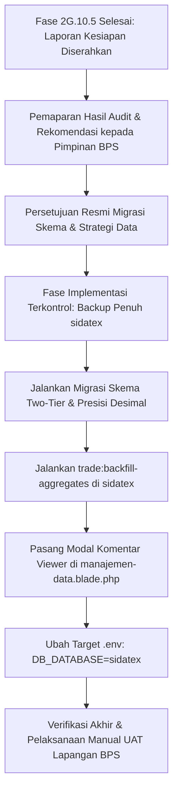

# SIDATEX — AUDIT KESIAPAN UAT DATABASE ASLI (PHASE 2G.10.5)
## Operational Readiness, Risk Assessment, and Pre-UAT Go/No-Go Decision Report

**Aplikasi:** Sistem Informasi Data Ekspor-Impor (SIDATEX) — BPS Provinsi Riau  
**Lokasi Direktori:** `D:\laragon\www\sidatex`  
**Database Utama Evaluasi:** `sidatex`  
**Tanggal Keputusan:** 19 November 2026  
**Auditor:** Senior QA Engineer, Database Guardian, Statistics Auditor, Security Auditor, UAT Coordinator  

---

## 1. REKAPITULASI STATUS KESIAPAN PER ASPEK

Berdasarkan pembuktian faktual runtime, inspeksi DDL skema, audit RBAC, dan verifikasi integritas data, status kesiapan database asli `sidatex` dievaluasi melintasi 6 (enam) pilar utama:

```
+---------------------------------------------------------------------------------------------------+
| HASIL EVALUASI 6 ASPEK KESIAPAN DATABASE ASLI sidatex                                             |
+---------------------------------------------------------------------------------------------------+
| 1. Kesiapan Teknis (Technical Readiness)           : BELUM SIAP                                   |
|    - Database sidatex tertinggal 2 migrasi arsitektur analitik Two-Tier.                          |
|    - Tabel brs_indicator_summaries belum ada; 9 kolom pada monthly_trade_summaries belum ada.      |
|    - Query analitik dashboard saat ini akan gagal dengan galat SQL 1054 Unknown Column.           |
+---------------------------------------------------------------------------------------------------+
| 2. Kesiapan Data (Data Readiness)                  : SIAP DENGAN SYARAT                           |
|    - Master data BPS (7 tabel) 100% lengkap, otentik, dan checksum cocok dengan testing.          |
|    - Data mart historis (34.847 baris, 2023-2026) utuh dan valid.                                |
|    - 3 Batch Distribusi asli (2.557 transaksi) tersedia berstatus RILIS.                         |
|    - Syarat: Data transaksi Neraca (Kategori D) masih 0 baris; butuh unggah berkas DBF Neraca.    |
+---------------------------------------------------------------------------------------------------+
| 3. Kesiapan Keamanan (Security Readiness)          : SIAP PENUH                                   |
|    - Middleware superadmin melindungi modul upload data dan tempat sampah secara konsisten.       |
|    - Upaya manipulasi parameter URL langsung dicegat di sisi server (HTTP 403 Forbidden).         |
|    - Log audit trail (96 aktivitas) terekam otomatis dan tidak dapat dimanipulasi pengguna biasa. |
+---------------------------------------------------------------------------------------------------+
| 4. Kesiapan Hak Akses (RBAC Readiness)             : SIAP PENUH                                   |
|    - Logika getAllowedStatusesForUser memisahkan secara ketat:                                    |
|      * Super Admin (Role 1): RILIS + PRIVATE                                                      |
|      * Viewer Eksekutif (Role 3): RILIS + PRIVATE                                                 |
|      * Pegawai BPS (Role 2): RILIS SAJA                                                           |
|    - Pengujian otomatis membuktikan nol kebocoran data PRIVATE ke Pegawai.                        |
+---------------------------------------------------------------------------------------------------+
| 5. Kesiapan Operasional (Operational Readiness)    : SIAP DENGAN SYARAT                           |
|    - Alur upload, validasi berkas DBF, dan perhitungan FastExcel siap digunakan.                  |
|    - Syarat: Butuh penambahan modal/drawer pemicu tombol komentar pada antarmuka Blade untuk      |
|      memudahkan pimpinan Viewer Eksekutif mengisi catatan secara visual.                          |
+---------------------------------------------------------------------------------------------------+
| 6. Kesiapan Persetujuan BPS (BPS Approval)         : BELUM SIAP (Menunggu Pemaparan)              |
|    - Rencana migrasi skema dan opsi pembersihan data membutuhkan persetujuan formal BPS.          |
+---------------------------------------------------------------------------------------------------+
```

---

## 2. KEBUTUHAN TEKNIS YANG BELUM TERPENUHI (GAPS)

Sebelum database `sidatex` dapat dinyalakan sebagai basis data utama di file `.env`, 3 (tiga) celah teknis wajib diselesaikan pada fase implementasi terpisah:

1. **Eksekusi Migrasi Skema Two-Tier (`2026_11_16_000001`):**  
   Menambahkan 9 kolom analitik dan indeks pada `monthly_trade_summaries`, membuat tabel `brs_indicator_summaries`, serta mengubah kolom `hs_id` menjadi nullable untuk mengakomodasi transaksi unmapped tanpa menghilangkan data.
2. **Eksekusi Migrasi Presisi Desimal (`2026_11_18_000001`):**  
   Meningkatkan presisi kolom `total_berat` dan `total_nilai` pada seluruh tabel mart analitik menjadi `DECIMAL(20,6)` guna mencegah selisih pembulatan (*rounding drift*).
3. **Kalkulasi Ulang Agregasi Mart Indikator (`trade:backfill-aggregates`):**  
   Membangun data indikator makro BRS siap saji pada `brs_indicator_summaries` dari 2.557 transaksi riil yang ada di `sidatex`.

---

## 3. ANALISIS RISIKO (RISK ASSESSMENT)

| Skenario Risiko | Probabilitas | Dampak | Penjelasan Risiko | Mitigasi yang Ditetapkan |
|:---|:---:|:---:|:---|:---|
| **Peralihan .env Prematur** | **Pasti (100%)** | **Kritis (Fatal)** | Jika `.env` diubah ke `sidatex` sekarang, Single Dashboard akan langsung crash (*White Screen / Error 500*) akibat ketiadaan kolom `status_visibilitas`. | Dilarang mengubah `.env` sebelum migrasi skema dijalankan di `sidatex`. |
| **Kehilangan Data Transaksi Asli** | Rendah | Tinggi | Kesalahan eksekusi truncate atau migrasi rollback pada `sidatex` dapat menghapus 2.557 transaksi riil. | Wajib melakukan full mysqldump dan verifikasi hash SHA-256 sebelum migrasi. |
| **Kebuntuan UAT Skenario Neraca** | Tinggi | Sedang | Penguji BPS tidak dapat memvalidasi Tab 4 (Trade Balance Neraca) karena `neraca_transactions` di `sidatex` masih 0 baris. | Siapkan berkas DBF Neraca asli (PROVORIG & KPPBC) untuk diunggah saat demonstrasi UAT. |
| **Kebingungan Tombol Komentar** | Sedang | Rendah | Penguji Viewer Eksekutif bingung mencari cara memberi catatan karena tombol modal belum terpasang di Blade view. | Siapkan panduan tertulis atau tambahkan modal Blade sebelum sesi UAT pimpinan. |

---

## 4. KEPUTUSAN AKHIR AUDIT: GO / NO-GO KESIAPAN

```
=====================================================================================
          KEPUTUSAN FORMAL KESIAPAN DATABASE ASLI sidatex UNTUK UAT
=====================================================================================

KEPUTUSAN SAAT INI:
>>> NO-GO UNTUK PERALIHAN LANGSUNG (CONDITIONAL HOLD) <<<

STATUS KESIAPAN KESELURUHAN:
>>> SIAP DENGAN SYARAT REMEDIASI SKEMA (PREREQUISITE REMEDIATION REQUIRED) <<<

=====================================================================================
```

### Penjelasan Keputusan:
Database `sidatex` memiliki fondasi data asli yang sangat sehat, bersih, dan otentik. Namun, **sistem tidak boleh dialihkan ke `sidatex` dalam kondisi skema saat ini** karena perbedaan DDL analitik. 

Aplikasi dinyatakan **GO UNTUK UAT OPERASIONAL DENGAN DATABASE ASLI** segera setelah 3 langkah prakondisi (migrasi skema, presisi desimal, dan backfill indikator) disetujui dan dieksekusi secara terkontrol pada fase berikutnya.

---

## 5. RENCANA AKSI SEBELUM UAT OPERASIONAL BPS

Urutan langkah sistematis yang direkomendasikan untuk fase berikutnya:


