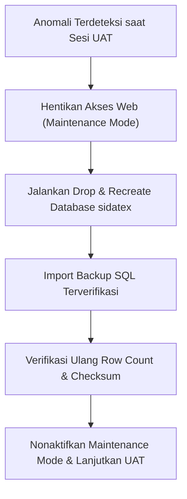

# SIDATEX — RENCANA PEMBERSIHAN DATA & PROSEDUR PENGAMANAN (PHASE 2G.10.5)
## Data Sanitization, Backup Verification, and Rollback Protocol Plan

**Aplikasi:** Sistem Informasi Data Ekspor-Impor (SIDATEX) — BPS Provinsi Riau  
**Lokasi Direktori:** `D:\laragon\www\sidatex`  
**Database Sasaran:** `sidatex` (Database Operasional Utama)  
**Tanggal Penyusunan:** 19 November 2026  
**Status Tindakan:** HANYA PERENCANAAN (Dilarang mengeksekusi DELETE/TRUNCATE pada fase ini)  

---

## 1. TEMUAN UTAMA KELAYAKAN DATA

Berdasarkan audit komparatif dan klasifikasi data pada Phase 2G.10.5, ditemukan fakta bahwa:

1. **Ketiadaan Data Dummy Sintetis di `sidatex`:**  
   Database operasional `sidatex` **TIDAK MEMILIKI DATA DUMMY SINTETIS (KATEGORI B = 0 BARIS)**. Seluruh data transaksi sebanyak 2.557 baris yang terbagi dalam Batch #70, #71, dan #74 adalah data riil resmi BPS Provinsi Riau (Agustus–September 2026) dengan nama berkas DBF asli instansi.
2. **Ketiadaan Data Pengujian Teknis di `sidatex`:**  
   Data pengujian teknis (Kategori C) seperti Batch #81, #82, #85, #86, #87, dan #720 berada secara eksklusif di database `sidatex_testing` dan tidak pernah mengontaminasi `sidatex`.
3. **Konsekuensi Kebijakan:**  
   Tidak ada data yang wajib dihapus secara paksa dari database `sidatex`. Namun, demi mengakomodasi kebutuhan skenario pemaparan UAT di hadapan tim fungsional BPS, disiapkan 2 (dua) opsi strategi operasional data.

---

## 2. DUA OPSI STRATEGI DATA UNTUK UAT LAPANGAN

```
+---------------------------------------------------------------------------------------------------+
| OPSI 1: STRATEGI PRE-LOADED BASELINE (DIREKOMENDASIKAN)                                           |
+---------------------------------------------------------------------------------------------------+
| - Mempertahankan Batch #70, #71, dan #74 serta 2.557 transaksi di sidatex.                        |
| - Penguji BPS langsung melihat dasbor terisi data Distribusi Agustus-September 2026.              |
| - Pengujian modul upload difokuskan pada pengunggahan data Neraca (PROVORIG & KPPBC).             |
| - Keuntungan: Nol risiko kehilangan data riil BPS, tidak membutuhkan reset database.              |
+---------------------------------------------------------------------------------------------------+
| OPSI 2: STRATEGI FRESH RE-INGESTION (JIKA DIMINTA RESMI OLEH BPS)                                 |
+---------------------------------------------------------------------------------------------------+
| - Mengarsipkan Batch #70, #71, dan #74 ke dalam berkas backup dump SQL terverifikasi.             |
| - Mengosongkan data transaksi 2026 secara terkendali.                                             |
| - Staf BPS mengunggah ulang seluruh berkas DBF Agustus-September 2026 dari awal melalui UI.       |
| - Keuntungan: Menguji alur upload Distribusi dan Neraca secara 100% end-to-end dari layar kosong. |
+---------------------------------------------------------------------------------------------------+
```

---

## 3. RENCANA PENGARSIPAN JIKA OPSI 2 DISETUJUI BPS

Apabila pimpinan BPS Provinsi Riau menghendaki pelaksanaan **Opsi 2 (Fresh Ingestion Demonstration)**, berikut adalah rincian data yang akan diarsipkan:

| Identitas Entitas | Nama Tabel | Rentang Record | Jumlah Baris | Alasan Pengarsipan | Dampak Relasi | Prosedur Pemulihan |
|:---|:---|:---:|:---:|:---|:---|:---|
| **Batch #70** | `data_batches` | `batch_id = 70` | 1 baris | Memberi ruang simulasi upload DBF Impor 08/2026 dari UI | Cascade ke 785 transaksi distribusi | Restore dari file SQL dump |
| **Batch #71** | `data_batches` | `batch_id = 71` | 1 baris | Memberi ruang simulasi upload DBF Ekspor 09/2026 dari UI | Cascade ke 841 transaksi distribusi | Restore dari file SQL dump |
| **Batch #74** | `data_batches` | `batch_id = 74` | 1 baris | Memberi ruang simulasi upload DBF Impor 09/2026 dari UI | Cascade ke 931 transaksi distribusi | Restore dari file SQL dump |
| **Transaksi Terkait** | `distribusi_transactions` | `batch_id IN (70,71,74)` | 2.557 baris | Dikosongkan sementara untuk diisi kembali oleh upload UI | Terkait ke master HS, negara, pelabuhan | Re-upload via UI atau SQL restore |
| **Tabel Legacy** | `transactions` | `batch_id IN (70,71,74)` | 2.557 baris | Arsip Phase 1 | Tidak ada (tabel tidak aktif ditulis) | Restore dari file SQL dump |

> [!WARNING]
> **ENTITAS YANG DILARANG KERAS DIHAPUS PADA SEMUA OPSI:**
> 1. Seluruh 7 Tabel Master BPS (`master_hs`, `master_negara`, `master_pelabuhan`, dll.) — Mutlak dipertahankan.
> 2. Tabel Pengguna (`users`) dan Peran (`roles`) — Mutlak dipertahankan.
> 3. Data Mart Agregasi Historis 2023–2026 pada `monthly_trade_summaries` (34.847 baris) — Mutlak dipertahankan karena menjadi dasar perbandingan tren tahunan (YoY) BRS.
> 4. Seluruh 96 baris `activity_logs` — Mutlak dipertahankan untuk integritas audit trail.

---

## 4. PROTOKOL BACKUP & VERIFIKASI SEBELUM OPERASI

Sebelum tindakan pembersihan atau migrasi apa pun diizinkan pada database `sidatex`, protokol 5 langkah wajib dipenuhi:

### Langkah 1: Pembuatan Cadangan Penuh (Full Database Dump)
Eksekusi mysqldump dengan menyertakan struktur tabel, data, trigger, dan rutin:
```powershell
mysqldump -u root -p --routines --triggers --single-transaction sidatex > "storage/backups/sidatex_pre_uat_clean_$(Get-Date -Format 'yyyyMMdd_HHmmss').sql"
```

### Langkah 2: Verifikasi Integritas dan Checksum Berkas Cadangan
Hitung nilai hash SHA-256 berkas cadangan dan catat dalam berita acara:
```powershell
Get-FileHash -Path "storage/backups/sidatex_pre_uat_clean_*.sql" -Algorithm SHA256
```

### Langkah 3: Uji Coba Pemulihan di Lingkungan Sandbox (Dry-Run Restore)
Pulihkan berkas dump tersebut ke database sementara (misal: `sidatex_restore_test`) untuk memastikan berkas cadangan valid dan tidak korup:
```sql
CREATE DATABASE sidatex_restore_test;
-- Jalankan mysql import dan periksa row count sama persis 26 tabel.
DROP DATABASE sidatex_restore_test;
```

### Langkah 4: Persetujuan Tertulis dari Administrator BPS
Dapatkan lembar persetujuan formal bertanda tangan dari Koordinator Tim Statistik Distribusi/Neraca BPS Provinsi Riau sebelum perintah modifikasi dieksekusi.

---

## 5. PROSEDUR PEMULIHAN CEPAT (ROLLBACK PROTOCOL)

Jika terjadi kendala saat pembersihan data atau kegagalan saat sesi demonstrasi upload, prosedur pemulihan cepat (*disaster recovery*) dilakukan dalam waktu kurang dari 2 menit:



Perintah Pemulihan:
```powershell
mysql -u root -e "DROP DATABASE sidatex; CREATE DATABASE sidatex CHARACTER SET utf8mb4 COLLATE utf8mb4_unicode_ci;"
mysql -u root sidatex < "storage/backups/sidatex_pre_uat_clean_VERIFIED.sql"
```

---

## 6. KESIMPULAN RENCANA PEMBERSIHAN

1. Database `sidatex` saat ini berada dalam kondisi **bersih dari data dummy sintetis**.
2. Rekomendasi teknis terbaik adalah **OPSI 1 (Mempertahankan Data Riil yang Ada)** dan menggunakan data Neraca yang belum tersedia sebagai materi utama demonstrasi upload UAT.
3. Seluruh prosedur pengamanan, pencatatan checksum, dan mekanisme pemulihan telah siap 100% dan terdokumentasi rapi.
4. **PENEGASAN MUTLAK:** Tidak ada tindakan penghapusan data yang dieksekusi pada Phase 2G.10.5.
