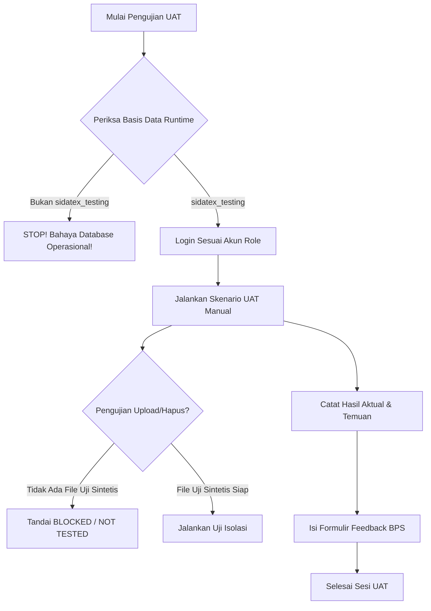

# PANDUAN PELAKSANAAN MANUAL USER ACCEPTANCE TESTING (UAT)
## SISTEM INFORMASI DATA EKSPOR-IMPOR (SIDATEX)
### BADAN PUSAT STATISTIK (BPS) PROVINSI RIAU

**Kode Dokumen:** `SIDATEX-DOC-UAT-GUIDE-2G10`  
**Versi Dokumen:** 1.0  
**Tanggal Terbit:** 19 November 2026  
**Klasifikasi:** Dokumen Panduan Pengujian Internal BPS Provinsi Riau  
**Status Kesiapan:** `MANUAL UAT PACKAGE PREPARED — PENDING BPS FIELD EXECUTION`

---

## DAFTAR ISI
1. [Pendahuluan dan Tujuan UAT](#1-pendahuluan-dan-tujuan-uat)
2. [Ruang Lingkup dan Batasan Pengujian](#2-ruang-lingkup-dan-batasan-pengujian)
3. [Arsitektur Konsep dan Metodologi SIDATEX](#3-arsitektur-konsep-dan-metodologi-sidatex)
4. [Prasyarat Lingkungan dan Akun Pengujian](#4-prasyarat-lingkungan-dan-akun-pengujian)
5. [Struktur Dokumen Paket UAT Manual](#5-struktur-dokumen-paket-uat-manual)
6. [Panduan Langkah Pengujian per Peran Pengguna (Role)](#6-panduan-langkah-pengujian-per-peran-pengguna-role)
   - 6.1 [Panduan Pengujian Super Admin (Role 1)](#61-panduan-pengujian-super-admin-role-1)
   - 6.2 [Panduan Pengujian Pegawai BPS (Role 2)](#62-panduan-pengujian-pegawai-bps-role-2)
   - 6.3 [Panduan Pengujian Viewer Eksekutif (Role 3)](#63-panduan-pengujian-viewer-eksekutif-role-3)
7. [Panduan Pengujian Fitur Khusus & Metodologi](#7-panduan-pengujian-fitur-khusus--metodologi)
   - 7.1 [Verifikasi Tooltip Metodologi Distribusi vs Neraca (F-05)](#71-verifikasi-tooltip-metodologi-distribusi-vs-neraca-f-05)
   - 7.2 [Verifikasi Trade Balance & Notifikasi Asimetri Kumulatif (F-03)](#72-verifikasi-trade-balance--notifikasi-asimetri-kumulatif-f-03)
   - 7.3 [Verifikasi Penanganan Pertumbuhan Statistik & Data Kosong](#73-verifikasi-penanganan-pertumbuhan-statistik--data-kosong)
8. [Instruksi Keamanan Data dan Larangan Operasional](#8-instruksi-keamanan-data-dan-larangan-operasional)
9. [Tata Cara Pencatatan Hasil, Temuan, dan Feedback](#9-tata-cara-pencatatan-hasil-temuan-dan-feedback)
10. [Kriteria Kelulusan dan Penerimaan Sistem](#10-kriteria-kelulusan-dan-penerimaan-sistem)
11. [Tanya Jawab & Penanganan Kendala (FAQ / Troubleshooting)](#11-tanya-jawab--penanganan-kendala-faq--troubleshooting)

---

## 1. PENDAHULUAN DAN TUJUAN UAT

### 1.1 Latar Belakang
Sistem Informasi Data Ekspor-Impor (SIDATEX) BPS Provinsi Riau telah melewati rangkaian audit teknis, pengujian unit dan fitur otomatis (180 tes PHPUnit lulus, 1.527 assertion valid), audit keamanan RBAC, verifikasi integritas rumus statistik, serta uji visual browser tanpa galat JavaScript (Phase 2G.6 sampai dengan Phase 2G.9). 

Untuk memastikan bahwa sistem memenuhi kebutuhan operasional faktual, kenyamanan antarmuka, ketepatan alur kerja statistik, dan tata kelola diseminasi data BPS Provinsi Riau, diperlukan tahap **Manual Business User Acceptance Testing (UAT)** yang dilaksanakan langsung oleh staf, analis, dan pimpinan BPS Provinsi Riau menggunakan peramban web (*web browser*) dan skenario proses bisnis nyata.

### 1.2 Tujuan Pelaksanaan Manual UAT
1. **Validasi Alur Bisnis Nyata:** Memastikan fungsi penyajian data makro, penelusuran komoditas, pemetaan pelabuhan/kabupaten, dan neraca perdagangan bekerja secara intuitif dan akurat.
2. **Penegakan Hak Akses Berbasis Peran (RBAC):** Memastikan batasan kewenangan antara Super Admin, Pegawai BPS, dan Viewer Eksekutif ditegakkan secara ketat di sisi antarmuka maupun sisi server.
3. **Kesesuaian Metodologi Statistik BPS:** Mengonfirmasi bahwa pengguna memahami dan dapat membedakan dengan jelas metodologi **Distribusi** (pelabuhan muat/bongkar di Riau) dan **Neraca** (asal barang/KPPBC di Riau), serta tidak terjadi kerancuan data.
4. **Evaluasi Pengalaman Pengguna (Usability & Clarity):** Mengumpulkan umpan balik (*feedback*) objektif dari staf BPS mengenai kenyamanan, kecepatan, kejelasan visualisasi, dan kemudahan filter data.
5. **Inventarisasi Masalah Lapangan:** Menemukan potensi kendala teknis atau kebutuhan penyempurnaan sebelum sistem dinyatakan diterima secara resmi (*Formal Business Acceptance*).

---

## 2. RUANG LINGKUP DAN BATASAN PENGUJIAN

### 2.1 Ruang Lingkup Pengujian
Pengujian manual mencakup seluruh halaman antarmuka utama SIDATEX:
1. **Halaman Otentikasi (`/login` & `/logout`):** Pengujian otentikasi akun, proteksi sesi, dan pemindahan halaman sesuai peran.
2. **Single Dashboard Statistik Terintegrasi (`/dashboard`):**
   - Tab 1: Overview Global & Tren Makro Ekspor-Impor Riau.
   - Tab 2: Tabulasi Time Series Komoditas (Bulanan, Triwulanan, Tahunan, Kumulatif).
   - Tab 3: Detail Analisis Komoditas, Pelabuhan, dan Pemetaan Wilayah (Leaflet.js).
   - Tab 4: Neraca Perdagangan (*Trade Balance*) & Matriks Asimetri Periode Kumulatif.
3. **Dashboard Spesifik Distribusi (`/distribusi/dashboard`):** Analisis transaksi pergerakan barang melalui pelabuhan Riau.
4. **Dashboard Spesifik Neraca (`/neraca/dashboard`):** Analisis transaksi pergerakan barang berdasarkan asal komoditas Provinsi Riau.
5. **Modul Manajemen Data & Riwayat Batch (`/manajemen-data`):** Tinjauan batch, pengelolaan metadata, status rilis (khusus Super Admin).
6. **Modul Trash Data & Pemulihan (`/trash-data`):** Pengujian isolasi data terhapus lunak (*soft delete*) dan fitur pemulihan (khusus Super Admin).
7. **Modul Audit Trail Log Aktivitas (`/activity-logs`):** Pengecekan rekam jejak aksi pengguna (khusus Super Admin).
8. **Modul Ekspor Laporan (`/export/powerpoint/{batchId}` & Unduh Tabel):** Validasi unduhan data dan presentasi.

### 2.2 Batasan Penting (Out of Scope / Prohibited Actions)
1. **Dilarang Mengakses Database Operasional:** Pengujian manual HANYA boleh dijalankan pada lingkungan uji (*testing environment*) dengan database `sidatex_testing`. Database produksi/operasional `sidatex` dilarang disentuh.
2. **Dilarang Merusak Data Uji Historis:** Batch #71 (berstatus RILIS) dan Batch #720 (berstatus PRIVATE) pada basis data pengujian tidak boleh dihapus permanen atau diubah integritas datanya.
3. **Pengujian Modul Unggah DBF (`/upload-data`):** Proses unggah data DBF mentah hanya boleh diuji jika staf BPS telah menyiapkan file DBF uji coba sintetis yang terisolasi. Jika file uji belum tersedia, skenario unggah ditandai `NOT TESTED` atau `BLOCKED`.
4. **Tidak Melakukan Modifikasi Kode di Tempat:** Staf penguji bertugas mencatat anomali atau bug ke dalam log temuan, bukan memodifikasi kode program atau konfigurasi peladen (*server*).

---

## 3. ARSITEKTUR KONSEP DAN METODOLOGI SIDATEX

Pemahaman konsep berikut sangat penting bagi staf penguji agar dapat memverifikasi kewajaran angka statistik:

### 3.1 Pemisahan Metodologi Distribusi vs Neraca
BPS Provinsi Riau menerapkan dua pendekatan statistik perdagangan luar negeri dengan semesta data (*data universe*) yang berbeda:
- **Pendekatan Distribusi Perdagangan (Flow of Goods):**
  - Mengukur arus fisik komoditas yang keluar/masuk melalui pintu gerbang pelabuhan di Provinsi Riau.
  - **Ekspor Distribusi:** Komoditas dimuat melalui Pelabuhan Muat Riau (**POD = Port of Discharge / Loading Port Riau**).
  - **Impor Distribusi:** Komoditas dibongkar di Pelabuhan Bongkar Riau (**KDPROV = Kode Provinsi Riau**).
- **Pendekatan Neraca Perdagangan Wilayah (Origin/Ownership of Goods):**
  - Mengukur kontribusi ekonomi komoditas yang diproduksi oleh wilayah Provinsi Riau, meskipun diekspor melalui pelabuhan luar provinsi (misalnya via Belawan, Tanjung Priok, atau Dumai).
  - **Ekspor Neraca:** Komoditas berasal dari wilayah Riau (**PROVORIG = Provinsi Riau**).
  - **Impor Neraca:** Komoditas yang diawasi oleh Kantor Pengawasan Bea Cukai Riau (**KPPBC Riau**).
- **Aturan Metodologis Mutlak:** Angka Distribusi dan Neraca **TIDAK BOLEH DIJUMLAHKAN ATAU DIGABUNGKAN** karena memiliki basis pencatatan yang berbeda. Sistem menyediakan tombol/switcher metodologi dan tooltip penjelasan interaktif.

### 3.2 Siklus Hidup dan Status Data (DRAFT, PRIVATE, RILIS, TRASH)
- **DRAFT:** Data hasil preview parsing berkas DBF yang belum disimpan ke data mart transaksional.
- **PRIVATE:** Data batch yang telah disimpan dan diagregasi, namun masih dalam tahap telaah dan verifikasi internal tim statistik BPS. Hanya dapat dilihat oleh **Super Admin** dan **Viewer Eksekutif**. Pegawai BPS dilarang melihat data bertipe PRIVATE.
- **RILIS:** Data resmi statistik ekspor-impor yang telah disetujui untuk publikasi umum. Dapat diakses oleh seluruh pengguna (Super Admin, Pegawai BPS, Viewer Eksekutif).
- **TRASH:** Batch data yang dihapus secara lunak (*soft deleted*). Data di Trash otomatis dikeluarkan dari seluruh perhitungan dashboard statistik.

---

## 4. PRASYARAT LINGKUNGAN DAN AKUN PENGUJIAN

### 4.1 Lingkungan Pengujian
- **URL Aplikasi Pengujian:** Mengikuti alamat IP dan nomor port lingkungan pengujian yang disiapkan oleh teknisi BPS:
  - *Penggunaan Lokal (Komputer Teknisi/Server):* `http://127.0.0.1:8000/login` atau `http://127.0.0.1:8094/login` (bergantung pada konfigurasi atau perintah `php artisan serve --port=...` yang dijalankan teknisi).
  - *Penggunaan Bersama di Jaringan Kantor BPS (LAN):* Alamat loopback `127.0.0.1` pada komputer teknisi **TIDAK DAPAT** diakses langsung oleh komputer klien staf BPS lainnya di jaringan LAN. Untuk sesi pengujian bersama, teknisi BPS wajib menjalankan web server dengan binding jaringan lokal (misalnya: `php artisan serve --host=0.0.0.0 --port=8094` atau virtual host web server) dan membagikan alamat IP server lokal (misalnya: `http://192.168.x.x:8094/login` atau domain intranet BPS yang ditunjuk).
- **Target Basis Data:** `sidatex_testing` (MySQL / MariaDB terisolasi).
- **Peramban Web yang Didukung:** Google Chrome (v110+), Microsoft Edge (v110+), Mozilla Firefox (v110+). Resolusi layar yang direkomendasikan adalah minimal $1366 \times 768$ piksel.

### 4.2 Kredensial Akun Pengujian (Testing Accounts)
Tiga akun resmi telah disiapkan pada lingkungan pengujian:

| Peran (Role) | Role ID | Username | Password | Hak Akses Utama |
|---|:---:|---|---|---|
| **Super Admin** | 1 | `admin_sidatex` | `password` | Akses penuh: Unggah DBF, rilis batch, kelola data, trash, audit log, melihat data PRIVATE & RILIS. |
| **Pegawai BPS** | 2 | `pegawai_sidatex` | `password123` | Akses baca analisis (*read-only*): Dashboard, filter, unduh data RILIS. Dilarang melihat data PRIVATE dan modul admin. |
| **Viewer Eksekutif** | 3 | `viewer_sidatex` | `password` | Akses pimpinan (*executive viewer*): Dashboard makro, melihat data RILIS dan data telaah internal PRIVATE, tanpa hak mutasi/hapus data. |

> [!IMPORTANT]
> Jangan mengubah kata sandi atau role akun-akun di atas selama sesi UAT berlangsung agar rekan penguji lain dapat melakukan pengujian secara simultan.

---

## 5. STRUKTUR DOKUMEN PAKET UAT MANUAL

Paket pengujian ini terdiri dari 6 dokumen resmi yang saling melengkapi:
1. `SIDATEX_PHASE_2G_10_MANUAL_UAT_GUIDE.md` *(Dokumen Ini)*: Panduan komprehensif alur pengujian bagi penguji BPS.
2. `SIDATEX_PHASE_2G_10_MANUAL_UAT_TEST_CASES.md`: Katalog 30 skenario pengujian rinci per modul dan per peran. Kolom hasil aktual dan status disediakan dalam kondisi kosong untuk diisi oleh penguji.
3. `SIDATEX_PHASE_2G_10_MANUAL_UAT_FEEDBACK_FORM.md`: Formulir survei pengalaman pengguna (skala Likert 1–5 dan pertanyaan terbuka).
4. `SIDATEX_PHASE_2G_10_MANUAL_UAT_FINDINGS_LOG.md`: Lembar kerja pencatatan temuan bug, deviasi statistik, atau kendala teknis.
5. `SIDATEX_PHASE_2G_10_UAT_PREREQUISITES_CHECKLIST.md`: Lembar verifikasi kesiapan teknis 13 butir sebelum pengujian dimulai.
6. `SIDATEX_PHASE_2G_10_PREPARATION_REPORT.md`: Laporan eksekutif kesiapan paket UAT.

---

## 6. PANDUAN LANGKAH PENGUJIAN PER PERAN PENGGUNA (ROLE)

### 6.1 Panduan Pengujian Super Admin (Role 1)
**Tujuan:** Memvalidasi tata kelola sistem penuh, mulai dari pengawasan data, status rilis, audit log, hingga manajemen trash.

#### Skenario A: Login & Akses Halaman Utama
1. Buka peramban dan navigasikan ke URL login pengujian (misal: `http://127.0.0.1:8000/login` atau `http://127.0.0.1:8094/login` atau alamat server LAN BPS).
2. Masukkan username `admin_sidatex` dan password `password`. Klik tombol **Masuk**.
3. Pastikan sistem mengarahkan ke halaman `/dashboard` dengan salam selamat datang dan lencana peran **Super Admin**.
4. Periksa bilah navigasi samping (*sidebar*): pastikan seluruh menu tampil lengkap (Dashboard, Upload Data, Manajemen Data, Trash Data, Log Aktivitas).

#### Skenario B: Eksplorasi Single Dashboard Statistik
1. Buka Tab 1 (Overview Global). Ubah dropdown periode tahun (misal: 2026 atau 2023) dan bulan. Pastikan kartu ringkasan Nilai Ekspor (FOB), Nilai Impor (CIF), dan grafik tren merespons dengan cepat.
2. Buka Tab 2 (Tabulasi Time Series). Periksa sub-tab Komoditas Utama (Migas vs Non-Migas, Kode HS 2 digit) dan tabel time series.
3. Buka Tab 3 (Detail Analisis & Wilayah). Periksa peta interaktif Leaflet.js pelabuhan muat/bongkar di Riau serta tabel negara tujuan ekspor.
4. Buka Tab 4 (Neraca Perdagangan / Trade Balance). Periksa kartu Neraca Perdagangan Bulanan dan Kumulatif. Periksa keberadaan kotak peringatan asimetri periode kumulatif jika terdapat ketidakseimbangan ketersediaan data ekspor dan impor.

#### Skenario C: Manajemen Data & Status Rilis (`/manajemen-data`)
1. Klik menu **Manajemen Data** pada sidebar (`/manajemen-data`).
2. Periksa daftar batch yang tampil. Identifikasi **Batch #71** (status RILIS) dan **Batch #720** (status PRIVATE).
3. Uji tombol pengalihan status rilis (*Toggle Release*) HANYA pada batch uji coba terisolasi, yaitu **Batch #74** (atau batch staging non-historis yang disiapkan). **DILARANG KERAS** menguji tombol ini pada Batch #71 (baseline RILIS) atau Batch #720 (baseline PRIVATE).
4. Uji fitur ekspor data batch dalam format Excel (*Export Batch*). Pastikan berkas `.xlsx` terunduh dan dapat dibuka dengan benar.

#### Skenario D: Pemantauan Log Aktivitas (`/activity-logs`)
1. Klik menu **Log Aktivitas** pada sidebar (`/activity-logs`).
2. Pastikan tabel audit trail memuat riwayat pencatatan aksi (login, upload, toggle release, delete) dengan informasi pengguna, waktu, dan alamat IP.
3. Coba fitur filter atau pencarian log aktivitas untuk memastikan pencatatan audit bekerja transparan.

#### Skenario E: Pengelolaan Tempat Sampah (`/trash-data`)
1. Klik menu **Trash Data** pada sidebar (`/trash-data`).
2. Pastikan halaman menampilkan daftar batch atau transaksi yang telah dihapus lunak (*soft deleted*).
3. Periksa tombol pemulihan (*Restore*) dan pembersihan (*Force Delete*). Pastikan konfirmasi dialog muncul sebelum aksi dieksekusi.

---

### 6.2 Panduan Pengujian Pegawai BPS (Role 2)
**Tujuan:** Memvalidasi penggunaan analisis statistik sehari-hari oleh staf teknis BPS serta memastikan penegakan batasan hak akses baca (*read-only*) dan perlindungan data tertutup (*PRIVATE*).

#### Skenario A: Login & Verifikasi Antarmuka Terbatas
1. Lakukan logout dari akun sebelumnya, lalu navigasikan ke `/login`.
2. Masukkan username `pegawai_sidatex` dan password `password123`. Klik **Masuk**.
3. Pastikan mendarat di `/dashboard` dengan lencana peran **Pegawai**.
4. Periksa bilah navigasi: menu **Upload Data**, **Trash Data**, dan **Log Aktivitas** **TIDAK BOLEH TAMPIL** pada antarmuka Pegawai.

#### Skenario B: Analisis Data Rilis & Ketiadaan Data Private
1. Pada `/dashboard`, buka filter data. Pegawai BPS HANYA berhak melihat data statistik yang telah berstatus **RILIS** (seperti Batch #71).
2. Periksa apakah data dari batch tertutup (**Batch #720** berstatus PRIVATE) sama sekali tidak bocor ke dalam kalkulasi kartu metrik atau tabel komoditas Pegawai. Nilai agregat harus murni mencerminkan data RILIS.

#### Skenario C: Uji Filter Periode, Komoditas, dan Metodologi
1. Ubah filter tahun dan bulan pada dashboard. Pastikan angka pertumbuhan MoM (Month-to-Month) dan YoY (Year-on-Year) terhitung otomatis.
2. Periksa kasus data bulan berjalan kosong: sistem harus menampilkan tanda strip `—` atau `N/A`, dan **TIDAK BOLEH MENAMPILKAN ANGKA PALSU `-100%`**.
3. Beralih antara metodologi **Distribusi** dan **Neraca** menggunakan tombol yang tersedia. Amati perbedaan angka ekspor/impor dan pastikan pengguna memahami perbedaan semesta datanya.

#### Skenario D: Uji Pelanggaran Akses (Security Guard Check - HTTP 403)
Sebagai pengujian keamanan manual, ketikkan URL terlarang secara langsung pada bilah alamat peramban:
1. Akses `[URL-UAT]/upload-data` (misal: `http://127.0.0.1:8000/upload-data` atau `http://127.0.0.1:8094/upload-data` atau URL host LAN aktif).
   - **Hasil yang Diharapkan:** Akses DITOLAK dengan halaman peringatan **403 Forbidden** atau pengalihan (*redirect*) aman. Sistem tidak boleh membuka formulir unggah.
2. Akses `[URL-UAT]/trash-data`.
   - **Hasil yang Diharapkan:** Akses DITOLAK (HTTP 403).
3. Akses `[URL-UAT]/activity-logs`.
   - **Hasil yang Diharapkan:** Akses DITOLAK (HTTP 403).

---

### 6.3 Panduan Pengujian Viewer Eksekutif (Role 3)
**Tujuan:** Memvalidasi kebutuhan pimpinan/eksekutif BPS dalam meninjau angka makro perdagangan luar negeri sebelum dan sesudah rilis resmi, tanpa risiko modifikasi data yang tidak sengaja.

#### Skenario A: Login & Tampilan Dashboard Eksekutif
1. Lakukan logout dan masuk dengan username `viewer_sidatex` dan password `password`.
2. Pastikan diarahkan ke `/dashboard` dengan lencana peran **Viewer Eksekutif**.
3. Periksa sidebar: menu administratif (Upload, Trash, Log) tidak tersedia, mencerminkan mode telaah eksekutif.

#### Skenario B: Verifikasi Akses Data RILIS dan PRIVATE
1. Buka filter dashboard pada periode yang memuat data telaah internal (**Batch #720** - status PRIVATE).
2. Sebagai Viewer Eksekutif, sistem **MENGIZINKAN** peninjauan data PRIVATE untuk keperluan telaah angka pra-rilis BRS. Pastikan data dapat dianalisis pada grafik dan tabel ringkasan.

#### Skenario C: Integritas Proteksi Read-Only
1. Pastikan tidak ada tombol aksi mutasi data (seperti Tambah Data, Hapus, Ubah Status Rilis, atau Restore) yang muncul pada antarmuka Viewer Eksekutif.
2. Coba akses langsung endpoint mutasi melalui browser untuk memastikan otorisasi server menolaknya secara absolut.

---

## 7. PANDUAN PENGUJIAN FITUR KHUSUS & METODOLOGI

Tiga fitur khusus telah disempurnakan berdasarkan temuan audit Phase 2G.6 sampai 2G.8. Staf BPS diharapkan memberikan perhatian khusus pada aspek berikut:

### 7.1 Verifikasi Tooltip Metodologi Distribusi vs Neraca (F-05)
- **Lokasi:** Halaman `/dashboard` (di samping switcher metodologi Distribusi / Neraca) dan halaman `/distribusi/dashboard`.
- **Langkah Pengujian:**
  1. Arahkan kursor (*hover*) atau klik pada ikon informasi `(i)` di dekat tombol pilihan metodologi.
  2. Pastikan popover/tooltip interaktif muncul dengan teks penjelasan resmi:
     - **Distribusi:** Menjelaskan pencatatan komoditas berdasarkan pintu keluar/masuk fisik pelabuhan di wilayah Provinsi Riau (POD = Riau untuk Ekspor, KDPROV = Riau untuk Impor).
     - **Neraca:** Menjelaskan pencatatan komoditas berdasarkan wilayah asal barang yang diproduksi di Riau (PROVORIG = Riau untuk Ekspor) dan pengawasan kantor kepabeanan Riau (KPPBC Riau untuk Impor).
  3. Pastikan teks terbaca jelas, rapi, tidak terpotong oleh batas layar (*overflow*), dan dapat ditutup kembali dengan mudah.

### 7.2 Verifikasi Trade Balance & Notifikasi Asimetri Kumulatif (F-03)
- **Lokasi:** `/dashboard` -> Tab 4 (Trade Balance / Neraca Perdagangan).
- **Langkah Pengujian:**
  1. Pilih periode di mana ketersediaan data kumulatif antara ekspor dan impor berbeda (misalnya data ekspor tersedia sampai bulan tertentu, sedangkan impor memiliki rentang bulan yang berbeda).
  2. Periksa kartu **Neraca Perdagangan Bulanan**: Nilai dihitung dari $\text{Ekspor FOB} - \text{Impor CIF}$. Jika salah satu komponen bernilai null/kosong, kartu tidak boleh menampilkan angka nol palsu, melainkan simbol strip `—`.
  3. Periksa kartu **Neraca Perdagangan Kumulatif**: Jika terjadi ketidakseimbangan rentang bulan (*asymmetric cumulative window*), sistem **WAJIB MENAMPILKAN BANNER / ALERT AMBER** yang menjelaskan secara transparan bahwa periode kumulatif ekspor dan impor berbeda.
  4. Lencana status (*Badge Surplus / Defisit / Seimbang*) tidak boleh menampilkan "Seimbang" secara keliru saat data tidak tersedia.

### 7.3 Verifikasi Penanganan Pertumbuhan Statistik & Data Kosong
- **Lokasi:** Seluruh kartu metrik ringkasan (MoM, YoY, QoQ, C-to-C).
- **Langkah Pengujian:**
  1. Pilih filter bulan di mana transaksi belum pernah ada atau kosong.
  2. Pastikan indikator pertumbuhan menampilkan strip `—` atau `N/A`.
  3. Pastikan **TIDAK PERNAH MUNCUL ANGKA `-100.00%`** ketika ketiadaan data disebabkan oleh ketiadaan transaksi pada bulan berjalan (*no observations*).
  4. Pastikan tabel top komoditas tidak memunculkan baris semu `'Lainnya'` saat data kosong.

---

## 8. INSTRUKSI KEAMANAN DATA DAN LARANGAN OPERASIONAL

Untuk melindungi integritas data BPS, seluruh staf penguji wajib mematuhi aturan baku berikut:

1. **LARANGAN MUTLAK PADA DATABASE OPERASIONAL (`sidatex`):** Pengujian hanya dilakukan pada port/koneksi `sidatex_testing`. Tidak ada toleransi terhadap pengujian langsung pada basis data operasional BPS.
2. **JANGAN MERUSAK BATCH SEEDER (#71 dan #720):** Batch ini merupakan acuan pengujian regresi otomatis. Jangan melakukan *Force Delete* pada kedua batch tersebut.
3. **PENGUJIAN UPLOAD:** Jika melakukan uji unggah berkas, gunakan berkas DBF pengujian terisolasi berukuran kecil. Jangan mengunggah berkas mentah operasional bulanan tanpa koordinasi dengan Tim IT BPS.
4. **PERLINDUNGAN PRIVASI:** Jangan menyebarkan tangkapan layar data berstatus PRIVATE ke luar lingkungan kerja resmi BPS Provinsi Riau.

---

## 9. TATA CARA PENCATATAN HASIL, TEMUAN, DAN FEEDBACK

Setelah mencoba setiap skenario pada dokumen `SIDATEX_PHASE_2G_10_MANUAL_UAT_TEST_CASES.md`, penguji mencatat hasil dengan prosedur berikut:

### 9.1 Mengisi Lembar Test Case
Pada setiap butir test case, isi kolom yang disediakan:
- **Hasil Aktual:** Tuliskan apa yang sebenarnya terlihat pada layar (misal: "Halaman dashboard menampilkan kartu ekspor US$ 1.250,50 Juta, grafik tren ter-render sempurna").
- **Status Pengujian:** Pilih salah satu dari empat status resmi:
  - `PASS`: Berjalan tepat sesuai kriteria hasil yang diharapkan.
  - `FAIL`: Mengalami kegagalan fungsi, perhitungan salah, atau tampilan rusak.
  - `BLOCKED`: Tidak dapat diuji karena adanya kendala prasyarat (misal berkas uji DBF belum tersedia).
  - `NOT TESTED`: Belum sempat diuji pada sesi berjalan.
- **Catatan Penguji:** Masukan tambahan atau kondisi spesifik saat pengujian.
- **Bukti Screenshot:** Simpan berkas tangkapan layar dengan format `[TC-ID]_[Role]_[Deskripsi].png` dan catat nama berkasnya pada lembar uji.
- **Nama & Tanggal Penguji:** Cantumkan nama lengkap penguji BPS dan tanggal pelaksanaan.

### 9.2 Mencatat Masalah pada Log Temuan (`FINDINGS_LOG`)
Jika menemukan anomali atau kesalahan (status `FAIL` atau `BLOCKED`), segera catat pada dokumen `SIDATEX_PHASE_2G_10_MANUAL_UAT_FINDINGS_LOG.md`:
- Tentukan **Tingkat Keparahan (Severity)**:
  - **Critical:** Sistem berhenti (*crash*), kebocoran keamanan data privat, atau data operasional terancam.
  - **High:** Rumus statistik makro salah hitung, fitur inti tidak berfungsi sama sekali.
  - **Medium:** Filter data lambat merespons, tata letak grafik bergeser pada resolusi tertentu, teks tooltip kurang presisi.
  - **Low:** Kesalahan ketik (*typo*), format desimal kurang seragam, kontras warna label.
  - **Informational:** Saran perbaikan alur di masa depan yang di luar cakupan spesifikasi saat ini.

### 9.3 Mengisi Formulir Feedback Pengguna (`FEEDBACK_FORM`)
Di akhir sesi pengujian, setiap staf BPS wajib melengkapi dokumen `SIDATEX_PHASE_2G_10_MANUAL_UAT_FEEDBACK_FORM.md` secara mandiri dan objektif untuk memberikan penilaian kualitatif dan kuantitatif.

---

## 10. KRITERIA KELULUSAN DAN PENERIMAAN SISTEM

Penerimaan sistem SIDATEX dipisahkan secara tegas ke dalam 3 tingkatan evaluasi:

| Tingkatan Evaluasi | Pelaksana | Ruang Lingkup & Kriteria | Status Saat Ini |
|---|---|---|:---:|
| **1. Technical Validation (Automated UAT)** | Antigravity AI & Test Runner | - 180 Test PHPUnit PASS (1.527 assertions) - 77 Skenario UAT Otomatis PASS (100%) - 4 Reviewer Independen Lulus (4/4 PASS) - 0 Galat JavaScript pada Console Peramban | **LULUS / SELESAI** |
| **2. Manual Business UAT** | Staf, Analis, dan Operator BPS Provinsi Riau | - Seluruh skenario pada katalog test case dieksekusi - Tidak ada temuan Critical atau High yang belum terselesaikan - Temuan Medium terdokumentasi dan memiliki rencana mitigasi - Rerata skor kepuasan formulir feedback $\ge 3,5$ (skala 5) | **PENDING BPS FIELD EXECUTION** |
| **3. Formal Business Acceptance** | Pimpinan Berwenang BPS Provinsi Riau | - Peninjauan seluruh laporan UAT dan rekomendasi tim - Penandatanganan resmi Berita Acara Penerimaan (BAP) Sistem oleh Pejabat Pembuat Komitmen (PPK) / Pimpinan BPS | **PENDING FORMAL SIGN-OFF** |

> [!CAUTION]
> Kelulusan teknis otomatis (Tingkat 1) TIDAK DAPAT menggantikan atau dianggap sebagai Penerimaan Bisnis Resmi (Tingkat 3). Keputusan akhir penerimaan sistem sepenuhnya berada di tangan pejabat berwenang BPS Provinsi Riau.

---

## 11. TANYA JAWAB & PENANGANAN KENDALA (FAQ / TROUBLESHOOTING)

**Q1: Mengapa angka Nilai Ekspor pada metodologi Distribusi berbeda dengan angka pada metodologi Neraca untuk bulan yang sama?**  
*Jawab:* Hal ini normal dan benar secara metodologis statistik BPS. Distribusi mencatat komoditas yang keluar lewat pelabuhan laut/udara di Riau (POD = Riau), sedangkan Neraca mencatat komoditas yang berasal dari wilayah produksi Riau (PROVORIG = Riau) meskipun dikapalkan melalui pelabuhan luar daerah. Keduanya tidak boleh dijumlahkan.

**Q2: Mengapa pada Tab 4 Trade Balance muncul peringatan berwarna kuning (*Amber Alert*)?**  
*Jawab:* Peringatan tersebut menandakan bahwa rentang bulan kumulatif ekspor dan impor asimetris (misal ekspor tersedia Jan–Sep, sedangkan impor Jan–Agt). Ini adalah fitur keselamatan statistik (F-03) agar pengguna tidak salah menginterpretasikan neraca kumulatif sebagai perbandingan periode yang setara.

**Q3: Saya login sebagai Pegawai BPS, tetapi mengapa saya tidak bisa menemukan tombol Unggah DBF atau menu Trash?**  
*Jawab:* Ini merupakan implementasi pembatasan peran (RBAC) yang benar. Pegawai BPS hanya memiliki kewenangan analisis (*read-only*). Kewenangan unggah dan kelola data sensitif hanya dimiliki oleh Super Admin.

**Q4: Apa yang harus dilakukan jika peramban menampilkan halaman putih atau galat saat membuka dashboard?**  
*Jawab:*
1. Buka *Developer Tools* peramban (tekan tombol `F12` atau `Ctrl + Shift + I`) dan pilih tab **Console**.
2. Ambil tangkapan layar (*screenshot*) pesan galat merah yang tertera.
3. Catat URL halaman dan langkah yang baru saja dilakukan ke dalam dokumen `SIDATEX_PHASE_2G_10_MANUAL_UAT_FINDINGS_LOG.md`.
4. Beritahukan kepada Koordinator UAT atau tim teknis pengembang.
