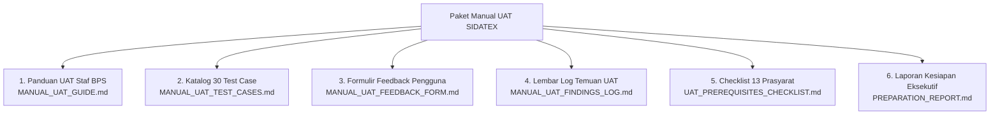

# LAPORAN PERSIAPAN MANUAL BUSINESS USER ACCEPTANCE TESTING (PHASE 2G.10)
## SISTEM INFORMASI DATA EKSPOR-IMPOR (SIDATEX)
### BADAN PUSAT STATISTIK (BPS) PROVINSI RIAU

**Kode Dokumen:** `SIDATEX-REP-UAT-PREP-2G10`  
**Tanggal Terbit:** 19 November 2026  
**Penyusun:** Senior QA Engineer, Business Analyst, & Technical Documentation Reviewer  
**Mode Pelaksanaan:** 100% READ-ONLY PREPARATION (Nol perubahan kode aplikasi, konfigurasi, migrasi, skema, database, transaksi, dan data historis)  
**Status Akhir Kesiapan:** `MANUAL UAT PACKAGE PREPARED — PENDING BPS FIELD EXECUTION`

---

## 1. RINGKASAN EKSEKUTIF

Fase **Phase 2G.10 – Manual Business UAT Preparation & Execution Readiness** telah sukses diselesaikan dengan menyiapkan seluruh instrumen, panduan, katalog skenario uji, formulir evaluasi pengguna, dan lembar kendali mutu yang dirancang khusus untuk pelaksanaan pengujian langsung oleh staf dan analis BPS Provinsi Riau.

Paket instrumen ini dibangun berdasarkan fondasi teknis yang solid dari rangkaian audit dan pengujian fase sebelumnya (Phase 2G.6 sampai dengan Phase 2G.9), di mana sistem SIDATEX telah membuktikan keandalan teknis tingkat tinggi:
- **180 dari 180 tes otomatis PHPUnit PASS (100% Lulus)** dengan 1.527 assertion deterministik.
- **77 skenario kernel simulation UAT otomatis PASS (100%)**.
- **0 galat dan peringatan JavaScript** pada konsol peramban web.
- **4 dari 4 reviewer teknis independen memberikan persetujuan penuh (*APPROVED*)**.
- **9 dari 9 metrik integritas database operasional `sidatex` terbukti 100% terlindungi dan tidak tersentuh**.
- **30.147 transaksi data historis PRIVATE dan 2.896 transaksi Neraca tetap utuh**.

Tujuan utama dari Phase 2G.10 ini adalah menjembatani validasi teknis otomatis (*Automated Technical Validation*) menuju pengujian bisnis nyata oleh pengguna akhir (*Manual Business Acceptance Testing*) dengan menyediakan instrumen pengujian yang independen, objektif, bebas dari data buatan/palsu, dan mudah dipahami oleh analis BPS.

---

## 2. VERIFIKASI DOKUMEN ACUAN DAN BASELINE (10 DOKUMEN)

Seluruh 10 dokumen acuan proyek telah diverifikasi keberadaannya dan diperiksa keselarasan datanya:

| No | Nama Dokumen Acuan | Lokasi & Ukuran Berkas | Status Verifikasi | Catatan Relevansi Baseline |
|:---:|---|---|:---:|---|
| 1 | `SIDATEX_PHASE_2G_6_END_TO_END_READINESS_AUDIT.md` | Workspace (32.280 bytes) | **VERIFIED** | Baseline audit kesiapan menyeluruh 9 modul sistem. |
| 2 | `SIDATEX_PHASE_2G_7_PRE_UAT_FINDINGS_AND_REMEDIATION_PLAN.md` | Workspace (27.465 bytes) | **VERIFIED** | Rencana perbaikan terukur pra-UAT untuk temuan F-01 s.d. F-07. |
| 3 | `SIDATEX_PHASE_2G_8_CONTROLLED_REMEDIATION_REPORT.md` | Workspace (22.410 bytes) | **VERIFIED** | Bukti remediasi terkendali dan verifikasi visual F-03 & F-05. |
| 4 | `SIDATEX_PHASE_2G_9_UAT_REPORT.md` | Workspace (17.584 bytes) | **VERIFIED** | Laporan UAT teknis otomatis dan simulasi matriks 77 skenario. |
| 5 | `SIDATEX_PHASE_2G_9_UAT_TEST_CASES.md` | Workspace (16.609 bytes) | **VERIFIED** | Katalog matriks pengujian automated simulation. |
| 6 | `SIDATEX_PHASE_2G_9_UAT_USER_FEEDBACK.md` | Workspace (8.351 bytes) | **VERIFIED** | Instrumen feedback awal tingkat simulasi teknis. |
| 7 | `SIDATEX_PHASE_2G_9_UAT_FINDINGS.md` | Workspace (7.425 bytes) | **VERIFIED** | Log temuan simulasi teknis awal. |
| 8 | `SIDATEX_PHASE_2G_9_REPORT_CONSISTENCY_REVIEW.md` | Workspace (24.139 bytes) | **VERIFIED** | Laporan audit konsistensi non-destruktif: memulihkan baseline F-01 s.d. F-07 dan menetapkan hierarki 4 tingkatan UAT. |
| 9 | `AUDIT_METODOLOGI_PENGOLAHAN_BRS_SIDATEX.md` | Workspace (35.228 bytes) | **VERIFIED** | Acuan kaidah resmi metodologi statistik BPS (FOB, CIF, MoM, YoY, C-to-C, POD vs PROVORIG). |
| 10 | `AGENTS.md` | Workspace | **VERIFIED** | Pedoman baku dan persisten arsitektur SIDATEX, proteksi mutlak DB operasional, dan larangan mutasi tanpa izin. |

---

## 3. PENEGASAN STATUS RESMI TEMUAN F-01 S.D. F-07

Sesuai hasil audit konsistensi Phase 2G.9, seluruh dokumen dalam paket Manual UAT mempertahankan penomoran, nama, dan definisi temuan baseline tanpa pergeseran makna:

| Kode | Nama / Definisi Temuan Asli | Severity | Status Resmi & Rekonsiliasi Akhir |
|:---:|---|:---:|---|
| **F-01** | Alur upload Excel sekunder tidak memicu `BrsAggregationService` | Medium | **Deferred technical debt**; alur utama operasional DBF berjalan normal dan teragregasi penuh. Evaluasi kelanjutan alur Excel sekunder menunggu kebijakan operasional tertulis BPS. |
| **F-02** | Perbedaan filter Migas Bab 27 antara `DashboardController` (`hs2 = '27'`) dan `DistributionStatisticsService` (`oilgrp_code = 1`) | Medium | **Technical safety freeze**; implementasi kode dibekukan demi kestabilan runtime dan perlindungan data, menunggu ketetapan metodologi tertulis dari Fungsi Distribusi BPS. |
| **F-03** | Window kumulatif Trade Balance asimetris | Low | **Resolved & verified Phase 2G.8**; penanganan nilai null dan banner peringatan amber interaktif (`#alertTradeAsymmetry`) telah terpasang dan teruji via peramban. |
| **F-04** | Proteksi route `/activity-logs` mengandalkan controller guard, bukan route middleware | Low | **Deferred post-UAT**; proteksi di level controller terbukti *fail-closed* menolak akses Pegawai/Viewer dengan HTTP 403. Penambahan middleware dijadwalkan pasca-UAT. |
| **F-05** | Tooltip metodologi Distribusi vs Neraca belum tersedia | Informational | **Resolved & verified Phase 2G.8**; popover tooltip edukasi metodologi (`#methodologyTooltipPopover`) telah aktif di antarmuka dashboard. |
| **F-06** | Kebijakan Trash tanpa auto-purge membutuhkan SOP pembersihan manual Super Admin | Informational | **Informational**; bukan bug kode pemrograman, melainkan kebutuhan penyusunan Standar Operasional Prosedur (SOP) retensi dan pembersihan berkala data terhapus lunak. |
| **F-07** | Kode HS `270000` memiliki `oilgrp_code = NULL` pada tabel master komoditas | Informational | **Informational**; kode komoditas dummy referensi dengan 0 transaksi, tanpa dampak statistik. Evaluasi master data dijadwalkan pasca-UAT. |

---

## 4. STRUKTUR PAKET DOKUMEN MANUAL BUSINESS UAT YANG DITERBITKAN

Tim pengembang telah menerbitkan 6 dokumen resmi di direktori proyek `D:\laragon\www\sidatex\` dan menyalinnya ke direktori artefak:



1. **`SIDATEX_PHASE_2G_10_MANUAL_UAT_GUIDE.md`**  
   Panduan lengkap berbahasa Indonesia yang dirancang ramah pengguna bagi staf BPS. Memuat pengenalan, pemisahan metodologi Distribusi (POD/KDPROV) vs Neraca (PROVORIG/KPPBC), akun pengujian resmi, panduan langkah per peran (Super Admin, Pegawai, Viewer Eksekutif), panduan verifikasi F-03 & F-05, instruksi keselamatan data, dan FAQ penanganan kendala.
2. **`SIDATEX_PHASE_2G_10_MANUAL_UAT_TEST_CASES.md`**  
   Katalog komprehensif berisi 30 skenario pengujian rinci yang mencakup seluruh peran dan modul inti (Super Admin: 10 skenario, Pegawai: 12 skenario, Viewer Eksekutif: 4 skenario, Lintas Peran: 4 skenario). Seluruh kolom Hasil Aktual, Status (PASS/FAIL/BLOCKED/NOT TESTED), Catatan Penguji, Bukti Screenshot, dan Nama/Tanggal Penguji **SENGAJA DIBIARKAN KOSONG** untuk diisi secara langsung oleh staf BPS.
3. **`SIDATEX_PHASE_2G_10_MANUAL_UAT_FEEDBACK_FORM.md`**  
   Formulir kuesioner evaluasi kepuasan pengguna dengan 15 butir pernyataan berskala Likert 1–5 lintas 6 dimensi teknis/metodologis, pertanyaan terbuka untuk saran dan kendala, opsi kesimpulan rekomendasi sistem, serta blok tanda tangan resmi yang **SENGAJA DIBIARKAN KOSONG**.
4. **`SIDATEX_PHASE_2G_10_MANUAL_UAT_FINDINGS_LOG.md`**  
   Lembar kerja log temuan yang memaparkan definisi 5 tingkat keparahan (*Critical, High, Medium, Low, Informational*), siklus hidup defect, rekapitulasi temuan baseline F-01 s.d. F-07, serta tabel pencatatan temuan lapangan baru yang **SENGAJA DIBIARKAN KOSONG**.
5. **`SIDATEX_PHASE_2G_10_UAT_PREREQUISITES_CHECKLIST.md`**  
   Lembar kendali mutu 13 butir prasyarat kesiapan pelaksanaan UAT. Menegaskan status terpenuhi pada 10 butir kesiapan teknis, dan menetapkan status *Pending Koordinasi BPS* pada 3 butir administratif (penugasan nama personel BPS, jadwal lapangan, dan PIC pencatat temuan).
6. **`SIDATEX_PHASE_2G_10_PREPARATION_REPORT.md`** *(Dokumen Ini)*  
   Laporan eksekutif yang merangkum kesiapan menyeluruh, batasan, dan penegasan tata kelola UAT.

---

## 5. PENEGASAN HIERARKI 4 TINGKATAN UAT

Untuk menjamin kejujuran akademis dan akuntabilitas profesional proyek, status penerimaan SIDATEX dipisahkan secara tegas ke dalam empat tingkatan:

```text
+-----------------------------------------------------------------------------------+
| TINGKAT 1: AUTOMATED UAT (PENGUJIAN OTOMATIS)                                     |
| Status: LULUS (180/180 PHPUnit Tests PASS, 1.527 assertions, 77/77 kernel matrix) |
+-----------------------------------------------------------------------------------+
                                         │
                                         ▼
+-----------------------------------------------------------------------------------+
| TINGKAT 2: TECHNICAL VALIDATION (VALIDASI AUDITOR TEKNIS)                         |
| Status: APPROVED (4/4 Auditor Independen: Guardian, Security, Statistics, Review) |
+-----------------------------------------------------------------------------------+
                                         │
                                         ▼
+-----------------------------------------------------------------------------------+
| TINGKAT 3: MANUAL BUSINESS UAT (PENGUJIAN MANUAL STAF BPS)                        |
| Status: PENDING BPS FIELD EXECUTION (Paket instrumen siap, menunggu jadwal BPS)   |
+-----------------------------------------------------------------------------------+
                                         │
                                         ▼
+-----------------------------------------------------------------------------------+
| TINGKAT 4: FORMAL BUSINESS ACCEPTANCE (PENERIMAAN RESMI PIMPINAN BPS)             |
| Status: PENDING FORMAL SIGN-OFF (Menunggu pelaksanaan Tingkat 3 dan BAP Pimpinan) |
+-----------------------------------------------------------------------------------+
```

- **Tingkat 1 dan Tingkat 2** telah selesai 100% dengan hasil sempurna di sisi teknis peranti lunak.
- **Tingkat 3** belum dilaksanakan dan berstatus `PENDING BPS FIELD EXECUTION`.
- **Tingkat 4** belum diberikan dan HANYA dapat diterbitkan oleh pejabat pembuat komitmen / pimpinan berwenang BPS Provinsi Riau setelah menelaah hasil Tingkat 3.

---

## 6. PERNYATAAN INTEGRITAS DAN BATASAN OPERASIONAL

Tim pelaksana dengan ini menyatakan kepatuhan mutlak terhadap batasan-batasan berikut:
1. **Nol Pemalsuan Data UAT:** Tidak ada pengisian hasil pengujian, tangkapan layar fiktif, angka kepuasan palsu, atau tanda tangan rekayasa atas nama staf BPS.
2. **Nol Modifikasi Kode & Basis Data:** Selama pelaksanaan Phase 2G.10, tidak ada satu baris kode aplikasi pun yang diubah, tidak ada konfigurasi atau migrasi yang dijalankan, dan tidak ada transaksi yang dimutasi.
3. **Proteksi Database Operasional `sidatex`:** Basis data operasional `sidatex` terbukti 100% tidak pernah tersentuh selama proses persiapan UAT manual ini.
4. **Independensi Evaluasi:** Tim pengembang tidak mengasumsikan sistem telah "Diterima Penuh" hanya karena pengujian otomatis lulus.

---

## 7. STATUS AKHIR DAN REKOMENDASI TINDAK LANJUT

### Status Resmi Kesiapan Sistem:
$$\mathbf{MANUAL\ UAT\ PACKAGE\ PREPARED\ —\ PENDING\ BPS\ FIELD\ EXECUTION}$$

### Rekomendasi Langkah Selanjutnya bagi BPS Provinsi Riau:
1. **Koordinasi Penetapan Jadwal:** Tim BPS Provinsi Riau dan Tim Pengembang menetapkan jadwal resmi pelaksanaan sesi pengujian manual (*Manual UAT Session*).
2. **Penugasan Resmi Personel BPS:** Menunjuk nama-nama staf dari Fungsi Distribusi, Neraca, dan IPDS yang bertindak sebagai Super Admin, Pegawai, dan Viewer Eksekutif.
3. **Penyediaan Berkas DBF Uji Coba:** Menyiapkan file DBF sintetis terisolasi jika BPS menghendaki pengujian penuh pada modul Unggah DBF (`/upload-data`).
4. **Penyiapan Akses Jaringan & Port URL:** Teknisi BPS memastikan port web server aktif (misal port 8000 atau port 8094 via artisan serve). Untuk pengujian bersama multi-user pada LAN BPS, web server dijalankan dengan binding host `0.0.0.0` dan membagikan alamat IP server lokal.
5. **Penetapan Batch Uji Toggle Release:** Pengujian pengalihan status rilis diarahkan pada Batch #74 (atau batch uji pementasan non-historis), dengan perlindungan mutlak pada Batch #71 (RILIS) dan Batch #720 (PRIVATE).
6. **Pelaksanaan Pengujian Lapangan:** Staf BPS menjalankan 30 skenario pengujian dengan mengacu pada `SIDATEX_PHASE_2G_10_MANUAL_UAT_GUIDE.md` dan mencatat hasil pada `...TEST_CASES.md`.
7. **Pengumpulan Feedback & Log Temuan:** Mengumpulkan formulir feedback dan log temuan untuk evaluasi bersama.

---

## 8. STOP CONDITION

Sesuai instruksi baku Phase 2G.10, seluruh pekerjaan persiapan instrumen UAT manual dinyatakan **SELESAI (DONE)** setelah keenam dokumen output terbit dan terverifikasi.

**TIM PENGEMBANG BERHENTI DI TAHAP INI DAN TIDAK AKAN MELANJUTKAN KE PHASE 2G.11 ATAU MELAKUKAN PERUBAHAN APAPUN TANPA PERSETUJUAN TERTULIS EKSPLISIT DARI PENGGUNA.**
