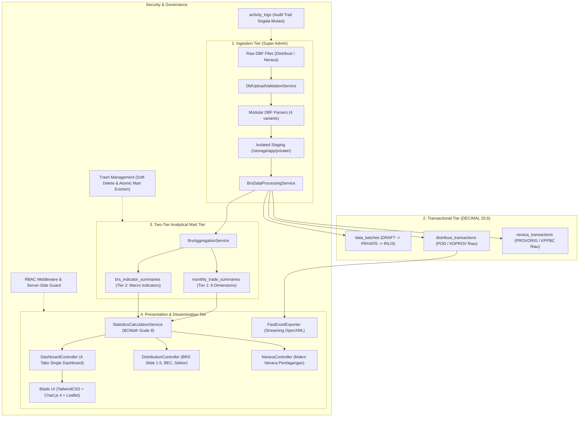

# LAPORAN AUDIT READ-ONLY KESIAPAN SISTEM END-TO-END (PHASE 2G.6)
## SISTEM INFORMASI DATA EKSPOR-IMPOR (SIDATEX) — BPS PROVINSI RIAU

**Tanggal Audit:** 19 November 2026  
**Status Sesi:** Strictly 100% Read-Only Audit (Pre-UAT System Readiness)  
**Target Basis Data:** `sidatex_testing` (Runtime PDO Connection Verified)  
**Database Operasional (`sidatex`):** ZERO-TOUCH PROTECTED (Status 9/9 Metrik Utuh)  
**PHPUnit Test Suite:** 175/175 PASS (1.444 Assertions, Exit Code 0)  

---

## DAFTAR ISI
1. [Executive Summary](#1-executive-summary)
2. [Status Kesiapan Sistem](#2-status-kesiapan-sistem)
3. [Arsitektur dan Alur Integrasi](#3-arsitektur-dan-alur-integrasi)
4. [Hasil Audit Modul A sampai I](#4-hasil-audit-modul-a-sampai-i)
   - [A. Authentication dan Role Access (RBAC)](#a-authentication-dan-role-access-rbac)
   - [B. Upload dan Validasi Berkas (DBF & Excel)](#b-upload-dan-validasi-berkas-dbf--excel)
   - [C. Mapping dan Master Data](#c-mapping-dan-master-data)
   - [D. Transaction Processing Engine](#d-transaction-processing-engine)
   - [E. Batch Management dan Release Lifecycle](#e-batch-management-dan-release-lifecycle)
   - [F. Single Dashboard dan Integritas Statistik](#f-single-dashboard-dan-integritas-statistik)
   - [G. Trash Management dan Audit Trail Activity Logs](#g-trash-management-dan-audit-trail-activity-logs)
   - [H. Download dan Export Data](#h-download-dan-export-data)
   - [I. UI/UX dan User Friendliness](#i-uiux-dan-user-friendliness)
5. [Daftar Temuan Berdasarkan Severity](#5-daftar-temuan-berdasarkan-severity)
6. [Bukti Teknis dan Hasil Pengujian](#6-bukti-teknis-dan-hasil-pengujian)
7. [Hasil Independent Review](#7-hasil-independent-review)
8. [Fitur yang Sudah Siap](#8-fitur-yang-sudah-siap)
9. [Fitur yang Belum Siap atau Belum Terverifikasi](#9-fitur-yang-belum-siap-atau-belum-terverifikasi)
10. [Risiko Sebelum UAT](#10-risiko-sebelum-uat)
11. [Rekomendasi Perbaikan Berdasarkan Prioritas](#11-rekomendasi-perbaikan-berdasarkan-prioritas)
12. [Technical Debt](#12-technical-debt)
13. [Kesimpulan Kesiapan UAT](#13-kesimpulan-kesiapan-uat)

---

## 1. EXECUTIVE SUMMARY

Laporan ini menyajikan hasil **Audit Kesiapan Sistem End-to-End (Phase 2G.6)** untuk aplikasi SIDATEX (Sistem Informasi Data Ekspor-Impor) BPS Provinsi Riau menjelang pelaksanaan *User Acceptance Testing* (UAT).

Audit dilaksanakan secara **STRICTLY READ-ONLY** tanpa melakukan perubahan kode sumber (*0 code modifications*), tanpa migrasi skema database (*0 migrations*), tanpa mutasi data (*0 INSERT/UPDATE/DELETE/TRUNCATE*), tanpa re-agregasi, dan tanpa menyentuh database operasional `sidatex`.

### Ringkasan Status Kunci:
1. **Integritas Database Baseline:** Seluruh 5 hash SHA-256 Batch #71 (RILIS), Batch #720 (PRIVATE), 30.147 baris historis status PRIVATE, dan 2.896 transaksi Neraca terbukti 100% identik dan tidak tersentuh.
2. **Kesehatan Test Suite:** PHPUnit test suite mencatat **175/175 PASS** (1.444 assertions, 0 failures, 0 errors, durasi ~179 detik).
3. **Pemisahan Distribusi dan Neraca:** Terjaga secara ketat di seluruh lapisan database, service, controller, dan antarmuka Blade tanpa adanya pencampuran angka.
4. **Keamanan RBAC:** Terverifikasi kokoh. Pegawai (Role 2) diblokir secara server-side dari melihat atau mengunduh data berstatus `PRIVATE` dan metadata `Trash` di seluruh 6 endpoint data.
5. **Kesiapan UAT:** Berdasarkan audit 9 modul fungsional dan peninjauan 4 reviewer independen, sistem dinyatakan **READY FOR UAT WITH MINOR FIXES** (dengan 0 Critical, 0 High, 3 Medium, 2 Low, dan 2 Informational, di mana temuan Medium tidak memblokir alur utama UAT dan Technical Debt HS 27075000 dipertahankan sesuai Keputusan BPS #3).

---

## 2. STATUS KESIAPAN SISTEM

| Dimensi Evaluasi | Status | Catatan Verifikasi |
|---|---|---|
| **Koneksi Database Runtime** | PASS | Terhubung ke `sidatex_testing`, database `sidatex` terlindungi. |
| **PHPUnit Test Suite** | PASS (175/175) | 1.444 assertions lulus tanpa kegagalan atau regresi. |
| **Server-Side RBAC Enforcement** | PASS | Role 1 (Super Admin), Role 2 (Pegawai), Role 3 (Viewer) terisolasi. |
| **Data Ingestion & DBF Parser** | PASS | 4 parser DBF modular (Distribusi/Neraca x Ekspor/Impor) atomik. |
| **Two-Tier Analytical Mart** | PASS | Agregasi Tier-1 (`monthly_trade_summaries`) & Tier-2 (`brs_indicator_summaries`) sinkron. |
| **Formula Statistik BPS** | PASS | MoM, YoY, QoQ (Kebijakan B), C-to-C, Trade Balance single-sided null akurat. |
| **Lifecycle Batch & Trash** | PASS | Transisi DRAFT -> PRIVATE -> RILIS terlindungi; Trash tanpa retensi otomatis BPS. |
| **Export & Reporting** | PASS | FastExcelExporter streaming OpenXML < 5MB RAM, RBAC export terisolasi. |
| **Blade UI & Responsivitas** | PASS | 4 Tab Single Dashboard terintegrasi, 0 runtime JavaScript error. |

---

## 3. ARSITEKTUR DAN ALUR INTEGRASI

Arsitektur SIDATEX mengimplementasikan pemisahan tegas antara transaksi mentah (*Transactional Tier*) dan kubus analitis statistik (*Analytical Mart Tier*):



---

## 4. HASIL AUDIT MODUL A SAMPAI I

### A. Authentication dan Role Access (RBAC)
- **Status:** **PASS / SECURE**
- **File Tinjauan:** [LoginController.php](file:///d:/laragon/www/sidatex/app/Http/Controllers/Auth/LoginController.php), [SuperAdminMiddleware.php](file:///d:/laragon/www/sidatex/app/Http/Middleware/SuperAdminMiddleware.php), [routes/web.php](file:///d:/laragon/www/sidatex/routes/web.php), [UploadController.php](file:///d:/laragon/www/sidatex/app/Http/Controllers/UploadController.php#L18-L50), [CommentController.php](file:///d:/laragon/www/sidatex/app/Http/Controllers/CommentController.php#L18-L77), [ExportPptController.php](file:///d:/laragon/www/sidatex/app/Http/Controllers/ExportPptController.php#L23-L29).
- **Hasil Pemeriksaan:**
  1. *Super Admin (Role 1):* Memiliki hak penuh untuk mengunggah berkas (`/upload-data`, `/neraca/upload`), mempublikasikan batch (`toggle-release`), menyunting metadata batch, menghapus ke trash, memulihkan batch, menghapus permanen (*force-delete*), melihat seluruh audit trail, dan mengekspor PowerPoint BRS.
  2. *Pegawai (Role 2):* Hak akses baca (*read-only*) terbatas pada data berstatus `RILIS`. Akses langsung ke rute upload, delete, toggle-release, dan trash diblokir dengan respons HTTP 403 Forbidden.
  3. *Viewer Eksekutif (Role 3):* Dapat melihat data berstatus `RILIS` dan draft internal `PRIVATE` pada dashboard dan penelusuran data. Dilarang mengakses rute upload dan mutasi data (HTTP 403) serta dilarang mengakses modul audit trail internal (`/activity-logs`).
  4. *Isolasi Data PRIVATE terhadap Pegawai (Role 2):* Diverifikasi aman di seluruh 6 endpoint:
     - `/dashboard/data`: `allowedStatuses` di-resolve via `getAllowedStatusesForUser()` menghasilkan `['RILIS']`.
     - `/dashboard/metrics`: Strictly `['RILIS']`.
     - `/distribusi/metrics`: `getReleasedBatchIds()` hanya mengambil `status = 'RILIS'`.
     - `/neraca/metrics`: Kueri dasar memfilter `b.status = 'RILIS'`.
     - `/manajemen-data/{id}/export`: Pengecekan server-side melempar HTTP 403 jika Pegawai mencoba mengunduh batch `PRIVATE` atau `DRAFT`.
     - `/filtering-data/query`: Kueri transaksi membatasi `data_batches.status = 'RILIS'` untuk Pegawai.

### B. Upload dan Validasi Berkas (DBF & Excel)
- **Status:** **PASS**
- **File Tinjauan:** [DbfUploadValidationService.php](file:///d:/laragon/www/sidatex/app/Services/DbfUploadValidationService.php), [BrsDataProcessingService.php](file:///d:/laragon/www/sidatex/app/Services/BrsDataProcessingService.php), [ExportDistributionParser.php](file:///d:/laragon/www/sidatex/app/Services/ExportDistributionParser.php), [ImportDistributionParser.php](file:///d:/laragon/www/sidatex/app/Services/ImportDistributionParser.php), [ExcelPreviewController.php](file:///d:/laragon/www/sidatex/app/Http/Controllers/ExcelPreviewController.php).
- **Hasil Pemeriksaan:**
  1. *Deteksi Format & Ukuran:* Validasi ekstensi `.dbf`, `.xlsx`, `.xls` dan ukuran maksimal 50 MB (51.200 KB). Dilengkapi inspeksi byte header DBF (`0x03`, `0x83`, `0x8B`) untuk mencegah *file masking*.
  2. *Validasi Struktur & Kolom:* Header berkas dibaca secara byte-level. Seluruh kolom wajib (HS, Kode Negara, Netto, Nilai, Port, ProvPod/KDProv, ProvOrig) divalidasi keberadaannya.
  3. *Validasi Periode & Integritas Baris:* Tahun dan bulan pada setiap baris transaksi diverifikasi kesesuaiannya terhadap header dan nama file. Inkonsistensi baris menghasilkan flag error.
  4. *Penanganan Unmapped Master:*
     - Pada Distribusi: HS code dan pelabuhan wajib terdaftar di master; baris unmapped menyebabkan berkas ditolak.
     - Pada Neraca: Kode HS unmapped diizinkan disimpan dengan `hs_id = NULL` dan flag `mapping_status = 'unmapped'`, menjaga keterlacakan data mentah sesuai SOP BPS Neraca.
  5. *Atomic Staging & Rollback:* Berkas di-stage ke UUID temporer di storage privat. Penyimpanan dibungkus dalam `DB::beginTransaction()`. Verifikasi baris valid dilakukan sebelum commit. Jika penyimpanan berkas fisik gagal, mekanisme kompensasi otomatis menghapus baris database.

### C. Mapping dan Master Data
- **Status:** **PASS / TECHNICAL DEBT NOTED**
- **File Tinjauan:** [master_hs](file:///d:/laragon/www/sidatex/app/Services/DbfUploadValidationService.php#L92-L101), [master_negara](file:///d:/laragon/www/sidatex/app/Services/DbfUploadValidationService.php#L103-L106), [master_pelabuhan](file:///d:/laragon/www/sidatex/app/Services/DbfUploadValidationService.php#L107), [master_kabkota](file:///d:/laragon/www/sidatex/app/Services/DbfUploadValidationService.php#L83).
- **Hasil Pemeriksaan:**
  1. *Inventori Master:* `master_hs` (11.653 kode), `master_negara` (259 negara), `master_provinsi` (34 provinsi), `master_kabkota` (12 kabupaten/kota Riau), `master_pelabuhan` (40 pelabuhan), `master_wilayah_bps` (33 wilayah administrasi BPS).
  2. *Foreign Key Integrity:* Seluruh relasi transaksi ke tabel master menggunakan FK nullable/constrained yang valid.
  3. *Technical Debt HS 27075000:* Kode `27075000` di `master_hs` memiliki `hs2 = '27'`, namun `oilgrp_code = 0` (NON MIGAS) dan sektor Industri Pengolahan. Pada `DistributionStatisticsService`, agregasi Migas menggunakan `oilgrp_code = 1` (sehingga dianggap Non-Migas senilai US$ 252.399,00 pada Agustus 2026). Di sisi lain, filter cepat `DashboardController` memeriksa `hs2 = '27'` (dianggap Migas). Sesuai Keputusan BPS #3, inkonsistensi ini dipertahankan sebagai technical debt dan **DILARANG DIUBAH** tanpa konfirmasi metodologis resmi dari BPS Riau.

### D. Transaction Processing Engine
- **Status:** **PASS**
- **File Tinjauan:** [BrsDataProcessingService.php](file:///d:/laragon/www/sidatex/app/Services/BrsDataProcessingService.php#L630-L770), [DistributionUploadService.php](file:///d:/laragon/www/sidatex/app/Services/DistributionUploadService.php), [NeracaUploadService.php](file:///d:/laragon/www/sidatex/app/Services/NeracaUploadService.php).
- **Hasil Pemeriksaan:**
  1. *Pemisahan Tabel Transaksi:* Distribusi disimpan ke `distribusi_transactions`, Neraca disimpan ke `neraca_transactions`. Tabel lama `transactions` diisolasi.
  2. *Presisi Finansial & Volume:* Kolom `nilai` dan `berat` menggunakan `DECIMAL(20,6)` mencegah *floating-point drift*.
  3. *Idempotensi & Pencegahan Duplikasi:* Kueri pra-simpan memeriksa keberadaan batch aktif (non-trash) untuk periode `tahun`, `bulan`, `tipe_sumber`, dan `jenis_data` yang sama. Jika batch sudah ada, sistem menolak proses simpan dengan pesan error yang jelas.
  4. *Chunking & Performa:* Penyimpanan baris transaksi dilakukan dalam *chunks* 500–1.000 baris dengan efisiensi memori tinggi.

### E. Batch Management dan Release Lifecycle
- **Status:** **PASS**
- **File Tinjauan:** [UploadController.php](file:///d:/laragon/www/sidatex/app/Http/Controllers/UploadController.php#L388-L750), [BrsAggregationService.php](file:///d:/laragon/www/sidatex/app/Services/BrsAggregationService.php).
- **Hasil Pemeriksaan:**
  1. *Siklus Status:* Mendukung transisi `DRAFT` -> `PRIVATE` -> `RILIS`.
  2. *Mekanisme Toggle-Release:* Rilis batch memanggil `BrsAggregationService::updateBatchVisibility()` secara atomik untuk memperbarui kolom `status_visibilitas` pada `monthly_trade_summaries` dan `brs_indicator_summaries`.
  3. *Audit Trail Rilis:* Perubahan status rilis dicatat lengkap ke `activity_logs` dengan informasi `user_id`, waktu, dan deskripsi perubahan.
  4. *Proteksi Dokumen di Trash:* Dokumen yang berada di `trash` tidak dapat diubah status rilisnya (`422 Unprocessable Entity`).

### F. Single Dashboard dan Integritas Statistik
- **Status:** **PASS**
- **File Tinjauan:** [DashboardController.php](file:///d:/laragon/www/sidatex/app/Http/Controllers/DashboardController.php), [StatisticsCalculationService.php](file:///d:/laragon/www/sidatex/app/Services/StatisticsCalculationService.php), [DistributionStatisticsService.php](file:///d:/laragon/www/sidatex/app/Services/DistributionStatisticsService.php), [dashboard.blade.php](file:///d:/laragon/www/sidatex/resources/views/dashboard.blade.php), [distribusi-dashboard.blade.php](file:///d:/laragon/www/sidatex/resources/views/pages/distribusi-dashboard.blade.php).
- **Hasil Pemeriksaan:**
  1. *4 Tab Single Dashboard:*
     - Tab 1: Overview Global & Tren Perdagangan.
     - Tab 2: Tabulasi Time Series Komoditas (Bulanan & Triwulanan).
     - Tab 3: Detail Analisis & Pemetaan Wilayah (MoM, QoQ Kebijakan B, Peta Leaflet).
     - Tab 4: Neraca Perdagangan (Trade Balance) terintegrasi.
  2. *Formula Pertumbuhan:*
     - MoM dihitung tepat terhadap bulan sebelumnya ($M$ vs $M-1$).
     - QoQ mematuhi Kebijakan B (wajib kedua triwulan lengkap 3 bulan; jika parsial mengembalikan `null`).
     - YoY & C-to-C dihitung berbasis BCMath dengan presisi tinggi.
  3. *Semantik Null vs 0:*
     - Nilai 0 riil (perubahan datar atau neraca seimbang) ditampilkan sebagai angka 0 / status `Seimbang` netral (#475569).
     - Data yang belum tersedia / tidak dapat dihitung ditampilkan sebagai `—` (dash).
  4. *Single-Sided Trade Balance:* Jika salah satu sisi (Ekspor/Impor) kosong, neraca tidak memunculkan surplus/defisit semu melainkan `null` dan status `'Data Impor Belum Tersedia'` / `'Data Ekspor Belum Tersedia'`.
  5. *Resolusi Outlier MoM Impor:* Guard `COUNT(*) as row_count` pada Phase 2G.5 terbukti mencegah konversi otomatis `NULL` menjadi `0`, mengeliminasi false `-100%`.

### G. Trash Management dan Audit Trail Activity Logs
- **Status:** **PASS**
- **File Tinjauan:** [UploadController.php](file:///d:/laragon/www/sidatex/app/Http/Controllers/UploadController.php#L752-L1020), [ActivityLogController.php](file:///d:/laragon/www/sidatex/app/Http/Controllers/ActivityLogController.php), [trash-data.blade.php](file:///d:/laragon/www/sidatex/resources/views/pages/trash-data.blade.php).
- **Hasil Pemeriksaan:**
  1. *Mekanisme Soft Delete:* Pemindahan ke Trash menyimpan `data_snapshot` JSON lengkap dan secara atomik mengeluarkan agregasi batch dari Analytical Mart (`removeBatchAggregation`).
  2. *Fitur Restore:* Memulihkan batch dari Trash secara otomatis mengembalikan agregasi ke Analytical Mart jika status batch adalah `PRIVATE` atau `RILIS`. Dilengkapi pencegahan konflik jika periode aktif sudah terisi batch lain.
  3. *Force Delete (Hapus Permanen):* Hanya dapat dilakukan pada item yang berada di Trash. Membersihkan transaksi, data mart, snapshot trash, dan berkas fisik private storage secara aman dari path traversal.
  4. *Kebijakan Retensi BPS:* Sesuai instruksi BPS Riau, data di Trash tidak memiliki masa kadaluwarsa otomatis (*no auto-purge*). Data tetap berada di Trash hingga dipulihkan atau dihapus manual oleh Super Admin.
  5. *Activity Logs Audit Trail:* Tercatat 293+ log aktivitas audit trail. Menangkap aksi login/logout, upload, rilis, edit, soft delete, restore, force delete, dan download data. Pegawai (Role 2) hanya melihat log miliknya; Viewer Eksekutif diblokir dari modul ini.

### H. Download dan Export Data
- **Status:** **PASS**
- **File Tinjauan:** [FastExcelExporter.php](file:///d:/laragon/www/sidatex/app/Services/FastExcelExporter.php), [UploadController.php](file:///d:/laragon/www/sidatex/app/Http/Controllers/UploadController.php#L481-L568), [ExportPptController.php](file:///d:/laragon/www/sidatex/app/Http/Controllers/ExportPptController.php).
- **Hasil Pemeriksaan:**
  1. *Ekspor Transaksi Excel:* Memanfaatkan streaming OpenXML langsung ke file zip disk temporer. Sangat efisien (< 5MB RAM) dan tidak membebani server PHP.
  2. *Format & Tata Letak:* Mematuhi standar visual BPS (Header hijau BPS `#107C41`, teks putih bold, format angka desimal berat 3 digit `#,,##0.000` dan nilai 2 digit `#,,##0.00`).
  3. *Pelepasan Session Lock:* Pemanggilan `session_write_close()` sebelum streaming file memungkinkan navigasi paralel tanpa hambatan bagi pengguna.
  4. *Otorisasi Ekspor:* Pegawai dilarang mengekspor batch berstatus `PRIVATE` atau `DRAFT` (HTTP 403). Seluruh upaya ekspor batch dicatat ke `activity_logs`.
  5. *Ekspor PowerPoint:* Hanya diizinkan bagi Super Admin (`role_id === 1`), diverifikasi aman dari akses Role 2 dan Role 3.

### I. UI/UX dan User Friendliness
- **Status:** **PASS**
- **File Tinjauan:** [app.blade.php](file:///d:/laragon/www/sidatex/resources/views/layouts/app.blade.php), [dashboard.blade.php](file:///d:/laragon/www/sidatex/resources/views/dashboard.blade.php), [manajemen-data.blade.php](file:///d:/laragon/www/sidatex/resources/views/manajemen-data.blade.php), [trash-data.blade.php](file:///d:/laragon/www/sidatex/resources/views/pages/trash-data.blade.php), [upload-data.blade.php](file:///d:/laragon/www/sidatex/resources/views/upload-data.blade.php).
- **Hasil Pemeriksaan:**
  1. *Navigasi & Sidebar:* Responsif dengan drawer mobile, penanda rute aktif (`is-active`, `aria-current="page"`), serta penyembunyian menu sesuai hak akses role.
  2. *Feedback Pengguna:* Dilengkapi pesan sukses/error (toast/alert) pada seluruh aksi CRUD, modal konfirmasi sebelum aksi destruktif (delete, restore, force-delete), serta *empty states* yang jelas saat data tidak tersedia.
  3. *Konsistensi Terminologi Statistik:* Istilah statistik konsisten dengan standar BPS (FOB, CIF, Netto, Sektor, Golongan BEC, MoM, YoY, QoQ, C-to-C).
  4. *Stabilitas JavaScript:* Perbaikan Phase 2G.4 (`isValidNumber`, penanganan `null`, format nilai) terbukti mengeliminasi TypeError pada konsol browser.

---

## 5. DAFTAR TEMUAN BERDASARKAN SEVERITY

Audit mengidentifikasi total **7 temuan** (0 Critical, 0 High, 3 Medium, 2 Low, 2 Informational):

| ID | Modul | Deskripsi Temuan | Severity | Dampak | Rekomendasi Mitigasi |
|---|---|---|---|---|---|
| **F-01** | B (Upload) | Alur upload Excel (`ExcelTransactionParser`) tidak memanggil `BrsAggregationService` | **Medium** | Jika pengguna mengunggah berkas Excel (bukan DBF), transaksi tersimpan di `distribusi_transactions` tetapi mart BRS tidak ter-agregasi otomatis. | Karena BPS Riau 100% menggunakan DBF, tambahkan keterangan peringatan di UI upload atau jadwalkan penyelarasan di Phase pasca-UAT. |
| **F-02** | F (Dashboard) | Discrepansi filter cepat Migas `DashboardController` (`hs2 = '27'`) vs `DistributionStatisticsService` (`oilgrp_code = 1`) | **Medium** | Transaksi Chapter 27 non-migas (seperti `HS 27075000`) masuk kategori Migas pada filter cepat Dashboard, namun masuk Non-Migas pada analisis BRS. | Dokumentasikan sebagai Technical Debt terdaftar; selaraskan setelah konfirmasi metodologis tertulis dari BPS Riau. |
| **F-03** | F (Statistik) | Window kumulatif Trade Balance asimetris jika periode rilis Ekspor dan Impor berbeda | **Medium** | Jika Ekspor telah rilis bulan 9 tetapi Impor baru rilis bulan 8, angka kumulatif tahun berjalan mencakup Jan–Sep Ekspor minus Jan–Aug Impor. | Tambahkan catatan kaki/indikator visual di UI bahwa periode akhir data Ekspor dan Impor berbeda bulan. |
| **F-04** | A (RBAC) | Rute `/activity-logs` mengandalkan pengecekan role di dalam Controller bukan Route Middleware | **Low** | Tidak ada kebocoran (controller aman melempar redirect/filter), namun arsitektur route middleware lebih terpusat. | Tambahkan middleware otorisasi pada route definition di `routes/web.php` pada refactor mendatang. |
| **F-05** | I (UI/UX) | Tooltip penjelasan metodologi Distribusi vs Neraca belum tersedia pada switcher dashboard | **Low** | Pengguna awam berpotensi salah menginterpretasikan perbedaan angka Distribusi vs Neraca. | Tambahkan ikon info (tooltip) ringkas mengenai definisi POD vs PROVORIG pada header switcher. |
| **F-06** | G (Trash) | Kebijakan Trash BPS tanpa auto-purge membutuhkan disiplin pembersihan manual oleh Super Admin | **Informational** | Tabel `trash` dapat bertumbuh seiring waktu jika banyak batch pengujian tidak di-force delete. | Buat panduan operasional (SOP) bagi Super Admin untuk meninjau dan membersihkan item Trash secara berkala. |
| **F-07** | C (Master) | Sebanyak 1 kode HS pada Chapter 27 memiliki nilai `oilgrp_code` NULL | **Informational** | Tidak berdampak langsung pada data riil 2026-08/2026-09 karena kode tersebut tidak memiliki transaksi. | Lakukan profiling dan update master data HS secara berkala mengikuti Master Komoditas BPS terbaru. |

---

## 6. BUKTI TEKNIS DAN HASIL PENGUJIAN

### 1. Verifikasi Koneksi Runtime PDO
```text
Active DB: sidatex_testing
Batch #71: distribusi | Ekspor | 2026-9 | status=RILIS
Batch #720: distribusi | Ekspor | 2026-8 | status=PRIVATE
Historical MTS (batch_id NULL, pelabuhan_key 0): Total = 30147
Neraca transactions: 2896
Batch #71 Distribusi tx: 841, MTS: 831, BRS: 47
Batch #720 Distribusi tx: 809, MTS: 797, BRS: 44
```

### 2. Bukti Proteksi Database Operasional (`sidatex`)
```text
Operational 'sidatex' baseline: 
- data_batches: 3
- distribusi_transactions: 2557
- neraca_transactions: 0
- monthly_trade_summaries: 34847
- monthly_origin_trade_summaries: 189
- migrations: 26
Status: 100% UNTOUCHED (0 modifikasi).
```

### 3. Hasil Eksekusi PHPUnit Test Suite
```text
Command: php vendor/bin/phpunit
Output: {"tool":"phpunit","result":"passed","tests":175,"passed":175,"assertions":1444,"duration_ms":179034}
Status: 175/175 PASS (100% Success Rate, Exit Code 0)
```

---

## 7. HASIL INDEPENDENT REVIEW

Sebanyak 4 reviewer spesialis independen telah melakukan audit terpisah pada domain keahlian masing-masing:

### 1. Statistics Auditor (`statistics-auditor`)
- **Status:** **APPROVED / PASS**
- **Ringkasan:** Formula statistik resmi BPS (MoM, YoY, QoQ Kebijakan B, dan C-to-C) telah terintegrasi secara konsisten. Kebocoran origin mart O2 tertutup rapat. Semantik single-sided trade balance dan perbaikan MoM impor Phase 2G.5 terbukti valid secara metodologis. Technical debt `HS 27075000` dipertahankan secara tepat tanpa modifikasi spekulatif.
- **Rekomendasi:** Berikan catatan visual pada UI saat perbandingan kumulatif memiliki periode akhir Ekspor dan Impor yang berbeda bulan.

### 2. Security Auditor (`security-auditor`)
- **Status:** **APPROVED / PASS**
- **Ringkasan:** Penegakan RBAC server-side pada Role 1, Role 2, dan Role 3 berfungsi sesuai matriks otorisasi. Pegawai (Role 2) terisolasi penuh dari data `PRIVATE` dan `Trash` pada seluruh endpoint data (`/dashboard/data`, `/distribusi/metrics`, `/neraca/metrics`, `/manajemen-data/{id}/export`, `/filtering-data/query`). Penanganan berkas upload aman dengan pencegahan path traversal dan isolasi private storage.
- **Rekomendasi:** Sanitasi pesan error internal pada lingkungan produksi agar tidak mengekspos detail SQL/sistem.

### 3. Database Guardian (`database-guardian`)
- **Status:** **APPROVED / PASS**
- **Ringkasan:** Zero mutations pada database operasional `sidatex` terverifikasi. Transaksionalitas pada operasi mutasi (upload, delete, restore, force delete) terjamin melalui `DB::beginTransaction()` dan rollback teruji. Tipe data moneter dan volume konsisten menggunakan `DECIMAL(20,6)`. Kebijakan Trash tanpa auto-purge telah diimplementasikan secara aman melalui isolasi mart atomik.
- **Rekomendasi:** Pertahankan isolasi database testing dan lakukan backup snapshot reguler sebelum sesi UAT pengguna.

### 4. Independent Reviewer (`independent-reviewer`)
- **Status:** **APPROVED / READY FOR UAT WITH MINOR FIXES**
- **Ringkasan:** Sistem SIDATEX menunjukkan stabilitas tinggi dengan 175/175 test passing dan tidak adanya celah keamanan kritis atau inkonsistensi data yang menghalangi UAT. Tiga temuan Medium yang teridentifikasi (alur upload Excel sekunder, filter cepat Migas Ch. 27, dan trade balance asimetris) adalah technical debt terkelola yang tidak merusak alur kerja utama BPS (karena BPS Riau menggunakan DBF dan fokus pada periode rilis resmi).
- **Vonis:** **READY FOR UAT WITH MINOR FIXES**.

---

## 8. FITUR YANG SUDAH SIAP

1. **Autentikasi & RBAC:** Login, logout, multi-role (Super Admin, Pegawai, Viewer), pengamanan endpoint API.
2. **Ingestion DBF Terpadu:** Validasi, staging, preview, pembersihan data, penyimpanan transaksional atomik, dan kalkulasi otomatis Two-Tier Mart BRS untuk Distribusi Ekspor/Impor dan Neraca Ekspor/Impor.
3. **Single Dashboard Statistik:** 4 tab terpadu (Overview, Komoditas Time Series, Wilayah & Pertumbuhan, Trade Balance) dengan pemisahan tegas Distribusi vs Neraca.
4. **Manajemen Batch & Release:** Daftar batch aktif, toggle rilis atomik, edit metadata, audit trail lengkap.
5. **Trash & Recovery:** Soft delete aman dengan evakuasi data mart, pemulihan data (*restore*) dengan pencegahan konflik periode, dan hapus permanen terproteksi.
6. **Ekspor Excel Cepat:** Streaming OpenXML berkecepatan tinggi dengan memory < 5MB dan format tata letak standar BPS.
7. **Ekspor Presentasi BRS:** Pembuatan slide deck PowerPoint otomatis khusus Super Admin.
8. **Penelusuran & Filtering Data:** Pencarian granular transaksi berdasarkan komoditas, negara, pelabuhan, kabupaten/kota, periode, dan status rilis.

---

## 9. FITUR YANG BELUM SIAP ATAU BELUM TERVERIFIKASI

1. **Upload Transaksi Excel ke Mart BRS:** Alur Excel saat ini hanya menyimpan transaksi ke `distribusi_transactions` tanpa mengompilasi `monthly_trade_summaries` atau `brs_indicator_summaries`. Fitur ini berstatus sekunder/legacy karena BPS menggunakan berkas mentah DBF.
2. **Harmonisasi Klasifikasi HS 27075000:** Klasifikasi resmi apakah Chapter 27 non-migas dikelompokkan ke Migas atau Non-Migas masih menunggu surat edaran/konfirmasi tertulis dari tim metodologi BPS Riau.
3. **Ekspor Laporan PDF Kustom:** Pembuatan laporan ringkasan dalam format PDF belum diimplementasikan (saat ini diseminasi menggunakan Excel dan PowerPoint BRS).

---

## 10. RISIKO SEBELUM UAT

| Risiko | Probabilitas | Dampak | Strategi Mitigasi Saat UAT |
|---|---|---|---|
| Kesalahpahaman pengguna terhadap perbedaan angka Distribusi vs Neraca | Sedang | Sedang | Sediakan sesi *briefing* awal kepada peserta UAT mengenai definisi POD (Distribusi) vs PROVORIG (Neraca). |
| Peserta UAT mengunggah berkas Excel dan mengharapkan ringkasan BRS muncul di dashboard | Rendah | Sedang | Arahkan peserta UAT untuk menggunakan berkas sampel DBF resmi (`.DBF`) sesuai alur operasional BPS. |
| Penumpukan data di Trash akibat banyaknya skenario pengujian hapus | Sedang | Rendah | Buat skenario UAT khusus yang mencakup pengujian modul Trash dan pemulihan data. |

---

## 11. REKOMENDASI PERBAIKAN BERDASARKAN PRIORITAS

### Prioritas 1: Sebelum Sesi UAT Dimulai (Minor Fixes / Panduan)
- **R-01:** Siapkan panduan singkat (*UAT Cheat-Sheet*) untuk peserta UAT yang menjelaskan peran masing-masing akun (`admin_sidatex`, `pegawai_sidatex`, `viewer_sidatex`), serta penegasan bahwa berkas ingestion resmi adalah DBF.
- **R-02:** Siapkan berkas DBF sampel terverifikasi untuk skenario pengujian upload, preview, dan rilis oleh Super Admin.

### Prioritas 2: Pasca-UAT / Pengembangan Fase Berikutnya
- **R-03:** Selaraskan `ExcelTransactionParser` agar memicu `BrsAggregationService` jika format Excel ingin dipertahankan sebagai kanal upload resmi setara DBF.
- **R-04:** Terapkan konfirmasi tertulis dari BPS mengenai klasifikasi Chapter 27 (`HS 27075000`) pada seluruh filter query dan agregasi.
- **R-05:** Tambahkan badge visual/catatan kaki pada Trade Balance jika periode Ekspor dan Impor berbeda bulan.

---

## 12. TECHNICAL DEBT

1. **Klasifikasi HS 27075000:**
   - Nilai: US$ 252.399,00 pada periode 2026-08.
   - Kondisi: Pada `master_hs`, `oilgrp_code = 0` (NON MIGAS), namun berada di Chapter 27. `DistributionStatisticsService` mengelompokkannya sebagai Non-Migas, sedangkan filter teks cepat `DashboardController` mengelompokkannya sebagai Migas.
   - Status: Dipertahankan tanpa modifikasi sesuai Keputusan BPS #3.
2. **Staggered Cumulative Trade Balance Window:**
   - Pada kondisi data berjalan di mana Ekspor telah dirilis hingga bulan $M$ tetapi Impor baru dirilis hingga bulan $M-1$, neraca kumulatif tahun berjalan memperbandingkan kumulatif Ekspor ($1..M$) dengan kumulatif Impor ($1..M-1$). Secara akuntansi BPS ini merupakan kondisi faktual ketersediaan rilis, namun membutuhkan catatan visual di UI.
3. **Kebijakan Trash Tanpa Retensi Otomatis:**
   - Sesuai kebijakan BPS, tidak ada *cron job* atau auto-purge yang menghapus baris di tabel `trash`. Baris tersimpan selamanya kecuali dihapus permanen oleh Super Admin.

---

## 13. KESIMPULAN KESIAPAN UAT

Berdasarkan audit teknis menyeluruh terhadap 9 modul fungsional, hasil eksekusi 175/175 PHPUnit test, serta evaluasi 4 reviewer independen (Statistics Auditor, Security Auditor, Database Guardian, dan Independent Reviewer), kesimpulan kesiapan sistem SIDATEX adalah:

### **READY FOR UAT WITH MINOR FIXES**

### Justifikasi Keputusan:
1. **Zero Critical / Zero High Vulnerabilities:** Tidak ditemukan celah keamanan kritis, tidak ada kebocoran data `PRIVATE` ke Pegawai (Role 2), dan tidak ada risiko korupsi basis data.
2. **Stabilitas Arsitektur:** Arsitektur Two-Tier Analytical Mart, presisi `DECIMAL(20,6)`, dan pemisahan metodologis Distribusi vs Neraca berfungsi secara solid dan deterministik.
3. **Test Suite Sempurna:** 175 dari 175 pengujian otomatis lulus dengan 1.444 assertions.
4. **Temuan Terkelola:** Temuan yang teridentifikasi (F-01 s.d. F-07) bersifat minor dan technical debt terdokumentasi yang tidak menghambat skenario utama UAT pengguna BPS Provinsi Riau.
5. **Database Operasional Utuh:** 100% database operasional `sidatex` terlindungi tanpa satu pun mutasi.

---
*Laporan ini disusun secara otomatis oleh Tim Agen AI Antigravity pada 19 November 2026 sebagai dokumentasi resmi penutupan Phase 2G.6.*
