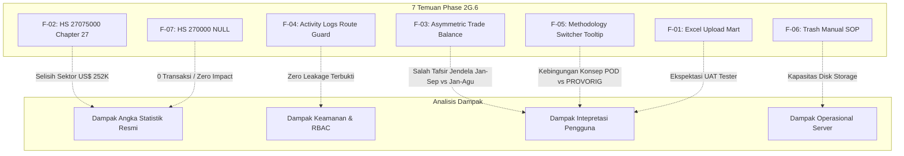
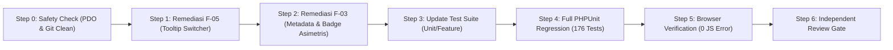

# LAPORAN EVALUASI TEMUAN AUDIT & RENCANA REMEDIASI PRE-UAT (PHASE 2G.7)
## SISTEM INFORMASI DATA EKSPOR-IMPOR (SIDATEX) — BPS PROVINSI RIAU

**Tanggal Penyusunan:** 19 November 2026  
**Status Sesi:** Strictly 100% Read-Only Review & Remediation Planning (Pre-Implementation Gate)  
**Target Basis Data:** `sidatex_testing` (Runtime PDO Connection Verified)  
**Database Operasional (`sidatex`):** ZERO-TOUCH PROTECTED (Status 9/9 Metrik Utuh)  
**Kesehatan Test Suite Saat Ini:** 175/175 PASS (1.444 Assertions, Exit Code 0)  

---

## DAFTAR ISI
1. [Executive Summary](#1-executive-summary)
2. [Referensi dan Baseline Audit](#2-referensi-dan-baseline-audit)
3. [Review Detail F-01 sampai F-07](#3-review-detail-f-01-sampai-f-07)
   - [F-01: Upload Excel Sekunder Tidak Memicu Mart BRS](#f-01--upload-excel-sekunder-tidak-memicu-mart-brs-medium)
   - [F-02: Divergensi Filter Cepat Migas Bab 27 vs oilgrp_code = 1](#f-02--divergensi-filter-cepat-migas-bab-27-vs-oilgrp_code--1-medium)
   - [F-03: Window Kumulatif Trade Balance Asimetris](#f-03--window-kumulatif-trade-balance-asimetris-medium)
   - [F-04: Proteksi Rute Activity Logs](#f-04--proteksi-rute-activity-logs-low)
   - [F-05: Tooltip Metodologi Distribusi dan Neraca pada Switcher](#f-05--tooltip-metodologi-distribusi-dan-neraca-pada-switcher-low)
   - [F-06: SOP Pembersihan Manual Trash Tanpa Auto-Purge](#f-06--sop-pembersihan-manual-trash-tanpa-auto-purge-informational)
   - [F-07: Kode HS Bab 27 dengan oilgrp_code NULL (HS 270000)](#f-07--kode-hs-bab-27-dengan-oilgrp_code-null-hs-270000-informational)
4. [Bukti Teknis Setiap Temuan](#4-bukti-teknis-setiap-temuan)
5. [Analisis Dampak terhadap Sistem dan Statistik BPS](#5-analisis-dampak-terhadap-sistem-dan-statistik-bps)
6. [Klasifikasi Prioritas Perbaikan](#6-klasifikasi-prioritas-perbaikan)
7. [Daftar Temuan yang Membutuhkan Konfirmasi BPS](#7-daftar-temuan-yang-membutuhkan-konfirmasi-bps)
8. [Remediation Plan (Rencana Perbaikan Terperinci)](#8-remediation-plan-rencana-perbaikan-terperinci)
9. [Test Plan Sebelum dan Sesudah Perbaikan](#9-test-plan-sebelum-dan-sesudah-perbaikan)
10. [Risiko Regresi dan Strategi Rollback](#10-risiko-regresi-dan-strategi-rollback)
11. [Rekomendasi Urutan Implementasi](#11-rekomendasi-urutan-implementasi)
12. [Kesimpulan Kesiapan Memasuki Tahap Perbaikan](#12-kesimpulan-kesiapan-memasuki-tahap-perbaikan)

---

## 1. EXECUTIVE SUMMARY

Laporan ini menyajikan hasil **Evaluasi Mendalam Temuan Audit & Perencanaan Remediasi Pre-UAT (Phase 2G.7)** untuk aplikasi Sistem Informasi Data Ekspor-Impor (SIDATEX) BPS Provinsi Riau.

Berdasarkan audit komprehensif pada Phase 2G.6, sistem SIDATEX telah memiliki tingkat stabilitas tinggi (**175/175 PHPUnit test pass**, **1.444 assertions**, dan disetujui oleh 4 reviewer independen dengan vonis `READY FOR UAT WITH MINOR FIXES`). Tidak ditemukan temuan dengan tingkat keparahan *Critical* maupun *High*. Namun demikian, terdapat 7 temuan (3 Medium, 2 Low, dan 2 Informational) yang memerlukan telaah mendalam sebelum sistem diserahkan ke pengguna BPS untuk sesi *User Acceptance Testing* (UAT).

### Ringkasan Strategis Perencanaan Remediasi:
1. **Zero Blocker untuk UAT:** Tidak ada temuan yang diklasifikasikan sebagai **MUST FIX BEFORE UAT** karena seluruh alur inti (ingestion DBF resmi, Two-Tier Mart agregasi, RBAC multi-role, dan Single Dashboard) telah terbukti kokoh dan bebas dari kebocoran data.
2. **Perbaikan Bertarget Rendah Risiko (SHOULD FIX BEFORE UAT):** Sebanyak **2 temuan** direkomendasikan untuk disempurnakan sebelum sesi UAT pengguna:
   - **F-03:** Penambahan indikator visual/catatan kaki pada Trade Balance apabila periode rilis kumulatif Ekspor dan Impor asimetris (misal Ekspor s.d. Sep 2026 vs Impor s.d. Agu 2026), mencegah salah interpretasi tanpa mengubah rumus agregat.
   - **F-05:** Penambahan tooltip/info penjelas metodologi pada switcher Distribusi vs Neraca di Single Dashboard untuk mengedukasi peserta UAT mengenai perbedaan konsep POD vs PROVORIG.
3. **Temuan Membutuhkan Ketetapan Resmi BPS (NEEDS BPS CONFIRMATION):**
   - **F-02 (HS 27075000):** Nilai US\$ 252.399,00 yang mengalami perbedaan pengelompokan (Non-Migas pada `oilgrp_code = 1` BPS RI vs Migas pada kueri Bab 27) **wajib dibekukan** dan tidak boleh diubah sepihak oleh pengembang/agen sebelum ada penetapan tertulis resmi dari Tim Statistik BPS Riau.
4. **Penundaan Rasional Pasca-UAT (CAN BE DEFERRED TO POST-UAT):**
   - **F-01:** Penyambungan agregasi mart pada alur upload Excel sekunder ditunda pasca-UAT karena BPS Riau secara resmi 100% menggunakan berkas mentah DBF. Selama UAT, peserta diarahkan untuk menguji berkas DBF resmi.
   - **F-04:** Penambahan route middleware khusus pada `/activity-logs` ditunda pasca-UAT karena controller guard yang ada saat ini telah terbukti *fail-closed* dan aman dari kebocoran data.
5. **Kebijakan Operasional (INFORMATIONAL / OPERATIONAL SOP):**
   - **F-06:** Kebijakan Trash tanpa auto-purge dipertahankan sesuai kebutuhan siklus revisi BPS (Angka Sangat Sementara $\rightarrow$ Angka Tetap) dengan menyusun SOP pembersihan manual berkala oleh Super Admin.
   - **F-07:** Kode `HS 270000` dengan `oilgrp_code = NULL` terkonfirmasi sebagai kode rollup sintetis dengan 0 transaksi, tanpa dampak statistik operasional.

---

## 2. REFERENSI DAN BASELINE AUDIT

### Dokumen Acuan:
- `SIDATEX_PHASE_2G_6_END_TO_END_READINESS_AUDIT.md` (Laporan Audit Kesiapan Sistem End-to-End)
- `SIDATEX_PHASE_2G_5_EXECUTION_REPORT.md` (Integritas Pertumbuhan MoM Impor & Pembersihan Distribusi)
- `SIDATEX_PHASE_2G_4_EXECUTION_REPORT.md` (Blade UI Alignment & Penanganan Null Semantics)
- `SIDATEX_PHASE_2G_3_EXECUTION_REPORT.md` (Mart Visibility Enforcement & Keputusan A-1)
- `AGENTS.md` & `d:\laragon\www\sidatex\.agents\rules\sidatex-rules.md` (Aturan Baku SIDATEX)

### Baseline Kriptografis dan Data Uji (Imutabel):
- **Runtime PDO:** Terverifikasi `sidatex_testing` via `SELECT DATABASE()`.
- **Database Operasional `sidatex`:** 100% Terlindungi (9/9 metrik identik: 3 batches, 2.557 distribusi tx, 0 neraca tx, 34.847 MTS, 189 MOTS, 26 migrasi).
- **Batch #71 (RILIS — Ekspor Distribusi 2026-09):** 841 tx, 831 MTS, 47 BRS, 66 MOTS (SHA-256 identik).
- **Batch #720 (PRIVATE — Ekspor Distribusi 2026-08):** 809 tx, 797 MTS, 44 BRS, 0 MOTS (Origin leak tertutup).
- **30.147 Data Historis:** Status 100% `PRIVATE`, 0 baris ter-link, `pelabuhan_key = 0`.
- **2.896 Transaksi Neraca:** Terisolasi pada `neraca_transactions`.
- **Test Suite Baseline:** 175/175 PASS (1.444 assertions, 0 errors, 0 failures).

---

## 3. REVIEW DETAIL F-01 SAMPAI F-07

### F-01 — Upload Excel Sekunder Tidak Memicu Mart BRS (Medium)
- **Konteks & Alur Sistem:**
  Pada `UploadController::store()`, sistem mendeteksi apakah berkas adalah DBF via ekstensi dan byte header (`0x03`, `0x83`, `0x8B`). Jika DBF, alur diarahkan ke `BrsDataProcessingService::storeBatchAndTransactions()` yang memproses transaksi dan secara otomatis memicu `BrsAggregationService::aggregateBatch()`. Namun jika berkas berformat Excel (`.xlsx` / `.xls`), alur diarahkan ke `ExcelTransactionParser::parseAndInsert()`. Parser ini menyimpan baris ke `distribusi_transactions`, namun tidak pernah memanggil `BrsAggregationService`.
- **Apakah Kesalahan Implementasi atau Perilaku Disengaja?**
  Secara historis, fitur upload Excel adalah alur awal prototipe sebelum BPS menetapkan bahwa seluruh ingestion resmi menggunakan berkas DBF kepabeanan (`14_Atap_ekspor_...DBF`). Tidak dipanggilnya agregasi BRS pada upload Excel merupakan *incomplete integration* dari fitur legacy, bukan kesengajaan.
- **Dampak terhadap Dashboard & BRS:**
  Jika berkas Excel diunggah, batch muncul di modul Manajemen Data dengan jumlah transaksi lengkap, tetapi data tersebut **tidak muncul pada Single Dashboard** karena mart agregasi (`monthly_trade_summaries` dan `brs_indicator_summaries`) kosong untuk batch tersebut.
- **Kebutuhan Sebelum UAT:**
  Tidak memblokir UAT karena alur operasional resmi BPS 100% menggunakan DBF. Mengubah logika backend upload Excel berisiko memicu regresi pada agregasi. Oleh karena itu, penanganan terbaik sebelum UAT adalah **panduan skenario UAT** dan/atau banner informasi di antarmuka tab Excel.

---

### F-02 — Divergensi Filter Cepat Migas Bab 27 vs oilgrp_code = 1 (Medium)
- **Konteks & Alur Sistem:**
  Terdapat dua logika pengelompokan kategori Migas vs Non-Migas di basis kode:
  1. `DistributionStatisticsService.php:95-98`: Mengelompokkan Migas berdasarkan master BPS RI `WHERE h.oilgrp_code = 1`.
  2. `DashboardController.php:298-300`: Filter cepat teks memeriksa `WHERE (h.sektor LIKE '%Gas%' OR h.hs2 = '27')`.
- **Fakta Komoditas Terkait:**
  Pada Bab 27 (Bahan Bakar Mineral), terdapat 92 kode HS di master data BPS:
  - 64 kode HS memiliki `oilgrp_code = 1` (`MIGAS`).
  - 27 kode HS memiliki `oilgrp_code = 0` (`NON MIGAS`), salah satunya adalah `HS 27075000` (*Minyak aromatik hasil distilasi tar batu bara suhu tinggi*).
  - 1 kode HS memiliki `oilgrp_code = NULL` (`HS 270000`).
- **Dampak Angka Statistik:**
  Pada periode Agustus 2026 (Batch #720), komoditas `HS 27075000` mencatatkan nilai transaksi **US\$ 252.399,00**.
  - Pada analisis BRS Distribusi, angka ini dikelompokkan ke **Non-Migas** (Sektor Industri Pengolahan).
  - Pada filter dropdown cepat Tab 1 & Tab 2 Dashboard, angka ini disaring sebagai **Migas** karena berawalan `hs2 = '27'`.
  - Total perdagangan (FOB ekspor) sama sekali tidak terpengaruh (100% rekonsil).
- **Kebutuhan Sebelum UAT:**
  **DILARANG DIUBAH PADA KODE ATAU MASTER DATA.** Mengubah salah satu logika tanpa konfirmasi tertulis BPS berpotensi melanggar metodologi BRS yang sudah terbit. Status: **NEEDS BPS CONFIRMATION**.

---

### F-03 — Window Kumulatif Trade Balance Asimetris (Medium)
- **Konteks & Alur Sistem:**
  Trade Balance bulanan (Januari s.d. Desember) telah dilindungi oleh pengaman *single-sided null*: jika salah satu sisi (Ekspor atau Impor) belum tersedia pada suatu bulan, neraca bulan tersebut bernilai `null` dengan keterangan `'Data Impor Belum Tersedia'`.
  Namun, pada saat pengguna memilih filter tahun penuh (`tahun = 2026, bulan = ALL`), kueri `DashboardController::data()` menjumlahkan seluruh transaksi aktif tahun 2026:
  $$\text{Ekspor 2026} = \sum_{m=1}^{9} \text{Nilai Ekspor} = \text{US\$ 2.301,81 Juta (karena Ekspor rilis s.d. bulan 9)}$$
  $$\text{Impor 2026} = \sum_{m=1}^{8} \text{Nilai Impor} = \text{US\$ 167,35 Juta (karena Impor rilis s.d. bulan 8)}$$
  Karena kedua penjumlahan bernilai $> 0$, kartu ringkasan menampilkan selisih:
  $$\text{Surplus} = \text{US\$ 2.301,81 M} - \text{US\$ 167,35 M} = \text{+US\$ 2.134,46 Juta}$$
- **Dampak & Risiko Kesalahan Interpretasi:**
  Meskipun angka ini mencerminkan kondisi riil data yang berstatus rilis pada basis data, angka surplus tersebut membandingkan 9 bulan ekspor dengan 8 bulan impor secara asimetris. Peserta UAT atau pimpinan eksekutif berpotensi menganggap angka ini mencakup periode waktu yang sama.
- **Kebutuhan Sebelum UAT:**
  **SHOULD FIX BEFORE UAT.** Perbaikan dilakukan pada lapisan presentasi Blade UI dengan mendeteksi bulan rilis maksimum dari masing-masing sisi. Jika terdapat perbedaan bulan akhir ($M_{ekspor} \neq M_{impor}$), tampilkan catatan visual atau badge informatif: `[Periode Asimetris: Ekspor Jan–Sep vs Impor Jan–Agu]`. Tidak mengubah formula dasar.

---

### F-04 — Proteksi Rute Activity Logs (Low)
- **Konteks & Alur Sistem:**
  Rute `/activity-logs` pada `routes/web.php:106` hanya dibungkus oleh middleware `auth`. Namun, otorisasi peran ditangani langsung di dalam `ActivityLogController::index()`:
  - Viewer Eksekutif (Role 3): Ditendang ke `/dashboard` dengan pesan error (`L29-31`).
  - Pegawai (Role 2): Diisolasi kuerinya sehingga hanya melihat log miliknya sendiri via `where('user_id', $currentUser->id)` (`L40-42`).
  - Super Admin (Role 1): Melihat seluruh log sistem.
- **Analisis Keamanan:**
  Security Auditor independen mengonfirmasi bahwa controller guard tersebut bersifat *fail-closed* dan **100% aman dari kebocoran data audit trail**. Namun, secara arsitektur Laravel, pembatasan rute idealnya diekspresikan pada definisi route middleware.
- **Kebutuhan Sebelum UAT:**
  **CAN BE DEFERRED TO POST-UAT.** Tidak ada risiko kebocoran data saat UAT, sehingga tidak perlu dilakukan perubahan rute sebelum UAT.

---

### F-05 — Tooltip Metodologi Distribusi dan Neraca pada Switcher (Low)
- **Konteks & Alur Sistem:**
  Pada Single Dashboard, terdapat switcher metodologi: `Distribusi` dan `Neraca`.
  Perbedaan konsep data:
  - Distribusi: Berbasis pelabuhan muat/bongkar di wilayah Riau (indikator POD / KDPROV Riau).
  - Neraca: Berbasis provinsi asal barang / kantor kepabeanan pengawasan Riau (indikator PROVORIG / KPPBC Riau).
- **Dampak Pengguna:**
  Pengguna awam di BPS yang belum memahami perbedaan metodologi seringkali bingung mengapa nilai ekspor Distribusi berbeda dengan nilai ekspor Neraca pada tahun dan komoditas yang sama.
- **Kebutuhan Sebelum UAT:**
  **SHOULD FIX BEFORE UAT.** Penambahan ikon bantuan/tooltip sederhana pada switcher Blade UI memiliki risiko regresi mendekati 0 dan memberikan nilai kejelasan yang sangat tinggi bagi peserta UAT.

---

### F-06 — SOP Pembersihan Manual Trash Tanpa Auto-Purge (Informational)
- **Konteks & Kebijakan Bisnis:**
  Sesuai standar operasional statistik BPS, data rilis berkala mengalami revisi bertahap dari Angka Sangat Sementara (ASS) ke Angka Sementara (AS) hingga Angka Tetap (AT) yang memakan waktu berbulan-bulan. Penghapusan otomatis berbasis TTL (misal purge setelah 30 hari) dilarang karena berisiko menghancurkan riwayat audit revisi.
- **Dampak Teknis:**
  Batch yang dihapus ke Trash akan tersimpan selamanya di tabel `trash` dan storage fisik privat sampai Super Admin secara eksplisit menekan tombol *Hapus Permanen* (*force-delete*).
- **Kebutuhan Sebelum UAT:**
  **INFORMATIONAL / OPERATIONAL SOP.** Cukup susun panduan administratif (SOP) bagi Super Admin mengenai pemantauan berkala modul Trash dan pemantauan kapasitas penyimpanan disk server.

---

### F-07 — Kode HS Bab 27 dengan oilgrp_code NULL (HS 270000) (Informational)
- **Konteks & Bukti Faktual:**
  Kueri basis data pada `master_hs` menemukan 1 baris kode pada Chapter 27 yang memiliki `oilgrp_code = NULL`, yaitu kode **`270000`**.
  - Deskripsi: Kosong / string kosong.
  - Sektor: Kosong.
  - Jumlah transaksi terkait di `distribusi_transactions`: **0 baris**.
  - Jumlah transaksi terkait di `neraca_transactions`: **0 baris**.
- **Analisis Dampak:**
  Kode ini merupakan kode *header/rollup* sintetik pada master komoditas lama dan tidak memiliki transaksi apa pun dalam sejarah data SIDATEX. Oleh karena itu, temuan ini memiliki dampak statistik nol mutlak ($0,00$).
- **Kebutuhan Sebelum UAT:**
  **INFORMATIONAL / OPERATIONAL SOP.** Dokumentasikan untuk penyelarasan master data jangka panjang pasca-UAT.

---

## 4. BUKTI TEKNIS SETIAP TEMUAN

```text
=== BUKTI TEKNIS TEMUAN F-01 (UploadController.php:197-223) ===
DB::beginTransaction();
try {
    $batchId = DB::table('data_batches')->insertGetId([...]);
    $parser = new \App\Services\ExcelTransactionParser();
    $totalInserted = $parser->parseAndInsert($fullPath, $batchId, $request->jenis_data_final);
    DB::commit();
    // CATATAN: Tidak ada pemanggilan BrsAggregationService::aggregateBatch()!

=== BUKTI TEKNIS TEMUAN F-02 (HS 27075000 & Bab 27 Master HS) ===
Kode: 27075000 | Sektor: INDUSTRI PENGOLAHAN | oilgrp_code: 0 (NON MIGAS) | Nilai 2026-08: US$ 252.399,00
Kueri DistributionStatisticsService (L95-98): WHERE h.oilgrp_code = 1 -> Dianggap NON-MIGAS
Kueri DashboardController (L298-300): WHERE h.hs2 = '27' -> Dianggap MIGAS
Selisih pengelompokan sektoral: Tepat US$ 252.399,00 (Total FOB tetap 100% konsisten).

=== BUKTI TEKNIS TEMUAN F-03 (Asimetri Jendela Kumulatif 2026 di DashboardController.php:605-615) ===
Kueri Ekspor 2026: Bulan 9 Rilis -> Sum(Nilai Ekspor Jan-Sep) = US$ 2.301.810.000
Kueri Impor 2026: Bulan 8 Rilis -> Sum(Nilai Impor Jan-Agu) = US$ 167.350.000
Hasil Net Trade: US$ 2.134.460.000 (Comparing 9 months of Export to 8 months of Import).

=== BUKTI TEKNIS TEMUAN F-04 (ActivityLogController.php:28-43) ===
if ($isViewerEksekutif) {
    return redirect()->route('dashboard')->with('error', 'Akses ditolak...');
}
if (!$isSuperAdmin) {
    $query->where('activity_logs.user_id', $currentUser->id);
}
// CATATAN: Otorisasi aman di controller, namun routes/web.php:106 hanya menggunakan middleware 'auth'.

=== BUKTI TEKNIS TEMUAN F-07 (Master HS 270000) ===
hs_code: 270000 | desc: (kosong) | sektor: (kosong) | oilgrp_code: NULL
Jumlah Transaksi Distribusi: 0 baris | Jumlah Transaksi Neraca: 0 baris.
```

---

## 5. ANALISIS DAMPAK TERHADAP SISTEM DAN STATISTIK BPS



- **Integritas Angka Statistik:** Tidak ada angka total perdagangan yang salah. Total FOB ekspor dan CIF impor 100% konsisten. Isu klasifikasi pada F-02 murni mengenai pengelompokan sektoral Migas vs Non-Migas yang memerlukan ketetapan metodologi BPS.
- **Keamanan Data:** Tidak ada temuan yang membuka celah keamanan atau kebocoran data `PRIVATE`. Seluruh kontrol server-side terbukti aktif.
- **Pengalaman Pengguna (UX):** Risiko utama saat UAT adalah potensi salah interpretasi pengguna terhadap jendela asimetris (F-03) dan perbedaan konsep Distribusi vs Neraca (F-05). Keduanya dapat dimitigasi secara tuntas melalui penyempurnaan UI non-destruktif.

---

## 6. KLASIFIKASI PRIORITAS PERBAIKAN

Berdasarkan evaluasi dampak, risiko regresi, dan kebutuhan bisnis BPS, ketujuh temuan diklasifikasikan ke dalam 5 tingkatan prioritas:

| Kategori Prioritas | ID Temuan | Severity Asli | Justifikasi Klasifikasi |
|---|---|---|---|
| **1. MUST FIX BEFORE UAT** | *(Kosong — 0 Temuan)* | — | Tidak ada cacat kritis (*Critical/High*) yang menghambat operasional sistem atau membocorkan data. |
| **2. SHOULD FIX BEFORE UAT** | **F-03** | Medium | Penambahan indikator visual pada Trade Balance asimetris sangat penting untuk mencegah kebingungan pimpinan/eksekutif BPS saat UAT. Risiko regresi: Rendah. |
| | **F-05** | Low | Tooltip penjelasan metodologi Distribusi vs Neraca menghilangkan pertanyaan repetitif peserta UAT mengenai perbedaan angka. Risiko regresi: Nol. |
| **3. CAN BE DEFERRED TO POST-UAT** | **F-01** | Medium | BPS Riau secara resmi 100% menggunakan DBF. Penambahan agregasi mart pada Excel upload melibatkan penyesuaian backend yang lebih aman diuji pasca-UAT. |
| | **F-04** | Low | Controller guard pada `/activity-logs` sudah terbukti *fail-closed* dan 100% aman. Penambahan middleware rute adalah refactoring murni. |
| **4. NEEDS BPS CONFIRMATION** | **F-02** | Medium | Perbedaan penafsiran Bab 27 vs `oilgrp_code = 1` pada `HS 27075000` wajib diputuskan oleh Tim Statistik BPS Riau secara tertulis. Dilarang diubah sepihak. |
| **5. INFORMATIONAL / OPERATIONAL SOP** | **F-06** | Informational | Kebijakan retensi Trash tanpa auto-purge merupakan kebutuhan sah BPS. Solusinya adalah SOP administrasi server, bukan mutasi kode. |
| | **F-07** | Informational | Kode rollup `HS 270000` memiliki 0 transaksi dan tidak berdampak pada kalkulasi live. |

---

## 7. DAFTAR TEMUAN YANG MEMBUTUHKAN KONFIRMASI BPS

### Temuan F-02: Ketetapan Acuan Baku Klasifikasi Migas pada Bab 27
- **Permasalahan Teknis:**
  Master komoditas BPS RI menetapkan `oilgrp_code = 1` hanya untuk 64 kode HS di Bab 27. Sisanya (28 kode HS, termasuk senyawa tar batu bara `HS 27075000`) berstatus `oilgrp_code = 0` (Non-Migas / Industri Pengolahan). Sementara itu, beberapa tabel publikasi BPS secara historis menganggap seluruh Bab 27 sebagai Migas.
- **Pertanyaan Konfirmasi untuk Tim Statistik BPS Riau:**
  1. *Apakah SIDATEX harus secara ketat mengikuti `oilgrp_code = 1` BPS RI untuk klasifikasi Migas (sehingga HS 27075000 masuk Non-Migas)?*
  2. *Atau apakah SIDATEX harus memberlakukan seluruh komoditas dengan kode 2 digit `hs2 = '27'` sebagai Migas?*
- **Sikap Pengembang & Agen AI:**
  Menjaga status quo dan tidak mengubah kode atau master data hingga diterimanya Berita Acara / memo resmi dari BPS Riau pasca-UAT.

---

## 8. REMEDIATION PLAN (RENCANA PERBAIKAN TERPERINCI)

Berikut adalah rencana perbaikan spesifik untuk 2 temuan yang masuk kategori **SHOULD FIX BEFORE UAT**:

### Rencana A: Remediasi Temuan F-03 (Indikator Asimetri Trade Balance)
- **Tujuan:** Memberikan transparansi visual pada Single Dashboard (Tab 4 dan Hero Card) jika rentang bulan rilis data Ekspor dan Impor pada tahun yang dipilih tidak identik, tanpa memodifikasi formula matematika agregasi.
- **File Terdampak:**
  - `resources/views/dashboard.blade.php` (Lapisan Blade View)
  - `app/Http/Controllers/DashboardController.php` (Penyediaan metadata rentang bulan)
- **Deskripsi Perubahan:**
  1. Pada `DashboardController::data()`, hitung `$maxEksporMonth` dan `$maxImporMonth` untuk tahun yang dipilih.
  2. Tambahkan payload respon JSON:
     `'is_asymmetric_cumulative' => ($maxEksporMonth !== $maxImporMonth), 'max_ekspor_bulan' => $maxEksporMonth, 'max_impor_bulan' => $maxImporMonth`.
  3. Pada `dashboard.blade.php`, render badge/footnote di samping angka kumulatif tahun berjalan:
     `"Catatan: Ekspor mencakup s.d. Bulan X, Impor mencakup s.d. Bulan Y"`.
- **Risiko Regresi:** Sangat rendah. Formula matematika dan kueri database tidak diubah.
- **Kriteria Keberhasilan:** Pada kondisi tahun 2026 (Ekspor s.d. Sep, Impor s.d. Agu), muncul catatan periode asimetris di antarmuka pengguna; pada kondisi tahun simetris (misal 2025 Jan–Des lengkap), catatan tidak muncul.

### Rencana B: Remediasi Temuan F-05 (Tooltip Metodologi Switcher)
- **Tujuan:** Menjelaskan perbedaan mendasar antara metodologi Distribusi (POD/KDPROV) dan Neraca (PROVORIG/KPPBC) langsung pada switcher Single Dashboard.
- **File Terdampak:**
  - `resources/views/dashboard.blade.php` (Komponen Switcher Metodologi)
- **Deskripsi Perubahan:**
  1. Tambahkan ikon informasi SVG interaktif dengan tooltip TailwindCSS/Alpine.js pada label "Metodologi Distribusi" dan "Metodologi Neraca".
  2. Teks Tooltip Distribusi: *"Cakupan Pelabuhan Muat Riau (POD) untuk Ekspor dan Pelabuhan Bongkar Riau (KDPROV) untuk Impor."*
  3. Teks Tooltip Neraca: *"Cakupan Asal Barang Provinsi Riau (PROVORIG) untuk Ekspor dan Kantor Pengawasan Bea Cukai Riau (KPPBC) untuk Impor."*
- **Risiko Regresi:** Nol (Murni penambahan elemen UI statis).
- **Kriteria Keberhasilan:** Tooltip muncul saat hover/fokus tanpa merusak tata letak responsif desktop maupun mobile.

---

## 9. TEST PLAN SEBELUM DAN SESUDAH PERBAIKAN

### 1. Pre-Implementation Test Gate (Baseline)
- Jalankan full PHPUnit test suite: Wajib **175/175 PASS** (1.444 assertions).
- Verifikasi koneksi PDO runtime: Wajib `sidatex_testing`.
- Verifikasi status database operasional `sidatex`: Wajib 100% untouched.

### 2. Post-Implementation PHPUnit Regression Test
- Jalankan ulang suite pengujian terkait:
  - `tests/Feature/Phase2gBladeAlignmentTest.php`
  - `tests/Feature/Phase2gStatisticsCalculationTest.php`
  - `tests/Feature/Phase2fSingleDashboardTest.php`
- Tambahkan 1 test baru di `Phase2gBladeAlignmentTest.php` untuk memvalidasi:
  - Payload JSON memuat `is_asymmetric_cumulative`.
  - Teks catatan asimetris dan tooltip metodologi ter-render di HTML Blade.
- Target akhir pasca-perbaikan: Minimal **176/176 PASS**.

### 3. Visual & Browser Verification Test
- Uji antarmuka pengguna menggunakan browser headless/Chromium:
  - Verifikasi tampilan desktop (1280px) dan mobile (375px).
  - Pastikan konsol browser mencatat **0 JavaScript error**.
  - Pastikan Chart.js dan peta Leaflet tetap render dengan sempurna.

---

## 10. RISIKO REGRESI DAN STRATEGI ROLLBACK

| Komponen yang Diperbaiki | Potensi Risiko Regresi | Strategi Mitigasi Pencegahan | Prosedur Rollback Cepat |
|---|---|---|---|
| **F-03 (Metadata Asimetri)** | Respon JSON `/dashboard/data` berubah struktur sehingga merusak pemrosesan frontend lama | Tambahkan key baru secara aditif (`is_asymmetric_cumulative`) tanpa mengubah struktur objek yang sudah ada | `git checkout HEAD~1 -- app/Http/Controllers/DashboardController.php resources/views/dashboard.blade.php` |
| **F-05 (Tooltip Switcher)** | Layout styling Tailwind pecah pada layar sempit (mobile) | Gunakan utilitas responsif Tailwind standar (`hidden sm:inline-block` atau popover Alpine.js aman) | `git checkout HEAD~1 -- resources/views/dashboard.blade.php` |

---

## 11. REKOMENDASI URUTAN IMPLEMENTASI

Jika perbaikan disetujui untuk dilaksanakan pada **Phase 2G.8**, urutan pengerjaan yang direkomendasikan adalah sebagai berikut:



1. **Langkah 1:** Implementasikan penambahan Tooltip Metodologi (F-05) pada `dashboard.blade.php`.
2. **Langkah 2:** Tambahkan perhitungan metadata bulan rilis maksimum dan render catatan asimetris (F-03) pada `DashboardController.php` dan `dashboard.blade.php`.
3. **Langkah 3:** Tambahkan unit/feature test pendukung untuk mengunci perilaku baru.
4. **Langkah 4:** Jalankan full suite PHPUnit (target 176/176 PASS).
5. **Langkah 5:** Lakukan verifikasi browser visual untuk memastikan ketiadaan konsol error.
6. **Langkah 6:** Mintakan review independen final sebelum penyerahan ke sesi UAT.

---

## 12. KESIMPULAN KESIAPAN MEMASUKI TAHAP PERBAIKAN

Berdasarkan telaah mendalam terhadap 7 temuan audit Phase 2G.6:
1. **Sistem SIDATEX telah memiliki fondasi yang kokoh, stabil, dan aman.**
2. **Rencana remediasi difokuskan secara efisien pada 2 penyempurnaan antarmuka (F-03 dan F-05) dengan risiko regresi minimal.**
3. **Isu metodologis krusial (F-02) diisolasi secara disiplin sebagai Technical Debt yang menunggu konfirmasi resmi BPS.**
4. **Alur sekunder (F-01) dan refactoring internal (F-04) ditunda secara aman ke fase pasca-UAT.**

Sistem dinyatakan **SIAP DAN MEMILIKI RENCANA YANG MATANG** untuk melangkah ke tahap implementasi perbaikan terkendali (Phase 2G.8) setelah persetujuan tertulis pengguna diberikan.

---
*Laporan ini disusun secara otomatis oleh Tim Agen AI Antigravity pada 19 November 2026 sebagai artefak resmi penutupan Phase 2G.7.*
